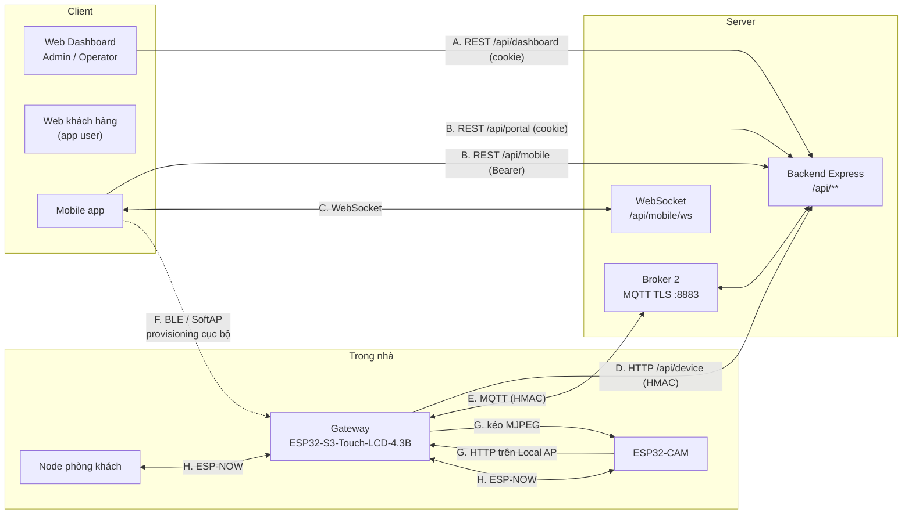

# API_DESIGN.md

> **Thiết kế API toàn hệ thống — software (Backend ↔ Web/Mobile) và firmware (Backend ↔ Gateway ↔ Node).**
> Một chỗ để tra mọi giao diện giữa các thành phần: REST, WebSocket, MQTT, HTTP cục bộ trong nhà, ESP-NOW.
> Mỗi API có cột **Trạng thái**:
> - **Đã có** — có trong code, đường dẫn file ghi kèm. Code là nguồn sự thật.
> - **Dự kiến** — đã thiết kế ở tài liệu khác hoặc ở đây, chưa có code. Có thể đổi khi hiện thực.
> - **Cũ** — route thời Prototype, giữ lại cho `tests/security/attack_demo*.sh`, không dùng cho tính năng mới.
>
> Bản máy đọc được nằm ở `contracts/` (`asyncapi.yaml` cho MQTT, `datapoints.yaml`, `openapi.json` sẽ sinh từ backend). Hiện các file đó mới là bản tạm, nên **tài liệu này vẫn là nguồn hợp đồng** cho tới khi chúng được viết đầy đủ.
>
> Tài liệu liên quan: [Backend](architecture/BACKEND_REFACTOR_SMARTHOME.md) §9–10 (API và MQTT đích), [IoT Node Network](firmware/IOT_NODE_NETWORK.md) (phần cứng và giao thức từng chặng), [WiFi Provisioning](firmware/SMART_HOME_WIFI_PROVISIONING.md) §15 (API provisioning), [Bảo mật](SECURITY_ARCHITECTURE.md), `backend/src/modules/README.md` (quy ước code).
>
> Cập nhật: 2026-10-26.

---

## MỤC LỤC

1. [Bản đồ API](#1-bản-đồ-api)
2. [Quy ước chung](#2-quy-ước-chung)
3. [Chữ ký HMAC](#3-chữ-ký-hmac)
4. [Software — Auth](#4-software--auth)
5. [Software — API khách hàng (Mobile, Portal)](#5-software--api-khách-hàng-mobile-portal)
6. [Software — WebSocket realtime](#6-software--websocket-realtime)
7. [Software — API Dashboard (Admin, Operator)](#7-software--api-dashboard-admin-operator)
8. [Software ↔ Firmware — API thiết bị (HTTP)](#8-software--firmware--api-thiết-bị-http)
9. [Software ↔ Firmware — MQTT](#9-software--firmware--mqtt)
10. [Firmware — API cục bộ trong nhà](#10-firmware--api-cục-bộ-trong-nhà)
11. [Firmware — ESP-NOW Gateway ↔ Node](#11-firmware--esp-now-gateway--node)
12. [Luồng nghiệp vụ → chuỗi API](#12-luồng-nghiệp-vụ--chuỗi-api)
13. [Phiên bản và thay đổi hợp đồng](#13-phiên-bản-và-thay-đổi-hợp-đồng)
14. [Câu hỏi còn mở](#14-câu-hỏi-còn-mở)

---

## 1. BẢN ĐỒ API



| Nhóm | Giữa | Giao thức | Xác thực | Mục |
|---|---|---|---|---|
| A | Web Dashboard → Backend | REST JSON | Cookie phiên nhân viên | 7 |
| B | Mobile / Web khách → Backend | REST JSON | Bearer + refresh token (Mobile), cookie `sh_user` (Portal) | 4, 5 |
| C | Mobile ↔ Backend | WebSocket JSON | Khung `auth` đầu tiên chứa access token | 6 |
| D | Gateway → Backend | HTTPS | HMAC gateway (+ HMAC node khi chuyển tiếp telemetry) | 8 |
| E | Gateway ↔ Backend | MQTT trên TLS | HMAC trong payload | 9 |
| F | Mobile → Gateway | BLE GATT hoặc HTTP trên SoftAP | ECDH + mã hoá phiên | 10.1 |
| G | Camera ↔ Gateway | HTTP trên Local AP | WPA2 Local AP + HMAC camera | 10.2, 10.3 |
| H | Node ↔ Gateway | ESP-NOW | LMK theo node + HMAC node | 11 |

Mobile **không** nói chuyện MQTT (bất biến 7); node **không** gọi Server trực tiếp ([IoT Node Network](firmware/IOT_NODE_NETWORK.md) §1).

---

## 2. QUY ƯỚC CHUNG

### 2.1. Kênh và tiền tố

| Tiền tố | Ai dùng | Xác thực | Ghi chú |
|---|---|---|---|
| `/api/dashboard/**` | ADMIN, OPERATOR | Cookie `sh_admin` / `sh_operator` | `requireDashboard("admin","operator")` gắn ở `app.module.ts` |
| `/api/portal/**` | USER (web khách) | Cookie `sh_user` | Ngoài phạm vi PRD V2 (FR-1.4), xem `frontend/README.md` |
| `/api/mobile/**` | USER (Mobile) | `Authorization: Bearer <access>` + refresh token | Cùng router với Portal: `createCustomerRouter(channel)` |
| `/api/device/**` | Gateway | HMAC | Không có phiên người dùng |
| `/api/health` | Giám sát | Không | |
| `/api/auth`, `/api/devices`, `/api/users`, `/api/audit-log`, `/api/notifications` | Prototype | Cookie cũ | **Cũ** — mục 7.3 |

Role hệ thống quyết định **kênh**; role trong nhà (OWNER / CONTROLLER / VIEWER / GUEST) quyết định **hành động** (RBAC 2 tầng, [Bảo mật](SECURITY_ARCHITECTURE.md) §8).

### 2.2. Request và response

- JSON UTF-8, body tối đa **10 KB** (`app.ts`). Ngoại lệ: upload firmware `application/octet-stream` ≤ 4 MB.
- Thời gian trả về dạng ISO 8601 UTC; trong payload thiết bị dùng `unix_ts` (giây).
- Phân trang: query `limit`, `page` (`shared/validation/validate`: `parseLimit`, `parsePage`).
- Id trong URL sai định dạng → **404**, không phải 400 (`parseIdParam`).
- Văn bản cho người dùng (thông báo, nhãn) bằng tiếng Việt; trường `detail` của lỗi bằng tiếng Anh. Client tự dịch mã lỗi thành hướng dẫn (bất biến 10).

### 2.3. Lỗi

```json
{ "error": "UPPER_SNAKE_CODE", "detail": "optional english detail" }
```

| HTTP | Mã thường gặp | Khi nào |
|---|---|---|
| 400 | `MISSING_FIELDS`, `INVALID_INPUT`, `NOT_CONTROLLABLE` | Thiếu hoặc sai dữ liệu |
| 401 | `NO_TOKEN`, `INVALID_TOKEN`, `INVALID_CREDENTIALS` | Chưa đăng nhập, token sai/hết hạn, sai mật khẩu |
| 403 | `FORBIDDEN`, `USE_DASHBOARD`, `USE_MOBILE_APP`, `WRONG_PORTAL`, `CSRF_CHECK_FAILED`, `ACCOUNT_LOCKED`, `ACCESS_GRANT_REQUIRED`, `OWNER_CANNOT_LEAVE` | Đúng nhà nhưng thiếu quyền; sai kênh; thiếu header chống CSRF; Operator chưa được cấp quyền vào nhà |
| 404 | `NOT_FOUND`, `HOME_NOT_FOUND`, … | Không tồn tại **hoặc nhà không thuộc quyền** (bất biến 6) |
| 409 | `HOME_SUSPENDED`, `DEVICE_OFFLINE`, `DEVICE_BLOCKED`, `ALREADY_CLAIMED`, `ALREADY_USED`, `GATEWAY_NOT_ASSIGNED` | Trạng thái không cho phép |
| 429 | — | Vượt giới hạn tần suất (`authLimiter`, `deviceDataLimiter`, `apiLimiter`) |
| 502 / 504 | `COMMAND_FAILED` / `TIMEOUT` | Gateway trả lỗi / không ack trong 5 giây |
| 500 | `INTERNAL_ERROR` | Lỗi lạ, có ghi audit `UNHANDLED_ERROR` |

### 2.4. Bất biến áp cho mọi API

- Secret thiết bị/gateway **chỉ trả 1 lần** lúc tạo; không API nào khác trả secret (bất biến 1).
- Không log password, token, secret, mật khẩu WiFi (bất biến 2).
- Ghi nhiều bảng trong 1 transaction (bất biến 9).
- Gợi ý AI không tự điều khiển thiết bị khi chưa được chấp nhận (bất biến 8).

---

## 3. CHỮ KÝ HMAC

Mọi chữ ký: `HMAC-SHA256(secret, message)` xuất **hex thường**, so sánh hằng thời gian, cửa sổ chống replay **±300 giây** (`modules/devices/domain/hmac.service.ts`, `TS_WINDOW_SECONDS` trong `modules/control/features/command-ack/command-ack.handler.ts`).

| Dùng cho | Ai ký | Secret | Chuỗi được ký | Trạng thái |
|---|---|---|---|---|
| Telemetry lớp 1 | Node | secret node | `<device_id>:<unix_ts>` | Đã có |
| Telemetry lớp 2, `/api/device/**` | Gateway | secret gateway | `<gateway_id>:<unix_ts>` | Đã có |
| Lệnh thiết bị | Backend | secret gateway | `<command_id>:<device_id>:<action>:<ts>` | Đã có |
| Lệnh gateway | Backend | secret gateway | `<command_id>:<gateway_id>:<action>:<ts>` | Đã có |
| Ack lệnh | Gateway | secret gateway | `<command_id>:<status>:<ts>` | Đã có |
| Lệnh OTA | Backend | secret gateway | `<job_id>:<version>:<ts>` | Đã có |
| Ảnh camera gửi Gateway, mở luồng camera | Camera / Gateway | secret camera | `<device_id>:<unix_ts>` | Dự kiến |

Hai dòng đầu là bất biến 5 — backend, gateway và node phải khớp từng byte. Chữ ký telemetry **không ký nội dung** `data`; tính toàn vẹn nội dung dựa vào TLS (Gateway → Server) và mã hoá ESP-NOW (Node → Gateway).

---

## 4. SOFTWARE — AUTH

`modules/identity/` (router `/auth` của từng kênh, mount trước guard của kênh ở `app.module.ts`). Mỗi kênh một bộ route, cookie/token không dùng chéo kênh.

| Method | `/api/dashboard/auth/…` | `/api/portal/auth/…` | `/api/mobile/auth/…` | Mô tả |
|---|---|---|---|---|
| POST | `/login` | `/login` | `/login` | Đăng nhập. Dashboard và Portal đặt cookie; Mobile trả `{access_token, refresh_token, token_type: "Bearer", expires_in: 900, refresh_expires_in: 2592000, user}` |
| POST | — | `/register` | `/register` | Khách tự đăng ký (email + mật khẩu) |
| POST | — | — | `/refresh` | Body `{refresh_token}` → cặp token mới. Refresh token xoay vòng theo họ (`family_id`); dùng lại token cũ → thu hồi cả họ |
| POST | `/logout` | `/logout` | `/logout` | Đăng xuất; Mobile thu hồi refresh token |
| GET | `/me` | `/me` | `/me` | Thông tin người dùng hiện tại |

- Route chưa có phiên của Portal/Dashboard kiểm header `X-Portal` chống CSRF (`csrfGuard`).
- Nhân viên đăng nhập kênh khách → 403 `USE_DASHBOARD`.
- Đổi mật khẩu (`POST /me/password`, mục 5) thu hồi mọi refresh token.

Trạng thái: **Đã có**.

---

## 5. SOFTWARE — API KHÁCH HÀNG (MOBILE, PORTAL)

Cùng một router cho `/api/mobile` và `/api/portal` (feature của từng module, gắn qua móc `customer` trong `<m>.module.ts`). Bảng dưới ghi đường dẫn tương đối; ví dụ `GET /homes` = `GET /api/mobile/homes`.
Cột **Quyền** là permission trong nhà (`modules/homes/domain/permissions.ts`): nhà không thuộc quyền → 404, thiếu quyền → 403.

### 5.1. Đã có

| Nhóm | Method | Path | Quyền | Mô tả |
|---|---|---|---|---|
| Kích hoạt | POST | `/claim` | — | Nhận nhà bằng mã kích hoạt / QR (1 transaction) |
| Nhà | GET | `/homes` | — | Danh sách nhà của tôi |
| | GET | `/homes/:homeId/overview` | `view` | Tổng quan: phòng, thiết bị, khí hậu |
| | PATCH | `/homes/:homeId` | `rename` | Đổi tên nhà |
| Phòng | GET | `/rooms/:roomId` | `view` | Chi tiết phòng |
| | PATCH | `/rooms/:roomId` | `rename` | Đổi tên phòng |
| Thiết bị | GET | `/devices/:deviceId` | `view` | Chi tiết thiết bị |
| | PATCH | `/devices/:deviceId` | `rename` | Đổi tên thiết bị |
| | GET | `/devices/:deviceId/telemetry` | `view` | Chuỗi số liệu `24h` / `7d` |
| | POST | `/devices/:deviceId/commands` | `control_device` | Bật/tắt (`turn_on` / `turn_off`), chờ ack ≤ 5 giây |
| Tự động hoá | GET | `/homes/:homeId/automations` | `view_automation` | Danh sách luật |
| | POST | `/homes/:homeId/automations` | `create_automation` | Tạo luật IF/THEN |
| | PATCH | `/automations/:ruleId` | `create_automation` (+ chủ luật hoặc `manage_any_rule`) | Sửa, bật/tắt luật |
| | DELETE | `/automations/:ruleId` | như trên | Xoá luật |
| | GET | `/automations/:ruleId/history` | `view_automation` | Lịch sử chạy |
| Gợi ý AI | GET | `/homes/:homeId/suggestions` | `view_automation` | Gợi ý thói quen |
| | POST | `/suggestions/:id/accept` | `create_automation` | Chấp nhận → tạo luật (bất biến 8) |
| | POST | `/suggestions/:id/dismiss` | `create_automation` | Bỏ qua |
| Thành viên | GET | `/homes/:homeId/members` | `view` | Danh sách thành viên |
| | POST | `/homes/:homeId/members/invite` | `manage_members` | Mời thành viên |
| | PATCH | `/members/:memberId` | `manage_members` | Đổi role, quyền thiết bị của GUEST, hạn |
| | DELETE | `/members/:memberId` | `manage_members` | Xoá thành viên |
| | POST | `/homes/:homeId/leave` | thành viên | Rời nhà; OWNER → 403 `OWNER_CANNOT_LEAVE` |
| Lời mời | GET | `/invitations` | — | Lời mời đang chờ của tôi |
| | POST | `/invitations/:id/accept` · `/decline` | — | Nhận / từ chối |
| Thông báo | GET | `/notifications` | — | Danh sách |
| | PATCH | `/notifications/:id/read` · `/notifications/read-all` | — | Đánh dấu đã đọc |
| Hồ sơ | GET · PATCH | `/me/profile` | — | Xem / sửa hồ sơ |
| | POST | `/me/password` | — | Đổi mật khẩu |

### 5.2. Dự kiến

| Nhóm | Method | Path | Quyền | Mô tả | Nguồn thiết kế |
|---|---|---|---|---|---|
| Camera | GET | `/devices/:deviceId/snapshots?limit=` | `view` | Danh sách ảnh gần đây (URL có kiểm quyền) | [IoT Node Network](firmware/IOT_NODE_NETWORK.md) §5.3 |
| | GET | `/snapshots/:snapshotId` | `view` | Tải ảnh JPEG | như trên |
| | POST | `/devices/:deviceId/commands` với `action: "snapshot"` | `control_device` | Yêu cầu chụp ngay (mở rộng `DeviceAction`) | §6.3 của tài liệu đó |
| | WS | `/cameras/:deviceId/live` | `view`, role ≠ GUEST | Xem trực tiếp, khung JPEG nhị phân, gia hạn 30 giây | §5.5 của tài liệu đó (tuỳ chọn) |
| Provisioning | POST | `/provision/start` | OWNER | Bắt đầu phiên đưa Gateway lên mạng | [WiFi Provisioning](firmware/SMART_HOME_WIFI_PROVISIONING.md) §15.2 |
| | GET | `/provision/status` | OWNER | Trạng thái phiên | như trên |
| | POST | `/pair-node` · GET `/pair-node/status` | OWNER | Bật chế độ ghép nối node, xem kết quả | như trên |
| | POST | `/change-wifi`, `/reset-gateway`, `/reset-node/:deviceId`, `/reset-home` | OWNER | Đổi WiFi, reset mạng gateway, reset ghép nối node, khôi phục gốc | như trên |
| | GET | `/gateway/status` | `view` | Online, phiên bản firmware, SSID che một phần | như trên |

**Không** có endpoint Cloud nào nhận mật khẩu WiFi — mật khẩu chỉ đi qua API cục bộ của Gateway (mục 10.1).

---

## 6. SOFTWARE — WEBSOCKET REALTIME

`GET /api/mobile/ws` (`modules/realtime/features/mobile-ws/mobile-ws.gateway.ts`). **Đã có.**

1. Client mở kết nối; khung **đầu tiên trong 10 giây** phải là `{ "type": "auth", "token": "<access_token>" }`. Token không bao giờ nằm trong URL.
2. Hợp lệ → `{ "type": "auth_ok", "user_id", "home_ids" }`. Token hết hạn → đóng mã `4401`, client refresh rồi mở lại.
3. Server đẩy sự kiện theo nhà mà người dùng là thành viên hiệu lực:

| `type` | Nội dung | Phát khi |
|---|---|---|
| `telemetry` | `home_id`, số liệu mới của thiết bị | Ingest MQTT/HTTP xong |
| `device_state` | `home_id`, `device` (trạng thái sau lệnh) | Lệnh được ack, simulator đổi trạng thái |
| `notification` | `home_id`, `notification` | Có thông báo cho người dùng |
| `home_changed` | `home_id` | Đổi thành viên, role, tên, phòng, trạng thái nhà — client tải lại |

Khung tối đa 4 KB. Server ping định kỳ; client không phản hồi pong bị đóng. Mất kết nối → client thử lại 1, 2, 4, 8, 16 giây rồi 30 giây, trong lúc đó poll REST.

**Dự kiến:** sự kiện `camera_event` (`home_id`, `device_id`, `snapshot_id`) khi có chuyển động. Live video **không** đi qua kênh này (mục 5.2).

---

## 7. SOFTWARE — API DASHBOARD (ADMIN, OPERATOR)

Tiền tố `/api/dashboard` (feature của từng module, gắn qua móc `dashboard` trong `<m>.module.ts`), sau `requireDashboard("admin","operator")`. Operator chỉ xem/thao tác nhà được cấp quyền (`operator_home_access`); thiếu → 403 `ACCESS_GRANT_REQUIRED`.

### 7.1. Đã có

| Nhóm | Method | Path | Ai | Mô tả |
|---|---|---|---|---|
| Smart Home | GET · POST | `/smart-homes` | A, O | Danh sách; tạo nhà theo KIT (1 transaction, không trả secret) |
| | GET · PATCH | `/smart-homes/:id` | A, O | Chi tiết; sửa tên/địa chỉ (O chỉ với nhà chưa claim); đổi trạng thái chỉ A |
| | POST | `/smart-homes/:id/activation-codes` | A, O | Phát mã kích hoạt (mã rõ chỉ trả lần này) |
| | POST | `/smart-homes/:id/activation-codes/revoke` | A, O | Thu hồi mã |
| | POST | `/smart-homes/:id/assign-owner` | A, O | Gán chủ nhà thủ công |
| | POST | `/smart-homes/:id/access-requests` | O | Operator xin quyền vào nhà |
| Khách hàng | GET | `/customers` · `/customers/:id` | A, O | Danh sách, chi tiết |
| Gateway | GET | `/gateways` · `/gateways/:id` | A, O | Danh sách, chi tiết |
| | POST | `/gateways/:id/restart` · `/factory-reset` | A, O | Lệnh gateway, trả `202 {command_id}` |
| Thiết bị | GET | `/devices` · `/devices/:id` · `/devices/:id/telemetry` | A, O | Danh sách, chi tiết, số liệu |
| | PATCH | `/devices/:id` · `/devices/:id/status` | A, O | Sửa; khoá/mở thiết bị |
| | DELETE | `/devices/:id` | A | Gỡ thiết bị |
| Tự động hoá | GET | `/automation` | A, O | Luật trên toàn hệ thống |
| | PATCH | `/automation/:id` | A | Bật/tắt luật |
| Firmware | GET | `/firmware` | A, O | Danh sách bản firmware |
| | POST | `/firmware` | A | Upload binary (`application/octet-stream` ≤ 4 MB) |
| | PATCH | `/firmware/:id` | A | Đánh dấu bản ổn định |
| OTA | GET | `/ota/deployments` | A, O | Danh sách đợt OTA |
| | POST | `/ota/deployments` | A (toàn hệ thống), O (1 nhà) | Tạo đợt OTA, phát `ota/command` qua MQTT |
| | POST | `/ota/deployments/:id/rollback` | A, O (có giới hạn) | Rollback đợt OTA |
| Thông báo | GET | `/notifications` | A, O | Thông báo nhân viên |
| | PATCH | `/notifications/:id/read` · `/read-all` | A, O | Đánh dấu đã đọc |
| Log | GET | `/logs/:category` | A, O | Xem log theo nhóm |
| | DELETE | `/logs/:category` | A | Xoá log |
| Thống kê | GET | `/stats/admin` · `/stats/operator` · `/stats/badges` | A / O | Số liệu trang chủ, badge menu |
| Đội ngũ | GET · POST | `/team` | A | Danh sách, tạo nhân viên |
| | PATCH · DELETE | `/team/:id` | A | Sửa, xoá |
| Cấp quyền Operator | GET | `/operator-access` | A, O | Danh sách quyền đã cấp |
| | POST | `/operator-access` | A | Cấp quyền vào nhà |
| | POST | `/operator-access/:id/revoke` | A | Thu hồi |
| AI | POST | `/ai/suggestions/run` | A, O | Chạy sinh gợi ý ngay |
| Simulator | GET | `/simulator/status` | A, O | Trạng thái simulator (`is_simulated=1`) |
| | POST | `/simulator/devices/:id/power` · `/door` | A, O | Giả lập đổi trạng thái thiết bị |

A = ADMIN, O = OPERATOR. Phân quyền chi tiết từng route nằm trong controller; cột "Ai" là tóm tắt.

### 7.2. Dự kiến

| Method | Path | Mô tả | Ghi chú |
|---|---|---|---|
| GET | `/gateways/:id/nodes` | Node đã ghép nối với Gateway: RSSI, pin, firmware, lần cuối thấy | Nguồn: heartbeat Gateway (mục 9.2) |
| GET | `/devices/:id/snapshots` | Ảnh camera | Chỉ khi có quyền vào nhà; **không** có live view cho nhân viên ([IoT Node Network](firmware/IOT_NODE_NETWORK.md) §5.5, quyền riêng tư) |

### 7.3. Route cũ (Prototype)

`/api/auth/{login,logout,me}`, `/api/devices` (`GET /`, `/:id`, `/:id/data`), `/api/users`, `/api/audit-log`, `/api/notifications` (`modules/legacy/routes/*.routes.ts`). **Cũ** — giữ cho kịch bản tấn công khi bảo vệ (`tests/security/attack_demo*.sh`). Không thêm tính năng mới vào đây.

---

## 8. SOFTWARE ↔ FIRMWARE — API THIẾT BỊ (HTTP)

Tiền tố `/api/device`. Gateway gọi qua HTTPS, kiểm chứng chứng chỉ Server bằng CA (bất biến 3).

| Method | Path | Xác thực | Body / Query | Trạng thái |
|---|---|---|---|---|
| POST | `/device/data` | HMAC 2 lớp trong body | `{gateway_id, gw_timestamp, gw_hmac, sensor_payload: {sensor_id, sn_timestamp, sn_hmac, data}}` — **cùng payload với MQTT** `gateway/+/data`, dùng làm đường dự phòng khi MQTT lỗi | Đã có (`modules/telemetry/features/ingest-http/`) |
| GET | `/device/sensors` | HMAC gateway trên query `gateway_id, gw_timestamp, gw_hmac` | Trả danh sách sensor **kèm secret** để gateway kiểm HMAC lớp 1 | Đã có — **lỗ hổng đã biết** ([Bảo mật](SECURITY_ARCHITECTURE.md) §2). Thay bằng cấp secret lúc ghép nối (mục 14, Q1) |
| POST | `/device/camera/snapshot` | Header `X-Gateway-Id`, `X-Timestamp`, `X-Signature` (HMAC gateway) | Body `image/jpeg` ≤ 200 KB; header `X-Device-Id` (camera), `X-Trigger: motion\|request`, `X-Command-Id?`. Trả `201 {snapshot_id}` | Dự kiến |
| WS | `/device/camera/live` | HMAC gateway khi mở kết nối | Tin nhị phân = 1 khung JPEG; tin văn bản `{type:"end"}` khi dừng | Dự kiến, tuỳ chọn |

`modules/telemetry/features/ingest-http/` (HTTP) và `modules/telemetry/features/ingest-mqtt/` (MQTT) phải giữ **cùng logic xác thực** (bất biến 4): cả hai gọi chung hàm HMAC của `modules/devices` và `telemetry/domain/ingest-common.ts`.

---

## 9. SOFTWARE ↔ FIRMWARE — MQTT

Broker 2 (`mosquitto`, cổng 8883 TLS; 1883 chỉ cho môi trường dev). Gateway là client MQTT duy nhất phía nhà.

### 9.1. Đã có

| Topic | Chiều | QoS | Payload | Code |
|---|---|---|---|---|
| `gateway/<gateway_id>/data` | GW → Server | 1 | `{gateway_id, gw_timestamp, gw_hmac, gateway_ip, sensor_payload: {sensor_id, sn_timestamp, sn_hmac, data}}` | `modules/telemetry/features/ingest-mqtt/` |
| `home/<home_id>/gateway/<gw>/device/<dev>/command` | Server → GW | 1 | `{command_id, action, ts, hmac}`; `action ∈ {turn_on, turn_off}` | `modules/control/` (`features/send-gateway-command`, `command-ack`) |
| `home/<home_id>/gateway/<gw>/device/<dev>/command/ack` | GW → Server | 1 | `{command_id, status: "ok"\|"error", power?, ts, hmac}`; Server chờ 5 giây | như trên |
| `home/<home_id>/gateway/<gw>/command` | Server → GW | 1 | `{command_id, action, ts, hmac}`; `action ∈ {restart, factory_reset}` | như trên |
| `home/<home_id>/gateway/<gw>/ota/command` | Server → GW | 1 | `{job_id, version, target_type, checksum_sha256, ts, hmac}` | như trên |

Ghi chú: firmware gateway hiện tại (`firmware/gateway-node`) **mới chỉ publish `gateway/+/data`**; chưa subscribe lệnh, chưa gửi ack. Lệnh tới gateway thật sẽ hết hạn `TIMEOUT` cho tới khi firmware làm xong bước 3 trong [IoT Node Network](firmware/IOT_NODE_NETWORK.md) §9.

### 9.2. Dự kiến

Theo [Backend](architecture/BACKEND_REFACTOR_SMARTHOME.md) §10.2, rút gọn cho phạm vi V2:

| Topic | Chiều | QoS / Retain | Payload |
|---|---|---|---|
| `home/<h>/gateway/<gw>/heartbeat` | GW → Server | 0 | `{ts, uptime, rssi, ip, fw_version, nodes: [{device_id, rssi, battery?, last_seen, fw_version}], hmac}` — mỗi 30 giây |
| `home/<h>/gateway/<gw>/device/<dev>/status` | GW → Server | 1, **retain** | `{power?, online, source: "gateway_local"\|"node"\|"command", ts, hmac}` — trạng thái cuối, gồm cả thao tác trên màn hình Gateway |
| `home/<h>/gateway/<gw>/device/<dev>/camera/event` | GW → Server | 1 | `{type: "motion", ts, snapshot_id?, hmac}` |
| `home/<h>/gateway/<gw>/device/<dev>/command` mở rộng | Server → GW | 1 | Thêm `action ∈ {snapshot, live_start, live_stop}` cho camera |
| `home/<h>/gateway/<gw>/ota/progress` · `ota/result` | GW → Server | 0 · 1 | `{job_id, percent}` · `{job_id, status, version, ts, hmac}` |
| `home/<h>/gateway/<gw>/provision/<event>` | GW → Server | 1 | `event ∈ {wifi_status, node_pair_result}` |
| `home/<h>/gateway/<gw>/device/<dev>/telemetry` | GW → Server | 1 | Thay `gateway/+/data` khi chuyển topic sang dạng có `home_id` (mục 13) |

Mọi payload GW → Server có `ts` + `hmac` bằng secret gateway; chuỗi ký của từng topic chốt khi hiện thực và ghi vào mục 3.

---

## 10. FIRMWARE — API CỤC BỘ TRONG NHÀ

Toàn bộ mục này **Dự kiến**.

### 10.1. Gateway ↔ Mobile: provisioning (BLE GATT hoặc SoftAP `192.168.4.1`)

Chỉ mở khi Gateway ở chế độ provisioning; đóng sau khi xong hoặc hết giờ. Nguồn: [WiFi Provisioning](firmware/SMART_HOME_WIFI_PROVISIONING.md) §8, §15.1.

| Method | Path | Mô tả |
|---|---|---|
| GET | `/local/gateway/info` | `{gateway_uuid, fw_version, ecdh_pubkey}` |
| POST | `/local/gateway/handshake` | Trao đổi khoá ECDH (Curve25519), tạo khoá phiên |
| POST | `/local/gateway/wifi` | `{ssid, password}` **mã hoá bằng khoá phiên** (AES-256-GCM) |
| GET | `/local/gateway/wifi/status` | `{status: connecting\|connected\|failed}` |

### 10.2. Gateway: nhận ảnh từ Camera (HTTP trên Local AP)

| Method | Path | Header | Body | Phản hồi |
|---|---|---|---|---|
| POST | `/local/camera/snapshot` | `X-Device-Id`, `X-Timestamp`, `X-Signature` (HMAC camera), `X-Trigger`, `X-Command-Id?` | `image/jpeg` ≤ 200 KB | `201` nhận; `401` sai HMAC; `413` quá lớn |

### 10.3. Camera: phát luồng (HTTP server trên ESP32-CAM)

| Method | Path | Header | Phản hồi |
|---|---|---|---|
| GET | `/stream?fs=vga\|qvga&q=10..30` | `X-Device-Id`, `X-Timestamp`, `X-Signature` (Gateway ký bằng secret camera) | `200 multipart/x-mixed-replace`, mỗi phần 1 khung JPEG; `401` sai HMAC; `409` đã có 1 luồng đang mở |

Chi tiết thông số luồng: [IoT Node Network](firmware/IOT_NODE_NETWORK.md) §5.4.

---

## 11. FIRMWARE — ESP-NOW GATEWAY ↔ NODE

**Dự kiến.** Áp dụng cho Node phòng khách và kênh điều khiển của Camera. Gói ≤ 250 byte, mã hoá bằng LMK riêng từng node. Chi tiết dò kênh, mã hoá: [IoT Node Network](firmware/IOT_NODE_NETWORK.md) §5.1.

**Khung chung:** `{ver: uint8, type: uint8, seq: uint16, body: JSON thu gọn}`. Gateway bỏ gói có `seq` trùng của cùng node.

| `type` | Chiều | `body` | Gateway xử lý |
|---|---|---|---|
| `TELEMETRY` | Node → GW | `{sensor_id, sn_timestamp, sn_hmac, data}` — y hệt `sensor_payload` | Kiểm HMAC lớp 1, bọc thành `gateway/+/data` |
| `EVENT` | Node → GW | `{event: "motion"\|…, ts}` | Camera: chờ ảnh rồi publish `camera/event` |
| `CMD` | GW → Node | `{command_id, action, params?}` | Gửi sau khi đã kiểm HMAC lệnh từ Server |
| `CMD_ACK` | Node → GW | `{command_id, status: "ok"\|"error", power?}` | Ký và publish `command/ack`; node im lặng 3 giây → ack `error` |
| `HEARTBEAT` | Node → GW | `{uptime, rssi, fw_version, battery?}` mỗi 30 giây | Gom vào heartbeat Gateway |
| `TIME_SYNC` | GW → Node | `{ts}` | Gửi sau ghép nối, khi nhận `PING`, kèm mỗi ack |
| `PING` | Node → GW | `{}` | Dùng để dò kênh; trả `TIME_SYNC` |
| `PAIR_REQUEST` · `PAIR_CHALLENGE` · `PAIR_RESPONSE` · `PAIR_RESULT` | 2 chiều | Theo [WiFi Provisioning](firmware/SMART_HOME_WIFI_PROVISIONING.md) §9.1 | Chỉ trong cửa sổ ghép nối 60 giây; cấp LMK, với Camera cấp thêm thông tin Local AP |

`action` của node phòng khách (`turn_on`, `turn_off`, có thể thêm theo phần cứng) chốt khi có chi tiết mạch ([IoT Node Network](firmware/IOT_NODE_NETWORK.md) §4.3). Camera: `snapshot`, `live_start`, `live_stop`.

---

## 12. LUỒNG NGHIỆP VỤ → CHUỖI API

| Luồng | Chuỗi API | Trạng thái |
|---|---|---|
| Đăng nhập Mobile | `POST /api/mobile/auth/login` → `GET /api/mobile/ws` (`auth`) → `POST /auth/refresh` khi hết hạn | Đã có |
| Nhận nhà | Dashboard `POST /smart-homes` → `POST /smart-homes/:id/activation-codes` → Mobile `POST /claim` → WS `home_changed` | Đã có |
| Telemetry | Node ESP-NOW `TELEMETRY` → MQTT `gateway/+/data` (hoặc `POST /api/device/data`) → WS `telemetry` | Backend đã có; ESP-NOW dự kiến |
| Bật/tắt thiết bị | `POST /devices/:id/commands` → MQTT `.../command` → ESP-NOW `CMD` → `CMD_ACK` → MQTT `.../command/ack` → HTTP 200 + WS `device_state` | Backend đã có; firmware dự kiến |
| Thao tác trên màn hình Gateway | ESP-NOW `CMD`/`CMD_ACK` → MQTT `.../status` (`source: gateway_local`) → WS `device_state` | Dự kiến |
| Chuyển động → ảnh | ESP-NOW `EVENT` → `POST /local/camera/snapshot` → `POST /api/device/camera/snapshot` → MQTT `camera/event` → WS `camera_event` | Dự kiến |
| Xem trực tiếp trên Gateway | `GET /stream` (Camera) → hiển thị LCD | Dự kiến |
| Xem trực tiếp trên Mobile | WS `/api/mobile/cameras/:id/live` → MQTT `command {live_start}` → `GET /stream` → WS `/api/device/camera/live` → Mobile | Dự kiến, tuỳ chọn |
| Đưa Gateway lên mạng | `POST /api/mobile/provision/start` → BLE/SoftAP `/local/gateway/*` → MQTT `provision/wifi_status` | Dự kiến |
| OTA | Dashboard `POST /firmware` → `POST /ota/deployments` → MQTT `ota/command` → `ota/progress`, `ota/result` | Backend đã có phần phát lệnh; firmware dự kiến |

---

## 13. PHIÊN BẢN VÀ THAY ĐỔI HỢP ĐỒNG

- **REST:** chưa đánh số phiên bản trong URL. Thêm trường mới được; đổi hoặc bỏ trường phải sửa cùng lúc Web, Mobile và ghi vào tài liệu này. Khi có client ngoài nhóm phát triển mới cân nhắc `/api/v2`.
- **MQTT:** đang ở 2 dạng topic: `gateway/+/data` (cũ) và `home/<h>/gateway/<gw>/...` (mới). Chuyển telemetry sang dạng mới theo [Backend](architecture/BACKEND_REFACTOR_SMARTHOME.md) §10.4: backend subscribe **cả hai** trong giai đoạn chuyển, firmware đổi sau, rồi mới bỏ topic cũ.
- **ESP-NOW:** trường `ver` trong khung. Gateway chấp nhận `ver` hiện tại và `ver - 1` để OTA từng node không làm đứt kết nối.
- **HMAC:** đổi chuỗi ký là thay đổi phá vỡ — phải đổi đồng thời backend, gateway, node (bất biến 5).
- Thay đổi chạm ≥ 2 tầng theo quy trình multi-agent trong `CLAUDE.md`: chốt hợp đồng ở đây trước khi code.

---

## 14. CÂU HỎI CÒN MỞ

| # | Câu hỏi | Đề xuất mặc định |
|---|---|---|
| Q1 | Bỏ `GET /api/device/sensors` (trả secret sensor cho gateway) bằng cách nào | Gateway nhận secret node trong lúc ghép nối (mã hoá), lưu NVS mã hoá; endpoint chỉ trả danh sách `device_id` + trạng thái |
| Q2 | Chuỗi ký HMAC cho heartbeat, status, camera/event, ota/result | Theo mẫu `<khoá chính>:<giá trị chính>:<ts>` như lệnh và ack; chốt khi hiện thực |
| Q3 | Telemetry đệm khi mất Internet bị từ chối vì quá 300 giây | Xem [IoT Node Network](firmware/IOT_NODE_NETWORK.md) §10 Q3 |
| Q4 | Thêm `action` mới (`snapshot`, `live_start`, `live_stop`, dimmer…) vào `DeviceAction` | Thêm khi làm camera và khi có chi tiết node phòng khách |
| Q5 | Có cần Portal (`/api/portal`) cho các API dự kiến không | Không ở V2 — Portal ngoài phạm vi PRD; API dự kiến chỉ làm cho Mobile |
