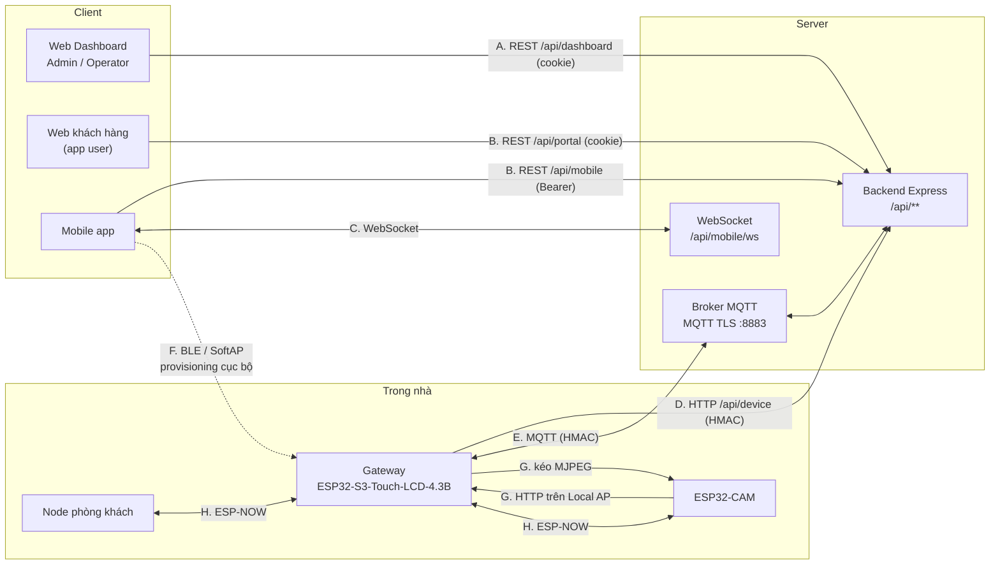

# API_DESIGN.md

> **Thiết kế API toàn hệ thống — software (Backend ↔ Web/Mobile) và firmware (Backend ↔ Gateway ↔ Node).**
> Một chỗ để tra mọi giao diện giữa các thành phần: REST, WebSocket, MQTT, HTTP cục bộ trong nhà, ESP-NOW.
> Mỗi API có cột **Trạng thái**:
> - **Đã có** — có trong code, đường dẫn file ghi kèm. Code là nguồn sự thật.
> - **Dự kiến** — đã thiết kế ở tài liệu khác hoặc ở đây, chưa có code. Có thể đổi khi hiện thực.
> - **Cũ** — route thời Prototype, giữ lại cho `tests/security/attack_demo*.sh`, không dùng cho tính năng mới.
>
> Bản máy đọc được nằm ở `contracts/` (`asyncapi.yaml` cho MQTT, `datapoints.yaml`, `openapi.json` sẽ sinh từ backend). Hiện các file đó mới là bản tạm, nên **tài liệu này vẫn là nguồn hợp đồng** cho tới khi chúng được viết đầy đủ.
>
> Tài liệu liên quan: [Backend](architecture/BACKEND_REFACTOR_SMARTHOME.md) §9–10 (API và MQTT đích), [IoT Node Network](firmware/IOT_NODE_NETWORK.md) (phần cứng và giao thức từng chặng), [WiFi Provisioning](firmware/SMART_HOME_WIFI_PROVISIONING.md) §15 (API provisioning), [Bảo mật](SECURITY_ARCHITECTURE.md), `backend/src/modules/README.md` (quy ước code).
>
> Cập nhật: 2026-10-26; hẹn giờ một lần và dữ liệu hành vi cho AI (mục 5.1): 2026-11-14.

---

## MỤC LỤC

1. [Bản đồ API](#1-bản-đồ-api)
2. [Quy ước chung](#2-quy-ước-chung)
3. [Chữ ký HMAC](#3-chữ-ký-hmac)
4. [Software — Auth](#4-software--auth)
5. [Software — API khách hàng (Mobile, Portal)](#5-software--api-khách-hàng-mobile-portal)
6. [Software — WebSocket realtime](#6-software--websocket-realtime)
7. [Software — API Dashboard (Admin, Operator)](#7-software--api-dashboard-admin-operator)
8. [Software ↔ Firmware — API thiết bị (HTTP)](#8-software--firmware--api-thiết-bị-http)
9. [Software ↔ Firmware — MQTT](#9-software--firmware--mqtt)
10. [Firmware — API cục bộ trong nhà](#10-firmware--api-cục-bộ-trong-nhà)
11. [Firmware — ESP-NOW Gateway ↔ Node](#11-firmware--esp-now-gateway--node)
12. [Luồng nghiệp vụ → chuỗi API](#12-luồng-nghiệp-vụ--chuỗi-api)
13. [Phiên bản và thay đổi hợp đồng](#13-phiên-bản-và-thay-đổi-hợp-đồng)
14. [Câu hỏi còn mở](#14-câu-hỏi-còn-mở)

---

## 1. BẢN ĐỒ API



| Nhóm | Giữa | Giao thức | Xác thực | Mục |
|---|---|---|---|---|
| A | Web Dashboard → Backend | REST JSON | Cookie phiên nhân viên | 7 |
| B | Mobile / Web khách → Backend | REST JSON | Bearer + refresh token (Mobile), cookie `sh_user` (Portal) | 4, 5 |
| C | Mobile ↔ Backend | WebSocket JSON | Khung `auth` đầu tiên chứa access token | 6 |
| D | Gateway → Backend | HTTPS | HMAC gateway (+ HMAC node khi chuyển tiếp telemetry) | 8 |
| E | Gateway ↔ Backend | MQTT trên TLS | HMAC trong payload | 9 |
| F | Mobile → Gateway | BLE GATT hoặc HTTP trên SoftAP | ECDH + mã hoá phiên | 10.1 |
| G | Camera ↔ Gateway | HTTP trên Local AP | WPA2 Local AP + HMAC camera | 10.2, 10.3 |
| H | Node ↔ Gateway | ESP-NOW | LMK theo node + HMAC node | 11 |

Mobile **không** nói chuyện MQTT (bất biến 7); node **không** gọi Server trực tiếp ([IoT Node Network](firmware/IOT_NODE_NETWORK.md) §1).

---

## 2. QUY ƯỚC CHUNG

### 2.1. Kênh và tiền tố

| Tiền tố | Ai dùng | Xác thực | Ghi chú |
|---|---|---|---|
| `/api/dashboard/**` | ADMIN, OPERATOR | Cookie `sh_admin` / `sh_operator` | `requireDashboard("admin","operator")` gắn ở `app.module.ts` |
| `/api/portal/**` | USER (web khách) | Cookie `sh_user` | Ngoài phạm vi PRD V2 (FR-1.4), xem `frontend/README.md` |
| `/api/mobile/**` | USER (Mobile) | `Authorization: Bearer <access>` + refresh token | Cùng router với Portal: `createCustomerRouter(channel)` |
| `/api/device/**` | Gateway | HMAC | Không có phiên người dùng |
| `/api/service/**` | Dịch vụ nội bộ (AI Agent `agent/`) | `Authorization: Bearer <SERVICE_API_TOKEN>` | Chưa đặt token → 503 `SERVICE_CHANNEL_DISABLED`; nginx trả 404 cho `/api/service/` từ bên ngoài, agent gọi thẳng `backend:5000` trong mạng Docker |
| `/api/health` | Giám sát | Không | |
| `/api/auth`, `/api/devices`, `/api/users`, `/api/audit-log`, `/api/notifications` | Prototype | Cookie cũ | **Cũ** — mục 7.3 |

Role hệ thống quyết định **kênh**; role trong nhà (OWNER / CONTROLLER / VIEWER / GUEST) quyết định **hành động** (RBAC 2 tầng, [Bảo mật](SECURITY_ARCHITECTURE.md) §8).

### 2.2. Request và response

- JSON UTF-8, body tối đa **10 KB** (`app.ts`). Ngoại lệ: upload firmware `application/octet-stream` ≤ 4 MB.
- Thời gian trả về dạng ISO 8601 UTC; trong payload thiết bị dùng `unix_ts` (giây).
- Phân trang: query `limit`, `page` (`shared/validation/validate`: `parseLimit`, `parsePage`).
- Id trong URL sai định dạng → **404**, không phải 400 (`parseIdParam`).
- Văn bản cho người dùng (thông báo, nhãn) bằng tiếng Việt; trường `detail` của lỗi bằng tiếng Anh. Client tự dịch mã lỗi thành hướng dẫn (bất biến 10).

### 2.3. Lỗi

```json
{ "error": "UPPER_SNAKE_CODE", "detail": "optional english detail" }
```

| HTTP | Mã thường gặp | Khi nào |
|---|---|---|
| 400 | `MISSING_FIELDS`, `INVALID_INPUT`, `NOT_CONTROLLABLE` | Thiếu hoặc sai dữ liệu |
| 401 | `NO_TOKEN`, `INVALID_TOKEN`, `INVALID_CREDENTIALS` | Chưa đăng nhập, token sai/hết hạn, sai mật khẩu |
| 403 | `FORBIDDEN`, `USE_DASHBOARD`, `USE_MOBILE_APP`, `WRONG_PORTAL`, `CSRF_CHECK_FAILED`, `ACCOUNT_LOCKED`, `ACCESS_GRANT_REQUIRED`, `OWNER_CANNOT_LEAVE` | Đúng nhà nhưng thiếu quyền; sai kênh; thiếu header chống CSRF; Operator chưa được cấp quyền vào nhà |
| 404 | `NOT_FOUND`, `HOME_NOT_FOUND`, … | Không tồn tại **hoặc nhà không thuộc quyền** (bất biến 6) |
| 409 | `HOME_SUSPENDED`, `DEVICE_OFFLINE`, `DEVICE_BLOCKED`, `ALREADY_CLAIMED`, `ALREADY_USED`, `GATEWAY_NOT_ASSIGNED` | Trạng thái không cho phép |
| 429 | — | Vượt giới hạn tần suất (`authLimiter`, `deviceDataLimiter`, `apiLimiter`) |
| 502 / 504 | `COMMAND_FAILED` / `TIMEOUT` | Gateway trả lỗi / không ack trong 5 giây |
| 500 | `INTERNAL_ERROR` | Lỗi lạ, có ghi audit `UNHANDLED_ERROR` |

### 2.4. Bất biến áp cho mọi API

- Secret thiết bị/gateway **chỉ trả 1 lần** lúc tạo; không API nào khác trả secret (bất biến 1).
- Không log password, token, secret, mật khẩu WiFi (bất biến 2).
- Ghi nhiều bảng trong 1 transaction (bất biến 9).
- Gợi ý AI không tự điều khiển thiết bị khi chưa được chấp nhận (bất biến 8).

---

## 3. CHỮ KÝ HMAC

Mọi chữ ký: `HMAC-SHA256(secret, message)` xuất **hex thường**, so sánh hằng thời gian, cửa sổ chống replay **±300 giây** (`modules/devices/domain/hmac.service.ts`, `TS_WINDOW_SECONDS` trong `modules/control/features/command-ack/command-ack.handler.ts`).

| Dùng cho | Ai ký | Secret | Chuỗi được ký | Trạng thái |
|---|---|---|---|---|
| Telemetry lớp 1 | Node | secret node | `<device_id>:<unix_ts>` | Đã có |
| Telemetry lớp 2, `/api/device/**` | Gateway | secret gateway | `<gateway_id>:<unix_ts>` | Đã có |
| Lệnh thiết bị | Backend | secret gateway | `<command_id>:<device_id>:<action>:<ts>` | Đã có |
| Lệnh gateway | Backend | secret gateway | `<command_id>:<gateway_id>:<action>:<ts>` | Đã có |
| Ack lệnh | Gateway | secret gateway | `<command_id>:<status>:<ts>` | Đã có |
| Lệnh OTA | Backend | secret gateway | `<job_id>:<version>:<ts>` | Đã có |
| Ảnh camera lên Server (`POST /api/device/camera/snapshot`) | Gateway | secret gateway | `<gateway_id>:<ts>:<device_id>:<trigger>:<command_id>:<sha256_hex(body)>` — gắn chữ ký với nội dung ảnh; `<command_id>` rỗng khi không có `X-Command-Id` (hai dấu `:` liền nhau); `sha256_hex` = sha256 hex thường của đúng các byte body | Đã có |
| Heartbeat gateway | Gateway | secret gateway | `<gateway_id>:<ts>` | Đã có |
| Sự kiện camera (`camera/event`) | Gateway | secret gateway | `<device_id>:motion:<ts>` | Đã có |
| Ảnh camera gửi Gateway, mở luồng camera | Camera / Gateway | secret camera | `<device_id>:<unix_ts>` | Dự kiến |

Hai dòng đầu là bất biến 5 — backend, gateway và node phải khớp từng byte. Chữ ký telemetry **không ký nội dung** `data`; tính toàn vẹn nội dung dựa vào TLS (Gateway → Server) và mã hoá ESP-NOW (Node → Gateway). Riêng ảnh camera **có ký nội dung** (sha256 của body nằm trong chuỗi ký).

Ghi chú rủi ro tạm chấp nhận: heartbeat gateway và `camera/event` vẫn ký chuỗi ngắn (`<gateway_id>:<ts>`, `<device_id>:motion:<ts>`) nên có thể bị phát lại trong cửa sổ ±300 giây, và `nodes[]`/`ip` của heartbeat **không được ký**. Chấp nhận cho tới khi Broker MQTT có ACL theo gateway (FR-12.4) — khi đó chỉ gateway sở hữu topic mới publish được.

---

## 4. SOFTWARE — AUTH

`modules/identity/` (router `/auth` của từng kênh, mount trước guard của kênh ở `app.module.ts`). Mỗi kênh một bộ route, cookie/token không dùng chéo kênh.

| Method | `/api/dashboard/auth/…` | `/api/portal/auth/…` | `/api/mobile/auth/…` | Mô tả |
|---|---|---|---|---|
| POST | `/login` | `/login` | `/login` | Đăng nhập. Dashboard và Portal đặt cookie; Mobile trả `{access_token, refresh_token, token_type: "Bearer", expires_in: 900, refresh_expires_in: 2592000, user}` |
| POST | — | `/register` | `/register` | Khách tự đăng ký (email + mật khẩu) |
| POST | — | — | `/refresh` | Body `{refresh_token}` → cặp token mới. Refresh token xoay vòng theo họ (`family_id`); dùng lại token cũ → thu hồi cả họ |
| POST | `/logout` | `/logout` | `/logout` | Đăng xuất; Mobile thu hồi refresh token |
| GET | `/me` | `/me` | `/me` | Thông tin người dùng hiện tại |

- Route chưa có phiên của Portal/Dashboard kiểm header `X-Portal` chống CSRF (`csrfGuard`).
- Nhân viên đăng nhập kênh khách → 403 `USE_DASHBOARD`.
- Đổi mật khẩu (`POST /me/password`, mục 5) thu hồi mọi refresh token.

Trạng thái: **Đã có**.

---

## 5. SOFTWARE — API KHÁCH HÀNG (MOBILE, PORTAL)

Cùng một router cho `/api/mobile` và `/api/portal` (feature của từng module, gắn qua móc `customer` trong `<m>.module.ts`). Bảng dưới ghi đường dẫn tương đối; ví dụ `GET /homes` = `GET /api/mobile/homes`.
Cột **Quyền** là permission trong nhà (`modules/homes/domain/permissions.ts`): nhà không thuộc quyền → 404, thiếu quyền → 403.

### 5.1. Đã có

| Nhóm | Method | Path | Quyền | Mô tả |
|---|---|---|---|---|
| Kích hoạt | POST | `/claim` | — | Nhận nhà bằng mã kích hoạt / QR (1 transaction) |
| Nhà | GET | `/homes` | — | Danh sách nhà của tôi |
| | GET | `/homes/:homeId/overview` | `view` | Tổng quan: phòng, thiết bị, khí hậu |
| | PATCH | `/homes/:homeId` | `rename` | Đổi tên nhà |
| Phòng | GET | `/rooms/:roomId` | `view` | Chi tiết phòng |
| | PATCH | `/rooms/:roomId` | `rename` | Đổi tên phòng |
| Thiết bị | GET | `/devices/:deviceId` | `view` | Chi tiết thiết bị |
| | PATCH | `/devices/:deviceId` | `rename` | Đổi tên thiết bị |
| | GET | `/devices/:deviceId/telemetry` | `view` | Chuỗi số liệu `24h` / `7d` |
| Camera | GET | `/devices/:deviceId/snapshots?limit=` | `view` | Ảnh gần đây của camera (`limit` 1–50, mặc định 20; mới nhất trước): `{device_id, items: [{id, trigger: "motion"\|"request", size_bytes, captured_at}]}`. Thiết bị không phải camera → 404. Chỉ liệt kê ảnh chụp khi camera đang ở nhà hiện tại (`home_id` ảnh = `home_id` camera) |
| | GET | `/snapshots/:snapshotId/image` | `view` | Tải ảnh JPEG (`Cache-Control: private, max-age=86400, immutable`); không tồn tại / không có quyền / file mất / ảnh chụp ở nhà khác với nhà hiện tại của camera → 404 (ảnh chỉ thuộc về nhà lúc chụp). Web dùng thẳng `/api/portal/snapshots/<id>/image` trong `` (cookie `sh_user`), mobile gửi `Authorization: Bearer` |
| | POST | `/devices/:deviceId/commands` | `control_device` | Bật/tắt (`turn_on` / `turn_off`); điều hòa (`appliance = "ac"`) thêm `{action: "set_temp", temperature: 16..30}` → MQTT `set_temp_<NN>`; học mã remote IR `{action: "learn_code", slot: "off" \| 16..30}` → MQTT `learn_off` / `learn_t<NN>` (chỉ điều hòa, khác → 400 `NOT_CONTROLLABLE`; ack ok = đã học xong, chỉ bật bit trong `ac_codes`, không đổi `power`/`ac_setpoint`). rèm (`appliance = "curtain"`) thêm `{action: "set_pos", position: 0..100}` (số nguyên; web và màn hình Node/Gateway dùng 0 = đóng, 50, 100) → MQTT `set_pos_<N>` (không đệm số 0; chỉ rèm, khác → 400 `NOT_CONTROLLABLE`; `position` thiếu/không phải số nguyên/ngoài 0..100 → 400 `INVALID_INPUT`; ack ok → `curtain_pos = N`, `power = ack.power ?? N > 0`; `turn_on` trên rèm → `curtain_pos = 100`, `turn_off` → 0). Chờ ack ≤ 5 giây (`learn_*`: ≤ 15 giây — Node chờ người dùng bấm remote tối đa 10 giây). `CustomerDevice` và sự kiện WebSocket `device_state` có `appliance`, `ac_setpoint`, `ac_codes` (bitmask mã IR đã học: bit 0 = TẮT, bit `t−15` = BẬT ở t°C; `null` = chưa học/chưa biết), `curtain_pos` (rèm: % mở 0..100, 0 = đóng; `null` = chưa biết hoặc không phải rèm) |
| Hẹn giờ | GET | `/homes/:homeId/schedules?scope=upcoming\|history&limit=` | `view` (thành viên nhà) | Lịch hẹn giờ một lần của nhà (`scope` mặc định `upcoming`; `limit` 1–100, mặc định 50) → `{items: Schedule[]}`. GUEST chỉ thấy lịch do mình tạo. Chi tiết: "Hẹn giờ một lần" bên dưới |
| | POST | `/homes/:homeId/schedules` | `control_device` (thiết bị) | Tạo lịch (`ScheduleInput`) → 201 `Schedule` |
| | POST | `/schedules/:scheduleId/cancel` | người tạo hoặc OWNER | Huỷ lịch còn `scheduled` → 200 `Schedule` |
| Tự động hoá | GET | `/homes/:homeId/automations` | `view_automation` | Danh sách luật |
| | POST | `/homes/:homeId/automations` | `create_automation` | Tạo luật IF/THEN |
| | PATCH | `/automations/:ruleId` | `create_automation` (+ chủ luật hoặc `manage_any_rule`) | Sửa, bật/tắt luật |
| | DELETE | `/automations/:ruleId` | như trên | Xoá luật |
| | GET | `/automations/:ruleId/history` | `view_automation` | Lịch sử chạy |
| Gợi ý AI | GET | `/homes/:homeId/suggestions` | `view_automation` | Gợi ý thói quen |
| | POST | `/suggestions/:id/accept` | `create_automation` | Chấp nhận → tạo luật (bất biến 8) |
| | POST | `/suggestions/:id/dismiss` | `create_automation` | Bỏ qua |
| Thành viên | GET | `/homes/:homeId/members` | `view` | Danh sách thành viên |
| | POST | `/homes/:homeId/members/invite` | `manage_members` | Mời thành viên |
| | PATCH | `/members/:memberId` | `manage_members` | Đổi role, quyền thiết bị của GUEST, hạn |
| | DELETE | `/members/:memberId` | `manage_members` | Xoá thành viên |
| | POST | `/homes/:homeId/leave` | thành viên | Rời nhà; OWNER → 403 `OWNER_CANNOT_LEAVE` |
| Lời mời | GET | `/invitations` | — | Lời mời đang chờ của tôi |
| | POST | `/invitations/:id/accept` · `/decline` | — | Nhận / từ chối |
| Thông báo | GET | `/notifications` | — | Danh sách |
| | PATCH | `/notifications/:id/read` · `/notifications/read-all` | — | Đánh dấu đã đọc |
| Hồ sơ | GET · PATCH | `/me/profile` | — | Xem / sửa hồ sơ |
| | POST | `/me/password` | — | Đổi mật khẩu |

#### WebSocket xem trực tiếp camera — chỉ kênh Portal

`GET /api/portal/cameras/:deviceId/live` (WebSocket, `modules/camera/features/live-relay/live-viewer.controller.ts`). **Đã có** cho web khách hàng; **không** có trên `/api/mobile` (xem 5.2) và **không** có cho Admin/Operator (quyền riêng tư, [IoT Node Network](firmware/IOT_NODE_NETWORK.md) §5.5). Phía Gateway đẩy khung lên: mục 8, "WebSocket `/api/device/camera/live`".

- **Trước upgrade** (lỗi → HTTP thô rồi đóng socket): quá 60 upgrade/phút/IP → `429`; thiếu/sai `Origin` → `403 ORIGIN_NOT_ALLOWED` (host của `Origin` phải trùng `Host`/`X-Forwarded-Host`, hoặc nằm trong `FRONTEND_URL`, danh sách phân tách dấu phẩy); cookie `sh_user` thiếu/sai/hết hạn hoặc không phải role USER → `401`.
- **Sau upgrade** — trình duyệt không đọc được HTTP status nên backend đóng bằng mã ứng dụng:

| Close code | Nghĩa |
|---|---|
| `4401` | Phiên đăng nhập hết hạn, `token_version` đổi hoặc tài khoản bị khoá (kiểm lại mỗi 30 giây) |
| `4403` | Role trong nhà là GUEST (chỉ OWNER, CONTROLLER, VIEWER được xem), hoặc mất quyền giữa chừng |
| `4404` | Camera không tồn tại / không thuộc nhà của user / không phải camera / id > 2147483647 (bất biến 6: không lộ sự tồn tại) |
| `4408` | Camera không phản hồi: chưa có luồng sau 20 giây, hoặc luồng mất quá 15 giây |
| `4409` | Camera đã đủ 4 người xem |
| `4429` | User đã mở 2 luồng, hoặc mở quá 10 lần/phút |
| `4501` | Camera mô phỏng (`is_simulated`) — không hỗ trợ |
| `1000` | Kết thúc bình thường |

- **Server → client:** tin **nhị phân** = đúng 1 khung JPEG chuyển tiếp nguyên vẹn (người xem chậm: `bufferedAmount` > 256 KB thì bỏ khung, luôn giữ khung mới nhất; người xem mới nhận ngay khung cuối nếu < 2 giây tuổi); tin **văn bản** `{"type":"state","state":"connecting"|"live"|"reconnecting"|"camera_unavailable"}`. Client không cần gửi gì (`maxPayload` 1 KB); server ping mỗi 30 giây, không pong thì đóng.
- **Phiên do Backend làm chủ** (chỉ trong RAM, không ghi đĩa/DB): người xem đầu tiên mở → tạo `session_id` (UUID v4) + gửi MQTT `live_start` (mục 9.1); người xem cuối rời → chờ 10 giây rồi `live_stop` và đóng luồng lên. Chưa có luồng sau 10 giây → gửi lại `live_start` 1 lần.
- **Audit:** `CAMERA_LIVE_VIEW_START` khi qua kiểm quyền, `CAMERA_LIVE_VIEW_END` kèm `{duration_s, reason}`.
- Web: `frontend/packages/modules/devices/src/features/camera-live/`; dev nối thẳng backend bằng `NEXT_PUBLIC_LIVE_WS_ORIGIN` ([Lên Server](guides/LEN_SERVER.md) §6, "Xem trực tiếp camera trên web").

#### Hẹn giờ một lần

Module `modules/schedules` (cập nhật 2026-11-14), gắn qua móc `customer` nên có ở cả `/api/portal` (kênh ghi nhận `web`) và `/api/mobile` (`mobile`). Chỉ cho **relay có `appliance` ∈ {lamp, fan, curtain, ac}**; chạy đúng **một lần**, không lặp (lặp lại là việc của Automation). Bảng: `scheduled_actions` ([Database](architecture/DATABASE_REFACTOR_SMARTHOME.md) §7.8).

**`ScheduleInput`** (`POST /homes/:homeId/schedules`):

```json
{ "device_id": 41,
  "action": "turn_on | turn_off | set_temp | set_pos",
  "temperature": 26, "position": 50,
  "when": { "at": "20:00", "date": "2026-11-15" } }
```

- `action` theo loại: đèn/quạt `turn_on`, `turn_off` · rèm `turn_on`, `turn_off`, `set_pos` (`position` ∈ {0, 50, 100}) · điều hoà `turn_on`, `turn_off`, `set_temp` (`temperature` 16–30). Không hợp loại hoặc không phải relay có `appliance` ở trên → 400 `NOT_CONTROLLABLE`.
- `when` có **đúng một** trong hai: `{at: "HH:MM", date?: "YYYY-MM-DD"}` hoặc `{after_minutes: 1..10080}`. Quy đổi `run_at` theo `smart_homes.timezone` của nhà (hàm thuần `resolveWhen`, `modules/schedules/domain/when.ts`): `at` không `date` = hôm nay lúc HH:MM, đã qua (< now + 30 giây) thì sang ngày mai; `at` + `date` = đúng giờ đó, giây = 0; `after_minutes` = now + N phút. Bắt buộc `now + 30 giây ≤ run_at ≤ now + 7 ngày`.
- Thứ tự kiểm khi tạo: `requireDeviceAccess(control_device)` (404/403 như API lệnh) → thiết bị không thuộc `:homeId` → 404 → nhà tạm ngưng → 409 `HOME_SUSPENDED` → loại thiết bị/thao tác → 400 `NOT_CONTROLLABLE` → nhà đã có ≥ 50 lịch `scheduled` → 409 `SCHEDULE_LIMIT`. Thiếu trường → 400 `MISSING_FIELDS`, sai giá trị → 400 `INVALID_INPUT`. **Không** kiểm online lúc tạo (lúc chạy mới kiểm).
- Huỷ: lịch không có / không thuộc quyền / GUEST không phải người tạo → cùng 404 "Schedule not found"; không phải người tạo và không phải OWNER → 403; `status ≠ scheduled` (kể cả runner vừa giành lịch) → 409 `SCHEDULE_NOT_CANCELLABLE`. Huỷ được cả khi nhà tạm ngưng.
- Audit: `SCHEDULE_CREATED`, `SCHEDULE_CANCELLED` (category `automation`).

**`Schedule`** (snake_case): `id`, `home_id`, `timezone`, `device_id`, `device_name`, `room_name`, `appliance` (3 trường đầu của thiết bị là `null` khi thiết bị đã xoá; `room_name` `null` khi chưa gán phòng), `action` (`turn_on|turn_off|set_temp|set_pos`), `temperature`, `position` (`null` nếu không áp dụng), `action_label` (backend sinh, tiếng Việt, không chứa tên phòng: "Bật Đèn", "Mở Rèm 50%", "Đặt Điều hoà 26°C"), `run_at` (ISO UTC), `status`, `origin` (`user|ai_agent`), `channel` (`web|mobile`), `created_by_user_id`, `created_by_name`, `error_code`, `executed_at`, `cancelled_at`, `created_at`, `can_cancel` (`status = scheduled` và người gọi là người tạo hoặc OWNER).

- `status`: `scheduled` → `running` → `done|skipped|failed|missed`, hoặc `cancelled`. Tab "sắp chạy" = `scheduled`+`running` (xếp theo `run_at` tăng), tab "lịch sử" = các trạng thái còn lại (mới nhất trước).
- `error_code`: `DEVICE_OFFLINE`, `TIMEOUT`, `COMMAND_FAILED`, `DEVICE_BLOCKED`, `HOME_SUSPENDED`, `NOT_CONTROLLABLE`, `NO_DEVICE`, `ACCESS_REVOKED`, `ALREADY_IN_STATE`, `INTERRUPTED`, `UNKNOWN`.

**Runner** (worker `scheduleRunner`, `modules/schedules/schedules.module.ts`): tick 5 giây, không chạy chồng, lỗi bắt tại chỗ. Lịch `running` quá 10 phút (backend tắt giữa chừng) → `failed`/`INTERRUPTED`; việc dọn chạy lúc khởi động và mỗi ~1 phút, giả định chỉ một tiến trình backend. Mỗi tick giành tối đa 20 lịch tới hạn theo thứ tự `(run_at, id)` bằng một câu `UPDATE … FOR UPDATE SKIP LOCKED` rồi xử lý từng lịch theo thứ tự:

1. Quá hạn > 5 phút (backend tắt đè qua giờ) → `missed`, không chạy bù.
2. Thiết bị đã xoá hoặc không còn thuộc nhà → `failed`/`NO_DEVICE`.
3. Người tạo bị khoá hoặc mất quyền `control_device` (kể cả GUEST hết hạn) → `cancelled`/`ACCESS_REVOKED`, không thông báo.
4. Thiết bị đã ở trạng thái đích → `skipped`/`ALREADY_IN_STATE`, không gửi lệnh.
5. Còn lại gọi lại đúng `sendDeviceCommand` của lệnh tay (kênh `system`, `source = schedule`, hoặc `ai_agent` khi `origin = ai_agent`) → `done` kèm `device_command_id`; `HttpError` → `failed` với mã lỗi của nó nếu nằm trong 11 mã trên (`NOT_FOUND` → `NO_DEVICE`, mã khác → `UNKNOWN`). Lệnh tự ghi `device_commands`, audit và hành vi như lệnh tay, runner không ghi trùng.

Thông báo cho **người tạo** (`related_device_id` = thiết bị): `SCHEDULE_DONE` (success), `SCHEDULE_SKIPPED` (info), `SCHEDULE_FAILED` (warning, kèm lý do tiếng Việt), `SCHEDULE_MISSED` (warning). Đi qua cơ chế thông báo thường: Mobile nhận tin WebSocket `notification` (mục 6); web không có WebSocket, chỉ poll `/notifications` mỗi 15 giây (kể cả khi tab ẩn, để popup trình duyệt vẫn chạy).

`device_commands.source` (và `CommandSource` trong code) gồm `user`, `automation`, `operator`, **`schedule`**, **`ai_agent`**; `ai_agent` chừa cho trợ lý AI ([Đề xuất AI Agent](proposals/DE_XUAT_AI_AGENT.md)), chưa có nơi nào ghi.

#### Dữ liệu hành vi cho AI

Mục tiêu: **mỗi lần trạng thái tải (đèn, quạt, rèm, điều hoà) đổi = đúng 1 dòng `user_behavior_logs`**, bất kể đổi từ đâu ([PRD](PRD_SMART_HOME.md) FR-7.3; [Database](architecture/DATABASE_REFACTOR_SMARTHOME.md) §7.12). Không có API đọc riêng; dữ liệu cho gợi ý thói quen và cho việc huấn luyện sau này.

| Đường | Khi nào | Nguồn (`source`) | Người (`user_id`) |
|---|---|---|---|
| 1. Lệnh từ server | `sendDeviceCommand` nhận ack ok (trừ `learn_*`) | `automation` / `schedule` / `ai_agent` / `dashboard` (Operator hoặc kênh dashboard) / `mobile` / `manual` (web khách); `ai_suggested` của Automation vẫn thắng | `issued_by` |
| 2. Telemetry của Node | Bấm tại chỗ (màn hình Gateway/Node đi thẳng ESP-NOW, server chỉ thấy qua telemetry), hoặc telemetry về trước ack | Gán cho lệnh `device_commands` cùng thiết bị chưa có dòng log (xem "Chống trùng" dưới) → nguồn của lệnh đó; không khớp → `local` | Của lệnh khớp, hoặc `NULL` |

- Đường 2 phát sự kiện `appliance_changed` từ `syncNodeAppliances` (`modules/devices/domain/appliance-sync.ts`) khi power đổi, rèm đổi `curtain_pos` hoặc điều hoà đổi `ac_setpoint` (không tính `ac_codes`, không tính việc chỉ vừa online lại); listener ở `modules/control/features/record-behavior/`. Vì đi qua `telemetry/domain/ingest-common.ts` dùng chung nên HTTP và MQTT ghi giống nhau (bất biến 4). Hạn chế: đường 2 không biết lệnh `ai_suggested` nên ghi `automation`.
- **Chống trùng:** dòng `devices` là trọng tài. Cả đường lệnh (trong transaction ack) lẫn đường telemetry đều khoá dòng (`SELECT … FOR UPDATE`) rồi mới đọc trạng thái cũ và ghi trạng thái mới; chỉ bên thực sự làm đổi trạng thái mới ghi dòng hành vi, hai gói telemetry đồng thời được tuần tự hoá bằng chính khoá này. Đường telemetry gán nguồn cho lệnh chưa có dòng log nếu lệnh có `issued_at ≤ lúc nhận + 2 s` và thuộc một trong các dạng: `pending`/`sent` phát ra trong 20 s trước (quá 20 s coi là lệnh mồ côi); `acked` trong 3 s; `timeout` trong 20 s. Dòng từ lệnh mang `device_command_id`; unique index một phần trên cột đó + `ON CONFLICT DO NOTHING` chỉ là lưới an toàn. Lệnh không đổi trạng thái (bật khi đã bật) = không có dòng; lệnh timeout không sinh dòng ở đường lệnh, nhưng nếu telemetry chứng tỏ tải đã đổi thì đường telemetry ghi dòng gắn `device_command_id` của lệnh đó. Việc ghi **không bao giờ ném lỗi** làm hỏng lệnh.
- **Hành động:** `TURN_ON`, `TURN_OFF`, `SET_TEMP`, `SET_POS` (rèm) suy từ cặp trạng thái trước/sau (`deriveBehaviorAction`, `modules/control/domain/`). Điều hoà đang tắt đặt 26 °C = một dòng `TURN_ON` có `level_after = 26`. `previous_state`/`new_state` là `ON`/`OFF` theo power; mức (vị trí rèm, nhiệt độ đặt) nằm ở `level_before`/`level_after`.
- **Ngữ cảnh khí hậu:** `temperature`/`humidity` của phòng lúc đổi — lấy từ chính telemetry của Node (có SHT31) nếu có, không thì từ cảm biến cùng phòng trong 10 phút gần nhất (`getRoomClimate`, facade telemetry); không có → `NULL`. Chỉ nhận giá trị trong miền hợp lệ (nhiệt độ −40…125 °C, độ ẩm 0…100 %); ngoài miền → `NULL` trong dòng hành vi và bị bỏ qua khi rollup.
- Mô phỏng: `is_simulated` copy từ thiết bị; gợi ý thói quen (`recommendations`) chỉ đọc nguồn `mobile`, `manual`, `local`.

#### Khí hậu dài hạn và xuất dữ liệu

`sensor_data` chỉ giữ `TELEMETRY_RETENTION_DAYS` = 8 ngày nên worker `telemetryRollup` (module `telemetry`) tổng hợp nhiệt độ/độ ẩm theo giờ vào **`telemetry_history`** (`bucket_type = hourly`: avg/min/max/số mẫu theo thiết bị và chỉ số; chạy ngay khi khởi động lấp 7 ngày, rồi mỗi giờ lấp 3 giờ; chỉ giờ đã trọn).

`npm run export:behavior -- --home <id> [--from YYYY-MM-DD --to YYYY-MM-DD] [--include-simulated]` (`backend/src/scripts/export-behavior.ts`, mặc định 30 ngày gần nhất, UTC, bỏ dòng mô phỏng) ghi 2 file CSV vào `backend/storage/exports/` (gitignore): `behavior_home<id>_<from>_<to>.csv` từ view `v_behavior_training` (thêm `seconds_since_prev_change`) và `climate_home<id>_<from>_<to>.csv` từ `telemetry_history`. Không có tên, email hay secret.

### 5.2. Dự kiến

| Nhóm | Method | Path | Quyền | Mô tả | Nguồn thiết kế |
|---|---|---|---|---|---|
| Camera | POST | `/devices/:deviceId/commands` với `action: "snapshot"` | `control_device` | Yêu cầu chụp ngay (mở rộng `DeviceAction`) | §6.3 của tài liệu đó |
| | WS | `/api/mobile/cameras/:deviceId/live` | JWT Bearer, role ≠ GUEST | Xem trực tiếp trên Mobile — **vẫn dự kiến**; kênh Portal đã có (mục 5.1), Mobile cần cách xác thực WebSocket bằng Bearer (không đặt token trong URL) | §5.5 của tài liệu đó (tuỳ chọn) |
| Provisioning | POST | `/provision/start` | OWNER | Bắt đầu phiên đưa Gateway lên mạng | [WiFi Provisioning](firmware/SMART_HOME_WIFI_PROVISIONING.md) §15.2 |
| | GET | `/provision/status` | OWNER | Trạng thái phiên | như trên |
| | POST | `/pair-node` · GET `/pair-node/status` | OWNER | Bật chế độ ghép nối node, xem kết quả | như trên |
| | POST | `/change-wifi`, `/reset-gateway`, `/reset-node/:deviceId`, `/reset-home` | OWNER | Đổi WiFi, reset mạng gateway, reset ghép nối node, khôi phục gốc | như trên |
| | GET | `/gateway/status` | `view` | Online, phiên bản firmware, SSID che một phần | như trên |

**Không** có endpoint Cloud nào nhận mật khẩu WiFi — mật khẩu chỉ đi qua API cục bộ của Gateway (mục 10.1).

---

## 6. SOFTWARE — WEBSOCKET REALTIME

`GET /api/mobile/ws` (`modules/realtime/features/mobile-ws/mobile-ws.gateway.ts`). **Đã có.**

1. Client mở kết nối; khung **đầu tiên trong 10 giây** phải là `{ "type": "auth", "token": "<access_token>" }`. Token không bao giờ nằm trong URL.
2. Hợp lệ → `{ "type": "auth_ok", "user_id", "home_ids" }`. Token hết hạn → đóng mã `4401`, client refresh rồi mở lại.
3. Server đẩy sự kiện theo nhà mà người dùng là thành viên hiệu lực:

| `type` | Nội dung | Phát khi |
|---|---|---|
| `telemetry` | `home_id`, số liệu mới của thiết bị | Ingest MQTT/HTTP xong |
| `device_state` | `home_id`, `device` (trạng thái sau lệnh) | Lệnh được ack, simulator đổi trạng thái |
| `notification` | `home_id`, `notification` | Có thông báo cho người dùng |
| `home_changed` | `home_id` | Đổi thành viên, role, tên, phòng, trạng thái nhà — client tải lại |
| `camera_snapshot` | `home_id`, `device_id`, `snapshot: {id, trigger, size_bytes, captured_at}` | Camera vừa gửi ảnh lên (GUEST chỉ nhận khi camera nằm trong thiết bị được cấp); ảnh lấy bằng `GET /snapshots/:id/image` |

Khung tối đa 4 KB. Server ping định kỳ; client không phản hồi pong bị đóng. Mất kết nối → client thử lại 1, 2, 4, 8, 16 giây rồi 30 giây, trong lúc đó poll REST.

Thông báo chuyển động đi qua tin `notification` (`type: "CAMERA_MOTION"`). Live video **không** đi qua kênh này — có WebSocket riêng (mục 5.1, "WebSocket xem trực tiếp camera").

---

## 7. SOFTWARE — API DASHBOARD (ADMIN, OPERATOR)

Tiền tố `/api/dashboard` (feature của từng module, gắn qua móc `dashboard` trong `<m>.module.ts`), sau `requireDashboard("admin","operator")`. Operator chỉ xem/thao tác nhà được cấp quyền (`operator_home_access`); thiếu → 403 `ACCESS_GRANT_REQUIRED`.

### 7.1. Đã có

| Nhóm | Method | Path | Ai | Mô tả |
|---|---|---|---|---|
| Smart Home | GET · POST | `/smart-homes` | A, O | Danh sách; tạo nhà theo KIT (1 transaction, không trả secret) |
| | GET · PATCH | `/smart-homes/:id` | A, O | Chi tiết; sửa tên/địa chỉ (O chỉ với nhà chưa claim); đổi trạng thái chỉ A |
| | POST | `/smart-homes/register-gateway` | A, O | Đăng ký gateway + node/camera **thật** (device_id/secret đã nạp NVS) cho một khách: `{customer_id, home_name, gateway:{device_id, secret}, nodes:[{kind: node\|camera, device_id, secret, room_name?}], transfer?}` → 201 `{home:{id,name,created}, owner, devices[], transferred_from_home_ids}` (không trả secret). Nhà cùng tên của khách được dùng lại; mỗi node cảm biến kèm 4 thiết bị **thật** do node điều khiển: `<id>-lamp\|fan` (relay), `<id>-curtain` (động cơ bước), `<id>-ac` (IR). `transfer` xoá thiết bị khỏi nhà cũ (gateway → cả nhóm thiết bị nối qua nó). Lỗi: 404 `CUSTOMER_NOT_FOUND`, 409 `DEVICE_IN_OTHER_HOME` `{device_id, home_name (chỉ A), count}`, 403 `TRANSFER_REQUIRES_ADMIN` (O gửi `transfer`), 403 `ACCESS_GRANT_REQUIRED` (O thêm vào nhà đã có mà không có grant), 400 `DUPLICATE_DEVICE_ID` |
| | POST | `/smart-homes/:id/activation-codes` | A, O | Phát mã kích hoạt (mã rõ chỉ trả lần này) |
| | POST | `/smart-homes/:id/activation-codes/revoke` | A, O | Thu hồi mã |
| | POST | `/smart-homes/:id/assign-owner` | A, O | Gán chủ nhà thủ công |
| | POST | `/smart-homes/:id/access-requests` | O | Operator xin quyền vào nhà |
| Khách hàng | GET | `/customers` · `/customers/:id` | A, O | Danh sách, chi tiết |
| Gateway | GET | `/gateways` · `/gateways/:id` | A, O | Danh sách, chi tiết |
| | POST | `/gateways/:id/restart` · `/factory-reset` | A, O | Lệnh gateway, trả `202 {command_id}` |
| Thiết bị | GET | `/devices` · `/devices/:id` · `/devices/:id/telemetry` | A, O | Danh sách, chi tiết, số liệu |
| | PATCH | `/devices/:id` · `/devices/:id/status` | A, O | Sửa; khoá/mở thiết bị |
| | DELETE | `/devices/:id` | A | Gỡ thiết bị |
| Tự động hoá | GET | `/automation` | A, O | Luật trên toàn hệ thống |
| | PATCH | `/automation/:id` | A | Bật/tắt luật |
| Firmware | GET | `/firmware` | A, O | Danh sách bản firmware |
| | POST | `/firmware` | A | Upload binary (`application/octet-stream` ≤ 4 MB) |
| | PATCH | `/firmware/:id` | A | Đánh dấu bản ổn định |
| OTA | GET | `/ota/deployments` | A, O | Danh sách đợt OTA |
| | POST | `/ota/deployments` | A (toàn hệ thống), O (1 nhà) | Tạo đợt OTA, phát `ota/command` qua MQTT |
| | POST | `/ota/deployments/:id/rollback` | A, O (có giới hạn) | Rollback đợt OTA |
| Thông báo | GET | `/notifications` | A, O | Thông báo nhân viên |
| | PATCH | `/notifications/:id/read` · `/read-all` | A, O | Đánh dấu đã đọc |
| Log | GET | `/logs/:category` | A, O | Xem log theo nhóm |
| | DELETE | `/logs/:category` | A | Xoá log |
| Thống kê | GET | `/stats/admin` · `/stats/operator` · `/stats/badges` | A / O | Số liệu trang chủ, badge menu |
| Đội ngũ | GET · POST | `/team` | A | Danh sách, tạo nhân viên |
| | PATCH · DELETE | `/team/:id` | A | Sửa, xoá |
| Cấp quyền Operator | GET | `/operator-access` | A, O | Danh sách quyền đã cấp |
| | POST | `/operator-access` | A | Cấp quyền vào nhà |
| | POST | `/operator-access/:id/revoke` | A | Thu hồi |
| AI | POST | `/ai/suggestions/run` | A, O | Chạy sinh gợi ý ngay |
| AI Usage | GET | `/ai-usage/summary?range=24h\|7d\|30d` | A, O | Tổng chi phí (USD), token vào/ra/cache, lượt gọi, tỉ lệ lỗi, độ trễ TB/p50/p95, token đầu; chuỗi theo giờ/ngày (giờ VN); theo model, mục đích, nhà; chi phí hôm nay; ngân sách + tỷ giá; model chưa có giá |
| | GET | `/ai-usage/calls?limit=&status=failed&model=` | A, O | 50 lượt gọi gần nhất — số liệu kỹ thuật, **không** có nội dung hội thoại |
| | GET | `/ai-usage/prices` | A, O | Bảng giá model (USD / 1 triệu token vào, đọc cache, ghi cache, ra; STT USD/phút), nguồn + ngày tra |
| | POST · PUT · DELETE | `/ai-usage/prices`, `/ai-usage/prices/:id` | A | Thêm/sửa/xoá giá (nguồn `manual`); lượt gọi chưa có giá được tính bù. Lỗi 409 `PRICE_EXISTS` |
| | POST | `/ai-usage/prices/sync` | A | Đồng bộ từ kho giá LiteLLM (`AI_PRICING_SOURCE_URL`, chỉ https): body `{apply?: boolean}` — mặc định **xem trước** (không ghi), `apply: true` mới ghi; giữ giá `manual`, giá 0 từ nguồn bị bỏ qua, audit ghi giá trước/sau. Lỗi 502 `PRICE_SOURCE_UNREACHABLE` / `PRICE_SOURCE_INVALID` |
| | PUT | `/ai-usage/settings` | A | `{daily_budget_usd, usd_to_vnd}` (null = bỏ) |
| Simulator | GET | `/simulator/status` | A, O | Trạng thái simulator (`is_simulated=1`) |
| | POST | `/simulator/devices/:id/power` · `/door` | A, O | Giả lập đổi trạng thái thiết bị |

A = ADMIN, O = OPERATOR. Phân quyền chi tiết từng route nằm trong controller; cột "Ai" là tóm tắt.

#### Kênh dịch vụ — `POST /api/service/ai-usage`

AI Agent gửi số liệu mỗi lần gọi LLM/STT (module `ai-usage`; phía agent: `agent/src/smarthome_agent/usage`). Body là một bản ghi hoặc `{records: [...]}` (≤ 20) → 201 `{accepted}`. Trường: `provider`, `model`, `purpose` (`planner|clarify|summary|stt|eval|other`), `status` (`success|error|timeout`), `error_code?` (tên lớp lỗi, không có thông điệp), `input_tokens` (**tổng**, gồm `cached_input_tokens` và `cache_write_tokens`), `output_tokens` (gồm `reasoning_tokens`), `audio_seconds?`, `latency_ms`, `ttft_ms?`, `home_id?`, `user_id?`, `request_id?`, `round_index?`, `occurred_at?` (≤ 7 ngày). **Không** có trường nội dung prompt/câu trả lời. Chi phí do backend tính theo bảng giá lúc ghi (khớp model trùng tên hoặc bản có ngày như `gpt-5-mini-2025-08-07`); chưa có giá → `null`, tính bù khi có giá.

### 7.2. Dự kiến

| Method | Path | Mô tả | Ghi chú |
|---|---|---|---|
| GET | `/gateways/:id/nodes` | Node đã ghép nối với Gateway: RSSI, pin, firmware, lần cuối thấy | Nguồn: heartbeat Gateway (mục 9.2) |
| GET | `/devices/:id/snapshots` | Ảnh camera | Chỉ khi có quyền vào nhà; **không** có live view cho nhân viên ([IoT Node Network](firmware/IOT_NODE_NETWORK.md) §5.5, quyền riêng tư) |

### 7.3. Route cũ (Prototype)

`/api/auth/{login,logout,me}`, `/api/devices` (`GET /`, `/:id`, `/:id/data`), `/api/users`, `/api/audit-log`, `/api/notifications` (`modules/legacy/routes/*.routes.ts`). **Cũ** — giữ cho kịch bản tấn công khi bảo vệ (`tests/security/attack_demo*.sh`). Không thêm tính năng mới vào đây.

---

## 8. SOFTWARE ↔ FIRMWARE — API THIẾT BỊ (HTTP)

Tiền tố `/api/device`. Gateway gọi qua HTTPS, kiểm chứng chứng chỉ Server bằng CA (bất biến 3).

| Method | Path | Xác thực | Body / Query | Trạng thái |
|---|---|---|---|---|
| POST | `/device/data` | HMAC 2 lớp trong body | `{gateway_id, gw_timestamp, gw_hmac, sensor_payload: {sensor_id, sn_timestamp, sn_hmac, data}}` — **cùng payload với MQTT** `gateway/+/data`, dùng làm đường dự phòng khi MQTT lỗi | Đã có (`modules/telemetry/features/ingest-http/`) |
| GET | `/device/sensors` | HMAC gateway trên query `gateway_id, gw_timestamp, gw_hmac` | Trả danh sách sensor **kèm secret** để gateway kiểm HMAC lớp 1 | Đã có — **lỗ hổng đã biết** ([Bảo mật](SECURITY_ARCHITECTURE.md) §2). Thay bằng cấp secret lúc ghép nối (mục 14, Q1) |
| POST | `/device/camera/snapshot` | Header `X-Gateway-Id`, `X-Timestamp`, `X-Signature` = `HMAC-SHA256(secret gateway, "<gateway_id>:<ts>:<device_id>:<trigger>:<command_id>:<sha256_hex(body)>")` hex thường (`<command_id>` rỗng nếu không có `X-Command-Id`) | Body `image/jpeg` ≤ 200 KB; header `X-Device-Id` (camera), `X-Trigger: motion\|request`, `X-Command-Id?`; `X-Gateway-Id`/`X-Device-Id`/`X-Command-Id` khớp `^[A-Za-z0-9_.:-]{1,64}$`. Thứ tự kiểm: header → gateway tồn tại → `ts` ±300 s → gateway đúng loại + active → camera thuộc gateway + active → đọc body (≤ 200 KB) → HMAC → JPEG hợp lệ → camera đã gán nhà. Trả `201 {snapshot_id}` (chuỗi). Lỗi: `400 MISSING_GATEWAY_FIELDS`/`MISSING_FIELDS`/`INVALID_INPUT`/`INVALID_IMAGE`, `401 GATEWAY_AUTH_FAIL {reason: NOT_FOUND\|TIMESTAMP_EXPIRED\|HMAC_MISMATCH}`, `403 INVALID_DEVICE_TYPE`/`DEVICE_BLOCKED`/`DEVICE_NOT_ACTIVE`/`DEVICE_INACTIVE`, `404 CAMERA_NOT_FOUND`, `409 CAMERA_NOT_ASSIGNED` (camera chưa gán nhà, không lưu), `413 PAYLOAD_TOO_LARGE`; giới hạn 30 yêu cầu/phút | Đã có (`modules/camera/features/ingest-snapshot/`) |
| WS | `/device/camera/live` | Header `X-Gateway-Id`, `X-Device-Id`, `X-Session-Id`, `X-Timestamp`, `X-Signature` (chi tiết bên dưới) | Tin nhị phân = 1 khung JPEG; tin văn bản JSON `status` / `end` | Đã có (`modules/camera/features/live-relay/`) |

`modules/telemetry/features/ingest-http/` (HTTP) và `modules/telemetry/features/ingest-mqtt/` (MQTT) phải giữ **cùng logic xác thực** (bất biến 4): cả hai gọi chung hàm HMAC của `modules/devices` và `telemetry/domain/ingest-common.ts`.

#### WebSocket `/api/device/camera/live` (Gateway → Backend, xem trực tiếp)

Gateway mở khi nhận lệnh MQTT `live_start` (mục 9.1) cho một camera, qua cùng base URL với các API trên (`https` → `wss://<host>/api/device/camera/live` qua nginx :443, kiểm chứng chứng chỉ bằng CA nội bộ; không bao giờ tắt kiểm chứng TLS — bất biến 3). Phía Gateway: `components/services/src/gw_camera_relay.c`. Phía web xem: mục 5.1.

- **Header** của yêu cầu upgrade: `X-Gateway-Id` (UID gateway), `X-Device-Id` (UID camera), `X-Session-Id` (= `command_id` của `live_start`), `X-Timestamp` (unix giây), `X-Signature` = `HMAC-SHA256(secret gateway, "<gateway_id>:<ts>:<device_id>:<session_id>")` hex thường. Mọi id khớp `^[A-Za-z0-9_.:-]{1,64}$`.
- **Thứ tự kiểm** (trước upgrade; lỗi → HTTP thô rồi đóng socket): quá 30 upgrade/phút/IP → `429 RATE_LIMITED` (kiểm trước cả header) → header đủ/đúng định dạng (`400 INVALID_INPUT`) → gateway tồn tại (`401 GATEWAY_AUTH_FAIL {reason: NOT_FOUND}`) → `ts` ±300 giây (`401 … TIMESTAMP_EXPIRED`) → gateway đúng loại + active (`403`) → camera thuộc gateway + đúng loại camera (`404`) + active (`403`) → HMAC (`401 … HMAC_MISMATCH`) → phiên tồn tại và khớp camera + gateway (`404 LIVE_SESSION_NOT_FOUND`) → uplink cũ của phiên đã im ≥ 3 giây hoặc chưa có (`409 LIVE_UPLINK_BUSY`). Lỗi xác thực dùng chung hàm kiểm và đường audit/khoá gateway với `POST /device/camera/snapshot` (`modules/camera/domain/gateway-auth.ts`, `source: "ws_camera_live"`). Không log chữ ký, secret, `session_id`.
- **Gateway → Server, nhị phân** = đúng 1 khung JPEG (bắt đầu `FF D8`), ≤ 200 KB (`maxPayload` 256 KB; khung sai hoặc quá cỡ bị bỏ, không rớt kết nối). Quá 25 khung/giây → bỏ khung thừa.
- **Gateway → Server, văn bản** JSON: `{"type":"status","state":"connecting"|"streaming"|"camera_unavailable"}` (khi đổi trạng thái và mỗi 5 giây nếu không có khung), `{"type":"end"}` trước khi tự đóng.
- **Server → Gateway:** không gửi gì bắt buộc; Server đóng (1000) = dừng. Server không ping; uplink không có tin nào 15 giây → Server đóng.
- **Nối lại:** rớt mạng giữa phiên → Gateway thử lại cùng `session_id` sau 1, 2, 4 giây (ký lại `ts` mới); Server giữ phiên chờ 15 giây. Server đóng chủ động hoặc trả 400/401/403/404 → **không** nối lại. `409`/`429` → thử lại theo backoff. Uplink thứ hai của cùng phiên chỉ thay được uplink cũ khi cũ đã im ≥ 3 giây (chống replay chiếm uplink thật).
- Chỉ trong RAM: backend không ghi khung xuống đĩa/DB.

---

## 9. SOFTWARE ↔ FIRMWARE — MQTT

Broker MQTT (`mqtt-broker`, chỉ cổng 8883 TLS). Gateway là client MQTT duy nhất phía nhà.

### 9.1. Đã có

| Topic | Chiều | QoS | Payload | Code |
|---|---|---|---|---|
| `gateway/<gateway_id>/data` | GW → Server | 1 | `{gateway_id, gw_timestamp, gw_hmac, gateway_ip, sensor_payload: {sensor_id, sn_timestamp, sn_hmac, data}}` | `modules/telemetry/features/ingest-mqtt/` |
| `home/<home_id>/gateway/<gw>/device/<dev>/command` | Server → GW | 1 | `{command_id, action, ts, hmac}`; `action ∈ {turn_on, turn_off, set_temp_16..set_temp_30, learn_off, learn_t16..learn_t30, set_pos_0..set_pos_100}` (set_temp và learn_* chỉ cho điều hòa, set_pos chỉ cho rèm; `learn_*` Node ack sau ≤ 10 giây nên Backend chờ ack ≤ 15 giây, lệnh khác 5 giây); `<dev>` có thể là thiết bị con `<node_id>-<lamp/fan/curtain/ac>` — Gateway chuyển xuống node đó kèm `params.target` | `modules/control/` (`features/send-gateway-command`, `command-ack`) |
| `home/<home_id>/gateway/<gw>/device/<camera>/command` với `action ∈ {live_start, live_stop}` | Server → GW | 1, không retain | Cùng định dạng `{command_id, action, ts, hmac}` và cùng chuỗi ký `command_id:device_id:action:ts` như lệnh thiết bị, nhưng **`command_id` = `session_id`** của phiên xem trực tiếp (UUID v4). Gateway kiểm HMAC + `ts` ±300 giây, bỏ lệnh trùng, **không publish ack** (Backend không chờ ack; bộ nhận ack bỏ qua `command_id` lạ), **không ghi `device_commands`** (đây là điều khiển phiên, không phải lệnh người dùng) — thay vào đó có audit `CAMERA_LIVE_VIEW_START/END`. `live_start` với session mới khi đang có session khác của camera → Gateway đóng luồng lên cũ, mở luồng mới; `live_stop` đúng session → đóng luồng lên, ngừng kéo luồng camera nếu LCD cũng không xem. Gateway mở WebSocket `/api/device/camera/live` (mục 8) sau `live_start` | `modules/camera/features/live-relay/` (gửi qua `control.publishSessionCommand`) |
| `home/<home_id>/gateway/<gw>/device/<dev>/command/ack` | GW → Server | 1 | `{command_id, status: "ok"\|"error", power?, ts, hmac}`; Server chờ 5 giây | như trên |
| `home/<home_id>/gateway/<gw>/command` | Server → GW | 1 | `{command_id, action, ts, hmac}`; `action ∈ {restart, factory_reset}` | như trên |
| `home/<home_id>/gateway/<gw>/ota/command` | Server → GW | 1 | `{job_id, version, target_type, checksum_sha256, ts, hmac}` | như trên |
| `home/<home_id>/gateway/<gw>/heartbeat` | GW → Server | 0/1 | `{uptime, rssi, ip, fw_version, nodes: [{device_id, online, rssi, last_seen, fw_version}], ts, hmac}` mỗi ~30 giây; `hmac` = HMAC(secret gateway, `<gateway_id>:<ts>`). Kiểm: gateway active, `home_id` topic = nhà của gateway, `ts` ±300 giây. Hợp lệ → `last_seen` gateway + node `online: true`; thiết bị vừa online → WS `device_state` | `modules/devices/features/gateway-heartbeat/` |
| `home/<home_id>/gateway/<gw>/device/<dev>/camera/event` | GW → Server | 1 | `{type: "motion", ts, snapshot_id?, hmac}`; `hmac` = HMAC(secret gateway, `<dev>:motion:<ts>`). Hợp lệ → thông báo `CAMERA_MOTION` (OWNER/CONTROLLER/VIEWER, chống lặp 60 giây/camera) | `modules/camera/features/camera-event/` |

Ghi chú: firmware Gateway S3 bản sơ bộ (`firmware/ESP32-S3-Touch-LCD-4.3B-BOX-Demo/ESP-IDF/08_lvgl_Porting`, **chưa chạy trên board**) đã publish `gateway/+/data`, subscribe `.../device/+/command`, `.../command`, `.../ota/command` (wildcard `home/+`), kiểm HMAC + ts, chuyển lệnh xuống node qua ESP-NOW và gửi `.../command/ack`; `ota/command` mới kiểm chữ ký rồi log, `factory_reset` chưa làm. Firmware Arduino cũ `firmware/gateway-node` đã gỡ.

### 9.2. Dự kiến

Theo [Backend](architecture/BACKEND_REFACTOR_SMARTHOME.md) §10.2, rút gọn cho phạm vi V2:

| Topic | Chiều | QoS / Retain | Payload |
|---|---|---|---|
| `home/<h>/gateway/<gw>/device/<dev>/status` | GW → Server | 1, **retain** | `{power?, online, source: "gateway_local"\|"node"\|"command", ts, hmac}` — trạng thái cuối, gồm cả thao tác trên màn hình Gateway |
| `home/<h>/gateway/<gw>/device/<dev>/command` mở rộng | Server → GW | 1 | Thêm `action = snapshot` cho camera (`live_start`/`live_stop` đã có, mục 9.1) |
| `home/<h>/gateway/<gw>/ota/progress` · `ota/result` | GW → Server | 0 · 1 | `{job_id, percent}` · `{job_id, status, version, ts, hmac}` |
| `home/<h>/gateway/<gw>/provision/<event>` | GW → Server | 1 | `event ∈ {wifi_status, node_pair_result}` |
| `home/<h>/gateway/<gw>/device/<dev>/telemetry` | GW → Server | 1 | Thay `gateway/+/data` khi chuyển topic sang dạng có `home_id` (mục 13) |

Mọi payload GW → Server có `ts` + `hmac` bằng secret gateway; chuỗi ký của từng topic chốt khi hiện thực và ghi vào mục 3.

---

## 10. FIRMWARE — API CỤC BỘ TRONG NHÀ

Toàn bộ mục này **Dự kiến**.

### 10.1. Gateway ↔ Mobile: provisioning (BLE GATT hoặc SoftAP `192.168.4.1`)

Chỉ mở khi Gateway ở chế độ provisioning; đóng sau khi xong hoặc hết giờ. Nguồn: [WiFi Provisioning](firmware/SMART_HOME_WIFI_PROVISIONING.md) §8, §15.1.

| Method | Path | Mô tả |
|---|---|---|
| GET | `/local/gateway/info` | `{gateway_uuid, fw_version, ecdh_pubkey}` |
| POST | `/local/gateway/handshake` | Trao đổi khoá ECDH (Curve25519), tạo khoá phiên |
| POST | `/local/gateway/wifi` | `{ssid, password}` **mã hoá bằng khoá phiên** (AES-256-GCM) |
| GET | `/local/gateway/wifi/status` | `{status: connecting\|connected\|failed}` |

### 10.2. Gateway: nhận ảnh từ Camera (HTTP trên Local AP)

| Method | Path | Header | Body | Phản hồi |
|---|---|---|---|---|
| POST | `/local/camera/snapshot` | `X-Device-Id`, `X-Timestamp`, `X-Signature` (HMAC camera), `X-Trigger`, `X-Command-Id?` | `image/jpeg` ≤ 200 KB | `201` nhận; `401` sai HMAC; `413` quá lớn |

### 10.3. Camera: phát luồng (HTTP server trên ESP32-CAM)

| Method | Path | Header | Phản hồi |
|---|---|---|---|
| GET | `/stream?fs=vga\|qvga&q=10..30` | `X-Device-Id`, `X-Timestamp`, `X-Signature` (Gateway ký bằng secret camera) | `200 multipart/x-mixed-replace`, mỗi phần 1 khung JPEG có `Content-Length`; `400` tham số sai; `401` sai HMAC; `409` đã có 1 luồng đang mở; `503` camera chưa có giờ |

Chi tiết thông số luồng: [IoT Node Network](firmware/IOT_NODE_NETWORK.md) §5.4.

---

## 11. FIRMWARE — ESP-NOW GATEWAY ↔ NODE

**Dự kiến.** Áp dụng cho Node phòng khách và kênh điều khiển của Camera. Gói ≤ 250 byte, mã hoá bằng LMK riêng từng node. Chi tiết dò kênh, mã hoá: [IoT Node Network](firmware/IOT_NODE_NETWORK.md) §5.1.

**Khung chung:** `{ver: uint8, type: uint8, seq: uint16, body: JSON thu gọn}`. Gateway bỏ gói có `seq` trùng của cùng node.

| `type` | Chiều | `body` | Gateway xử lý |
|---|---|---|---|
| `TELEMETRY` | Node → GW | `{sensor_id, sn_timestamp, sn_hmac, data}` — y hệt `sensor_payload` | Kiểm HMAC lớp 1, bọc thành `gateway/+/data` |
| `EVENT` | Node → GW | `{event: "motion"\|…, ts}` | Camera: chờ ảnh rồi publish `camera/event` |
| `CMD` | GW → Node | `{command_id, action, params?, ts}`; `params.target` = thiết bị con (`"ac"`) khi Server gửi tới UID `<node_id>-<target>` | Gửi sau khi đã kiểm HMAC lệnh từ Server |
| `CMD_ACK` | Node → GW | `{command_id, status: "ok"\|"error", power?}` | Ký và publish `command/ack`; node im lặng 3 giây → ack `error` |
| `HEARTBEAT` | Node → GW | `{uptime, rssi, fw_version, battery?}` mỗi 30 giây | Gom vào heartbeat Gateway |
| `TIME_SYNC` | GW → Node | `{ts}` | Gửi sau ghép nối, khi nhận `PING`, kèm mỗi ack |
| `PING` | Node → GW | `{}` | Dùng để dò kênh; trả `TIME_SYNC` |
| `PAIR_REQUEST` · `PAIR_CHALLENGE` · `PAIR_RESPONSE` · `PAIR_RESULT` | 2 chiều | Theo [WiFi Provisioning](firmware/SMART_HOME_WIFI_PROVISIONING.md) §9.1 | Chỉ trong cửa sổ ghép nối 60 giây; cấp LMK, với Camera cấp thêm thông tin Local AP |

`action` của node phòng khách theo `params.target` (Gateway thêm khi Server gửi tới UID `<node_id>-<target>`; phần cứng: [IoT Node Network](firmware/IOT_NODE_NETWORK.md) §4.3):

| `target` | `action` | Ack |
|---|---|---|
| `lamp`, `fan` (relay) | `turn_on`, `turn_off`, `toggle` | Sau khi đóng/cắt, kèm `power`; `error` nếu đổi nhanh hơn 500 ms |
| `curtain` (động cơ bước) | `turn_on` = mở hẳn, `turn_off` = đóng hẳn, `toggle`, `stop`, `set_pos_<0..100>` | **Ngay khi bắt đầu chạy** (rèm chạy lâu hơn 3 giây Gateway chờ), `power` = đích > 0 (mở); vị trí thật đi theo TELEMETRY khi dừng |
| `ac` (IR — [Học mã IR điều hòa](guides/HOC_MA_IR_DIEU_HOA.md)) | `turn_on`, `turn_off`, `set_temp_<16..30>`; `learn_off` / `learn_t<16..30>` học mã remote | Kèm `power` sau khi phát; học mã ack sau khi học xong (bỏ qua `power`) |

Backend hiện gửi `turn_on`/`turn_off` (cộng `set_temp_*`, `learn_*` cho điều hòa và `set_pos_<N>` cho rèm, N = 0..100, không đệm số 0); `toggle`, `stop` node nhận sẵn. Node gửi trạng thái trong TELEMETRY mỗi 10 giây và ngay khi đổi (kể cả bấm trên màn hình node): `lamp`, `fan`, `ac` 0/1, `curtain` 0 = đóng / 2..100 = % mở (1 = mở chưa rõ %; khoá vắng khi đang chạy), `ac_temp`; `ac_codes` (bitmask 0..65535 mã đã học) đi gói riêng khi đổi. Backend (`telemetry/domain/ingest-common.ts`, chung đường MQTT và HTTP) đồng bộ `power_state` của `<node_id>-lamp|fan|curtain|ac` (rèm: mở = bật), `ac_setpoint`, `ac_codes`, `curtain_pos` (rèm: 0 → 0, 2..100 → % đó, 1/thiếu → giữ giá trị cũ), và tính online của chúng theo node. Camera: `snapshot`, `live_start`, `live_stop`.

---

## 12. LUỒNG NGHIỆP VỤ → CHUỖI API

| Luồng | Chuỗi API | Trạng thái |
|---|---|---|
| Đăng nhập Mobile | `POST /api/mobile/auth/login` → `GET /api/mobile/ws` (`auth`) → `POST /auth/refresh` khi hết hạn | Đã có |
| Nhận nhà | Dashboard `POST /smart-homes` → `POST /smart-homes/:id/activation-codes` → Mobile `POST /claim` → WS `home_changed` | Đã có |
| Gắn phần cứng thật cho khách | Dashboard `POST /smart-homes/register-gateway` (nhà đã có chủ ngay) → WS `home_changed`; gateway ghi `cloud/home_id` vào NVS | Đã có (console: trang Đăng ký Gateway) |
| Telemetry | Node ESP-NOW `TELEMETRY` → MQTT `gateway/+/data` (hoặc `POST /api/device/data`) → WS `telemetry` | Backend đã có; ESP-NOW dự kiến |
| Bật/tắt thiết bị | `POST /devices/:id/commands` → MQTT `.../command` → ESP-NOW `CMD` → `CMD_ACK` → MQTT `.../command/ack` → HTTP 200 + WS `device_state` | Backend đã có; firmware dự kiến |
| Hẹn giờ một lần | `POST /homes/:id/schedules` → (runner 5 giây, khi tới `run_at`) `sendDeviceCommand` như bật/tắt thiết bị (kèm WS `device_state` cho Mobile) → thông báo `SCHEDULE_*` (Mobile qua WS `notification`; web poll `/notifications` 15 giây); huỷ: `POST /schedules/:id/cancel` | Backend + web user đã hiện thực (2026-11-14); chưa thử trên phần cứng |
| Thao tác trên màn hình Gateway | ESP-NOW `CMD`/`CMD_ACK` → MQTT `.../status` (`source: gateway_local`) → WS `device_state` | Dự kiến |
| Chuyển động → ảnh | ESP-NOW `EVENT` → `POST /local/camera/snapshot` → `POST /api/device/camera/snapshot` → MQTT `camera/event` → thông báo `CAMERA_MOTION` + WS `camera_snapshot` | Backend đã có (module `camera`); firmware Gateway đã gửi |
| Xem trực tiếp trên Gateway | `GET /stream` (Camera) → hiển thị LCD | Đã chạy trên board (2026-11-08, VGA q=12 ≈ 3,3 fps); pipeline 2 task + `esp_new_jpeg` (2026-11-13) đã build, chưa đo lại trên board |
| Xem trực tiếp trên Web (user) | WS `/api/portal/cameras/:deviceId/live` → MQTT `command {live_start}` → `GET /stream` (Camera) → WS `/api/device/camera/live` (Gateway) → khung JPEG tới canvas của web; người xem cuối rời + 10 giây → MQTT `live_stop` | Backend + web đã có (module `camera`, `@shh/devices`); firmware Gateway + Camera đã viết, chưa thử đầu-cuối |
| Xem trực tiếp trên Mobile | WS `/api/mobile/cameras/:id/live` → MQTT `command {live_start}` → `GET /stream` → WS `/api/device/camera/live` → Mobile | **Dự kiến**, tuỳ chọn — Mobile chưa làm; endpoint `/api/mobile/…/live` chưa có |
| Đưa Gateway lên mạng | `POST /api/mobile/provision/start` → BLE/SoftAP `/local/gateway/*` → MQTT `provision/wifi_status` | Dự kiến |
| OTA | Dashboard `POST /firmware` → `POST /ota/deployments` → MQTT `ota/command` → `ota/progress`, `ota/result` | Backend đã có phần phát lệnh; firmware dự kiến |

---

## 13. PHIÊN BẢN VÀ THAY ĐỔI HỢP ĐỒNG

- **REST:** chưa đánh số phiên bản trong URL. Thêm trường mới được; đổi hoặc bỏ trường phải sửa cùng lúc Web, Mobile và ghi vào tài liệu này. Khi có client ngoài nhóm phát triển mới cân nhắc `/api/v2`.
- **MQTT:** đang ở 2 dạng topic: `gateway/+/data` (cũ) và `home/<h>/gateway/<gw>/...` (mới). Chuyển telemetry sang dạng mới theo [Backend](architecture/BACKEND_REFACTOR_SMARTHOME.md) §10.4: backend subscribe **cả hai** trong giai đoạn chuyển, firmware đổi sau, rồi mới bỏ topic cũ.
- **ESP-NOW:** trường `ver` trong khung. Gateway chấp nhận `ver` hiện tại và `ver - 1` để OTA từng node không làm đứt kết nối.
- **HMAC:** đổi chuỗi ký là thay đổi phá vỡ — phải đổi đồng thời backend, gateway, node (bất biến 5).
- Thay đổi chạm ≥ 2 tầng theo quy trình multi-agent trong `CLAUDE.md`: chốt hợp đồng ở đây trước khi code.

---

## 14. CÂU HỎI CÒN MỞ

| # | Câu hỏi | Đề xuất mặc định |
|---|---|---|
| Q1 | Bỏ `GET /api/device/sensors` (trả secret sensor cho gateway) bằng cách nào | Gateway nhận secret node trong lúc ghép nối (mã hoá), lưu NVS mã hoá; endpoint chỉ trả danh sách `device_id` + trạng thái |
| Q2 | Chuỗi ký HMAC cho heartbeat, status, camera/event, ota/result | Theo mẫu `<khoá chính>:<giá trị chính>:<ts>` như lệnh và ack; chốt khi hiện thực |
| Q3 | Telemetry đệm khi mất Internet bị từ chối vì quá 300 giây | Xem [IoT Node Network](firmware/IOT_NODE_NETWORK.md) §10 Q3 |
| Q4 | Thêm `action` mới (`snapshot`, dimmer…) vào `DeviceAction` | Thêm khi làm camera và khi có chi tiết node phòng khách. `live_start`/`live_stop` **đã chốt**: gửi riêng qua `publishSessionCommand`, không thuộc `DeviceAction`, không ghi `device_commands` (mục 9.1) |
| Q5 | Có cần Portal (`/api/portal`) cho các API dự kiến không | Không ở V2 — Portal ngoài phạm vi PRD; API dự kiến chỉ làm cho Mobile |
