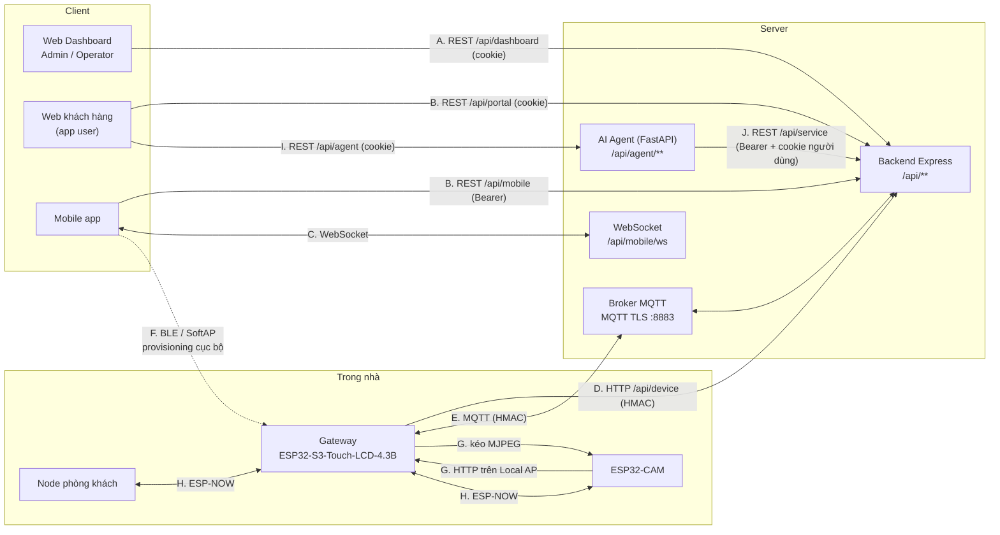
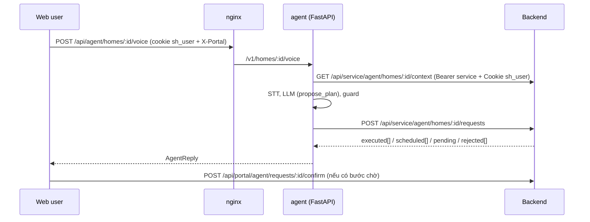

# API_DESIGN.md

> **Thiết kế API toàn hệ thống — software (Backend ↔ Web/Mobile) và firmware (Backend ↔ Gateway ↔ Node).**
> Một chỗ để tra mọi giao diện giữa các thành phần: REST, WebSocket, MQTT, HTTP cục bộ trong nhà, ESP-NOW.
> Mỗi API có cột **Trạng thái**:
> - **Đã có** — có trong code, đường dẫn file ghi kèm. Code là nguồn sự thật.
> - **Dự kiến** — đã thiết kế ở tài liệu khác hoặc ở đây, chưa có code. Có thể đổi khi hiện thực.
> - **Cũ** — route thời Prototype, giữ lại cho `tests/security/attack_demo*.sh`, không dùng cho tính năng mới.
>
> Bản máy đọc được nằm ở `contracts/` (`asyncapi.yaml` cho MQTT, `datapoints.yaml`, `openapi.json` sẽ sinh từ backend). Hiện các file đó mới là bản tạm, nên **tài liệu này vẫn là nguồn hợp đồng** cho tới khi chúng được viết đầy đủ.
>
> Tài liệu liên quan: [Backend](architecture/BACKEND_REFACTOR_SMARTHOME.md) §9–10 (API và MQTT đích), [IoT Node Network](firmware/IOT_NODE_NETWORK.md) (phần cứng và giao thức từng chặng), [WiFi Provisioning](firmware/SMART_HOME_WIFI_PROVISIONING.md) §15 (API provisioning), [Bảo mật](SECURITY_ARCHITECTURE.md), `backend/src/modules/README.md` (quy ước code).
>
> Cập nhật: 2026-10-26; hẹn giờ một lần và dữ liệu hành vi cho AI (mục 5.1): 2026-11-14; Trợ lý AI giọng nói/chữ — kênh `/api/agent/*` và 2 endpoint service (mục 5.1): 2026-11-14; luật "lệnh rõ → làm ngay" của Trợ lý (`executed`, type `done`): 2026-11-15; WebSocket xem camera trên Mobile (`/api/mobile/cameras/:deviceId/live`) và đường Mobile tới Trợ lý qua nginx cổng 80 (Bearer): 2026-11-15; telemetry chữ ký v2, mTLS + ACL cho broker, gỡ `GET /device/sensors`: 2026-11-16.

---

## MỤC LỤC

1. [Bản đồ API](#1-bản-đồ-api)
2. [Quy ước chung](#2-quy-ước-chung)
3. [Chữ ký HMAC](#3-chữ-ký-hmac)
4. [Software — Auth](#4-software--auth)
5. [Software — API khách hàng (Mobile, Portal)](#5-software--api-khách-hàng-mobile-portal)
6. [Software — WebSocket realtime](#6-software--websocket-realtime)
7. [Software — API Dashboard (Admin, Operator)](#7-software--api-dashboard-admin-operator)
8. [Software ↔ Firmware — API thiết bị (HTTP)](#8-software--firmware--api-thiết-bị-http)
9. [Software ↔ Firmware — MQTT](#9-software--firmware--mqtt)
10. [Firmware — API cục bộ trong nhà](#10-firmware--api-cục-bộ-trong-nhà)
11. [Firmware — ESP-NOW Gateway ↔ Node](#11-firmware--esp-now-gateway--node)
12. [Luồng nghiệp vụ → chuỗi API](#12-luồng-nghiệp-vụ--chuỗi-api)
13. [Phiên bản và thay đổi hợp đồng](#13-phiên-bản-và-thay-đổi-hợp-đồng)
14. [Câu hỏi còn mở](#14-câu-hỏi-còn-mở)

---

## 1. BẢN ĐỒ API



| Nhóm | Giữa | Giao thức | Xác thực | Mục |
|---|---|---|---|---|
| A | Web Dashboard → Backend | REST JSON | Cookie phiên nhân viên | 7 |
| B | Mobile / Web khách → Backend | REST JSON | Bearer + refresh token (Mobile), cookie `sh_user` (Portal) | 4, 5 |
| C | Mobile ↔ Backend | WebSocket JSON | Khung `auth` đầu tiên chứa access token | 6 |
| D | Gateway → Backend | HTTPS | HMAC gateway (+ HMAC node khi chuyển tiếp telemetry) | 8 |
| E | Gateway ↔ Backend | MQTT trên TLS | HMAC trong payload | 9 |
| F | Mobile → Gateway | BLE GATT hoặc HTTP trên SoftAP | ECDH + mã hoá phiên | 10.1 |
| G | Camera ↔ Gateway | HTTP trên Local AP | WPA2 Local AP + HMAC camera | 10.2, 10.3 |
| H | Node ↔ Gateway | ESP-NOW | LMK theo node + HMAC node | 11 |
| I | Web khách / Mobile → AI Agent | REST JSON (voice/chữ) qua nginx `/api/agent/` | Web: cookie `sh_user` + `X-Portal: user`; Mobile: `Authorization: Bearer <access>` qua nginx cổng 80 | 5.1 "Trợ lý AI" |
| J | AI Agent → Backend | REST JSON, trong mạng Docker | `Bearer SERVICE_API_TOKEN` + credential người dùng chuyển tiếp | 2.1, 5.1 "Trợ lý AI" |

Mobile **không** nói chuyện MQTT (bất biến 7); node **không** gọi Server trực tiếp ([IoT Node Network](firmware/IOT_NODE_NETWORK.md) §1).

---

## 2. QUY ƯỚC CHUNG

### 2.1. Kênh và tiền tố

| Tiền tố | Ai dùng | Xác thực | Ghi chú |
|---|---|---|---|
| `/api/dashboard/**` | ADMIN, OPERATOR | Cookie `sh_admin` / `sh_operator` | `requireDashboard("admin","operator")` gắn ở `app.module.ts` |
| `/api/portal/**` | USER (web khách) | Cookie `sh_user` | Ngoài phạm vi PRD V2 (FR-1.4), xem `frontend/README.md` |
| `/api/mobile/**` | USER (Mobile) | `Authorization: Bearer <access>` + refresh token | Cùng router với Portal: `createCustomerRouter(channel)` |
| `/api/device/**` | Gateway | HMAC | Không có phiên người dùng |
| `/api/service/**` | Dịch vụ nội bộ (AI Agent `agent/`) | `Authorization: Bearer <SERVICE_API_TOKEN>`; route `/api/service/agent/**` thêm credential người dùng (mục 5.1 "Trợ lý AI") | Chưa đặt token → 503 `SERVICE_CHANNEL_DISABLED`; nginx trả 404 cho `/api/service/` từ bên ngoài, agent gọi thẳng `backend:5000` trong mạng Docker |
| `/api/agent/**` | USER (web khách) → AI Agent | Cookie `sh_user` + `X-Portal: user` | **Không** vào backend: nginx `user.localhost` chuyển `/api/agent/<x>` → `agent:8000/v1/<x>`; admin/operator trả 404; dev mở thẳng `:3003` thì rewrite của Next làm việc đó (`AGENT_URL`). **Mobile** (Bearer): server mặc định cổng 80 (`http://<IP>`, `infra/nginx/nginx.conf`) cũng chuyển `/api/agent/<x>` → `agent:8000/v1/<x>` nhưng **chỉ khi có `Authorization: Bearer …`** (không có → 404, nên console quản trị bằng cookie không có Trợ lý), bỏ header `Cookie` khi chuyển tiếp, giới hạn 30 req/phút/IP, thân ≤ 2 MB. Gọi thẳng backend `:5000` thì `/api/agent` không tồn tại (404) |
| `/api/health` | Giám sát | Không | |
| `/api/auth`, `/api/devices`, `/api/users`, `/api/audit-log`, `/api/notifications` | Prototype | Cookie cũ | **Cũ** — mục 7.3 |

Role hệ thống quyết định **kênh**; role trong nhà (OWNER / CONTROLLER / VIEWER / GUEST) quyết định **hành động** (RBAC 2 tầng, [Bảo mật](SECURITY_ARCHITECTURE.md) §8).

### 2.2. Request và response

- JSON UTF-8, body tối đa **10 KB** (`app.ts`). Ngoại lệ: upload firmware `application/octet-stream` ≤ 4 MB.
- Thời gian trả về dạng ISO 8601 UTC; trong payload thiết bị dùng `unix_ts` (giây).
- Phân trang: query `limit`, `page` (`shared/validation/validate`: `parseLimit`, `parsePage`).
- Id trong URL sai định dạng → **404**, không phải 400 (`parseIdParam`).
- Văn bản cho người dùng (thông báo, nhãn) bằng tiếng Việt; trường `detail` của lỗi bằng tiếng Anh. Client tự dịch mã lỗi thành hướng dẫn (bất biến 10).

### 2.3. Lỗi

```json
{ "error": "UPPER_SNAKE_CODE", "detail": "optional english detail" }
```

| HTTP | Mã thường gặp | Khi nào |
|---|---|---|
| 400 | `MISSING_FIELDS`, `INVALID_INPUT`, `NOT_CONTROLLABLE` | Thiếu hoặc sai dữ liệu |
| 401 | `NO_TOKEN`, `INVALID_TOKEN`, `INVALID_CREDENTIALS` | Chưa đăng nhập, token sai/hết hạn, sai mật khẩu |
| 403 | `FORBIDDEN`, `USE_DASHBOARD`, `USE_MOBILE_APP`, `WRONG_PORTAL`, `CSRF_CHECK_FAILED`, `ACCOUNT_LOCKED`, `ACCESS_GRANT_REQUIRED`, `OWNER_CANNOT_LEAVE` | Đúng nhà nhưng thiếu quyền; sai kênh; thiếu header chống CSRF; Operator chưa được cấp quyền vào nhà |
| 404 | `NOT_FOUND`, `HOME_NOT_FOUND`, … | Không tồn tại **hoặc nhà không thuộc quyền** (bất biến 6) |
| 409 | `HOME_SUSPENDED`, `DEVICE_OFFLINE`, `DEVICE_BLOCKED`, `ALREADY_CLAIMED`, `ALREADY_USED`, `GATEWAY_NOT_ASSIGNED` | Trạng thái không cho phép |
| 429 | — | Vượt giới hạn tần suất (`authLimiter`, `deviceDataLimiter`, `apiLimiter`) |
| 502 / 504 | `COMMAND_FAILED` / `TIMEOUT` | Gateway trả lỗi / không ack trong 5 giây |
| 500 | `INTERNAL_ERROR` | Lỗi lạ, có ghi audit `UNHANDLED_ERROR` |

### 2.4. Bất biến áp cho mọi API

- Secret thiết bị/gateway **chỉ trả 1 lần** lúc tạo; không API nào khác trả secret (bất biến 1).
- Không log password, token, secret, mật khẩu WiFi (bất biến 2).
- Ghi nhiều bảng trong 1 transaction (bất biến 9).
- AI không tự điều khiển thiết bị khi lệnh chưa rõ (bất biến 8): gợi ý thói quen và việc AI tự suy ra phải được xác nhận; lệnh người dùng nói/gõ rõ ràng (backend kiểm từ câu gốc) thì Trợ lý làm ngay hoặc tự hẹn giờ và báo kết quả — luật ở mục 5.1 "Trợ lý AI".

---

## 3. CHỮ KÝ HMAC

Mọi chữ ký: `HMAC-SHA256(secret, message)` xuất **hex thường**, so sánh hằng thời gian, cửa sổ chống replay **±300 giây** (`modules/devices/domain/hmac.service.ts`, `TS_WINDOW_SECONDS` trong `modules/control/features/command-ack/command-ack.handler.ts`).

| Dùng cho | Ai ký | Secret | Chuỗi được ký | Trạng thái |
|---|---|---|---|---|
| Telemetry v2, lớp 1 (Node) | Node | secret node | `v2\|sn\|<sensor_id>\|<sn_timestamp>\|<sn_ctr>\|<sha256_hex(data_raw)>` — ký cả nội dung (`data_raw` = chuỗi JSON nguyên văn Node gửi) và bộ đếm chống phát lại | Đã có (2026-11-16) |
| Telemetry v2, lớp 2 (Gateway) | Gateway | secret gateway | `v2\|gw\|<gateway_id>\|<gw_timestamp>\|<gateway_ip hoặc rỗng>\|<sensor_id>\|<sn_ctr>\|<sn_hmac>` — phủ cả chữ ký Node và IP | Đã có (2026-11-16) |
| Heartbeat gateway (MQTT) | Gateway | secret gateway | `v2\|hb\|<gateway_id>\|<ts>\|<ctr>\|<sha256_hex(body_raw)>` — phủ cả `uptime`, `ip`, `nodes[]` (nằm trong `body_raw`) và bộ đếm; `ctr` chiếm trên `devices.last_ctr` của dòng gateway | Đã có (2026-11-16) |
| Ack lệnh (MQTT) | Gateway | secret gateway | `v2\|ack\|<gateway_id>\|<device_uid>\|<command_id>\|<status>\|<power>\|<ts>`; `<power>` = `1`/`0` hoặc rỗng khi ack không có trường `power`. Không có `ctr`: `command_id` dùng 1 lần (mục chờ ack bị xoá sau ack đầu tiên) | Đã có (2026-11-16) |
| Sự kiện camera (`camera/event`) | Gateway | secret gateway | `v2\|evt\|<gateway_id>\|<camera_id>\|<type>\|<ts>\|<snapshot_id hoặc rỗng>`. Không có `ctr` (backend đã chống lặp 60 giây/camera) | Đã có (2026-11-16) |
| Ảnh Camera → Gateway (`POST /local/camera/snapshot`, mục 10.2) | Camera | secret camera | `v2\|cam-up\|<cam_id>\|<ts>\|<ctr>\|<trigger>\|<command_id hoặc rỗng>` (header `X-Counter` = `ctr`); **không băm ảnh** — ảnh đi trong Local AP WPA2 | Đã có (2026-11-16, build kiểm, chưa nạp board) |
| Mở luồng Gateway → Camera (`GET /stream`, mục 10.3) | Gateway | secret camera | `v2\|cam-stream\|<cam_id>\|<ts>\|<ctr>\|<fs>\|<q>` — `fs`/`q` là giá trị **đã chuẩn hoá** camera sẽ dùng (vắng `fs` → `vga`, vắng `q` → `12`) | Đã có (2026-11-16, build kiểm, chưa nạp board) |
| Telemetry / heartbeat / ack / sự kiện camera v1 (cũ) | Node / Gateway | secret node / gateway | `<device_id>:<unix_ts>` / `<gateway_id>:<unix_ts>` (telemetry, heartbeat), `<command_id>:<status>:<ts>` (ack), `<device_id>:motion:<ts>` (camera/event) | Cũ — chỉ nhận khi `DEVICE_HMAC_V1=true` (mặc định `false`: telemetry → `401 PROTOCOL_V1_DISABLED`; heartbeat/ack/sự kiện dạng cũ bị bỏ + log cảnh báo). Camera ↔ Gateway **không còn** chế độ cũ |
| Lệnh thiết bị | Backend | secret gateway | `<command_id>:<device_id>:<action>:<ts>` | Đã có |
| Lệnh gateway | Backend | secret gateway | `<command_id>:<gateway_id>:<action>:<ts>` | Đã có |
| Lệnh OTA | Backend | secret gateway | `<job_id>:<version>:<ts>` | Đã có |
| Ảnh camera lên Server (`POST /api/device/camera/snapshot`) | Gateway | secret gateway | `<gateway_id>:<ts>:<device_id>:<trigger>:<command_id>:<sha256_hex(body)>` — gắn chữ ký với nội dung ảnh; `<command_id>` rỗng khi không có `X-Command-Id` (hai dấu `:` liền nhau); `sha256_hex` = sha256 hex thường của đúng các byte body | Đã có |
| Uplink xem trực tiếp (`WS /api/device/camera/live`) | Gateway | secret gateway | `<gateway_id>:<ts>:<device_id>:<session_id>` (mục 8) | Đã có |

Các dòng `v2|…` (telemetry, heartbeat, ack, sự kiện camera, Camera ↔ Gateway) là bất biến 5 — backend (`modules/devices/domain/signature-v2.ts`), firmware (`firmware/common/security_manager`) và `tests/security/lib_v2.sh` phải khớp từng byte. Mọi trường nối bằng `|` và không trường nào chứa `|` (id giới hạn `[A-Za-z0-9_.:-]`); khoá HMAC là chuỗi secret nguyên văn (byte UTF-8), không giải mã hex. Chữ ký telemetry v2 **ký nội dung** (sha256 của `data_raw` nằm trong chuỗi Node ký) nên sửa số đo dọc đường bị `401 SENSOR_AUTH_FAIL`; Gateway **không giữ secret Node**, chữ ký Node chỉ backend kiểm (lớp 2 độc lập, Gateway bị chiếm cũng không giả được số đo Node). Chặng Node → Gateway xác thực bằng ESP-NOW CCMP (LMK) + `ts` ±300 giây + `ctr` tăng; heartbeat Node qua ESP-NOW không ký HMAC (chỉ CCMP). Ảnh camera lên Server cũng **có ký nội dung** (sha256 của body nằm trong chuỗi ký). Chuỗi `<device_id>:<unix_ts>` không còn trong firmware (đã xoá `sm_device_sign/verify`). Ảnh Camera → Gateway thì **không** ký nội dung (chủ ý: xác thực bằng khoá camera + `ctr`); kẻ có mật khẩu Local AP và chặn được request thật có thể đổi ảnh — giới hạn đã chấp nhận.

**Bộ đếm `ctr`:** tăng ngặt, xấp xỉ unix mili giây (firmware dùng chung `sm_counter` trong `firmware/common/security_manager` cho Node, Gateway và Camera; mức sàn NVS `sec/ctr_floor` đặt trước 10 phút để mất điện không tụt ngược). Backend lưu `devices.last_ctr` và cập nhật nguyên tử (`claimDeviceCounter`): telemetry dùng dòng node (`sn_ctr`), heartbeat dùng dòng gateway. `ctr ≤ last_ctr` → telemetry `401 SENSOR_AUTH_FAIL {reason: REPLAYED}` (audit `REPLAY_ATTACK`), heartbeat bị bỏ + log cảnh báo; `ctr > now + 1 ngày` → `COUNTER_OUT_OF_RANGE`. Gói phát lại vẫn nằm trong cửa sổ ±300 giây bị chặn bằng `ctr`, không cần chờ hết hạn. Camera ↔ Gateway: bên nhận giữ `last_ctr` trong RAM theo từng camera (Gateway) hoặc cho luồng (Camera); khi `last_ctr = 0` (sau khởi động) lấy sàn `(now − 300) × 1000`, chỉ cập nhật sau khi nhận đủ body hợp lệ.

**Khoá thiết bị (FR-12.2):** chỉ lỗi `HMAC_MISMATCH` tới qua **MQTT telemetry** (người gửi đã qua mTLS + ACL) mới tăng `fail_count`/khoá thiết bị. Lỗi trên HTTP chỉ ghi audit, bị giới hạn theo `ip|gateway_id` (20 gói bị từ chối xác thực 400/401/403/404 / 15 phút → `429`). Lệch giờ, phát lại, v1 bị tắt không bao giờ làm khoá thiết bị — chống kẻ ngoài khoá gateway thật bằng gói giả. Hai đường camera do gateway gọi (`POST /device/camera/snapshot`, `WS /device/camera/live`) **không** tăng `fail_count`/không khoá gateway (không có danh tính transport — ai biết `gateway_id` cũng gọi được, đếm theo gateway sẽ cho kẻ ngoài khoá oan): mỗi lỗi chỉ ghi audit, và IP có ≥ 20 lỗi/15 phút → `429` (snapshot: `cameraSnapshotFailLimiter` ở `core/http/rate-limit.ts`; WS: bộ đếm RAM theo IP, `429 TOO_MANY_AUTH_FAILURES`). Heartbeat/ack/sự kiện camera sai chữ ký chỉ bị bỏ + log cảnh báo, không đếm `fail_count`.

**Phát hiện nghi nhân bản Gateway (A2):** từ heartbeat **đã đúng chữ ký**, backend theo dõi theo gateway trong RAM (`modules/devices/domain/gateway-clone-detector.ts`): `uptime` lùi hơn 5 giây ≥ 2 lần/10 phút, hoặc `ip` đổi ≥ 3 lần/10 phút giữa ≥ 2 giá trị, hoặc ≥ 3 heartbeat đúng chữ ký bị từ chối vì `ctr` phát lại/lùi trong 10 phút → audit `GATEWAY_DUPLICATE_SUSPECTED` + thông báo nhân viên (admin/operator), tối đa 1 lần/gateway/giờ. **Không tự khoá** gateway (không biết board nào là thật). Trạng thái chỉ trong RAM, khởi động lại thì học lại.

Rủi ro còn lại: chuỗi `v2|ack|…` và `v2|evt|…` không có `ctr` nên về lý thuyết có thể phát lại trong cửa sổ ±300 giây; tác động nhỏ (ack chỉ khớp được `command_id` còn đang chờ, một lần; sự kiện camera chống lặp 60 giây/camera). Broker bắt buộc mTLS và ACL theo CN chứng chỉ (FR-12.4, mục 9) nên chỉ chính gateway sở hữu topic mới publish được.

---

## 4. SOFTWARE — AUTH

`modules/identity/` (router `/auth` của từng kênh, mount trước guard của kênh ở `app.module.ts`). Mỗi kênh một bộ route, cookie/token không dùng chéo kênh.

| Method | `/api/dashboard/auth/…` | `/api/portal/auth/…` | `/api/mobile/auth/…` | Mô tả |
|---|---|---|---|---|
| POST | `/login` | `/login` | `/login` | Đăng nhập. Dashboard và Portal đặt cookie; Mobile trả `{access_token, refresh_token, token_type: "Bearer", expires_in: 900, refresh_expires_in: 2592000, user}` |
| POST | — | `/register` | `/register` | Khách tự đăng ký (email + mật khẩu) |
| POST | — | — | `/refresh` | Body `{refresh_token}` → cặp token mới. Refresh token xoay vòng theo họ (`family_id`); dùng lại token cũ → thu hồi cả họ |
| POST | `/logout` | `/logout` | `/logout` | Đăng xuất; Mobile thu hồi refresh token |
| GET | `/me` | `/me` | `/me` | Thông tin người dùng hiện tại |

- Route chưa có phiên của Portal/Dashboard kiểm header `X-Portal` chống CSRF (`csrfGuard`).
- Nhân viên đăng nhập kênh khách → 403 `USE_DASHBOARD`.
- Đổi mật khẩu (`POST /me/password`, mục 5) thu hồi mọi refresh token.

Trạng thái: **Đã có**.

---

## 5. SOFTWARE — API KHÁCH HÀNG (MOBILE, PORTAL)

Cùng một router cho `/api/mobile` và `/api/portal` (feature của từng module, gắn qua móc `customer` trong `<m>.module.ts`). Bảng dưới ghi đường dẫn tương đối; ví dụ `GET /homes` = `GET /api/mobile/homes`.
Cột **Quyền** là permission trong nhà (`modules/homes/domain/permissions.ts`): nhà không thuộc quyền → 404, thiếu quyền → 403.

### 5.1. Đã có

| Nhóm | Method | Path | Quyền | Mô tả |
|---|---|---|---|---|
| Kích hoạt | POST | `/claim` | — | Nhận nhà bằng mã kích hoạt / QR (1 transaction) |
| Nhà | GET | `/homes` | — | Danh sách nhà của tôi |
| | GET | `/homes/:homeId/overview` | `view` | Tổng quan: phòng, thiết bị, khí hậu |
| | PATCH | `/homes/:homeId` | `rename` | Đổi tên nhà |
| Phòng | GET | `/rooms/:roomId` | `view` | Chi tiết phòng |
| | PATCH | `/rooms/:roomId` | `rename` | Đổi tên phòng |
| Thiết bị | GET | `/devices/:deviceId` | `view` | Chi tiết thiết bị |
| | PATCH | `/devices/:deviceId` | `rename` | Đổi tên thiết bị |
| | GET | `/devices/:deviceId/telemetry` | `view` | Chuỗi số liệu `24h` / `7d` |
| Camera | GET | `/devices/:deviceId/snapshots?limit=` | `view` | Ảnh gần đây của camera (`limit` 1–50, mặc định 20; mới nhất trước): `{device_id, items: [{id, trigger: "motion"\|"request", size_bytes, captured_at}]}`. Thiết bị không phải camera → 404. Chỉ liệt kê ảnh chụp khi camera đang ở nhà hiện tại (`home_id` ảnh = `home_id` camera) |
| | GET | `/snapshots/:snapshotId/image` | `view` | Tải ảnh JPEG (`Cache-Control: private, max-age=86400, immutable`); không tồn tại / không có quyền / file mất / ảnh chụp ở nhà khác với nhà hiện tại của camera → 404 (ảnh chỉ thuộc về nhà lúc chụp). Web dùng thẳng `/api/portal/snapshots/<id>/image` trong `` (cookie `sh_user`), mobile gửi `Authorization: Bearer` |
| | POST | `/devices/:deviceId/commands` | `control_device` | Bật/tắt (`turn_on` / `turn_off`); điều hòa (`appliance = "ac"`) thêm `{action: "set_temp", temperature: 16..30}` → MQTT `set_temp_<NN>`; học mã remote IR `{action: "learn_code", slot: "off" \| 16..30}` → MQTT `learn_off` / `learn_t<NN>` (chỉ điều hòa, khác → 400 `NOT_CONTROLLABLE`; ack ok = đã học xong, chỉ bật bit trong `ac_codes`, không đổi `power`/`ac_setpoint`). rèm (`appliance = "curtain"`) thêm `{action: "set_pos", position: 0..100}` (số nguyên; web và màn hình Node/Gateway dùng 0 = đóng, 50, 100) → MQTT `set_pos_<N>` (không đệm số 0; chỉ rèm, khác → 400 `NOT_CONTROLLABLE`; `position` thiếu/không phải số nguyên/ngoài 0..100 → 400 `INVALID_INPUT`; ack ok → `curtain_pos = N`, `power = ack.power ?? N > 0`; `turn_on` trên rèm → `curtain_pos = 100`, `turn_off` → 0). Chờ ack ≤ 5 giây (`learn_*`: ≤ 15 giây — Node chờ người dùng bấm remote tối đa 10 giây). `CustomerDevice` và sự kiện WebSocket `device_state` có `appliance`, `ac_setpoint`, `ac_codes` (bitmask mã IR đã học: bit 0 = TẮT, bit `t−15` = BẬT ở t°C; `null` = chưa học/chưa biết), `curtain_pos` (rèm: % mở 0..100, 0 = đóng; `null` = chưa biết hoặc không phải rèm) |
| Hẹn giờ | GET | `/homes/:homeId/schedules?scope=upcoming\|history&limit=` | `view` (thành viên nhà) | Lịch hẹn giờ một lần của nhà (`scope` mặc định `upcoming`; `limit` 1–100, mặc định 50) → `{items: Schedule[]}`. GUEST chỉ thấy lịch do mình tạo. Chi tiết: "Hẹn giờ một lần" bên dưới |
| | POST | `/homes/:homeId/schedules` | `control_device` (thiết bị) | Tạo lịch (`ScheduleInput`) → 201 `Schedule` |
| | POST | `/schedules/:scheduleId/cancel` | người tạo hoặc OWNER | Huỷ lịch còn `scheduled` → 200 `Schedule` |
| Trợ lý AI | GET | `/agent/requests/:requestId` | người tạo yêu cầu | Chi tiết yêu cầu của Trợ lý (kể cả bước chờ xác nhận). Chi tiết: "Trợ lý AI" bên dưới |
| | POST | `/agent/requests/:requestId/confirm` | người tạo + `control_device` từng thiết bị | Xác nhận các bước chờ `{request_hash, step_indexes}` → 200 `{request_id, status, results: Schedule[]}` |
| | POST | `/agent/requests/:requestId/reject` | người tạo | Từ chối → 200 `{request_id, status: "rejected"}` |
| Tự động hoá | GET | `/homes/:homeId/automations` | `view_automation` | Danh sách luật |
| | POST | `/homes/:homeId/automations` | `create_automation` | Tạo luật IF/THEN |
| | PATCH | `/automations/:ruleId` | `create_automation` (+ chủ luật hoặc `manage_any_rule`) | Sửa, bật/tắt luật |
| | DELETE | `/automations/:ruleId` | như trên | Xoá luật |
| | GET | `/automations/:ruleId/history` | `view_automation` | Lịch sử chạy |
| Gợi ý AI | GET | `/homes/:homeId/suggestions` | `view_automation` | Gợi ý thói quen |
| | POST | `/suggestions/:id/accept` | `create_automation` | Chấp nhận → tạo luật (bất biến 8) |
| | POST | `/suggestions/:id/dismiss` | `create_automation` | Bỏ qua |
| Thành viên | GET | `/homes/:homeId/members` | `view` | Danh sách thành viên |
| | POST | `/homes/:homeId/members/invite` | `manage_members` | Mời thành viên |
| | PATCH | `/members/:memberId` | `manage_members` | Đổi role, quyền thiết bị của GUEST, hạn |
| | DELETE | `/members/:memberId` | `manage_members` | Xoá thành viên |
| | POST | `/homes/:homeId/leave` | thành viên | Rời nhà; OWNER → 403 `OWNER_CANNOT_LEAVE` |
| Lời mời | GET | `/invitations` | — | Lời mời đang chờ của tôi |
| | POST | `/invitations/:id/accept` · `/decline` | — | Nhận / từ chối |
| Thông báo | GET | `/notifications` | — | Danh sách |
| | PATCH | `/notifications/:id/read` · `/notifications/read-all` | — | Đánh dấu đã đọc |
| Hồ sơ | GET · PATCH | `/me/profile` | — | Xem / sửa hồ sơ |
| | POST | `/me/password` | — | Đổi mật khẩu |

#### WebSocket xem trực tiếp camera — kênh Portal và Mobile

`GET /api/portal/cameras/:deviceId/live` (WebSocket, `modules/camera/features/live-relay/live-viewer.controller.ts`). **Đã có** cho web khách hàng; kênh Mobile `GET /api/mobile/cameras/:deviceId/live` **đã có từ 2026-11-15** (đoạn "Kênh Mobile" bên dưới); **không** có cho Admin/Operator (quyền riêng tư, [IoT Node Network](firmware/IOT_NODE_NETWORK.md) §5.5). Phía Gateway đẩy khung lên: mục 8, "WebSocket `/api/device/camera/live`".

- **Trước upgrade** (lỗi → HTTP thô rồi đóng socket): quá 60 upgrade/phút/IP → `429`; thiếu/sai `Origin` → `403 ORIGIN_NOT_ALLOWED` (host của `Origin` phải trùng `Host`/`X-Forwarded-Host`, hoặc nằm trong `FRONTEND_URL`, danh sách phân tách dấu phẩy); cookie `sh_user` thiếu/sai/hết hạn hoặc không phải role USER → `401`.
- **Sau upgrade** — trình duyệt không đọc được HTTP status nên backend đóng bằng mã ứng dụng:

| Close code | Nghĩa |
|---|---|
| `4401` | Phiên đăng nhập hết hạn, `token_version` đổi hoặc tài khoản bị khoá (kiểm lại mỗi 30 giây) |
| `4403` | Role trong nhà là GUEST (chỉ OWNER, CONTROLLER, VIEWER được xem), hoặc mất quyền giữa chừng |
| `4404` | Camera không tồn tại / không thuộc nhà của user / không phải camera / id > 2147483647 (bất biến 6: không lộ sự tồn tại) |
| `4408` | Camera không phản hồi: chưa có luồng sau 20 giây, hoặc luồng mất quá 15 giây |
| `4409` | Camera đã đủ 4 người xem |
| `4429` | User đã mở 2 luồng, hoặc mở quá 10 lần/phút |
| `4501` | Camera mô phỏng (`is_simulated`) — không hỗ trợ |
| `1000` | Kết thúc bình thường |

- **Server → client:** tin **nhị phân** = đúng 1 khung JPEG chuyển tiếp nguyên vẹn (người xem chậm: `bufferedAmount` > 256 KB thì bỏ khung, luôn giữ khung mới nhất; người xem mới nhận ngay khung cuối nếu < 2 giây tuổi); tin **văn bản** `{"type":"state","state":"connecting"|"live"|"reconnecting"|"camera_unavailable"}`. Client không cần gửi gì (`maxPayload` 1 KB); server ping mỗi 30 giây, không pong thì đóng.
- **Phiên do Backend làm chủ** (chỉ trong RAM, không ghi đĩa/DB): người xem đầu tiên mở → tạo `session_id` (UUID v4) + gửi MQTT `live_start` (mục 9.1); người xem cuối rời → chờ 10 giây rồi `live_stop` và đóng luồng lên. Chưa có luồng sau 10 giây → gửi lại `live_start` 1 lần.
- **Audit:** `CAMERA_LIVE_VIEW_START` khi qua kiểm quyền, `CAMERA_LIVE_VIEW_END` kèm `{duration_s, reason}`.
- Web: `frontend/packages/modules/devices/src/features/camera-live/`; dev nối thẳng backend bằng `NEXT_PUBLIC_LIVE_WS_ORIGIN` ([Lên Server](guides/LEN_SERVER.md) §6, "Xem trực tiếp camera trên web").

**Kênh Mobile — `GET /api/mobile/cameras/:deviceId/live`** (**đã có 2026-11-15**; `live-mobile-viewer.controller.ts`, logic xem dùng chung với web ở `live-viewer.run.ts`; chưa thử với backend/phần cứng thật). Cùng nội dung với viewer web (cùng bảng close code, cùng khung nhị phân JPEG và `{"type":"state"}`, cùng phiên/audit); khác ở cách xác thực vì app không có cookie:
- **Trước upgrade:** chỉ giới hạn 60 upgrade/phút/IP (`429`, bucket riêng với viewer web). **Không** kiểm `Origin` (app không có; Bearer không tự được trình duyệt gửi nên không có CSWSH) và **không** đọc cookie.
- **Khung `auth`:** ngay sau upgrade client gửi khung văn bản đầu tiên `{"type":"auth","token":"<access JWT>"}` (token ≤ 2048 ký tự) trong 10 giây. JSON hỏng, sai `type`, khung nhị phân, token sai/hết hạn/thu hồi/tài khoản khoá, hoặc quá 10 giây → đóng `4401`. Token **không** nằm trong URL (URL hay bị proxy ghi log) và không bị log. `maxPayload` của socket là 4096 byte.
- **Sau xác thực:** như viewer web — `4429` (mở quá 10 lần/phút/user hoặc đã đủ 2 luồng), `4404` (camera không tồn tại / không thuộc nhà / không phải camera / id ngoài 1..2147483647), `4403` (GUEST), `4501` (camera mô phỏng), `4408`, `4409`; kiểm lại `token_version`/khoá tài khoản/quyền mỗi 30 giây; access token hết hạn (15 phút) → `4401`.
- **Audit:** như viewer web nhưng `details.channel = "mobile"`.
- **App** (`mobile/lib/modules/devices/data/camera_live_ws_source.dart`): `4401` → `ApiClient.refreshSession()` rồi nối lại 1 lần; các mã `44xx`/`4501` khác → hiện câu tiếng Việt tương ứng và dừng; lỗi khác (`1006`, mất mạng) → nối lại sau 1/2/4 giây rồi dừng.

#### Hẹn giờ một lần

Module `modules/schedules` (cập nhật 2026-11-14), gắn qua móc `customer` nên có ở cả `/api/portal` (kênh ghi nhận `web`) và `/api/mobile` (`mobile`). Chỉ cho **relay có `appliance` ∈ {lamp, fan, curtain, ac}**; chạy đúng **một lần**, không lặp (lặp lại là việc của Automation). Bảng: `scheduled_actions` ([Database](architecture/DATABASE_REFACTOR_SMARTHOME.md) §7.8).

**`ScheduleInput`** (`POST /homes/:homeId/schedules`):

```json
{ "device_id": 41,
  "action": "turn_on | turn_off | set_temp | set_pos",
  "temperature": 26, "position": 50,
  "when": { "at": "20:00", "date": "2026-11-15" } }
```

- `action` theo loại: đèn/quạt `turn_on`, `turn_off` · rèm `turn_on`, `turn_off`, `set_pos` (`position` ∈ {0, 50, 100}) · điều hoà `turn_on`, `turn_off`, `set_temp` (`temperature` 16–30). Không hợp loại hoặc không phải relay có `appliance` ở trên → 400 `NOT_CONTROLLABLE`.
- `when` có **đúng một** trong hai: `{at: "HH:MM", date?: "YYYY-MM-DD"}` hoặc `{after_minutes: 1..10080}`. Quy đổi `run_at` theo `smart_homes.timezone` của nhà (hàm thuần `resolveWhen`, `modules/schedules/domain/when.ts`): `at` không `date` = hôm nay lúc HH:MM, đã qua (< now + 30 giây) thì sang ngày mai; `at` + `date` = đúng giờ đó, giây = 0; `after_minutes` = now + N phút. Bắt buộc `now + 30 giây ≤ run_at ≤ now + 7 ngày`.
- Thứ tự kiểm khi tạo: `requireDeviceAccess(control_device)` (404/403 như API lệnh) → thiết bị không thuộc `:homeId` → 404 → nhà tạm ngưng → 409 `HOME_SUSPENDED` → loại thiết bị/thao tác → 400 `NOT_CONTROLLABLE` → nhà đã có ≥ 50 lịch `scheduled` → 409 `SCHEDULE_LIMIT`. Thiếu trường → 400 `MISSING_FIELDS`, sai giá trị → 400 `INVALID_INPUT`. **Không** kiểm online lúc tạo (lúc chạy mới kiểm).
- Huỷ: lịch không có / không thuộc quyền / GUEST không phải người tạo → cùng 404 "Schedule not found"; không phải người tạo và không phải OWNER → 403; `status ≠ scheduled` (kể cả runner vừa giành lịch) → 409 `SCHEDULE_NOT_CANCELLABLE`. Huỷ được cả khi nhà tạm ngưng.
- Audit: `SCHEDULE_CREATED`, `SCHEDULE_CANCELLED` (category `automation`).

**`Schedule`** (snake_case): `id`, `home_id`, `timezone`, `device_id`, `device_name`, `room_name`, `appliance` (3 trường đầu của thiết bị là `null` khi thiết bị đã xoá; `room_name` `null` khi chưa gán phòng), `action` (`turn_on|turn_off|set_temp|set_pos`), `temperature`, `position` (`null` nếu không áp dụng), `action_label` (backend sinh, tiếng Việt, không chứa tên phòng; tên thiết bị bắt đầu bằng từ loại tải dạng "Xxx" thì viết thường chữ đầu: "Bật đèn", "Chỉnh rèm về 50%" (vị trí giữa chừng là đích, không phải hướng), "Mở rèm 100%", "Đóng rèm", "Đặt điều hoà 26°C"; tên khác giữ nguyên), `run_at` (ISO UTC), `status`, `origin` (`user|ai_agent`), `channel` (`web|mobile`), `created_by_user_id`, `created_by_name`, `error_code`, `executed_at`, `cancelled_at`, `created_at`, `can_cancel` (`status = scheduled` và người gọi là người tạo hoặc OWNER).

- `status`: `scheduled` → `running` → `done|skipped|failed|missed`, hoặc `cancelled`. Tab "sắp chạy" = `scheduled`+`running` (xếp theo `run_at` tăng), tab "lịch sử" = các trạng thái còn lại (mới nhất trước).
- `error_code`: `DEVICE_OFFLINE`, `TIMEOUT`, `COMMAND_FAILED`, `DEVICE_BLOCKED`, `HOME_SUSPENDED`, `NOT_CONTROLLABLE`, `NO_DEVICE`, `ACCESS_REVOKED`, `ALREADY_IN_STATE`, `INTERRUPTED`, `UNKNOWN`.

**Runner** (worker `scheduleRunner`, `modules/schedules/schedules.module.ts`): tick 5 giây, không chạy chồng, lỗi bắt tại chỗ. Lịch `running` quá 10 phút (backend tắt giữa chừng) → `failed`/`INTERRUPTED`; việc dọn chạy lúc khởi động và mỗi ~1 phút, giả định chỉ một tiến trình backend. Mỗi tick giành tối đa 20 lịch tới hạn theo thứ tự `(run_at, id)` bằng một câu `UPDATE … FOR UPDATE SKIP LOCKED` rồi xử lý từng lịch theo thứ tự:

1. Quá hạn > 5 phút (backend tắt đè qua giờ) → `missed`, không chạy bù.
2. Thiết bị đã xoá hoặc không còn thuộc nhà → `failed`/`NO_DEVICE`.
3. Người tạo bị khoá hoặc mất quyền `control_device` (kể cả GUEST hết hạn) → `cancelled`/`ACCESS_REVOKED`, không thông báo.
4. Thiết bị đã ở trạng thái đích → `skipped`/`ALREADY_IN_STATE`, không gửi lệnh.
5. Còn lại gọi lại đúng `sendDeviceCommand` của lệnh tay (kênh `system`, `source = schedule`, hoặc `ai_agent` khi `origin = ai_agent`) → `done` kèm `device_command_id`; `HttpError` → `failed` với mã lỗi của nó nếu nằm trong 11 mã trên (`NOT_FOUND` → `NO_DEVICE`, mã khác → `UNKNOWN`). Lệnh tự ghi `device_commands`, audit và hành vi như lệnh tay, runner không ghi trùng.

Thông báo cho **người tạo** (`related_device_id` = thiết bị): `SCHEDULE_DONE` (success), `SCHEDULE_SKIPPED` (info), `SCHEDULE_FAILED` (warning, kèm lý do tiếng Việt), `SCHEDULE_MISSED` (warning). Đi qua cơ chế thông báo thường: Mobile nhận tin WebSocket `notification` (mục 6); web không có WebSocket, chỉ poll `/notifications` mỗi 15 giây (kể cả khi tab ẩn, để popup trình duyệt vẫn chạy).

`device_commands.source` (và `CommandSource` trong code) gồm `user`, `automation`, `operator`, **`schedule`**, **`ai_agent`**; `ai_agent` do Trợ lý AI ghi khi lịch có `origin = ai_agent` chạy (đã hiện thực 2026-11, mục "Trợ lý AI" bên dưới; [Đề xuất AI Agent](proposals/DE_XUAT_AI_AGENT.md)).

#### Trợ lý AI (giọng nói + chữ)

**Đã hiện thực 2026-11-14** (code viết theo hợp đồng này; chưa chạy đầu-cuối với OpenAI thật). Có ở web app `user` và (từ 2026-11-15) app Mobile (module `ai`: nút mic nổi, gọi agent bằng Bearer qua nginx cổng 80, xác nhận/từ chối qua `/api/mobile/agent/requests/:id/confirm|reject`; chưa thử đầu-cuối). Người dùng nói/gõ tiếng Việt ("8h tối bật đèn, tắt quạt sau 30p nữa"); dịch vụ Python `agent/` (STT + LLM) chỉ **đề xuất kế hoạch**, còn **backend quyết định** từng bước theo luật tất định bên dưới: lệnh rõ → làm ngay hoặc tự hẹn giờ; lệnh chưa rõ → hỏi lại hoặc thẻ xác nhận. Cập nhật 2026-11-15 (người dùng chốt; luật dưới đây là hợp đồng, code backend/agent/web cập nhật cùng đợt) — trước đó chỉ tự đặt lịch khi nói rõ + còn ≥ 2 phút + ≤ 3 bước, lệnh chạy ngay luôn phải xác nhận. LLM không có công cụ thực thi, không nhận ID thật hay tên nhà/thành viên.



**A. Agent FastAPI — `/api/agent/*` (nginx) = `/v1/*` (agent):**

| Method | Path | Vào | Ra |
|---|---|---|---|
| POST | `/api/agent/homes/:homeId/voice?conversation_id=` | Body = audio thô; `Content-Type` ∈ `audio/webm`, `ogg`, `mp4`, `mpeg`, `wav`, `x-wav`, `x-m4a` (bỏ `;codecs=…` khi so); header tuỳ chọn `X-Audio-Duration-Ms` | `AgentReply` (có `transcript`) |
| POST | `/api/agent/homes/:homeId/messages` | JSON `{text: 1..500, conversation_id?}` | `AgentReply` |
| GET | `/health` (chỉ trong mạng Docker) | — | `{status, llm_configured, stt_ready, backend_configured}`, không bao giờ trả key |

- **Xác thực:** cookie `sh_user` (POST bắt buộc `X-Portal: user`, thiếu/sai → 403 `CSRF_CHECK_FAILED`) hoặc `Authorization: Bearer <jwt>` (Mobile, qua nginx cổng 80 — mục "Bản đồ API", kênh `/api/agent/**`; token hết hạn → 401 `SESSION_EXPIRED`, app refresh rồi gửi lại 1 lần). Không có → 401 `NO_TOKEN`. Agent chỉ chuyển tiếp **đúng** cookie `sh_user` sang backend; không log credential.
- **Audio:** rỗng → 400 `EMPTY_AUDIO`; > 1 MB → 413 `AUDIO_TOO_LARGE`; type khác → 415 `UNSUPPORTED_AUDIO`. nginx chặn sớm thân > 2 MB. Tin nhắn chữ quá ~16 KB → 413.
- **Giới hạn:** ở agent (bộ nhớ tiến trình) theo credential (khoá = SHA-256, không lưu credential) và theo người (`AGENT_RATE_LIMIT_PER_MIN`, 10), cộng `AGENT_DAILY_LIMIT_PER_HOME` (200) theo nhà/ngày → 429 `RATE_LIMITED`; thêm lớp ngoài ở nginx 30 req/phút/IP (burst 10, vượt → 429). Mỗi request có thời hạn tổng ~40 giây (`AGENT_REQUEST_TIMEOUT_S`). Hai biến cũ `AGENT_ALLOW_R1_AUTO` và `AGENT_DAILY_BUDGET_USD` đã bỏ.
- **Thứ tự xử lý voice:** credential/CSRF → rate limit → kiểm audio → `context` (backend xác thực người dùng + nhà **trước** khi tốn tiền STT) → STT → LLM → guard → `requests` (nếu có bước) → `AgentReply`.
- **Lỗi agent** (`{error, message}`, `message` tiếng Việt): 401 `SESSION_EXPIRED` (**chỉ** khi phiên người dùng hết hạn), 403 `ACCOUNT_LOCKED` / `FORBIDDEN`, 404 `HOME_NOT_FOUND`, 503 `AGENT_UNAVAILABLE` (backend 5xx/timeout, chưa có hoặc **sai** token dịch vụ), 503 `LLM_DISABLED` / `STT_DISABLED` (chưa có key), cùng các mã audio/413/429/403 ở trên. Khi agent tắt (nginx trả 502), hẹn giờ thủ công vẫn chạy.

**`AgentReply`:**

```json
{ "conversation_id": "32 hex",
  "type": "answer | done | scheduled | confirm | mixed | clarify | refuse",
  "reply": "câu tiếng Việt", "transcript": "… | null",
  "clarification": { "question": "…", "options": ["8:00 sáng", "20:00 tối"] },
  "executed": [ /* Schedule — bước đã chạy ngay, kèm kết quả (status done/skipped/failed…) */ ],
  "scheduled": [ /* Schedule — lịch tương lai */ ],
  "pending": { "request_id": 15, "request_hash": "64 hex", "expires_at": "ISO",
               "steps": [ { "index": 0, "device_id": 41, "device_name": "Đèn", "room_name": "Phòng khách",
                            "action_label": "Bật đèn", "run_at": null, "reason": "…" } ] },
  "rejected": [ { "index": 2, "code": "NOT_CONTROLLABLE", "message": "…" } ] }
```

`type`: chỉ có bước đã chạy ngay → `done`; chỉ có lịch → `scheduled`; chỉ có bước chờ → `confirm`; có từ 2 loại trở lên → `mixed`; hỏi lại → `clarify` (tối đa 2 lần/hội thoại); trả lời câu hỏi trạng thái → `answer`; từ chối (VIEWER, việc quản trị, ngoài khả năng) → `refuse` (chỉ khi không có `executed`, `scheduled` lẫn `pending`). `reply` của done/scheduled/confirm/mixed do code soạn từ kết quả backend, không do LLM (VD "Đã bật đèn phòng khách.", "Đã hẹn: 20:00 tắt quạt. Bạn huỷ được trước giờ chạy."); `executed`/`scheduled` = `[]` và `clarification`/`pending` = `null` khi không có. Ghi âm nghe không ra (STT từ chối bản ghi hoặc transcript rỗng) → `clarify` "Mình chưa nghe rõ…", không trả 503. Hội thoại giữ trong RAM agent (≤ ~10 lượt, TTL 10 phút, gắn người + nhà; `conversation_id` lạ → mở hội thoại mới), không ghi đĩa.

**B. Kênh service — chỉ agent gọi** (Bearer `SERVICE_API_TOKEN` **và** credential người dùng: cookie `sh_user` trong header `Cookie`, hoặc `X-User-Authorization: Bearer <access JWT>`; middleware `requireActingUser` ưu tiên `X-User-Authorization` rồi mới tới cookie `sh_user`, chỉ role USER, không có → 401; kênh ghi nhận `web`/`mobile` lấy từ phiên, **không** từ body; body kênh `/api/service/agent` tối đa 32 KB):

| Method | Path | Mô tả |
|---|---|---|
| GET | `/api/service/agent/homes/:homeId/context` | Ngữ cảnh cho LLM (thành viên nhà, không phải → 404): `home` {`id`, `timezone`, `local_now` (ISO có offset), `iso_weekday`, `status`}, `actor` {`user_id`, `home_role`}, `rooms[]` {`id`, `name`, `climate`}, `devices[]` relay `appliance` ∈ {lamp, fan, curtain, ac} người dùng xem được {`id`, `name`, `room_id`, `appliance`, `power`, `level` (`curtain_pos`/`ac_setpoint`/`null`), `online`, `can_control`, `actions[]`}. **Không** có tên nhà, tên/email thành viên |
| POST | `/api/service/agent/homes/:homeId/requests` | Nộp kế hoạch → 201 `{request_id, status, executed[], scheduled[], pending, rejected[]}` (`executed` luôn có, `[]` nếu không có bước chạy ngay) |

`POST …/requests` — body `{input_kind: "voice"|"text", utterance: 1..500, summary: 1..200, steps: 1..10 × {device_id, action, temperature, position, when, reason ≤ 255, evidence_span ≤ 200}}`; `action`/`temperature`/`position` như `ScheduleInput`; `when` đúng một dạng: `{at: "HH:MM", day_offset: 0..6|null}` · `{after_minutes: 1..10080}` · `{now: true}`. Sai cấu trúc → 400 `INVALID_INPUT`; không phải thành viên → 404. `utterance` chỉ dùng để kiểm `evidence_span`, **không** được lưu hay ghi log.

**Luật quyết định từng bước** (tất định ở backend, `index` = vị trí trong mảng; không tin agent):

1. Thiết bị: `requireDeviceAccess(control_device)` (404 → `NOT_FOUND`, 403 → `FORBIDDEN`); thiết bị không thuộc `:homeId` → `NOT_FOUND`; nhà tạm ngưng → `HOME_SUSPENDED`; không phải relay lamp/fan/curtain/ac hoặc thao tác không hợp loại → `NOT_CONTROLLABLE`. Lỗi chỉ làm bước đó vào `rejected`, không làm hỏng cả yêu cầu.
2. Thời điểm: `now` → chạy ngay (`run_at = null`); `at`/`after_minutes` quy đổi bằng `resolveWhen` theo `smart_homes.timezone` (`day_offset` = ngày địa phương hôm nay + offset; `null` = lần tới gần nhất như `ScheduleInput`); ngoài 30 giây – 7 ngày → `rejected` `INVALID_WHEN`.
3. **Lệnh rõ (`explicit`) — đã hiện thực 2026-11-15** (hàm thuần `isExplicitStep`, `backend/src/modules/agent/domain/explicit-step.ts`; người dùng chốt bỏ ngưỡng độ tin cậy STT và giới hạn số bước). Chỉ khi đủ **cả R1–R5 và C1–C5**, tính trên câu gốc (tách đoạn tại `, ; . ! ?` và xuống dòng) và `evidence_span` đã chuẩn hoá (bên dưới), so cụm từ luôn theo ranh giới từ. Từ khoá có dấu so bản có dấu, người gõ không dấu so bản không dấu (bảo thủ: thà hỏi xác nhận còn hơn chạy nhầm). Hàm `isExplicitStep` lấy `when` của bước (`now` / `at` giờ:phút / `after` N phút) để so với giờ trong câu:
   - **R1 câu điều kiện** (cả câu): có "nếu / khi / hễ / mỗi khi / lúc nào / khi nào / trong trường hợp / giả sử / giả như / miễn là" → không rõ;
   - **R2 câu hỏi / kể lại** (đoạn chứa động từ của bước): đoạn kết bằng `?` (kể cả `？`); hoặc kết bằng "không / chưa / nhỉ / sao / chăng / hả / hở / chứ / rồi" (bỏ trợ từ cuối "nhé, ạ, đi, vậy…"; "tôi bật đèn rồi" → không rõ); hoặc có "có nên / có phải / làm sao / tại sao / thế nào / là gì / bao giờ / mấy giờ / bao nhiêu / được không / cách / bằng cách nào / hướng dẫn"; hoặc mẫu "có … không"; hoặc đoạn bắt đầu bằng "ai" → không rõ;
   - **R3 phủ định / quá khứ / ý định**: trong 3 token ngay trước động từ, **không vượt dấu câu**, có "đừng / không / chưa / khỏi / chẳng / chớ / tránh / huỷ / đâu / khoan / bỏ / đã / vừa / dừng / ngừng / ngưng / đứng / thôi / sẽ / định / quên", gõ tắt "ko / hok / hong / hem", hoặc "k" đứng ngay trước động từ → không rõ ("đừng tắt đèn", "đèn đã bật chưa", "tôi sẽ bật đèn"; nhưng "Tôi không thích tối, bật đèn" vẫn rõ). "dạ" ≠ "đã". Với `set_temp` không có động từ thì xét 3 token trước số và trước từ loại tải; "đang / hiện (tại)" trước số là câu kể trạng thái ("điều hoà đang 25 độ" → không rõ);
   - **R4 bước chạy ngay mà câu có giờ hoặc dấu hiệu hoãn cho động từ đó** ("bật đèn lúc 8h tối", "bật đèn sau 30 phút nữa", "bật đèn tối nay", "ngày mai", "lát nữa", "tuần", "thứ", "khuya", "giây"…) → không rõ, trừ khi có "ngay / luôn / bây giờ / liền / lập tức" hợp lệ ("bật đèn ngay, 30p nữa tắt đèn" thì bước bật vẫn rõ). "ngày" có dấu không phải "ngay"; "ngay lúc / sau / trước / khi / vào / trong / từ" hoặc "ngay" + số không phải "làm ngay" ("bật đèn ngay lúc 8h tối" → không rõ). **R4′ dấu hiệu lặp** ("mỗi", "hằng", "hàng ngày/tuần/tối/sáng") → cả bước chạy ngay lẫn bước hẹn giờ đều chờ xác nhận, vì hệ thống chỉ hẹn giờ **một lần**. Phạm vi của động từ là đoạn quanh nó, tới động từ kế bên, gồm trạng ngữ đứng đầu câu **kể cả khi tách bằng dấu phẩy** ("Lúc 8 giờ tối, bật đèn giúp tôi", "Ở phòng ngủ, bật đèn": đoạn liền trước không có động từ được gộp vào phạm vi thời gian và vùng đối tượng của động từ đầu đoạn sau); "7.30" / "7,30" là một mốc giờ chứ không phải ranh giới đoạn;
   - **R5 bước hẹn giờ phải có biểu thức giờ và giá trị khớp:** `at`: quy đổi theo buổi sáng/trưa/chiều/tối/đêm ("10 giờ đêm" = 22:00; "22h30"; "rưỡi"; phút nói không kèm "phút" như "tám giờ ba mươi" = 20:30); giờ 1–12 không nói buổi là mơ hồ ("8h bật đèn" → không rõ), "12 giờ tối" / "1 giờ trưa" cũng coi là mơ hồ; "kém / hơn" ("8 giờ kém 15") và phút > 59 → mơ hồ; phút phải khớp (không nói phút thì phút = 00). `after`: số phút khớp đúng ("nửa tiếng" = 30, "1 tiếng rưỡi" = 90, "1 tiếng 30 phút" = 90, "30phút", "ba chục phút"; số đọc bằng chữ 0–59 như "hai mươi", "bốn lăm"); đơn vị giờ chỉ là thời lượng khi là "tiếng" hoặc có "sau / trong" ngay trước hoặc "nữa" ngay sau — "tắt quạt lúc 2 giờ" không dùng được cho bước "sau 120 phút". Không kiểm ngày (sai ngày bị `resolveWhen` loại `INVALID_WHEN`);
   - **C1** đoạn trích dài ≥ 3 ký tự và là cụm từ nguyên vẹn của câu gốc;
   - **C2** đoạn trích chứa từ chỉ **đúng loại tải** của bước (đèn → `den`, quạt → `quat`, rèm → `rem`, điều hoà → `dieu hoa` / `may lanh`) — cố ý không nhận từ trong tên thiết bị, vì tên hay trùng từ giữa các thiết bị;
   - **C3** hướng lệnh / giá trị khớp động từ: bật/mở → `turn_on`, tắt → `turn_off`, đóng → rèm `turn_off`/`set_pos 0`, "mở" rèm → `turn_on`/`set_pos 100` (hoặc `set_pos 50` nếu có "một nửa" / "nửa chừng" / số 50 không đi với đơn vị giờ-phút); rèm nói **vị trí đích bằng con số** ("rèm về 50%", "rèm cửa năm mươi phần trăm", "rèm 100%", "đóng rèm một nửa") thì `set_pos N` rõ mà KHÔNG cần động từ (như "điều hoà 25 độ") — động từ nếu có không được ngược đích ("đóng rèm 100%" không rõ cho `set_pos 100`); `set_temp N` cần có đúng số N không phải giờ (chữ số hoặc đọc chữ khớp **trọn** — "hai mươi" không khớp trong "hai mươi lăm"; "25 phút", "18 giờ" không phải nhiệt độ; "mở rèm 50 phút" không phải một nửa) và không đi kèm "tắt". Động từ xét là động từ gần nhất đứng trước từ loại tải (không có thì gần nhất đứng sau); "tất cả" không tính là "tắt". Nhờ vậy "tắt đèn và bật quạt" chỉ rõ cho đúng bước đèn-tắt và quạt-bật, không rõ cho quạt-tắt;
   - **C5** đúng **một** thiết bị: nếu người dùng xem được > 1 thiết bị cùng loại tải trong nhà thì "vùng đối tượng" của động từ phải có lượng từ ("tất cả / toàn bộ / cả nhà"; "hết" chỉ tính khi đứng ngay trước từ thiết bị — "tắt hết đèn" — hoặc ngay sau ở cuối đoạn — "tắt đèn hết đi"; "bật đèn hết sức" thì không) hoặc nói phòng/tên mà điểm cao nhất thuộc duy nhất thiết bị của bước ("bật đèn" khi có 2 đèn → không rõ; "bật đèn phòng ngủ 2" ≠ "phòng ngủ"). Vùng đối tượng chạy từ đầu đoạn (nếu là động từ đầu tiên) tới động từ kế tiếp nên không lấy phòng của mệnh đề khác ("bật đèn phòng ngủ và tắt quạt phòng khách": đèn → phòng ngủ, quạt → phòng khách).

   **Giới hạn còn lại:** backend tin câu gốc do agent gửi; nếu STT nghe sai mà câu sai vẫn thành lệnh rõ (VD "bật đèn") thì vẫn chạy — chấp nhận, giảm thiểu bằng quyền như bấm tay, audit, `user_behavior_logs`, lịch huỷ được. Luật nghiêng về hỏi xác nhận khi không chắc; các trường hợp biết trước sẽ chờ xác nhận hoặc bị bỏ qua nằm ở [Bảo mật](SECURITY_ARCHITECTURE.md) §9.2.
4. **Lệnh rõ → làm ngay hoặc tự hẹn giờ**, không còn ngưỡng ≥ 2 phút và không giới hạn số bước mỗi yêu cầu (vẫn trong 30 giây – 7 ngày của `resolveWhen`): `explicit` + `when = now` → **chạy ngay** (bước `executed`); `explicit` + có `run_at` → tạo `scheduled_actions` (`origin = ai_agent`, `agent_request_id`, `created_by_user_id` = người dùng, `channel` theo phiên), huỷ được tới lúc chạy. Lịch tự hẹn giờ vẫn tính trần 50 lịch đang chờ/nhà → `rejected` `SCHEDULE_LIMIT`; bước chạy ngay không tính trần này (như đường xác nhận).
5. **Chờ xác nhận** cho mọi bước hợp lệ còn lại (không `explicit`: AI tự suy ra, thiếu động từ, mơ hồ thiết bị, sai hướng, phủ định…): lưu ở `agent_requests.pending_steps` (các bước chờ không bao giờ bị sửa sau khi tạo); `request_hash` = SHA-256 hex của JSON chuẩn hoá `[{index, device_id, command, run_at}]` theo `index` tăng — dùng để xác nhận đúng phiên bản thẻ đã hiển thị; `expires_at` = now + 5 phút.
6. Có ≥ 1 bước chạy ngay, tự hẹn giờ hoặc chờ → 1 dòng `agent_requests` (`pending` nếu còn bước chờ, ngược lại `completed`); không bước nào hợp lệ → không tạo dòng, trả `{request_id: null, status: "rejected"}`. Ghi `agent_requests` + `scheduled_actions` (cả lịch hẹn giờ lẫn bước chạy ngay) trong **1 transaction** (trần 50 lịch dùng advisory lock như `POST /homes/:id/schedules`). Bước chạy ngay được chèn thẳng ở trạng thái `running`, **sau commit** thực thi ngay bằng hàm chung với `scheduleRunner` (song song giữa các thiết bị khác nhau, tuần tự theo thứ tự bước trên cùng thiết bị; `notify: false`), worker không giành; kết quả (`done`/`skipped`/`failed`…) trả trong `executed[]` theo thứ tự bước. Yêu cầu chờ các bước chạy ngay **tối đa 6 giây** (agent gọi backend với timeout 10 giây) rồi trả trạng thái hiện tại — có thể còn `running`, lệnh vẫn chạy tiếp ở nền. Bước giống hệt (cùng thiết bị, lệnh, `when`) chỉ giữ bước đầu, bước sau bị bỏ, không báo lỗi.
7. Sau commit: có bước tự hẹn giờ → thông báo `AGENT_SCHEDULED` (severity `info`, "Trợ lý đã hẹn giờ", nội dung dạng "Đã hẹn: 19:40 Tắt quạt · 20:00 Bật đèn", giờ theo múi giờ nhà, thêm " ngày mai"/" dd/MM" nếu không phải hôm nay); bước chạy ngay **không** tạo thông báo (response đã có kết quả). Audit `AGENT_REQUEST_CREATED` (category `automation`; chỉ id, số bước theo loại gồm `executed`, mã `rejected`; không có câu nói/tóm tắt/đoạn trích); IP/UA trong audit là của container agent, không phải của người dùng. Mỗi lần bật/tắt vẫn ghi `user_behavior_logs` như bấm tay.

**Giới hạn còn lại của luật "lệnh rõ":** backend chỉ so đoạn trích với câu gốc do agent gửi; agent bị chiếm vẫn gửi được câu gốc tuỳ ý. Nằm ngoài mô hình đe doạ vì kẻ đó vẫn cần cookie người dùng hợp lệ + token dịch vụ ([Bảo mật](SECURITY_ARCHITECTURE.md) §9.2).

**Xác nhận / từ chối (kênh khách, mục "Đã có" ở trên):**

- `GET /agent/requests/:requestId` → `{id, status, summary, input_kind, created_at, expires_at, pending, schedules: Schedule[]}`; chỉ **người tạo** (khác/không có → 404 "Request not found"); `pending` quá hạn hiển thị `expired`.
- `POST …/confirm` body `{request_hash: "64 hex", step_indexes: [0]}` (1..10, không trùng, thuộc bước chờ; sai → 400 `INVALID_INPUT`). Không còn `pending` → 409 `REQUEST_NOT_PENDING`; quá hạn → `expired` + 409 `REQUEST_EXPIRED`; hash khác → 409 `REQUEST_CHANGED`. Transaction 1: `UPDATE … WHERE status = 'pending'` → `confirmed` (0 dòng → 409), kiểm lại quyền từng bước (mất quyền / thiết bị đã xoá / nhà tạm ngưng → dòng lịch `failed` với `error_code` `ACCESS_REVOKED` / `NO_DEVICE` / `HOME_SUSPENDED` / `UNKNOWN`, không ném cả yêu cầu), tạo `scheduled_actions` (`run_at` = `step.run_at` nếu còn > now + 5 giây, ngược lại now). Sau commit: lịch tới hạn chạy **ngay** bằng hàm thực thi chung với `scheduleRunner` (`notify: false`, không giữ transaction lúc chờ ack), lịch tương lai để worker chạy; cuối cùng `status → completed`. 200 `{request_id, status: "completed", results: Schedule[]}`. Audit `AGENT_REQUEST_CONFIRMED` / `AGENT_REQUEST_REJECTED` (chỉ id + số bước).
- Huỷ lịch Trợ lý đã đặt: `POST /schedules/:id/cancel` như lịch thường (tới trước khi chạy).

**Chuẩn hoá chữ cho `evidence_span`** (agent `guard/text.py` và backend phải giống hệt): `lower()` → `đ` → `d` → Unicode NFD → bỏ ký tự combining (U+0300–U+036F) → mọi ký tự ngoài `[a-z0-9]` thành dấu cách → gộp dấu cách → trim. Ví dụ "Tắt Quạt, sau 30p nữa!" → `tat quat sau 30p nua`.

**Dữ liệu lưu:** `agent_requests` ([Database](architecture/DATABASE_REFACTOR_SMARTHOME.md) §7.8) + `scheduled_actions.agent_request_id`. **Không** lưu audio, câu nói gốc hay transcript; không có job dọn. Số liệu LLM/STT (`purpose` `planner`/`stt`) gửi qua `POST /api/service/ai-usage` (mục 7.1).

**Chưa làm:** STT chạy cục bộ (`whisper_local`), luật dự phòng (PRD FR-7.18), phát giọng trả lời (TTS).

#### Dữ liệu hành vi cho AI

Mục tiêu: **mỗi lần trạng thái tải (đèn, quạt, rèm, điều hoà) đổi = đúng 1 dòng `user_behavior_logs`**, bất kể đổi từ đâu ([PRD](PRD_SMART_HOME.md) FR-7.3; [Database](architecture/DATABASE_REFACTOR_SMARTHOME.md) §7.12). Không có API đọc riêng; dữ liệu cho gợi ý thói quen và cho việc huấn luyện sau này.

| Đường | Khi nào | Nguồn (`source`) | Người (`user_id`) |
|---|---|---|---|
| 1. Lệnh từ server | `sendDeviceCommand` nhận ack ok (trừ `learn_*`) | `automation` / `schedule` / `ai_agent` / `dashboard` (Operator hoặc kênh dashboard) / `mobile` / `manual` (web khách); `ai_suggested` của Automation vẫn thắng | `issued_by` |
| 2. Telemetry của Node | Bấm tại chỗ (màn hình Gateway/Node đi thẳng ESP-NOW, server chỉ thấy qua telemetry), hoặc telemetry về trước ack | Gán cho lệnh `device_commands` cùng thiết bị chưa có dòng log (xem "Chống trùng" dưới) → nguồn của lệnh đó; không khớp → `local` | Của lệnh khớp, hoặc `NULL` |

- Đường 2 phát sự kiện `appliance_changed` từ `syncNodeAppliances` (`modules/devices/domain/appliance-sync.ts`) khi power đổi, rèm đổi `curtain_pos` hoặc điều hoà đổi `ac_setpoint` (không tính `ac_codes`, không tính việc chỉ vừa online lại); listener ở `modules/control/features/record-behavior/`. Vì đi qua `telemetry/domain/ingest-common.ts` dùng chung nên HTTP và MQTT ghi giống nhau (bất biến 4). Hạn chế: đường 2 không biết lệnh `ai_suggested` nên ghi `automation`.
- **Chống trùng:** dòng `devices` là trọng tài. Cả đường lệnh (trong transaction ack) lẫn đường telemetry đều khoá dòng (`SELECT … FOR UPDATE`) rồi mới đọc trạng thái cũ và ghi trạng thái mới; chỉ bên thực sự làm đổi trạng thái mới ghi dòng hành vi, hai gói telemetry đồng thời được tuần tự hoá bằng chính khoá này. Đường telemetry gán nguồn cho lệnh chưa có dòng log nếu lệnh có `issued_at ≤ lúc nhận + 2 s` và thuộc một trong các dạng: `pending`/`sent` phát ra trong 20 s trước (quá 20 s coi là lệnh mồ côi); `acked` trong 3 s; `timeout` trong 20 s. Dòng từ lệnh mang `device_command_id`; unique index một phần trên cột đó + `ON CONFLICT DO NOTHING` chỉ là lưới an toàn. Lệnh không đổi trạng thái (bật khi đã bật) = không có dòng; lệnh timeout không sinh dòng ở đường lệnh, nhưng nếu telemetry chứng tỏ tải đã đổi thì đường telemetry ghi dòng gắn `device_command_id` của lệnh đó. Việc ghi **không bao giờ ném lỗi** làm hỏng lệnh.
- **Hành động:** `TURN_ON`, `TURN_OFF`, `SET_TEMP`, `SET_POS` (rèm) suy từ cặp trạng thái trước/sau (`deriveBehaviorAction`, `modules/control/domain/`). Điều hoà đang tắt đặt 26 °C = một dòng `TURN_ON` có `level_after = 26`. `previous_state`/`new_state` là `ON`/`OFF` theo power; mức (vị trí rèm, nhiệt độ đặt) nằm ở `level_before`/`level_after`.
- **Ngữ cảnh khí hậu:** `temperature`/`humidity` của phòng lúc đổi — lấy từ chính telemetry của Node (có SHT31) nếu có, không thì từ cảm biến cùng phòng trong 10 phút gần nhất (`getRoomClimate`, facade telemetry); không có → `NULL`. Chỉ nhận giá trị trong miền hợp lệ (nhiệt độ −40…125 °C, độ ẩm 0…100 %); ngoài miền → `NULL` trong dòng hành vi và bị bỏ qua khi rollup.
- Mô phỏng: `is_simulated` copy từ thiết bị; gợi ý thói quen (`recommendations`) chỉ đọc nguồn `mobile`, `manual`, `local`.

#### Khí hậu dài hạn và xuất dữ liệu

`sensor_data` chỉ giữ `TELEMETRY_RETENTION_DAYS` = 8 ngày nên worker `telemetryRollup` (module `telemetry`) tổng hợp nhiệt độ/độ ẩm theo giờ vào **`telemetry_history`** (`bucket_type = hourly`: avg/min/max/số mẫu theo thiết bị và chỉ số; chạy ngay khi khởi động lấp 7 ngày, rồi mỗi giờ lấp 3 giờ; chỉ giờ đã trọn).

`npm run export:behavior -- --home <id> [--from YYYY-MM-DD --to YYYY-MM-DD] [--include-simulated]` (`backend/src/scripts/export-behavior.ts`, mặc định 30 ngày gần nhất, UTC, bỏ dòng mô phỏng) ghi 2 file CSV vào `backend/storage/exports/` (gitignore): `behavior_home<id>_<from>_<to>.csv` từ view `v_behavior_training` (thêm `seconds_since_prev_change`) và `climate_home<id>_<from>_<to>.csv` từ `telemetry_history`. Không có tên, email hay secret.

### 5.2. Dự kiến

| Nhóm | Method | Path | Quyền | Mô tả | Nguồn thiết kế |
|---|---|---|---|---|---|
| Camera | POST | `/devices/:deviceId/commands` với `action: "snapshot"` | `control_device` | Yêu cầu chụp ngay (mở rộng `DeviceAction`) | §6.3 của tài liệu đó |
| Provisioning | POST | `/provision/start` | OWNER | Bắt đầu phiên đưa Gateway lên mạng | [WiFi Provisioning](firmware/SMART_HOME_WIFI_PROVISIONING.md) §15.2 |
| | GET | `/provision/status` | OWNER | Trạng thái phiên | như trên |
| | POST | `/pair-node` · GET `/pair-node/status` | OWNER | Bật chế độ ghép nối node, xem kết quả | như trên |
| | POST | `/change-wifi`, `/reset-gateway`, `/reset-node/:deviceId`, `/reset-home` | OWNER | Đổi WiFi, reset mạng gateway, reset ghép nối node, khôi phục gốc | như trên |
| | GET | `/gateway/status` | `view` | Online, phiên bản firmware, SSID che một phần | như trên |

**Không** có endpoint Cloud nào nhận mật khẩu WiFi — mật khẩu chỉ đi qua API cục bộ của Gateway (mục 10.1).

---

## 6. SOFTWARE — WEBSOCKET REALTIME

`GET /api/mobile/ws` (`modules/realtime/features/mobile-ws/mobile-ws.gateway.ts`). **Đã có.**

1. Client mở kết nối; khung **đầu tiên trong 10 giây** phải là `{ "type": "auth", "token": "<access_token>" }`. Token không bao giờ nằm trong URL.
2. Hợp lệ → `{ "type": "auth_ok", "user_id", "home_ids" }`. Token hết hạn → đóng mã `4401`, client refresh rồi mở lại.
3. Server đẩy sự kiện theo nhà mà người dùng là thành viên hiệu lực:

| `type` | Nội dung | Phát khi |
|---|---|---|
| `telemetry` | `home_id`, số liệu mới của thiết bị | Ingest MQTT/HTTP xong |
| `device_state` | `home_id`, `device` (trạng thái sau lệnh) | Lệnh được ack, simulator đổi trạng thái |
| `notification` | `home_id`, `notification` | Có thông báo cho người dùng |
| `home_changed` | `home_id` | Đổi thành viên, role, tên, phòng, trạng thái nhà — client tải lại |
| `camera_snapshot` | `home_id`, `device_id`, `snapshot: {id, trigger, size_bytes, captured_at}` | Camera vừa gửi ảnh lên (GUEST chỉ nhận khi camera nằm trong thiết bị được cấp); ảnh lấy bằng `GET /snapshots/:id/image` |

Khung tối đa 4 KB. Server ping định kỳ; client không phản hồi pong bị đóng. Mất kết nối → client thử lại 1, 2, 4, 8, 16 giây rồi 30 giây, trong lúc đó poll REST.

Thông báo chuyển động đi qua tin `notification` (`type: "CAMERA_MOTION"`). Live video **không** đi qua kênh này — có WebSocket riêng (mục 5.1, "WebSocket xem trực tiếp camera").

---

## 7. SOFTWARE — API DASHBOARD (ADMIN, OPERATOR)

Tiền tố `/api/dashboard` (feature của từng module, gắn qua móc `dashboard` trong `<m>.module.ts`), sau `requireDashboard("admin","operator")`. Operator chỉ xem/thao tác nhà được cấp quyền (`operator_home_access`); thiếu → 403 `ACCESS_GRANT_REQUIRED`.

### 7.1. Đã có

| Nhóm | Method | Path | Ai | Mô tả |
|---|---|---|---|---|
| Smart Home | GET · POST | `/smart-homes` | A, O | Danh sách; tạo nhà theo KIT (1 transaction, không trả secret) |
| | GET · PATCH | `/smart-homes/:id` | A, O | Chi tiết; sửa tên/địa chỉ (O chỉ với nhà chưa claim); đổi trạng thái chỉ A |
| | POST | `/smart-homes/register-gateway` | A, O | Đăng ký gateway + node/camera **thật** (device_id/secret đã nạp NVS) cho một khách: `{customer_id, home_name, gateway:{device_id, secret}, nodes:[{kind: node\|camera, device_id, secret, room_name?}], transfer?}` → 201 `{home:{id,name,created}, owner, devices[], transferred_from_home_ids}` (không trả secret). Nhà cùng tên của khách được dùng lại; mỗi node cảm biến kèm 4 thiết bị **thật** do node điều khiển: `<id>-lamp\|fan` (relay), `<id>-curtain` (động cơ bước), `<id>-ac` (IR). `transfer` xoá thiết bị khỏi nhà cũ (gateway → cả nhóm thiết bị nối qua nó). Lỗi: 404 `CUSTOMER_NOT_FOUND`, 409 `DEVICE_IN_OTHER_HOME` `{device_id, home_name (chỉ A), count}`, 403 `TRANSFER_REQUIRES_ADMIN` (O gửi `transfer`), 403 `ACCESS_GRANT_REQUIRED` (O thêm vào nhà đã có mà không có grant), 400 `DUPLICATE_DEVICE_ID` |
| | POST | `/smart-homes/:id/activation-codes` | A, O | Phát mã kích hoạt (mã rõ chỉ trả lần này) |
| | POST | `/smart-homes/:id/activation-codes/revoke` | A, O | Thu hồi mã |
| | POST | `/smart-homes/:id/assign-owner` | A, O | Gán chủ nhà thủ công |
| | POST | `/smart-homes/:id/access-requests` | O | Operator xin quyền vào nhà |
| Khách hàng | GET | `/customers` · `/customers/:id` | A, O | Danh sách, chi tiết |
| Gateway | GET | `/gateways` · `/gateways/:id` | A, O | Danh sách, chi tiết |
| | POST | `/gateways/:id/restart` · `/factory-reset` | A, O | Lệnh gateway, trả `202 {command_id}` |
| Thiết bị | GET | `/devices` · `/devices/:id` · `/devices/:id/telemetry` | A, O | Danh sách, chi tiết, số liệu |
| | PATCH | `/devices/:id` · `/devices/:id/status` | A, O | Sửa; khoá/mở thiết bị |
| | DELETE | `/devices/:id` | A | Gỡ thiết bị |
| Tự động hoá | GET | `/automation` | A, O | Luật trên toàn hệ thống |
| | PATCH | `/automation/:id` | A | Bật/tắt luật |
| Firmware | GET | `/firmware` | A, O | Danh sách bản firmware |
| | POST | `/firmware` | A | Upload binary (`application/octet-stream` ≤ 4 MB) |
| | PATCH | `/firmware/:id` | A | Đánh dấu bản ổn định |
| OTA | GET | `/ota/deployments` | A, O | Danh sách đợt OTA |
| | POST | `/ota/deployments` | A (toàn hệ thống), O (1 nhà) | Tạo đợt OTA, phát `ota/command` qua MQTT |
| | POST | `/ota/deployments/:id/rollback` | A, O (có giới hạn) | Rollback đợt OTA |
| Thông báo | GET | `/notifications` | A, O | Thông báo nhân viên |
| | PATCH | `/notifications/:id/read` · `/read-all` | A, O | Đánh dấu đã đọc |
| Log | GET | `/logs/:category` | A, O | Xem log theo nhóm |
| | DELETE | `/logs/:category` | A | Xoá log |
| Thống kê | GET | `/stats/admin` · `/stats/operator` · `/stats/badges` | A / O | Số liệu trang chủ, badge menu |
| Đội ngũ | GET · POST | `/team` | A | Danh sách, tạo nhân viên |
| | PATCH · DELETE | `/team/:id` | A | Sửa, xoá |
| Cấp quyền Operator | GET | `/operator-access` | A, O | Danh sách quyền đã cấp |
| | POST | `/operator-access` | A | Cấp quyền vào nhà |
| | POST | `/operator-access/:id/revoke` | A | Thu hồi |
| AI | POST | `/ai/suggestions/run` | A, O | Chạy sinh gợi ý ngay |
| AI Usage | GET | `/ai-usage/summary?range=24h\|7d\|30d` | A, O | Tổng chi phí (USD), token vào/ra/cache, lượt gọi, tỉ lệ lỗi, độ trễ TB/p50/p95, token đầu; chuỗi theo giờ/ngày (giờ VN); theo model, mục đích, nhà; chi phí hôm nay; ngân sách + tỷ giá; model chưa có giá |
| | GET | `/ai-usage/calls?limit=&status=failed&model=` | A, O | 50 lượt gọi gần nhất — số liệu kỹ thuật, **không** có nội dung hội thoại |
| | GET | `/ai-usage/prices` | A, O | Bảng giá model (USD / 1 triệu token vào, đọc cache, ghi cache, ra; STT USD/phút), nguồn + ngày tra |
| | POST · PUT · DELETE | `/ai-usage/prices`, `/ai-usage/prices/:id` | A | Thêm/sửa/xoá giá (nguồn `manual`); lượt gọi chưa có giá được tính bù. Lỗi 409 `PRICE_EXISTS` |
| | POST | `/ai-usage/prices/sync` | A | Đồng bộ từ kho giá LiteLLM (`AI_PRICING_SOURCE_URL`, chỉ https): body `{apply?: boolean}` — mặc định **xem trước** (không ghi), `apply: true` mới ghi; giữ giá `manual`, giá 0 từ nguồn bị bỏ qua, audit ghi giá trước/sau. Lỗi 502 `PRICE_SOURCE_UNREACHABLE` / `PRICE_SOURCE_INVALID` |
| | PUT | `/ai-usage/settings` | A | `{daily_budget_usd, usd_to_vnd}` (null = bỏ) |
| Simulator | GET | `/simulator/status` | A, O | Trạng thái simulator (`is_simulated=1`) |
| | POST | `/simulator/devices/:id/power` · `/door` | A, O | Giả lập đổi trạng thái thiết bị |

A = ADMIN, O = OPERATOR. Phân quyền chi tiết từng route nằm trong controller; cột "Ai" là tóm tắt.

#### Kênh dịch vụ — `POST /api/service/ai-usage`

AI Agent gửi số liệu mỗi lần gọi LLM/STT (module `ai-usage`; phía agent: `agent/src/smarthome_agent/usage`). Body là một bản ghi hoặc `{records: [...]}` (≤ 20) → 201 `{accepted}`. Trường: `provider`, `model`, `purpose` (`planner|clarify|summary|stt|eval|other`), `status` (`success|error|timeout`), `error_code?` (tên lớp lỗi, không có thông điệp), `input_tokens` (**tổng**, gồm `cached_input_tokens` và `cache_write_tokens`), `output_tokens` (gồm `reasoning_tokens`), `audio_seconds?`, `latency_ms`, `ttft_ms?`, `home_id?`, `user_id?`, `request_id?`, `round_index?`, `occurred_at?` (≤ 7 ngày). **Không** có trường nội dung prompt/câu trả lời. Chi phí do backend tính theo bảng giá lúc ghi (khớp model trùng tên hoặc bản có ngày như `gpt-5-mini-2025-08-07`); chưa có giá → `null`, tính bù khi có giá.

### 7.2. Dự kiến

| Method | Path | Mô tả | Ghi chú |
|---|---|---|---|
| GET | `/gateways/:id/nodes` | Node đã ghép nối với Gateway: RSSI, pin, firmware, lần cuối thấy | Nguồn: heartbeat Gateway (mục 9.2) |
| GET | `/devices/:id/snapshots` | Ảnh camera | Chỉ khi có quyền vào nhà; **không** có live view cho nhân viên ([IoT Node Network](firmware/IOT_NODE_NETWORK.md) §5.5, quyền riêng tư) |

### 7.3. Route cũ (Prototype)

`/api/auth/{login,logout,me}`, `/api/devices` (`GET /`, `/:id`, `/:id/data`), `/api/users`, `/api/audit-log`, `/api/notifications` (`modules/legacy/routes/*.routes.ts`). **Cũ** — giữ cho kịch bản tấn công khi bảo vệ (`tests/security/attack_demo*.sh`). Không thêm tính năng mới vào đây.

---

## 8. SOFTWARE ↔ FIRMWARE — API THIẾT BỊ (HTTP)

Tiền tố `/api/device`. Gateway gọi qua HTTPS (nginx :443, `web.crt`), kiểm chứng chứng chỉ Server bằng CA (bất biến 3).

`GET /device/sensors` (từng trả secret node cho gateway) **đã gỡ 2026-11-16**: Gateway không còn giữ secret Node, chữ ký Node chỉ backend kiểm.

| Method | Path | Xác thực | Body / Query | Trạng thái |
|---|---|---|---|---|
| POST | `/device/data` | HMAC 2 lớp trong body (v2, mục 3) | `{"v":2, gateway_id, gw_timestamp, gw_hmac, gateway_ip?, sensor_payload: {sensor_id, sn_timestamp, sn_ctr, sn_hmac, data_raw}}` — `data_raw` là **chuỗi JSON nguyên văn** Node đã ký; **cùng payload với MQTT** `gateway/+/data`, dùng làm đường dự phòng khi MQTT lỗi. Body v1 (không có `v`, `data` là object) chỉ nhận khi `DEVICE_HMAC_V1=true`. Lỗi: `400 MISSING_GATEWAY_FIELDS`/`MISSING_SENSOR_FIELDS`/`INVALID_PAYLOAD`/`MISSING_PAYLOAD_DATA`, `401 GATEWAY_AUTH_FAIL {reason: NOT_FOUND\|TIMESTAMP_EXPIRED\|HMAC_MISMATCH\|PROTOCOL_V1_DISABLED}`, `401 SENSOR_AUTH_FAIL {reason: NOT_FOUND\|TIMESTAMP_EXPIRED\|HMAC_MISMATCH\|REPLAYED\|COUNTER_OUT_OF_RANGE}`, `403 INVALID_DEVICE_TYPE`/`SENSOR_GATEWAY_MISMATCH` (node không thuộc gateway này; audit `SENSOR_GATEWAY_MISMATCH`), `429` (IP có ≥ 20 gói bị từ chối/15 phút) | Đã có (`modules/telemetry/features/ingest-http/`, xác thực chung `telemetry/domain/ingest-auth.ts`) |
| POST | `/device/camera/snapshot` | Header `X-Gateway-Id`, `X-Timestamp`, `X-Signature` = `HMAC-SHA256(secret gateway, "<gateway_id>:<ts>:<device_id>:<trigger>:<command_id>:<sha256_hex(body)>")` hex thường (`<command_id>` rỗng nếu không có `X-Command-Id`) | Body `image/jpeg` ≤ 200 KB; header `X-Device-Id` (camera), `X-Trigger: motion\|request`, `X-Command-Id?`; `X-Gateway-Id`/`X-Device-Id`/`X-Command-Id` khớp `^[A-Za-z0-9_.:-]{1,64}$`. Thứ tự kiểm: header → gateway tồn tại → `ts` ±300 s → gateway đúng loại + active → camera thuộc gateway + active → đọc body (≤ 200 KB) → HMAC → JPEG hợp lệ → camera đã gán nhà. Trả `201 {snapshot_id}` (chuỗi). Lỗi: `400 MISSING_GATEWAY_FIELDS`/`MISSING_FIELDS`/`INVALID_INPUT`/`INVALID_IMAGE`, `401 GATEWAY_AUTH_FAIL {reason: NOT_FOUND\|TIMESTAMP_EXPIRED\|HMAC_MISMATCH}`, `403 INVALID_DEVICE_TYPE`/`DEVICE_BLOCKED`/`DEVICE_NOT_ACTIVE`/`DEVICE_INACTIVE`, `404 CAMERA_NOT_FOUND`, `409 CAMERA_NOT_ASSIGNED` (camera chưa gán nhà, không lưu), `413 PAYLOAD_TOO_LARGE`; giới hạn 30 yêu cầu/phút, và `429` khi IP có ≥ 20 lỗi xác thực/15 phút; lỗi xác thực **không** tăng `fail_count`/khoá gateway, chỉ audit (mục 3) | Đã có (`modules/camera/features/ingest-snapshot/`) |
| WS | `/device/camera/live` | Header `X-Gateway-Id`, `X-Device-Id`, `X-Session-Id`, `X-Timestamp`, `X-Signature` (chi tiết bên dưới) | Tin nhị phân = 1 khung JPEG; tin văn bản JSON `status` / `end` | Đã có (`modules/camera/features/live-relay/`) |

`modules/telemetry/features/ingest-http/` (HTTP) và `modules/telemetry/features/ingest-mqtt/` (MQTT) phải giữ **cùng logic xác thực** (bất biến 4): cả hai gọi chung hàm HMAC của `modules/devices` và `telemetry/domain/ingest-common.ts`.

#### WebSocket `/api/device/camera/live` (Gateway → Backend, xem trực tiếp)

Gateway mở khi nhận lệnh MQTT `live_start` (mục 9.1) cho một camera, qua cùng base URL với các API trên (`https` → `wss://<host>/api/device/camera/live` qua nginx :443, kiểm chứng chứng chỉ bằng CA nội bộ; không bao giờ tắt kiểm chứng TLS — bất biến 3). Phía Gateway: `components/services/src/gw_camera_relay.c`. Phía web xem: mục 5.1.

- **Header** của yêu cầu upgrade: `X-Gateway-Id` (UID gateway), `X-Device-Id` (UID camera), `X-Session-Id` (= `command_id` của `live_start`), `X-Timestamp` (unix giây), `X-Signature` = `HMAC-SHA256(secret gateway, "<gateway_id>:<ts>:<device_id>:<session_id>")` hex thường. Mọi id khớp `^[A-Za-z0-9_.:-]{1,64}$`.
- **Thứ tự kiểm** (trước upgrade; lỗi → HTTP thô rồi đóng socket): quá 30 upgrade/phút/IP → `429 RATE_LIMITED` (kiểm trước cả header) → header đủ/đúng định dạng (`400 INVALID_INPUT`) → gateway tồn tại (`401 GATEWAY_AUTH_FAIL {reason: NOT_FOUND}`) → `ts` ±300 giây (`401 … TIMESTAMP_EXPIRED`) → gateway đúng loại + active (`403`) → camera thuộc gateway + đúng loại camera (`404`) + active (`403`) → HMAC (`401 … HMAC_MISMATCH`) → phiên tồn tại và khớp camera + gateway (`404 LIVE_SESSION_NOT_FOUND`) → uplink cũ của phiên đã im ≥ 3 giây hoặc chưa có (`409 LIVE_UPLINK_BUSY`). Lỗi xác thực dùng chung hàm kiểm và đường audit với `POST /device/camera/snapshot` (`modules/camera/domain/gateway-auth.ts`, `source: "ws_camera_live"`), **không** tăng `fail_count`/khoá gateway (mục 3); thay vào đó IP có ≥ 20 lỗi xác thực/15 phút → từ chối upgrade `429 TOO_MANY_AUTH_FAILURES` (bộ đếm RAM `modules/camera/domain/uplink-fail-limiter.ts`, kiểm trước cả header; lỗi trạng thái phiên `404`/`409` không tính). Không log chữ ký, secret, `session_id`.
- **Gateway → Server, nhị phân** = đúng 1 khung JPEG (bắt đầu `FF D8`), ≤ 200 KB (`maxPayload` 256 KB; khung sai hoặc quá cỡ bị bỏ, không rớt kết nối). Quá 25 khung/giây → bỏ khung thừa.
- **Gateway → Server, văn bản** JSON: `{"type":"status","state":"connecting"|"streaming"|"camera_unavailable"}` (khi đổi trạng thái và mỗi 5 giây nếu không có khung), `{"type":"end"}` trước khi tự đóng.
- **Server → Gateway:** không gửi gì bắt buộc; Server đóng (1000) = dừng. Server không ping; uplink không có tin nào 15 giây → Server đóng.
- **Nối lại:** rớt mạng giữa phiên → Gateway thử lại cùng `session_id` sau 1, 2, 4 giây (ký lại `ts` mới); Server giữ phiên chờ 15 giây. Server đóng chủ động hoặc trả 400/401/403/404 → **không** nối lại. `409`/`429` → thử lại theo backoff. Uplink thứ hai của cùng phiên chỉ thay được uplink cũ khi cũ đã im ≥ 3 giây (chống replay chiếm uplink thật).
- Chỉ trong RAM: backend không ghi khung xuống đĩa/DB.

---

## 9. SOFTWARE ↔ FIRMWARE — MQTT

Broker MQTT (`mqtt-broker`, chỉ cổng 8883 TLS). Gateway là client MQTT duy nhất phía nhà.

**mTLS + ACL (FR-12.4, 2026-11-16):** broker `require_certificate`, `use_identity_as_username` + `use_username_as_clientid` (tên người dùng và client id bị ép bằng CN chứng chỉ, giả client id vô hiệu), `allow_anonymous false`, `acl_file` (`infra/mosquitto/acl`) và CRL `ca.crl` để thu hồi. Gateway (CN = `gateway_id`) chỉ publish/subscribe topic của chính nó (`pattern ... %u`), không nghe được `#` hay `$SYS`; backend dùng 4 tài khoản `iot-backend-data|commands|heartbeat|camera`, mỗi tài khoản chỉ đúng topic nó cần. Cấp/thu hồi cert gateway: `infra/pki/gen_mqtt_client.sh` ([MQTT TLS](guides/MQTT_TLS.md)). Topic `gateway/<gw>/data` do broker cưỡng chế nên backend còn so `gateway_id` trong payload với topic (`401 GATEWAY_AUTH_FAIL {reason: TOPIC_MISMATCH}`).

### 9.1. Đã có

| Topic | Chiều | QoS | Payload | Code |
|---|---|---|---|---|
| `gateway/<gateway_id>/data` | GW → Server | 1 | `{"v":2, gateway_id, gw_timestamp, gw_hmac, gateway_ip?, sensor_payload: {sensor_id, sn_timestamp, sn_ctr, sn_hmac, data_raw}}` — `data_raw` là chuỗi JSON nguyên văn Node đã ký (chuỗi ký ở mục 3). Dạng v1 cũ (không `v`, `data` object) chỉ nhận khi `DEVICE_HMAC_V1=true` | `modules/telemetry/features/ingest-mqtt/` (xác thực chung `telemetry/domain/ingest-auth.ts`) |
| `home/<home_id>/gateway/<gw>/device/<dev>/command` | Server → GW | 1 | `{command_id, action, ts, hmac}`; `action ∈ {turn_on, turn_off, set_temp_16..set_temp_30, learn_off, learn_t16..learn_t30, set_pos_0..set_pos_100}` (set_temp và learn_* chỉ cho điều hòa, set_pos chỉ cho rèm; `learn_*` Node ack sau ≤ 10 giây nên Backend chờ ack ≤ 15 giây, lệnh khác 5 giây); `<dev>` có thể là thiết bị con `<node_id>-<lamp/fan/curtain/ac>` — Gateway chuyển xuống node đó kèm `params.target` | `modules/control/` (`features/send-gateway-command`, `command-ack`) |
| `home/<home_id>/gateway/<gw>/device/<camera>/command` với `action ∈ {live_start, live_stop}` | Server → GW | 1, không retain | Cùng định dạng `{command_id, action, ts, hmac}` và cùng chuỗi ký `command_id:device_id:action:ts` như lệnh thiết bị, nhưng **`command_id` = `session_id`** của phiên xem trực tiếp (UUID v4). Gateway kiểm HMAC + `ts` ±300 giây, bỏ lệnh trùng, **không publish ack** (Backend không chờ ack; bộ nhận ack bỏ qua `command_id` lạ), **không ghi `device_commands`** (đây là điều khiển phiên, không phải lệnh người dùng) — thay vào đó có audit `CAMERA_LIVE_VIEW_START/END`. `live_start` với session mới khi đang có session khác của camera → Gateway đóng luồng lên cũ, mở luồng mới; `live_stop` đúng session → đóng luồng lên, ngừng kéo luồng camera nếu LCD cũng không xem. Gateway mở WebSocket `/api/device/camera/live` (mục 8) sau `live_start` | `modules/camera/features/live-relay/` (gửi qua `control.publishSessionCommand`) |
| `home/<home_id>/gateway/<gw>/device/<dev>/command/ack` | GW → Server | 1 | `{"v":2, command_id, status: "ok"\|"error", power?, ts, hmac}`; `hmac` = HMAC(secret gateway, `v2\|ack\|<gw>\|<dev>\|<command_id>\|<status>\|<power>\|<ts>`) (mục 3). Server chờ 5 giây. Dạng cũ (không `v`, chữ ký `<command_id>:<status>:<ts>`) chỉ nhận khi `DEVICE_HMAC_V1=true` | như trên |
| `home/<home_id>/gateway/<gw>/command` | Server → GW | 1 | `{command_id, action, ts, hmac}`; `action ∈ {restart, factory_reset}` | như trên |
| `home/<home_id>/gateway/<gw>/ota/command` | Server → GW | 1 | `{job_id, version, target_type, checksum_sha256, ts, hmac}` | như trên |
| `home/<home_id>/gateway/<gw>/heartbeat` | GW → Server | 0/1 | `{"v":2, ts, ctr, hmac, body_raw}` mỗi ~30 giây; `body_raw` = chuỗi JSON nguyên văn (ASCII, ≤ 4096 byte) `{uptime, rssi?, ip?, fw_version, nodes: [{device_id, online, rssi, last_seen, fw_version}]}`; `hmac` = HMAC(secret gateway, `v2\|hb\|<gw>\|<ts>\|<ctr>\|<sha256_hex(body_raw)>`). Kiểm theo thứ tự: gateway active, `home_id` topic = nhà của gateway, `ts` ±300 giây, chữ ký, `ctr` trong khoảng (≤ now + 1 ngày) rồi chiếm nguyên tử trên `devices.last_ctr` của dòng gateway (phát lại bị bỏ), sau cùng mới parse `body_raw`. Hợp lệ → `last_seen` gateway + node `online: true`; thiết bị vừa online → WS `device_state`; đồng thời chạy phát hiện nghi nhân bản (mục 3). Sai → bỏ + log cảnh báo, không tăng `fail_count`. Dạng cũ (không `v`, chữ ký `<gateway_id>:<ts>`) chỉ nhận khi `DEVICE_HMAC_V1=true` | `modules/devices/features/gateway-heartbeat/` |
| `home/<home_id>/gateway/<gw>/device/<dev>/camera/event` | GW → Server | 1 | `{"v":2, type: "motion", ts, snapshot_id?, hmac}`; `hmac` = HMAC(secret gateway, `v2\|evt\|<gw>\|<dev>\|<type>\|<ts>\|<snapshot_id hoặc rỗng>`). Hợp lệ → thông báo `CAMERA_MOTION` (OWNER/CONTROLLER/VIEWER, chống lặp 60 giây/camera). Dạng cũ (không `v`, chữ ký `<dev>:motion:<ts>`) chỉ nhận khi `DEVICE_HMAC_V1=true` | `modules/camera/features/camera-event/` |

Ghi chú: firmware Gateway S3 bản sơ bộ (`firmware/ESP32-S3-Touch-LCD-4.3B-BOX-Demo/ESP-IDF/08_lvgl_Porting`, **chưa chạy trên board**) đã publish `gateway/+/data`, subscribe `.../device/+/command`, `.../command`, `.../ota/command` (wildcard `home/+`), kiểm HMAC + ts, chuyển lệnh xuống node qua ESP-NOW và gửi `.../command/ack`; `ota/command` mới kiểm chữ ký rồi log, `factory_reset` chưa làm. Firmware Arduino cũ `firmware/gateway-node` đã gỡ.

### 9.2. Dự kiến

Theo [Backend](architecture/BACKEND_REFACTOR_SMARTHOME.md) §10.2, rút gọn cho phạm vi V2:

| Topic | Chiều | QoS / Retain | Payload |
|---|---|---|---|
| `home/<h>/gateway/<gw>/device/<dev>/status` | GW → Server | 1, **retain** | `{power?, online, source: "gateway_local"\|"node"\|"command", ts, hmac}` — trạng thái cuối, gồm cả thao tác trên màn hình Gateway |
| `home/<h>/gateway/<gw>/device/<dev>/command` mở rộng | Server → GW | 1 | Thêm `action = snapshot` cho camera (`live_start`/`live_stop` đã có, mục 9.1) |
| `home/<h>/gateway/<gw>/ota/progress` · `ota/result` | GW → Server | 0 · 1 | `{job_id, percent}` · `{job_id, status, version, ts, hmac}` |
| `home/<h>/gateway/<gw>/provision/<event>` | GW → Server | 1 | `event ∈ {wifi_status, node_pair_result}` |
| `home/<h>/gateway/<gw>/device/<dev>/telemetry` | GW → Server | 1 | Thay `gateway/+/data` khi chuyển topic sang dạng có `home_id` (mục 13) |

Mọi payload GW → Server có `ts` + `hmac` bằng secret gateway; chuỗi ký của từng topic chốt khi hiện thực và ghi vào mục 3.

---

## 10. FIRMWARE — API CỤC BỘ TRONG NHÀ

Toàn bộ mục này **Dự kiến**.

### 10.1. Gateway ↔ Mobile: provisioning (BLE GATT hoặc SoftAP `192.168.4.1`)

Chỉ mở khi Gateway ở chế độ provisioning; đóng sau khi xong hoặc hết giờ. Nguồn: [WiFi Provisioning](firmware/SMART_HOME_WIFI_PROVISIONING.md) §8, §15.1.

| Method | Path | Mô tả |
|---|---|---|
| GET | `/local/gateway/info` | `{gateway_uuid, fw_version, ecdh_pubkey}` |
| POST | `/local/gateway/handshake` | Trao đổi khoá ECDH (Curve25519), tạo khoá phiên |
| POST | `/local/gateway/wifi` | `{ssid, password}` **mã hoá bằng khoá phiên** (AES-256-GCM) |
| GET | `/local/gateway/wifi/status` | `{status: connecting\|connected\|failed}` |

### 10.2. Gateway: nhận ảnh từ Camera (HTTP trên Local AP)

| Method | Path | Header | Body | Phản hồi |
|---|---|---|---|---|
| POST | `/local/camera/snapshot` | `X-Device-Id`, `X-Timestamp`, `X-Counter` (`ctr`), `X-Signature` = HMAC(secret camera, `v2\|cam-up\|<cam_id>\|<ts>\|<ctr>\|<trigger>\|<command_id hoặc rỗng>`), `X-Trigger`, `X-Command-Id?` | `image/jpeg` ≤ 200 KB | `201` nhận; `401 AUTH_FAIL` (camera lạ, sai/thiếu chữ ký, `ts` ngoài ±300 giây, `ctr` không tăng — không phân biệt lý do); `413` quá lớn |

Thứ tự kiểm ở Gateway (`gw_local_http.c`): camera đã ghép → đồng hồ đã đồng bộ (`503 CLOCK_NOT_SYNCED`) → `ts` ±300 giây → chữ ký (so thời gian hằng) → `ctr` > `last_ctr` của camera đó (RAM; sau khởi động lấy sàn `(now − 300) × 1000`). `last_ctr` chỉ cập nhật sau khi nhận đủ thân ảnh hợp lệ. Không còn chế độ chữ ký cũ `<device_id>:<ts>`.

### 10.3. Camera: phát luồng (HTTP server trên ESP32-CAM)

| Method | Path | Header | Phản hồi |
|---|---|---|---|
| GET | `/stream?fs=vga\|qvga&q=10..30` | `X-Device-Id` (= id của camera đích), `X-Timestamp`, `X-Counter`, `X-Signature` = HMAC(secret camera, `v2\|cam-stream\|<cam_id>\|<ts>\|<ctr>\|<fs>\|<q>`) — Gateway ký, `fs`/`q` đã chuẩn hoá | `200 multipart/x-mixed-replace`, mỗi phần 1 khung JPEG có `Content-Length`; `400` tham số sai; `401` sai id/HMAC/`ts`/`ctr` không tăng; `409` đã có 1 luồng đang mở; `503` camera chưa có giờ |

Chi tiết thông số luồng: [IoT Node Network](firmware/IOT_NODE_NETWORK.md) §5.4.

---

## 11. FIRMWARE — ESP-NOW GATEWAY ↔ NODE

**Dự kiến.** Áp dụng cho Node phòng khách và kênh điều khiển của Camera. Gói ≤ 250 byte, mã hoá bằng LMK riêng từng node. Chi tiết dò kênh, mã hoá: [IoT Node Network](firmware/IOT_NODE_NETWORK.md) §5.1.

**Khung chung:** `{ver: uint8, type: uint8, seq: uint16, body: JSON thu gọn}`. Gateway bỏ gói có `seq` trùng của cùng node.

| `type` | Chiều | `body` | Gateway xử lý |
|---|---|---|---|
| `TELEMETRY_V2` (`0x12`) | Node → GW | `{"sn_timestamp","sn_ctr","sn_hmac","data":{...}}` — `data` là **khoá cuối** của chuỗi JSON, không có `sensor_id` (Gateway biết node qua MAC/LMK); `data_raw` = đúng chuỗi byte của object `data` đó | Không kiểm chữ ký Node (không giữ secret Node): kiểm CCMP/LMK, `sn_timestamp` ±300 giây, `sn_ctr` tăng; ký lớp 2 rồi bọc thành `gateway/+/data` v2. Khung `0x10` (`TELEMETRY` cũ) bị bỏ |
| `EVENT` | Node → GW | `{event: "motion"\|…, ts}` | Camera: chờ ảnh rồi publish `camera/event` |
| `CMD` | GW → Node | `{command_id, action, params?, ts}`; `params.target` = thiết bị con (`"ac"`) khi Server gửi tới UID `<node_id>-<target>` | Gửi sau khi đã kiểm HMAC lệnh từ Server |
| `CMD_ACK` | Node → GW | `{command_id, status: "ok"\|"error", power?}` | Ký và publish `command/ack`; node im lặng 3 giây → ack `error` |
| `HEARTBEAT` | Node → GW | `{uptime, rssi, fw_version, battery?}` mỗi 30 giây | Gom vào heartbeat Gateway |
| `TIME_SYNC` | GW → Node | `{ts}` | Gửi sau ghép nối, khi nhận `PING`, kèm mỗi ack |
| `PING` | Node → GW | `{}` | Dùng để dò kênh; trả `TIME_SYNC` |
| `PAIR_REQUEST` · `PAIR_CHALLENGE` · `PAIR_RESPONSE` · `PAIR_RESULT` | 2 chiều | Theo [WiFi Provisioning](firmware/SMART_HOME_WIFI_PROVISIONING.md) §9.1 | Chỉ trong cửa sổ ghép nối 60 giây; cấp LMK, với Camera cấp thêm thông tin Local AP |

`action` của node phòng khách theo `params.target` (Gateway thêm khi Server gửi tới UID `<node_id>-<target>`; phần cứng: [IoT Node Network](firmware/IOT_NODE_NETWORK.md) §4.3):

| `target` | `action` | Ack |
|---|---|---|
| `lamp`, `fan` (relay) | `turn_on`, `turn_off`, `toggle` | Sau khi đóng/cắt, kèm `power`; `error` nếu đổi nhanh hơn 500 ms |
| `curtain` (động cơ bước) | `turn_on` = mở hẳn, `turn_off` = đóng hẳn, `toggle`, `stop`, `set_pos_<0..100>` | **Ngay khi bắt đầu chạy** (rèm chạy lâu hơn 3 giây Gateway chờ), `power` = đích > 0 (mở); vị trí thật đi theo TELEMETRY khi dừng |
| `ac` (IR — [Học mã IR điều hòa](guides/HOC_MA_IR_DIEU_HOA.md)) | `turn_on`, `turn_off`, `set_temp_<16..30>`; `learn_off` / `learn_t<16..30>` học mã remote | Kèm `power` sau khi phát; học mã ack sau khi học xong (bỏ qua `power`) |

Backend hiện gửi `turn_on`/`turn_off` (cộng `set_temp_*`, `learn_*` cho điều hòa và `set_pos_<N>` cho rèm, N = 0..100, không đệm số 0); `toggle`, `stop` node nhận sẵn. Node gửi trạng thái trong TELEMETRY mỗi 10 giây và ngay khi đổi (kể cả bấm trên màn hình node): `lamp`, `fan`, `ac` 0/1, `curtain` 0 = đóng / 2..100 = % mở (1 = mở chưa rõ %; khoá vắng khi đang chạy), `ac_temp`; `ac_codes` (bitmask 0..65535 mã đã học) đi gói riêng khi đổi. Backend (`telemetry/domain/ingest-common.ts`, chung đường MQTT và HTTP) đồng bộ `power_state` của `<node_id>-lamp|fan|curtain|ac` (rèm: mở = bật), `ac_setpoint`, `ac_codes`, `curtain_pos` (rèm: 0 → 0, 2..100 → % đó, 1/thiếu → giữ giá trị cũ), và tính online của chúng theo node. Camera: `snapshot`, `live_start`, `live_stop`.

---

## 12. LUỒNG NGHIỆP VỤ → CHUỖI API

| Luồng | Chuỗi API | Trạng thái |
|---|---|---|
| Đăng nhập Mobile | `POST /api/mobile/auth/login` → `GET /api/mobile/ws` (`auth`) → `POST /auth/refresh` khi hết hạn | Đã có |
| Nhận nhà | Dashboard `POST /smart-homes` → `POST /smart-homes/:id/activation-codes` → Mobile `POST /claim` → WS `home_changed` | Đã có |
| Gắn phần cứng thật cho khách | Dashboard `POST /smart-homes/register-gateway` (nhà đã có chủ ngay) → WS `home_changed`; gateway ghi `cloud/home_id` vào NVS | Đã có (console: trang Đăng ký Gateway) |
| Telemetry | Node ESP-NOW `TELEMETRY_V2` → MQTT `gateway/+/data` (hoặc `POST /api/device/data`) → WS `telemetry` | Backend đã có; firmware Node + Gateway đã viết theo v2 (chưa thử đầu-cuối trên phần cứng) |
| Bật/tắt thiết bị | `POST /devices/:id/commands` → MQTT `.../command` → ESP-NOW `CMD` → `CMD_ACK` → MQTT `.../command/ack` → HTTP 200 + WS `device_state` | Backend đã có; firmware dự kiến |
| Hẹn giờ một lần | `POST /homes/:id/schedules` → (runner 5 giây, khi tới `run_at`) `sendDeviceCommand` như bật/tắt thiết bị (kèm WS `device_state` cho Mobile) → thông báo `SCHEDULE_*` (Mobile qua WS `notification`; web poll `/notifications` 15 giây); huỷ: `POST /schedules/:id/cancel` | Backend + web user đã hiện thực (2026-11-14), Mobile có màn Hẹn giờ (2026-11-15); chưa thử trên phần cứng |
| Trợ lý AI (giọng nói/chữ) | Web `POST /api/agent/homes/:id/voice\|messages` → nginx → agent `GET /api/service/agent/homes/:id/context` → STT + LLM + guard → `POST /api/service/agent/homes/:id/requests` → luật backend: lệnh rõ chạy ngay (`executed`) hoặc tự hẹn giờ (`scheduled_actions`, thông báo `AGENT_SCHEDULED`), còn lại chờ → web `POST /api/portal/agent/requests/:id/confirm\|reject`; tới giờ `scheduleRunner` → `sendDeviceCommand` (`source = ai_agent`) | Backend + agent + web đã hiện thực (2026-11-14, theo hợp đồng), Mobile có Trợ lý (2026-11-15; gọi agent bằng Bearer qua nginx cổng 80, xác nhận qua `/api/mobile/agent/requests/:id/confirm\|reject`); chưa chạy đầu-cuối với OpenAI thật |
| Thao tác trên màn hình Gateway | ESP-NOW `CMD`/`CMD_ACK` → MQTT `.../status` (`source: gateway_local`) → WS `device_state` | Dự kiến |
| Chuyển động → ảnh | ESP-NOW `EVENT` → `POST /local/camera/snapshot` → `POST /api/device/camera/snapshot` → MQTT `camera/event` → thông báo `CAMERA_MOTION` + WS `camera_snapshot` | Backend đã có (module `camera`); firmware Gateway đã gửi |
| Xem trực tiếp trên Gateway | `GET /stream` (Camera) → hiển thị LCD | Đã chạy trên board (2026-11-08, VGA q=12 ≈ 3,3 fps); pipeline 2 task + `esp_new_jpeg` (2026-11-13) đã build, chưa đo lại trên board |
| Xem trực tiếp trên Web (user) | WS `/api/portal/cameras/:deviceId/live` → MQTT `command {live_start}` → `GET /stream` (Camera) → WS `/api/device/camera/live` (Gateway) → khung JPEG tới canvas của web; người xem cuối rời + 10 giây → MQTT `live_stop` | Backend + web đã có (module `camera`, `@shh/devices`); firmware Gateway + Camera đã viết, chưa thử đầu-cuối |
| Xem trực tiếp trên Mobile | WS `/api/mobile/cameras/:id/live` → MQTT `command {live_start}` → `GET /stream` → WS `/api/device/camera/live` → Mobile | Backend (`live-mobile-viewer.controller.ts`, khung `auth` đầu tiên mang access token) + Mobile (`camera_live_ws_source.dart`) đã hiện thực 2026-11-15; chưa thử với backend/phần cứng thật |
| Đưa Gateway lên mạng | `POST /api/mobile/provision/start` → BLE/SoftAP `/local/gateway/*` → MQTT `provision/wifi_status` | Dự kiến |
| OTA | Dashboard `POST /firmware` → `POST /ota/deployments` → MQTT `ota/command` → `ota/progress`, `ota/result` | Backend đã có phần phát lệnh; firmware dự kiến |

---

## 13. PHIÊN BẢN VÀ THAY ĐỔI HỢP ĐỒNG

- **REST:** chưa đánh số phiên bản trong URL. Thêm trường mới được; đổi hoặc bỏ trường phải sửa cùng lúc Web, Mobile và ghi vào tài liệu này. Khi có client ngoài nhóm phát triển mới cân nhắc `/api/v2`.
- **MQTT:** đang ở 2 dạng topic: `gateway/+/data` (cũ) và `home/<h>/gateway/<gw>/...` (mới). Chuyển telemetry sang dạng mới theo [Backend](architecture/BACKEND_REFACTOR_SMARTHOME.md) §10.4: backend subscribe **cả hai** trong giai đoạn chuyển, firmware đổi sau, rồi mới bỏ topic cũ.
- **ESP-NOW:** trường `ver` trong khung. Gateway chấp nhận `ver` hiện tại và `ver - 1` để OTA từng node không làm đứt kết nối.
- **HMAC:** đổi chuỗi ký là thay đổi phá vỡ — phải đổi đồng thời backend, gateway, node (bất biến 5).
- **2026-11-16 — Telemetry chữ ký v2:** envelope `"v":2` (`sn_ctr`, `data_raw`), chuỗi ký mới ở mục 3, ESP-NOW `TELEMETRY_V2` (`0x12`), gỡ `GET /api/device/sensors`, mã lỗi mới `PROTOCOL_V1_DISABLED`/`REPLAYED`/`COUNTER_OUT_OF_RANGE`/`TOPIC_MISMATCH`/`SENSOR_GATEWAY_MISMATCH`. Chuyển tiếp: backend nhận v1 khi `DEVICE_HMAC_V1=true`; mặc định tắt, nên nạp firmware Node + Gateway v2 cùng lúc. Broker chuyển sang mTLS + ACL (mục 9.1) — gateway cần cert client.
- **2026-11-16 — Chữ ký v2 cho heartbeat, ack, sự kiện camera và Camera ↔ Gateway (đợt A+B):** heartbeat `{"v":2, ts, ctr, hmac, body_raw}`, ack/sự kiện camera thêm `"v":2`, chuỗi ký `v2|hb|`, `v2|ack|`, `v2|evt|`, `v2|cam-up|`, `v2|cam-stream|` (mục 3); thêm header `X-Counter` cho `/local/camera/snapshot` và `/stream`; lỗi xác thực trên `POST /device/camera/snapshot` và `WS /device/camera/live` không còn khoá gateway (chỉ audit + giới hạn `ip|gateway_id` 20/15 phút → `429`); thêm sự kiện audit `GATEWAY_DUPLICATE_SUSPECTED`. Chuyển tiếp: `DEVICE_HMAC_V1=true` nhận lại dạng cũ của heartbeat/ack/sự kiện camera (giống telemetry); Camera ↔ Gateway **không** có chế độ cũ nên phải nạp Camera + Gateway cùng lúc.
- Thay đổi chạm ≥ 2 tầng theo quy trình multi-agent trong `CLAUDE.md`: chốt hợp đồng ở đây trước khi code.

---

## 14. CÂU HỎI CÒN MỞ

| # | Câu hỏi | Đề xuất mặc định |
|---|---|---|
| Q1 | ~~Bỏ `GET /api/device/sensors` (trả secret sensor cho gateway) bằng cách nào~~ — **đã xử lý 2026-11-16** | Endpoint đã gỡ; Gateway không giữ secret Node, chữ ký Node chỉ backend kiểm (lớp 2 độc lập). Ghép nối ECDH/PMK riêng cho từng node còn là việc sau |
| Q2 | Chuỗi ký HMAC cho status, ota/result (heartbeat, ack, camera/event **đã chốt** 2026-11-16: `v2\|hb`, `v2\|ack`, `v2\|evt`, mục 3) | Theo mẫu `v2\|<loại>\|…` như các chuỗi đã có; chốt khi hiện thực |
| Q3 | Telemetry đệm khi mất Internet bị từ chối vì quá 300 giây | Xem [IoT Node Network](firmware/IOT_NODE_NETWORK.md) §10 Q3 |
| Q4 | Thêm `action` mới (`snapshot`, dimmer…) vào `DeviceAction` | Thêm khi làm camera và khi có chi tiết node phòng khách. `live_start`/`live_stop` **đã chốt**: gửi riêng qua `publishSessionCommand`, không thuộc `DeviceAction`, không ghi `device_commands` (mục 9.1) |
| Q5 | Có cần Portal (`/api/portal`) cho các API dự kiến không | Không ở V2 — Portal ngoài phạm vi PRD; API dự kiến chỉ làm cho Mobile |
