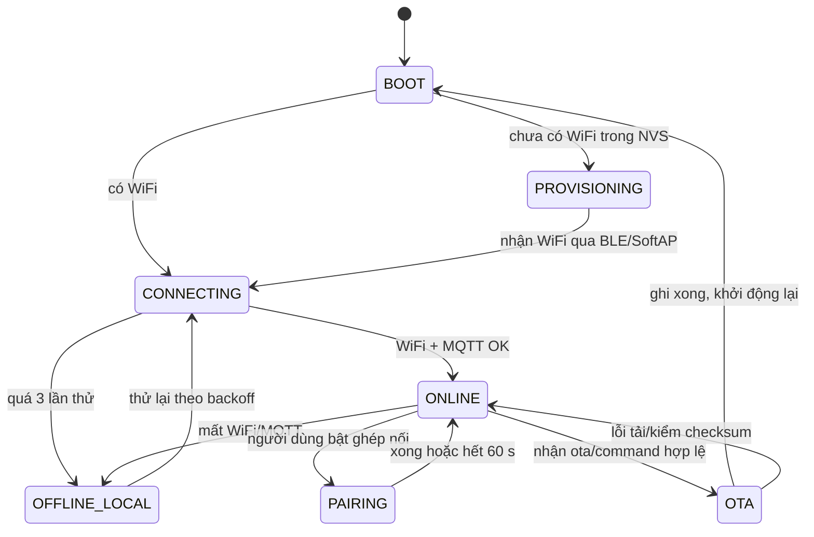

# DESIGN_PATTERNS.md

> **Đề xuất design pattern cho Backend, Frontend (Web + Mobile) và Firmware.**
> Mỗi pattern được ghi theo cùng một khuôn: **vấn đề nó giải quyết → áp ở đâu → trạng thái**.
> - **Đang dùng** — đã có trong code (ghi file). Giữ nguyên, code mới làm theo.
> - **Nên áp dụng** — chưa có, giải quyết một vấn đề cụ thể đang có hoặc sắp gặp (camera, ESP-NOW, OTA).
> - **Không nên** — pattern nghe hợp lý nhưng tốn công hơn lợi ích ở quy mô đồ án.
>
> Nguyên tắc chọn: **pattern phải trả lời một vấn đề có thật trong repo này**. Không thêm lớp trừu tượng "cho đẹp". Khi phân vân, chọn cách đơn giản hơn.
>
> Tài liệu liên quan: [API Design](API_DESIGN.md) (hợp đồng giữa các tầng), [Backend](architecture/BACKEND_REFACTOR_SMARTHOME.md), [Frontend](architecture/FRONTEND_REFACTOR_SMARTHOME.md), [Mobile](architecture/MOBILE_APP_ARCHITECTURE.md), [Firmware](firmware/EMBEDDED_ARCHITECTURE_ESP_IDF.md) §4–9, [IoT Node Network](firmware/IOT_NODE_NETWORK.md), `backend/src/modules/README.md`.
>
> Cập nhật: 2026-10-26.

---

## MỤC LỤC

1. [Tóm tắt một trang](#1-tóm-tắt-một-trang)
2. [Pattern xuyên tầng](#2-pattern-xuyên-tầng)
3. [Backend](#3-backend)
4. [Frontend Web](#4-frontend-web)
5. [Mobile](#5-mobile)
6. [Firmware](#6-firmware)
7. [Pattern không nên dùng](#7-pattern-không-nên-dùng)
8. [Thứ tự áp dụng](#8-thứ-tự-áp-dụng)
9. [Checklist cho review](#9-checklist-cho-review)

---

## 1. TÓM TẮT MỘT TRANG

| Tầng | Đang dùng (giữ) | Nên áp dụng (ưu tiên cao → thấp) |
|---|---|---|
| **Xuyên tầng** | Signed Envelope (HMAC), Correlation ID + Request–Reply, Mapper/DTO | Idempotency key + chống trùng, Retry có backoff + jitter, Contract-first |
| **Backend** | Modular Monolith + Vertical slice (module → feature, `check:arch`), Controller → Handler → Repository, Read Model, Middleware chain, Policy (RBAC), Unit of Work (`withTransaction`), Observer (`eventBus`), Strategy (simulator), Pending-request registry | **Ingest Pipeline dùng chung cho HTTP + MQTT**, Strategy registry cho trigger/action automation, Port–Adapter cho lưu ảnh, Fan-out hub cho live camera |
| **Frontend Web** | Monorepo + package dùng chung, Feature folders, Custom hook bọc SWR, Query-key factory, API client duy nhất, Error-code → thông điệp | State machine cho lệnh điều khiển, Adapter mock ↔ API cho phần còn mock |
| **Mobile** | Clean Architecture theo feature, Repository interface + remote/mock, Riverpod làm DI + state, Mapper, Realtime có fallback polling | Một nguồn sự thật cho sự kiện realtime, State machine cho provisioning/ghép nối, phiên live camera gắn vòng đời màn hình |
| **Firmware** | Module hoá theo `lib/<module>` | **Layered + HAL/Driver**, **Active Object (task + queue)**, **State machine** tường minh, Observer (`esp_event`), Command + dispatcher table, Store-and-forward, Double buffering, Shared protocol component, Cấp phát tĩnh, Supervisor/Watchdog |

---

## 2. PATTERN XUYÊN TẦNG

Các pattern này xuất hiện ở **nhiều tầng cùng lúc**; phải hiện thực giống nhau ở mọi nơi.

| Pattern | Vấn đề | Áp ở đâu | Trạng thái |
|---|---|---|---|
| **Signed Envelope** | Ai cũng có thể publish MQTT / gọi `/api/device` giả danh thiết bị | Payload mang `ts` + `hmac`; bên nhận kiểm trước khi đọc nội dung. Chuỗi ký ở [API Design](API_DESIGN.md) §3 | Đang dùng (`modules/devices/domain/hmac.service.ts`, `modules/control/`, `firmware/*/lib/hmac_util`) |
| **Correlation ID + Request–Reply qua kênh bất đồng bộ** | MQTT không có "response"; backend cần biết lệnh nào đã được thực hiện | `command_id` (UUID) đi trong lệnh, quay lại trong ack. Backend giữ bảng chờ có timeout 5 s | Đang dùng ở backend (`modules/control/domain/pending-acks.ts`); firmware **phải** giữ nguyên `command_id` qua ESP-NOW xuống node và ngược lại |
| **Mapper / DTO** | Dữ liệu DB, dữ liệu API và model UI khác nhau; lộ cột nhạy cảm nếu trả thẳng row | Backend: `toCustomerDevice`, `toConsoleDevice`. Mobile: `device_mapper.dart`. Web: `console/api/types` | Đang dùng |
| **Idempotency key + chống trùng** | QoS 1 của MQTT và retry HTTP có thể giao **trùng**; ESP-NOW có thể gửi lại | Lệnh: bỏ qua `command_id` đã xử lý (node nhớ 8 id gần nhất). Telemetry ESP-NOW: `seq` theo node. Ảnh: `X-Command-Id` | Nên áp dụng (firmware + endpoint ảnh) |
| **Retry có backoff + jitter** | Mất mạng thì cả đàn thiết bị reconnect cùng lúc, dồn tải lên broker | Delay 1, 2, 4, 8… tới trần 30–60 s, cộng ngẫu nhiên ±20%. Mobile WS đã có backoff (`realtime_source.dart`) | Nên áp dụng cho gateway (MQTT, HTTPS, kéo luồng camera) và thêm jitter cho Mobile |
| **Contract-first** | Ba nhóm (backend, app, firmware) code song song, lệch tên trường | Chốt hợp đồng trong [API Design](API_DESIGN.md) trước khi code; tầng nào đổi thì sửa tài liệu cùng commit | Nên áp dụng — đúng quy trình "plan" trong `CLAUDE.md` |

---

## 3. BACKEND

### 3.1. Đang dùng — giữ và làm theo

| Pattern | Vấn đề | Ở đâu |
|---|---|---|
| **Modular Monolith** | Một tiến trình dễ chạy, dễ demo; nhưng vẫn cần ranh giới domain rõ | `backend/src/modules/<domain>` (`identity`, `homes`, `devices`, `telemetry`, `control`, `automation`…), ghép ở `app.module.ts` |
| **Vertical slice (module → feature) + quy tắc phụ thuộc kiểm tự động** | Mỗi use case gom một chỗ (`features/<f>/`), module chỉ lộ `index.ts`; để ranh giới không mục dần theo thời gian | `modules/<m>/{domain,infrastructure,features}`; `npm run check:arch` (`backend/tools/check-architecture.mjs`, chạy trong CI) kiểm tầng, cửa `index.ts`, feature không gọi feature, chủ sở hữu bảng — luật L1–L4, T1–T3, C1 ở `modules/README.md` §3 |
| **Layered trong feature: Controller → Handler → Repository** | Tách HTTP, nghiệp vụ, SQL; SQL chỉ nằm một chỗ | `features/<f>/<f>.{controller,handler}.ts` + `infrastructure/*.repository.ts`; quy ước "SQL chỉ trong repository/read-model" (T1/T2) ở `modules/README.md` |
| **Read Model (CQRS nhẹ)** | Màn hình cần dữ liệu join nhiều bảng, khác mô hình ghi | `devices/infrastructure/device.read-model.ts` (`DEVICE_SELECT_SQL`, `latestReadings`) |
| **Middleware chain** | Auth, chống CSRF, rate limit, xác thực thiết bị áp cho cả nhóm route | `requireDashboard`, `requirePortalUser`, `requireMobileUser`, `csrfGuard` (`identity/guards/auth.guards.ts`), rate limit trong `core/http/rate-limit.ts` |
| **Factory theo kênh** | Mobile và Portal dùng chung nghiệp vụ, khác cách xác thực | `buildCustomerRouter(channel)` trong `app.module.ts`: mỗi module gắn handler qua móc `customer` |
| **Policy / Permission matrix** | RBAC 2 tầng phải nhất quán ở mọi endpoint | `homes/domain/permissions.ts` (`ROLE_PERMISSIONS`) + guard `requireHomeMember`, `requireDeviceAccess` — 404/403 đúng bất biến 6 |
| **Unit of Work** | Tạo nhà, claim ghi nhiều bảng phải cùng thành công hoặc cùng huỷ (bất biến 9) | `withTransaction(conn => …)` trong `infrastructure/database/db.ts`; hàm nhận `Queryable` |
| **Observer / in-process Event Bus** | Ingest, lệnh, thông báo cần báo cho WS hub, automation mà không gọi thẳng nhau | `shared/events/event-bus.ts`; phát `telemetry`, `device_state`, `notification`, `home_changed`; nghe ở `realtime/features/mobile-ws/`, `automation/features/run-automation-engine/` |
| **Strategy (đăng ký handler)** | Thiết bị giả lập và thiết bị thật nhận lệnh theo 2 cách khác nhau | `registerSimulatedCommandHandler` trong `modules/control/domain/simulated-command.ts` |
| **Pending-request registry** | Chờ ack MQTT có timeout, không rò bộ nhớ | `pendingAcks` + `registerPending` trong `control/domain/pending-acks.ts` (đăng ký **trước** khi publish) |
| **Optimistic lock bằng UPDATE có điều kiện** | Hai số đo đến cùng lúc không được kích hoạt một luật hai lần | `automation/features/run-automation-engine/`: "giành quyền chạy" bằng `UPDATE … WHERE last_condition_state = …` |

### 3.2. Nên áp dụng

#### a) Ingest Pipeline dùng chung cho HTTP và MQTT — **ưu tiên cao nhất**

**Vấn đề (có thật):** đường HTTP (`telemetry/features/ingest-http/`: `validate-device.middleware.ts` + `ingest-http.handler.ts`) và đường MQTT (`telemetry/features/ingest-mqtt/`) **chép lặp** cùng một chuỗi: kiểm HMAC gateway → kiểm HMAC node → `INSERT sensor_data` → `onTelemetryIngested` → cập nhật `last_seen`. Bất biến 4 ("hai đường phải cùng logic") hiện chỉ được giữ bằng cách sửa tay hai nơi.

**Hiện trạng sau refactor module → feature:** hai đường đã gọi chung hàm xác thực của `modules/devices` (`verifyGatewayHMAC`, `verifyDeviceHMAC`, `registerAuthFailure`) và bước `markGatewayAndSensorSeen` trong `telemetry/domain/ingest-common.ts`, nên lõi HMAC và chính sách khoá thiết bị chỉ còn một nơi. Nhưng *pipeline* (parse, thứ tự các bước, `insertSensorData`, `onTelemetryIngested`) vẫn nằm ở hai handler; hợp nhất thành lõi duy nhất dưới đây vẫn là bước tiếp theo.

**Pattern:** *Pipeline* (Template Method dạng hàm) + *Adapter* cho từng transport. Lõi xác thực và ghi dữ liệu viết **một lần**; HTTP và MQTT chỉ là adapter đổi request/message thành input và đổi kết quả thành response/log.

```ts
// modules/telemetry/domain/ingest-pipeline.ts — lõi duy nhất (đề xuất, chưa có)
export type IngestResult =
  | { ok: true; sensorDbId: number }
  | { ok: false; status: 400 | 401 | 403; code: string };

export async function ingestGatewayPayload(body: unknown, transport: "http" | "mqtt", ip?: string): Promise<IngestResult> {
  // 1. parse + kiểm trường bắt buộc
  // 2. verifyGatewayHMAC → verifyDeviceHMAC
  // 3. withTransaction: INSERT sensor_data
  // 4. onTelemetryIngested(...) rồi cập nhật last_seen
}

// features/ingest-http — adapter HTTP
router.post("/", async (req, res) => {
  const r = await ingestGatewayPayload(req.body, "http", clientIp(req));
  r.ok ? res.status(201).json({ ok: true }) : res.status(r.status).json({ error: r.code });
});

// features/ingest-mqtt — adapter MQTT
client.on("message", (_t, buf) => void ingestGatewayPayload(safeJson(buf), "mqtt"));
```

Lợi ích: bất biến 4 được đảm bảo **bằng cấu trúc code**, không bằng kỷ luật; ingest ảnh camera và topic `home/.../telemetry` sau này chỉ thêm adapter.

#### b) Strategy registry cho trigger và action của automation

**Vấn đề:** `automation/features/run-automation-engine/` hiện xử lý 2 loại trigger (`sensor_threshold`, `schedule`) bằng code riêng. Camera sẽ thêm trigger `motion`, node phòng khách có thể thêm action `dimmer` — mỗi lần thêm phải sửa lõi engine.

**Pattern:** *Strategy* + *Registry*. Mỗi loại trigger/action là một object cùng interface; engine chỉ tra bảng.

```ts
interface TriggerStrategy { type: string; subscribe(onFire: (ruleId: number, ctx: FireContext) => void): () => void; }
interface ActionStrategy  { type: string; execute(rule: RuleRow, ctx: FireContext): Promise<void>; }

const triggers = new Map<string, TriggerStrategy>([["sensor_threshold", thresholdTrigger], ["schedule", scheduleTrigger]]);
// Thêm camera: triggers.set("motion", motionTrigger) — engine không đổi
```

Giữ nguyên các đảm bảo hiện có: UPDATE có điều kiện để chống chạy đôi, mọi action đi qua `sendDeviceCommand` (bất biến 8).

#### c) Port–Adapter cho lưu ảnh camera

**Vấn đề:** endpoint ảnh dự kiến ([API Design](API_DESIGN.md) §8) cần lưu file. Demo lưu đĩa cục bộ; thiết kế đích ([Backend](architecture/BACKEND_REFACTOR_SMARTHOME.md)) dùng Object Storage.

```ts
interface SnapshotStore {
  put(deviceId: number, jpeg: Buffer): Promise<{ key: string }>;
  open(key: string): Promise<NodeJS.ReadableStream>;
  remove(key: string): Promise<void>;
}
// LocalDiskSnapshotStore (V2) — S3SnapshotStore (sau này). Service chỉ biết SnapshotStore.
```

Đường dẫn file **không** lộ ra client; client lấy ảnh qua endpoint có kiểm quyền theo nhà (bất biến 6).

#### d) Fan-out hub cho live camera (nếu làm xem từ xa)

**Vấn đề:** 1 gateway gửi khung JPEG lên, N người xem trên Mobile; mạng một người chậm không được làm chậm người khác hay làm đầy RAM server.

**Pattern:** *Publish–Subscribe* theo `deviceId` + *bounded buffer, drop-oldest* cho từng người xem. Khi người xem cuối rời → phát `live_stop` (giống `realtime/features/mobile-ws/mobile-ws.gateway.ts` đang quản lý kết nối theo nhà).

#### e) Gom job định kỳ về một Scheduler

**Vấn đề:** nhiều `setInterval` rải rác (automation tick, `run-habit-suggestions.job.ts`, `presence-monitor.job.ts`, các job purge) — khó tắt sạch khi test, khó biết job nào đang chạy.

**Hiện trạng:** worker đã được khai báo tập trung — mỗi module liệt kê trong `<m>.module.ts` (`AppModule.workers`), `main.ts` khởi động tất cả qua `listWorkers()` của `app.module.ts`. Vẫn thiếu phần còn lại của Scheduler: `intervalMs` do từng job tự quản, chưa có chống chạy chồng và `stopAll()`.

**Pattern:** một *Scheduler* nhỏ: đăng ký `{name, intervalMs, run}`, bọc try/catch, không chạy chồng nếu lần trước chưa xong, có `stopAll()`. Không cần thư viện cron.

---

## 4. FRONTEND WEB

### 4.1. Đang dùng — giữ và làm theo

| Pattern | Vấn đề | Ở đâu |
|---|---|---|
| **Micro-frontend trong monorepo** | 3 app (admin, operator, user) trùng nhiều màn hình; một app phình to thì khó tách việc | npm workspaces; app mỏng `apps/*` chỉ route + ghép; mỗi domain một package `packages/modules/<x>` (`@shh/<x>`) có cửa ra `index.ts`; nền chung `@shh/ui`, `@shh/api-client`, `@shh/utils` |
| **Vertical slice theo ca sử dụng** | Code theo domain + ca sử dụng dễ tìm, dễ xoá hơn theo loại file | `packages/modules/<x>/src/{api,model,ui,features/<ca-sử-dụng>}`; quy tắc phụ thuộc kiểm bằng `npm run check:arch` (`frontend/scripts/check-architecture.mjs`) |
| **Composition qua slot (render prop)** | Module không được import nhau mà trang cần phần của module khác | Feature nhận `renderTelemetry` / `renderLogs` / `renderDevices`, trang của app nối: `<DeviceDetailPage renderTelemetry={(p) => <DeviceTelemetryPanel {...p} />} />` |
| **Custom hook bọc SWR (stale-while-revalidate)** | Mỗi trang tự fetch, tự cache, tự poll sẽ lệch nhau | `useDeviceDetail`, `useDeviceList`… (trong `api/` của module) dùng `useDashboardSWR`, `refreshInterval` |
| **Query-key factory** | Chuỗi key viết tay dễ sai, khó `mutate` đúng chỗ | `deviceKey(id)` trong `modules/devices/src/api/devices.api.ts`; khoá mà nhiều module cùng làm mới ở `api-client/src/portal/keys.ts` |
| **API client duy nhất (Facade)** | Cookie, header `X-Portal`, 401, lỗi mạng xử lý một chỗ | `packages/api-client/src/http.ts` (`api`, `configureApi`, `FetchError`, `apiErrorCode`); cửa ra theo kênh `@shh/api-client/dashboard`, `/portal` |
| **Error-code → thông điệp** | UI phải hiện hướng dẫn tiếng Việt, không mã thô (bất biến 10) | `api-client/src/{dashboard,portal}/errors.ts`, `modules/auth/src/model/errors.ts` |

### 4.2. Nên áp dụng

#### a) State machine cho lệnh điều khiển

**Vấn đề:** một lệnh bật/tắt có thể mất tới 5 s (chờ ack), có thể `TIMEOUT`, `DEVICE_OFFLINE`. Dùng vài biến boolean (`loading`, `error`) dễ lọt trạng thái (bấm 2 lần, hiện "thành công" khi đã timeout).

```ts
type CommandState =
  | { kind: "idle" }
  | { kind: "sending"; action: "turn_on" | "turn_off" }
  | { kind: "acked"; power: boolean }
  | { kind: "failed"; code: string };      // map sang thông điệp tiếng Việt
// Nút bị khoá khi kind === "sending"; acked → mutate(deviceKey(id)) để SWR tải lại.
```

Không dùng optimistic update cho thiết bị thật: trạng thái chỉ đổi khi có ack (đúng nghĩa "đã bật").

#### b) Adapter mock ↔ API cho phần còn mock

**Vấn đề:** AI Dashboard và Admin Settings chưa có API. Khi nối API thật không được phải sửa từng component.

**Pattern:** truy cập dữ liệu chỉ nằm trong hook ở `api/` của module; bên trong hook chọn nguồn mock hoặc API. Component không biết dữ liệu đến từ đâu — cách Mobile đang làm với `USE_MOCK`. `@shh/ai` đã theo cách này (`api/useAiDashboard.ts` đọc `model/mockData.ts`, component trong `ui/` chỉ nhận props); `@shh/settings` còn giá trị cố định trong component.

#### c) Giữ polling cho Dashboard

Dashboard nhân viên **không cần** WebSocket: SWR poll 5 s đủ cho màn hình giám sát, ít code, không thêm kênh realtime thứ hai cần bảo mật. Chỉ xem lại khi số người dùng Dashboard đồng thời lớn.

---

## 5. MOBILE

### 5.1. Đang dùng — giữ và làm theo

| Pattern | Vấn đề | Ở đâu |
|---|---|---|
| **Clean Architecture theo feature** | Tách UI, nghiệp vụ, nguồn dữ liệu; test được domain | `mobile/lib/features/<feature>/{data,domain,presentation}` |
| **Repository interface + 2 hiện thực** | Chạy app không cần backend (demo, test) | `device_repository.dart` (interface) + `device_remote_repository.dart` / `device_mock_repository.dart`, chọn theo `USE_MOCK` (`core/config/app_config.dart`) |
| **Riverpod làm DI + state** | Không dùng service locator toàn cục; dễ override khi test | `AsyncNotifier`, `Notifier`, `.autoDispose`, `.family` trong `presentation/providers` |
| **Mapper** | JSON API ≠ entity domain | `device_mapper.dart` |
| **Realtime có fallback** | WebSocket mất thì app vẫn phải cập nhật | `core/realtime/realtime_source.dart` (backoff 1→30 s), `realtime_controller.dart` (poll REST 15 s khi WS rớt) |

### 5.2. Nên áp dụng

#### a) Một nguồn sự thật cho sự kiện realtime

**Vấn đề:** cùng một thiết bị xuất hiện ở trang chủ, trang phòng, trang chi tiết. Nếu mỗi màn hình tự nghe WebSocket, dữ liệu dễ lệch.

**Pattern:** sự kiện WS (`telemetry`, `device_state`, `home_changed`) chỉ đi vào **một** chỗ — notifier của feature tương ứng — và notifier cập nhật state; mọi màn hình chỉ `watch` provider. `home_changed` → `invalidate` provider của nhà đó, không vá từng phần.

#### b) State machine cho provisioning và ghép nối

**Vấn đề:** đưa Gateway lên mạng qua BLE/SoftAP ([WiFi Provisioning](firmware/SMART_HOME_WIFI_PROVISIONING.md) §8) có nhiều bước, nhiều lỗi giữa chừng; người dùng có thể thoát app.

```dart
sealed class ProvisionState {}
class Scanning extends ProvisionState {}
class Handshaking extends ProvisionState {}
class SendingWifi extends ProvisionState {}
class WaitingOnline extends ProvisionState { final DateTime deadline; WaitingOnline(this.deadline); }
class Done extends ProvisionState {}
class Failed extends ProvisionState { final String code; Failed(this.code); } // map sang hướng dẫn tiếng Việt
```

`switch` trên sealed class buộc UI xử lý **mọi** trạng thái; Dart báo lỗi biên dịch nếu thiếu.

#### c) Phiên live camera gắn vòng đời màn hình

**Vấn đề:** xem trực tiếp tốn băng thông gateway; quên đóng là camera phát mãi.

**Pattern:** provider `.autoDispose` sở hữu kết nối WS `/cameras/:id/live` và timer gia hạn 30 s; rời màn hình → provider bị huỷ → đóng kết nối → backend phát `live_stop`. Không giữ phiên live trong state toàn cục.

---

## 6. FIRMWARE

Firmware hiện tại là **super-loop** Arduino (`setup()`/`loop()`), module hoá theo `lib/<module>` ([Firmware](firmware/EMBEDDED_ARCHITECTURE_ESP_IDF.md) §1). Các pattern dưới áp cho Gateway S3, Camera và Node phòng khách khi viết lại ([IoT Node Network](firmware/IOT_NODE_NETWORK.md) §8).

### 6.1. Bảng tổng hợp

| Pattern | Vấn đề | Áp ở đâu | Ưu tiên |
|---|---|---|---|
| **Layered + HAL/Driver interface** | Driver dính MQTT/ESP-NOW thì không test được, không đổi phần cứng được | Driver chỉ biết GPIO/I2C/SPI; không biết Home/MQTT ([Firmware](firmware/EMBEDDED_ARCHITECTURE_ESP_IDF.md) §7) | Cao |
| **Active Object (task + queue)** | Một việc chậm (HTTP 10 s) làm treo cả vòng lặp — đã gặp ở `sensor_registry.cpp` | Mỗi việc một task, giao tiếp bằng `xQueue` | Cao |
| **Finite State Machine** | Vòng đời thiết bị nhiều nhánh (provisioning, ghép nối, online, OTA, mất mạng); `if` lồng nhau dễ sai | Gateway, Node, phiên ghép nối, phiên luồng camera | Cao |
| **Observer (`esp_event`)** | Component gọi thẳng nhau → phụ thuộc chéo | `WIFI_CONNECTED → MQTT_START`… ([Firmware](firmware/EMBEDDED_ARCHITECTURE_ESP_IDF.md) §9) | Cao |
| **Command + dispatcher table** | Lệnh từ Server, từ màn hình, từ automation cục bộ cần xử lý giống nhau, có ack | Bảng `action → handler` ở Gateway và Node | Cao |
| **Shared protocol component** | 2 bản `hmac_util` khác API cho cùng thuật toán (đã xảy ra) | `firmware/common/`: HMAC, codec khung ESP-NOW, `sensor_payload` | Cao |
| **Store-and-forward (ring buffer)** | Mất Internet thì mất dữ liệu | Hàng đợi vòng trên thẻ TF của Gateway | Trung bình |
| **Double buffering / buffer pool** | Ảnh camera và khung LCD lớn; cấp phát lại mỗi khung gây phân mảnh, giật hình | Camera `fb_count=2`; Gateway 2 buffer RGB565 cho LCD | Trung bình |
| **Cấp phát tĩnh / object pool** | Heap phân mảnh sau nhiều ngày chạy | Cấp phát lúc khởi động; không `malloc` trong callback; tránh `Arduino String` ở đường nóng | Trung bình |
| **Supervisor + Watchdog** | Task treo im lặng, thiết bị "sống" nhưng không làm gì | Task Watchdog của ESP-IDF; mỗi task báo sống định kỳ | Trung bình |
| **Retry với backoff + jitter** | Reconnect dồn dập khi router khởi động lại | MQTT, HTTPS, kéo luồng camera, dò kênh ESP-NOW | Trung bình |
| **Config object có phiên bản trong NVS** | Đổi cấu trúc cấu hình sau OTA làm thiết bị đọc sai | Struct cấu hình có trường `schema_version`; migrate khi khởi động | Thấp |

### 6.2. Active Object: callback không bao giờ làm việc nặng

Callback nhận ESP-NOW chạy trong task WiFi của hệ thống — làm việc nặng ở đây làm rớt gói. Callback chỉ **chép gói vào queue** rồi trả về; task riêng xử lý.

```c
static QueueHandle_t s_rx_queue;   // tạo lúc khởi động: xQueueCreate(16, sizeof(espnow_rx_t))

static void on_espnow_recv(const esp_now_recv_info_t *info, const uint8_t *data, int len) {
    espnow_rx_t item;
    if (len > (int)sizeof(item.data)) return;
    memcpy(item.mac, info->src_addr, 6);
    memcpy(item.data, data, len);
    item.len = len;
    xQueueSend(s_rx_queue, &item, 0);           // không chờ: đầy thì bỏ gói, không treo task WiFi
}

static void forward_task(void *arg) {           // kiểm HMAC lớp 1, ký lớp 2, publish MQTT
    espnow_rx_t item;
    for (;;) {
        if (xQueueReceive(s_rx_queue, &item, portMAX_DELAY)) handle_frame(&item);
    }
}
```

Cùng nguyên tắc cho: HTTP server nhận ảnh (chép vào buffer pool, đẩy con trỏ vào queue), sự kiện cảm ứng LVGL.

### 6.3. State machine tường minh

Viết bảng chuyển trạng thái thay vì `if` rải rác. Ví dụ Gateway:



```c
typedef enum { ST_BOOT, ST_PROVISIONING, ST_CONNECTING, ST_ONLINE, ST_OFFLINE_LOCAL, ST_PAIRING, ST_OTA } gw_state_t;
typedef gw_state_t (*state_fn)(gw_event_t ev);
static const state_fn STATE_TABLE[] = { on_boot, on_provisioning, on_connecting, on_online, on_offline, on_pairing, on_ota };
// Một task duy nhất sở hữu trạng thái; các component chỉ gửi event vào queue của nó.
```

Ở `OFFLINE_LOCAL` Gateway **vẫn** nhận dữ liệu node, vẫn cho điều khiển tại chỗ, ghi đệm thẻ TF ([IoT Node Network](firmware/IOT_NODE_NETWORK.md) §7).

### 6.4. Command + dispatcher table

```c
typedef esp_err_t (*cmd_handler_t)(const cmd_t *cmd, cmd_result_t *out);

static const struct { const char *action; cmd_handler_t fn; } CMD_TABLE[] = {
    { "turn_on",    relay_on  },
    { "turn_off",   relay_off },
    { "snapshot",   cam_snapshot },     // chỉ có trong build Camera (Kconfig)
    { "live_start", cam_live_start },
    { "live_stop",  cam_live_stop },
};
// Mọi nguồn lệnh (MQTT từ Server, nút trên LCD, automation cục bộ) tạo cmd_t rồi gọi cùng dispatcher.
// Dispatcher: bỏ command_id đã xử lý (idempotency) → gọi handler → luôn trả ack, kể cả lỗi.
```

---

## 7. PATTERN KHÔNG NÊN DÙNG

| Pattern | Vì sao không, ở quy mô này |
|---|---|
| **Microservices** | Một nhóm nhỏ, một lần demo; tách service thêm network, deploy, tracing mà không giải quyết vấn đề nào hiện có. Modular Monolith đã có ranh giới domain |
| **CQRS đầy đủ / Event Sourcing** | Read Model đơn giản đã đủ; event store + projector là việc của thiết kế đích ([Backend](architecture/BACKEND_REFACTOR_SMARTHOME.md) §18), không phải V2 |
| **DI container (InversifyJS, tsyringe)** | Truyền phụ thuộc qua tham số hàm và module ES là đủ; container thêm decorator, reflect-metadata, khó đọc |
| **Generic Repository / BaseRepository** | Truy vấn mỗi domain khác nhau; lớp generic chỉ che SQL và khuyến khích `SELECT *` lộ cột nhạy cảm |
| **Đổi sang ORM giữa dự án** | SQL tay + `?` placeholder đang chạy, đã kiểm; đổi ORM là rewrite toàn bộ repository |
| **Redux / store toàn cục cho Web** | SWR cache đã là store cho dữ liệu server; state UI nhỏ để trong component |
| **Optimistic update cho lệnh thiết bị thật** | Hiện "đã bật" khi đèn chưa bật là sai sự thật; chờ ack (≤ 5 s) |
| **Kế thừa nhiều tầng trong C++ firmware** | Khó đọc, tốn bộ nhớ vtable, khó debug trên thiết bị; dùng struct + bảng hàm như mục 6.4 |
| **Cấp phát động trong callback/ISR** | Phân mảnh heap, có thể crash sau nhiều giờ chạy |

---

## 8. THỨ TỰ ÁP DỤNG

| # | Việc | Tầng | Lý do ưu tiên | Gắn với |
|---|---|---|---|---|
| 1 | Ingest Pipeline dùng chung HTTP + MQTT (3.2a) | Backend | Đóng rủi ro lệch bất biến 4 đang có; mọi ingest mới (ảnh, topic `home/...`) dựa trên nó | Bất biến 4 |
| 2 | Shared protocol component + Active Object + State machine Gateway (6.1–6.3) | Firmware | Nền cho mọi bước port Gateway S3 | [IoT Node Network](firmware/IOT_NODE_NETWORK.md) §9 bước 1–2 |
| 3 | Command + dispatcher + idempotency (6.4, mục 2) | Firmware | Backend đã gửi lệnh, firmware chưa nhận | §9 bước 3 |
| 4 | State machine lệnh điều khiển (4.2a) + một nguồn sự thật realtime (5.2a) | Web, Mobile | Hiển thị đúng kết quả lệnh thật | FR điều khiển thiết bị |
| 5 | Strategy registry automation (3.2b) | Backend | Trước khi thêm trigger `motion` từ camera | Camera |
| 6 | Port–Adapter lưu ảnh (3.2c), double buffering camera (6.1) | Backend, Firmware | Khi làm snapshot | FR-5.8 |
| 7 | Fan-out hub (3.2d), phiên live gắn vòng đời màn hình (5.2c) | Backend, Mobile | Chỉ khi làm xem từ xa | FR-5.8 (COULD) |
| 8 | Scheduler (3.2e), Store-and-forward (6.1), config có phiên bản | Backend, Firmware | Cải thiện độ bền, không chặn tính năng | — |

---

## 9. CHECKLIST CHO REVIEW

**Backend**
- [ ] SQL chỉ nằm trong repository/read-model; luôn dùng `?`.
- [ ] Chạy `npm run check:arch` (cùng `npx tsc --noEmit`) và không thêm ngoại lệ `arch-allow` khi chưa có lý do.
- [ ] Ghi ≥ 2 bảng nằm trong `withTransaction`.
- [ ] Endpoint theo nhà đi qua `requireHomeMember` / `requireDeviceAccess` / `requireRoomAccess` (404/403 đúng).
- [ ] Logic xác thực thiết bị chỉ ở **một** chỗ (sau khi có Ingest Pipeline).
- [ ] Module nói chuyện với nhau qua `eventBus` hoặc hàm export trong `index.ts` (facade), không import sâu vào file nội bộ.

**Web / Mobile**
- [ ] Dữ liệu server lấy qua hook/provider, không fetch trực tiếp trong component/widget.
- [ ] Lỗi hiển thị bằng thông điệp tiếng Việt qua bảng map mã lỗi.
- [ ] Lệnh điều khiển có trạng thái `sending` và khoá nút; không optimistic.
- [ ] Mobile: repository có cả bản remote và mock; provider tạm thời dùng `.autoDispose`.

**Firmware**
- [ ] Callback (ESP-NOW, WiFi, HTTP, ngắt) chỉ chép dữ liệu vào queue rồi trả về.
- [ ] Không `malloc`/`new` trong callback, không `Arduino String` ở đường nóng.
- [ ] Trạng thái thiết bị do một task sở hữu, chuyển trạng thái theo bảng.
- [ ] Lệnh luôn có ack, kể cả khi lỗi; `command_id` trùng bị bỏ qua.
- [ ] HMAC và codec khung lấy từ `firmware/common/`, không chép lại.
- [ ] Không log secret, mật khẩu WiFi, token (bất biến 2); không tắt kiểm chứng TLS (bất biến 3).
