# Sơ đồ kiến trúc kỹ thuật — Hệ thống nhà thông minh an toàn dựa trên IoT

> Mô tả **thiết kế đang chạy trong code** (nhánh `develop`, cập nhật 2026-11-17). Đọc từ trên xuống: mục 1 là bức tranh một trang, các mục sau đi dần vào chi tiết. Mỗi nhận định có đường dẫn file làm bằng chứng.

## 0. Cách đọc

| Nhãn | Ý nghĩa | Màu trong sơ đồ |
|---|---|---|
| **DONE** | Có code + cấu hình, chạy được đầu-cuối | xanh lá |
| **PARTIAL** | Mới có một phần, hoặc chưa chạy với phần cứng / máy thật | vàng cam |
| **MOCKUP** | Dữ liệu hoặc hành vi giả phục vụ demo | xanh dương nhạt |
| **NOT IMPLEMENTED** | Chưa có code | đỏ |

Lưu ý về mức kiểm chứng: firmware chữ ký v2 đã build đạt nhưng **chưa nạp lại lên board**; app Mobile mới chạy test trên backend giả, **chưa chạy trên điện thoại thật**.

## 1. Tổng quan một trang

### 1.1 Hệ thống gồm những gì

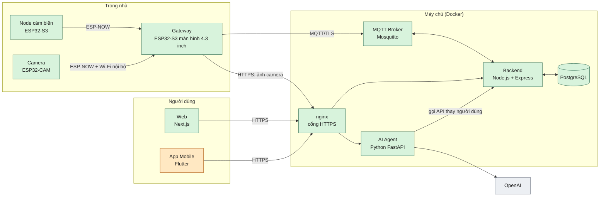

Hệ thống có 3 tầng nối tiếp nhau:

1. **Trong nhà**: Node và Camera không có Internet, chỉ nói chuyện với Gateway.
2. **Gateway** là thiết bị duy nhất trong nhà đi ra Internet, mang dữ liệu lên máy chủ.
3. **Máy chủ** lưu dữ liệu, gửi lệnh xuống Gateway và phục vụ Web/App. Người dùng không bao giờ nói chuyện trực tiếp với thiết bị.

### 1.2 Mỗi chặng truyền thế nào, bảo vệ ra sao

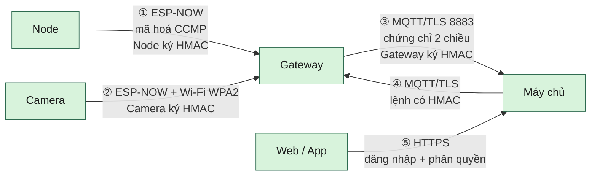

| Chặng | Đường truyền | Mã hoá đường truyền | Chứng minh ai gửi | Chống gửi lại gói cũ |
|---|---|---|---|---|
| ① Node → Gateway | ESP-NOW (Wi-Fi không cần router) | CCMP, khoá LMK riêng mỗi Node | Gateway chỉ nhận từ MAC đã ghép; Node **ký HMAC-SHA256** lên số đo bằng secret riêng — Gateway không biết secret này, chỉ máy chủ kiểm được | số `seq` + bộ đếm `ctr` tăng dần + thời gian ±300 s |
| ② Camera → Gateway | ESP-NOW (báo chuyển động) + Wi-Fi nội bộ do Gateway phát (gửi ảnh) | CCMP; WPA2 | Camera ký HMAC lên mỗi lần gửi ảnh bằng secret camera (chữ ký không gồm nội dung ảnh — toàn vẹn ảnh dựa vào WPA2) | `ctr` + thời gian ±300 s |
| ③ Gateway → Máy chủ | MQTT qua TLS, cổng 8883 (ảnh camera đi HTTPS 443) | TLS 1.2 | **Chứng chỉ client** của Gateway (mTLS) + Gateway **ký HMAC lớp thứ hai** bọc chữ ký của Node | `ctr` + thời gian ±300 s, máy chủ lưu `ctr` cuối cùng |
| ④ Máy chủ → Gateway → Node | MQTT/TLS rồi ESP-NOW | TLS; CCMP | Máy chủ ký HMAC lên lệnh bằng secret Gateway | mã lệnh `command_id` dùng 1 lần + thời gian ±300 s |
| ⑤ Web/App → Máy chủ | HTTPS qua nginx | TLS 1.2/1.3 | Web: cookie phiên; App: access token + refresh token | token hết hạn, refresh token dùng 1 lần |

**Ý chính khi trình bày:** dữ liệu của Node được ký **hai lớp**. Lớp trong do Node ký, lớp ngoài do Gateway ký. Máy chủ kiểm cả hai, nên kể cả khi Gateway bị chiếm, kẻ tấn công vẫn không làm giả được số đo của Node.

## 2. System Architecture

### 2.1 Bốn tầng và công nghệ

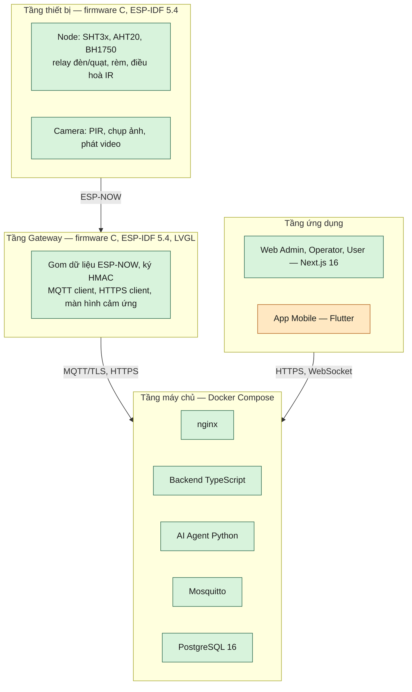

### 2.2 Thành phần và trạng thái

| Thành phần | Vai trò | Công nghệ | Trạng thái | Bằng chứng |
|---|---|---|---|---|
| Node phòng khách | Đo nhiệt độ, độ ẩm, ánh sáng; bật/tắt đèn, quạt; kéo rèm; điều hoà IR; màn hình bấm tại chỗ | ESP32-S3, ESP-IDF 5.4 | DONE (bản v2 chưa nạp lại board) | `firmware/esp32_s3_firmware_node/` |
| Camera | Phát hiện chuyển động, chụp ảnh, phát video MJPEG | ESP32-CAM, ESP-IDF | DONE (bản v2 chưa nạp lại board) | `firmware/esp32_cam/` |
| Gateway | Trung tâm nhà, cầu nối ESP-NOW ↔ máy chủ, màn hình điều khiển | ESP32-S3-Touch-LCD-4.3B, LVGL | DONE (bản v2 chưa nạp lại board) | `firmware/ESP32-S3-Touch-LCD-4.3B-BOX-Demo/ESP-IDF/08_lvgl_Porting/` |
| MQTT Broker | Trung chuyển tin nhắn Gateway ↔ Backend | Mosquitto 2, TLS 8883, mTLS bắt buộc | DONE | `infra/mosquitto/mosquitto.conf`, `infra/mosquitto/acl` |
| nginx | Cổng vào duy nhất từ bên ngoài, giữ chứng chỉ HTTPS | nginx, 80 → 443 | DONE | `infra/nginx/nginx.conf` |
| Backend | API, WebSocket, xử lý dữ liệu, gửi lệnh, tự động hoá | Node.js, Express 5, TypeScript | DONE | `backend/src/app.ts`, `app.module.ts` |
| AI Agent | Hiểu câu nói/gõ tiếng Việt, đề xuất kế hoạch cho Backend thực hiện | **Python, FastAPI**, OpenAI (STT + Responses API) — dịch vụ riêng, không nằm trong Backend | DONE | `agent/src/smarthome_agent/` |
| Cơ sở dữ liệu | Người dùng, nhà, thiết bị, số đo, nhật ký | PostgreSQL 16 | DONE | `infra/postgres/migrations/001_schema.sql` |
| Web | Console Admin/Operator và cổng khách hàng | Next.js 16, React 19 | DONE | `frontend/apps/{admin,operator,user}` |
| App Mobile | App khách hàng | Flutter | PARTIAL (chưa chạy trên máy thật) | `mobile/lib/` |
| OTA firmware | Cập nhật firmware từ xa | Backend tạo job + gửi lệnh; Gateway mới nhận và kiểm lệnh, **chưa tải/ghi firmware** | PARTIAL | `gw_app.c:267-270`, `backend/src/modules/ota/` |
| Thiết bị mô phỏng | Thiết bị ảo khi không có phần cứng (`is_simulated = 1`) | trong Backend | MOCKUP | `backend/src/modules/simulator/` |
| Chế độ mock của App | Dữ liệu giả để chạy App không cần máy chủ | `--dart-define=USE_MOCK=true` | MOCKUP | `mobile/lib/mock/` |
| Ghép nối tự động (BLE/SoftAP) | Cấp danh tính, khoá cho thiết bị mới | — hiện nạp tay file `nvs_dev.csv` | NOT IMPLEMENTED | `gw_registry.h` |
| Mã hoá bộ nhớ chip (Flash/NVS Encryption, Secure Boot) | Bảo vệ secret khi bị lấy chip | — | NOT IMPLEMENTED | `docs/firmware/PRODUCTION_HARDENING.md` |
| Thông báo đẩy (FCM/APNs), email | Báo ra ngoài ứng dụng | — chỉ có thông báo trong app | NOT IMPLEMENTED | không có trong `backend/src`, `mobile/lib` |

### 2.3 Triển khai trên máy chủ (Docker)

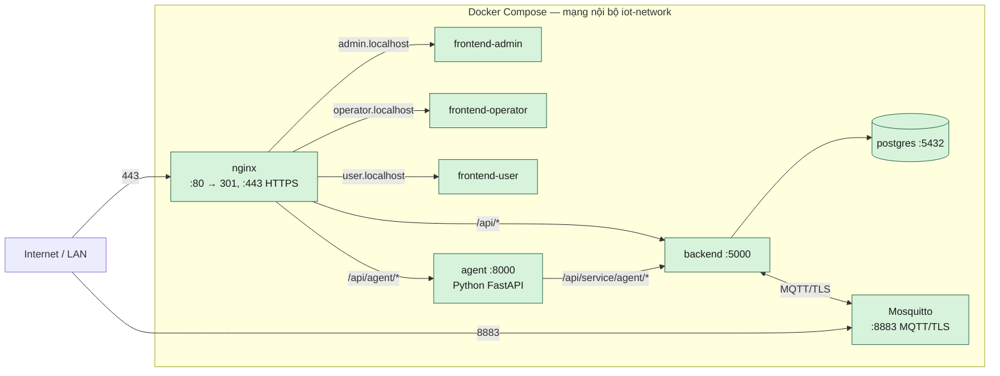

- Bản production (`compose.prod.yaml`) chỉ mở ra ngoài **3 cổng**: 80 (chỉ chuyển hướng), 443 và 8883. Backend, Agent và PostgreSQL chỉ nằm trong mạng Docker.
- Bản dev (`compose.yaml`) mở thêm cổng backend `:5000` và các frontend `:3001–3003` để tiện thử; PostgreSQL chỉ bind `127.0.0.1:5433`.
- nginx trả 404 cho `/api/service/*` ở mọi tên miền: kênh này chỉ dành cho Agent gọi Backend bên trong mạng Docker.

### 2.4 Bên trong Backend

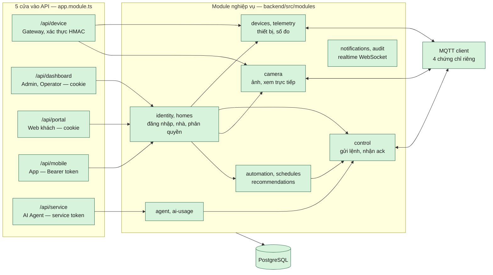

- Mỗi module là một "lát dọc" `domain / infrastructure / features`, chỉ gọi nhau qua `index.ts`; quy tắc kiểm bằng `npm run check:arch` (`backend/src/modules/README.md`).
- Mọi lệnh điều khiển — người bấm, tự động hoá, hẹn giờ, Trợ lý AI — đều đi qua **một hàm** `sendDeviceCommand` (`control/features/send-device-command/`).
- Backend dùng **4 kết nối MQTT với 4 chứng chỉ riêng** (nhận số đo, nhận heartbeat, nhận sự kiện camera, gửi lệnh); mỗi chứng chỉ chỉ có đúng quyền nó cần (`infrastructure/mqtt/broker.ts`, `infra/mosquitto/acl`).
- Sự kiện nội bộ (số đo mới, trạng thái thiết bị, thông báo) đi qua `shared/events/event-bus.ts` tới WebSocket của App, automation engine và bộ ghi thói quen.
- Route cũ của Prototype (`/api/auth`, `/api/devices`, …) còn giữ cho kịch bản demo tấn công `tests/security/attack_demo*.sh` (`modules/legacy/`).

### 2.5 Bên trong firmware

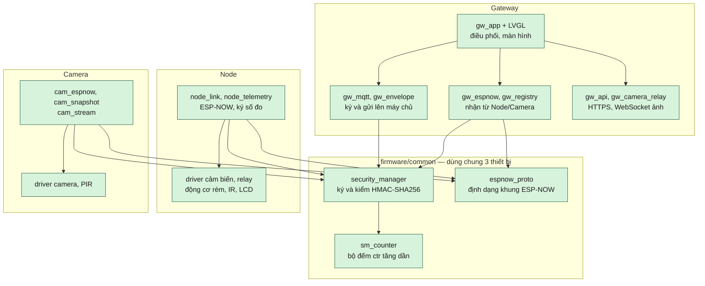

Danh tính (`device_id`, secret, khoá LMK, chứng chỉ MQTT) nằm trong NVS của từng chip và đang được nạp tay bằng `nvs_dev.csv` (`gw_config.h`, `node_config.h`, `gw_registry.h`). Secret chỉ được đọc trong `gw_config.c` / `gw_registry.c`; phần code khác chỉ gọi hàm ký/kiểm.

### 2.6 AI Agent — dịch vụ Python riêng

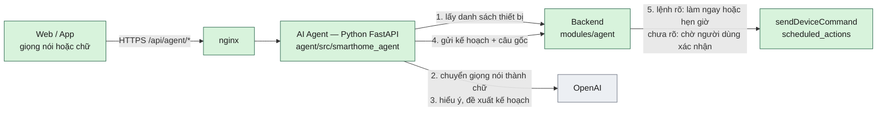

- Agent viết bằng **Python (FastAPI)**, chạy trong container riêng, tách khỏi Backend Node.js. Agent lo phần "hiểu ý" (STT + LLM), còn **quyết định có làm hay không** nằm ở Backend (`backend/src/modules/agent/domain/explicit-step.ts`, `step-rules.ts`).
- LLM chỉ có 2 công cụ: `ask_clarification` (hỏi lại) và `propose_plan` (đề xuất kế hoạch); không có công cụ nào điều khiển thiết bị trực tiếp.
- Agent không có quyền riêng: mỗi lần gọi Backend đều kèm service token **và** phiên của chính người dùng, nên Agent chỉ làm được những gì người đó được phép (`agent/src/smarthome_agent/clients/backend/client.py`, `backend/src/core/auth/service-token.ts`).

## 3. Data Flow Diagram

### 3.1 Ba luồng dữ liệu chính

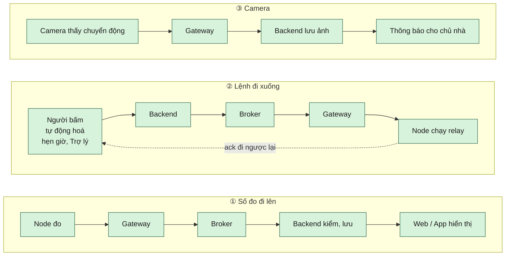

Topic MQTT đang dùng (`infra/mosquitto/acl`):

| Hướng | Topic | Nội dung |
|---|---|---|
| Gateway → Server | `gateway/<gw>/data` | Số đo của Node (2 chữ ký) |
| Gateway → Server | `home/<home>/gateway/<gw>/heartbeat` | Gateway còn sống, danh sách Node |
| Gateway → Server | `home/<home>/gateway/<gw>/device/<dev>/command/ack` | Kết quả chạy lệnh |
| Gateway → Server | `home/<home>/gateway/<gw>/device/<cam>/camera/event` | Sự kiện chuyển động |
| Server → Gateway | `home/<home>/gateway/<gw>/device/<dev>/command` | Lệnh bật/tắt, đặt nhiệt độ, mở luồng camera |
| Server → Gateway | `home/<home>/gateway/<gw>/ota/command` | Lệnh OTA (Gateway mới ghi log) |

Ảnh camera và đường dự phòng khi mất MQTT đi HTTPS: `POST /api/device/camera/snapshot`, `POST /api/device/data`.

### 3.2 DFD mức 1

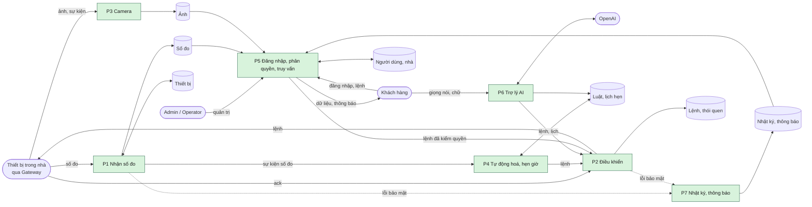

Thực thể ngoài chỉ trao đổi với tiến trình; kho dữ liệu chỉ được tiến trình đọc/ghi. Node và Camera không nói chuyện trực tiếp với máy chủ nên gộp vào "Thiết bị trong nhà".

## 4. Luồng end-to-end chi tiết

Mỗi luồng chia thành các **giai đoạn (GĐ)** nối tiếp nhau, đi qua đủ các thành phần từ thiết bị tới người dùng. Dưới mỗi sơ đồ là bảng **bảo mật theo giai đoạn**: ở giai đoạn đó kẻ tấn công có thể làm gì, và cái gì chặn lại.

### 4.1 Số đo: Node → Gateway → Server → Người dùng

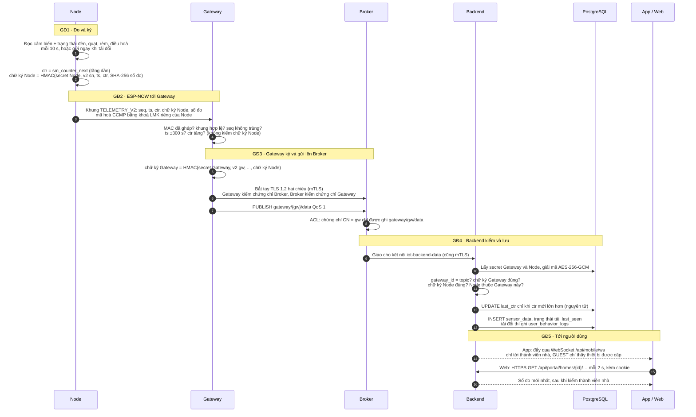

| GĐ | Kẻ tấn công thử… | Bị chặn bởi | Bằng chứng |
|---|---|---|---|
| 1 | Lấy chip Node, đọc secret trong bộ nhớ | **Chưa chặn**: NVS chưa mã hoá (điểm yếu 1) | `docs/firmware/PRODUCTION_HARDENING.md` |
| 2 | Nghe lén sóng ESP-NOW | CCMP + khoá LMK riêng mỗi thiết bị → không đọc được | `gw_espnow.h`, `node_link.h` |
| 2 | Thiết bị lạ giả làm Node | MAC không có trong danh sách ghép, không có LMK → bị bỏ | `gw_registry.h` |
| 2 | Thu khung rồi phát lại | `seq` trùng hoặc `ctr` không tăng → bị bỏ | `gw_espnow.h` |
| 3 | Dựng Broker giả để lừa Gateway (MITM) | Gateway kiểm chứng chỉ Broker bằng CA nhúng + so tên host (mục 5.3) | `gw_mqtt.c:361-376`, `gw_tls.h` |
| 3 | Kết nối Broker không có chứng chỉ, hoặc chứng chỉ đã thu hồi | `require_certificate`, `crlfile` → bắt tay TLS thất bại | `infra/mosquitto/mosquitto.conf` |
| 3 | Gateway A ghi vào topic của Gateway B | ACL `pattern write gateway/%u/data` | `infra/mosquitto/acl` |
| 4 | Sửa số đo trên đường đi | SHA-256 số đo đổi → chữ ký Node sai → `SENSOR_AUTH_FAIL` | `telemetry/domain/ingest-auth.ts` |
| 4 | Gateway bị chiếm, tự chế số đo của Node | Gateway không có secret Node → chữ ký Node sai | `signature-v2.ts` |
| 4 | Gửi lại gói hợp lệ cũ | `ctr ≤ last_ctr` → `REPLAYED` | `devices.last_ctr`, `claimDeviceCounter` |
| 4 | Gateway gửi số đo của Node nhà khác | `SENSOR_GATEWAY_MISMATCH` | `ingest-auth.ts` |
| 4 | Gửi rác liên tục | sai chữ ký 5 lần qua MQTT → khoá thiết bị | `devices/domain/auth-failure.ts` |
| 4 | Lộ bản sao DB | secret thiết bị lưu dạng `enc1:` AES-256-GCM, khoá giải mã nằm ngoài DB | `devices/domain/secret-box.ts` |
| 5 | Người ngoài xem số đo nhà khác | phải đăng nhập + là thành viên nhà; không phải → 404 | `homes/domain/access-policy.ts` |
| 5 | Nghe lén Web/App | HTTPS/WSS (TLS 1.2/1.3) | `infra/nginx/nginx.conf` |

Khi mất MQTT, Gateway gửi **đúng gói đó** qua HTTPS `POST /api/device/data` (`gw_app.c:1153`). Backend kiểm bằng cùng hàm, nhưng lỗi trên đường này không khoá thiết bị — chỉ chặn 20 gói lỗi / 15 phút theo IP + gateway (`core/http/rate-limit.ts`).

### 4.2 Điều khiển: Người dùng → Server → Gateway → Node → kết quả

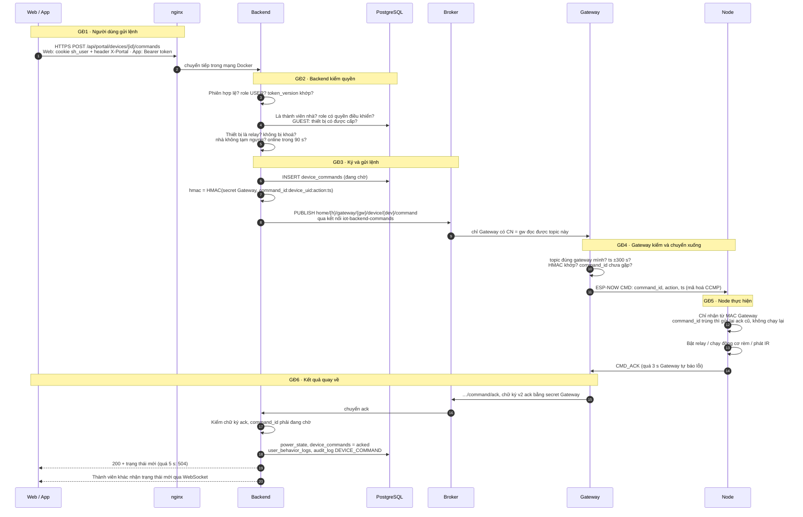

| GĐ | Kẻ tấn công thử… | Bị chặn bởi | Bằng chứng |
|---|---|---|---|
| 1 | Nghe lén hoặc sửa request | HTTPS | `nginx.conf` |
| 1 | Trang web lạ lừa trình duyệt gửi lệnh (CSRF) | Cookie `SameSite=Strict` + header `X-Portal` bắt buộc với request ghi | `identity/guards/auth.guards.ts` |
| 1 | Bấm liên tục | 60 lệnh / phút | `core/http/rate-limit.ts` |
| 2 | Điều khiển nhà người khác | không phải thành viên → 404 | `devices/domain/device-access.ts` |
| 2 | VIEWER cố điều khiển | thiếu quyền `control_device` → 403 | `homes/domain/permissions.ts` |
| 2 | Dùng phiên cũ sau khi chủ nhà đổi mật khẩu | `token_version` đổi → 401 | `identity/domain/session.service.ts` |
| 3 | Tự gửi lệnh lên Broker | chỉ `iot-backend-commands` được ghi topic lệnh (ACL); thiếu secret Gateway thì không ký được | `acl`, `gw_mqtt.h` |
| 4 | Phát lại một lệnh cũ | ts ±300 s + `command_id` chưa gặp | `gw_mqtt.h` |
| 4 | Lệnh cho Gateway nhà khác | ACL chỉ cho Gateway đọc topic mang tên mình; HMAC theo secret của từng Gateway | `acl` |
| 5 | Thiết bị lạ gửi lệnh thẳng cho Node | Node chỉ nhận từ MAC Gateway + CCMP | `node_link.h` |
| 5 | Lệnh bị gửi lặp | `command_id` trùng → không chạy lại | `node_link.h` |
| 6 | Giả ack "đã bật" | chữ ký v2 ack + ACL chỉ cho Gateway ghi topic của mình + `command_id` phải đang chờ | `control/features/command-ack/` |

Lệnh từ tự động hoá, hẹn giờ và Trợ lý AI vào thẳng GĐ3 qua cùng hàm `sendDeviceCommand` (`control/features/send-device-command/`). Bấm tại chỗ trên Gateway đi thẳng GĐ4 → GĐ5, trạng thái mới về Server qua số đo kế tiếp (luồng 4.1).

### 4.3 Camera: Chuyển động → Gateway → Server → Người dùng

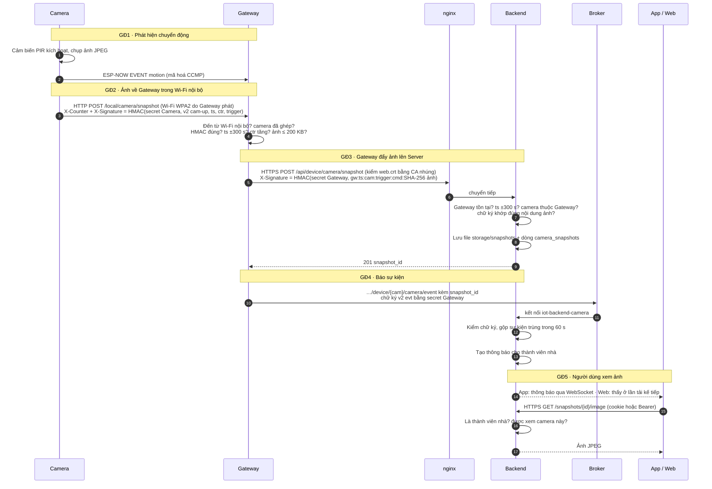

| GĐ | Kẻ tấn công thử… | Bị chặn bởi | Bằng chứng |
|---|---|---|---|
| 1 | Giả sự kiện chuyển động qua ESP-NOW | MAC đã ghép + CCMP | `cam_espnow.h`, `gw_espnow.h` |
| 2 | Vào Wi-Fi nội bộ của Gateway | WPA2; Camera không biết Wi-Fi thật của nhà | `gw_wifi.h` |
| 2 | Gửi ảnh giả lên Gateway | không có secret Camera → HMAC sai; `ctr` cũ → bị bỏ | `gw_local_http.h` |
| 2 | Sửa ảnh trên đường Camera → Gateway | **Chỉ dựa vào WPA2**: chữ ký Camera không băm nội dung ảnh (điểm yếu 4) | `gw_local_http.h:16` |
| 3 | Sửa ảnh trên đường Gateway → Server | TLS + chữ ký Gateway có SHA-256 ảnh | `camera/features/ingest-snapshot/ingest-snapshot.dto.ts` |
| 3 | Gửi ảnh vào camera nhà khác | camera phải thuộc đúng Gateway ký | `camera/domain/gateway-auth.ts` |
| 3 | Gửi rác liên tục | 30 ảnh / phút; 20 lỗi xác thực / 15 phút → 429 | `core/http/rate-limit.ts` |
| 4 | Giả sự kiện để spam thông báo | chữ ký v2 evt + ACL + gộp trùng 60 s | `camera/features/camera-event/` |
| 5 | Xem ảnh nhà người khác | không phải thành viên → 404 | `camera.module.ts`, `access-policy.ts` |

Nếu Camera không gửi ảnh kịp, Gateway vẫn báo sự kiện nhưng không kèm ảnh (`gw_app.c`, `MOTION_WAIT_US`).

### 4.4 Xem trực tiếp: Người dùng → Server → Gateway → Camera → ngược lại

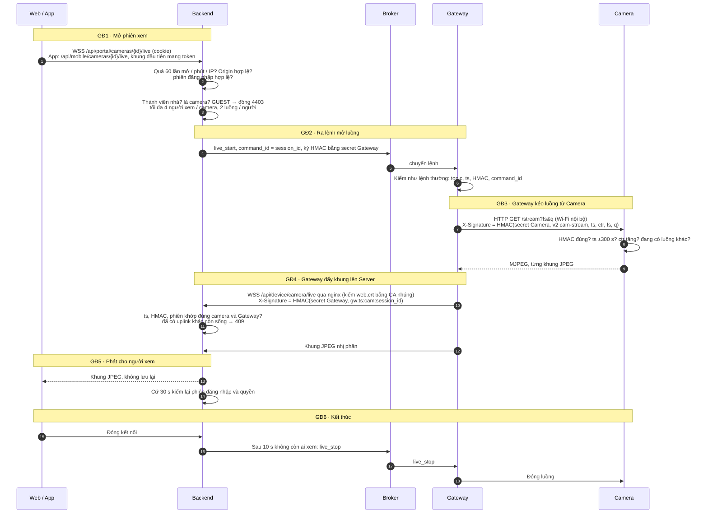

| GĐ | Kẻ tấn công thử… | Bị chặn bởi | Bằng chứng |
|---|---|---|---|
| 1 | Trang web lạ mở WebSocket bằng cookie của nạn nhân (CSWSH) | Kiểm `Origin` trước khi nâng cấp kết nối | `camera/features/live-relay/live-viewer.controller.ts` |
| 1 | Xem camera nhà khác | không phải thành viên → đóng 4404 | `live-viewer.run.ts` |
| 1 | Mở hàng loạt luồng làm nghẽn | 60 lần / phút / IP, 10 lần / phút / người, 4 người xem / camera | `camera/domain/live-session.ts` |
| 1 | Bị đuổi khỏi nhà nhưng vẫn đang xem | kiểm lại quyền mỗi 30 s | `live-session.ts` (`recheckMs`) |
| 2 | Giả lệnh `live_start` | HMAC secret Gateway + ACL | `publish-session-command.handler.ts` |
| 3 | Thiết bị lạ trong Wi-Fi nội bộ đòi luồng camera | không có secret Camera → 401 | `cam_stream.h` |
| 3 | Nghe lén khung trong Wi-Fi nội bộ | WPA2 (kênh này không có TLS) | `gw_camera_live.h` |
| 4 | Gửi khung giả lên Server | không có secret Gateway → HMAC sai; `session_id` phải khớp phiên đang mở | `live-uplink.controller.ts` |
| 4 | Phát lại kết nối uplink cũ để chiếm luồng | uplink thật còn sống → 409; chỉ thay khi uplink cũ im ≥ 3 s | `live-session.ts` |
| 5 | Nghe lén luồng trên Internet | WSS (TLS) cả hai đầu | `nginx.conf` |

Admin/Operator **không** có đường xem camera (quyền riêng tư): cookie nhân viên không phải `sh_user` (`live-viewer.controller.ts`).

## 5. Security Architecture

### 5.1 Bảo vệ theo từng chặng

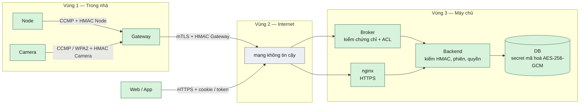

Mỗi lần dữ liệu đi qua ranh giới vùng đều phải qua **ba lớp**: mã hoá đường truyền, chứng minh danh tính người gửi, chống gửi lại gói cũ.

| Ranh giới | Mã hoá | Xác thực | Kiểm soát | Bằng chứng |
|---|---|---|---|---|
| Node/Camera → Gateway | CCMP (ESP-NOW), WPA2 (Wi-Fi nội bộ) | MAC đã ghép + khoá LMK; HMAC của Node/Camera | bỏ gói trùng `seq`, `ctr` tăng dần, thời gian ±300 s | `gw_espnow.h`, `gw_local_http.h`, `node_link.h` |
| Gateway → Broker | TLS 1.2 | Chứng chỉ client X.509, tên chứng chỉ = `gateway_id` | ACL: mỗi Gateway chỉ đọc/ghi topic mang tên mình | `mosquitto.conf`, `acl`, `gw_mqtt.c:361-376` |
| Broker → Backend | TLS 1.2 | Backend kiểm lại 2 chữ ký HMAC | Node phải thuộc Gateway gửi; `ctr` lớn hơn lần trước; sai 5 lần → khoá | `telemetry/domain/ingest-auth.ts` |
| Web/App → nginx → Backend | TLS 1.2/1.3 | Cookie (web) hoặc Bearer token (App) | Role hệ thống chọn kênh, role trong nhà chọn hành động | `identity/guards/auth.guards.ts`, `homes/domain/access-policy.ts` |
| Agent → Backend | mạng Docker nội bộ | Service token + phiên người dùng | Kiểm quyền như người dùng tự bấm | `core/auth/service-token.ts` |

### 5.2 Chữ ký HMAC hai lớp hoạt động thế nào

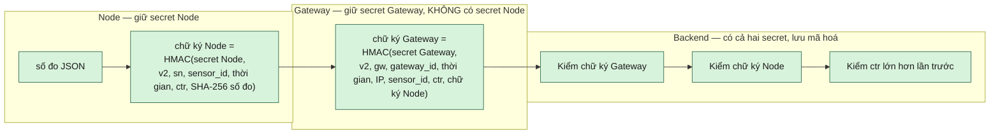

- **Sửa 1 ký tự số đo** → SHA-256 đổi → chữ ký Node sai.
- **Gateway bị chiếm**: ký được lớp ngoài nhưng không ký được lớp trong → không làm giả được số đo Node.
- **Gửi lại gói cũ** (replay) → `ctr` không lớn hơn giá trị đã lưu (`devices.last_ctr`) → bị từ chối.
- Thuật toán HMAC-SHA256, kết quả hex chữ thường, khớp từng byte giữa `backend/src/modules/devices/domain/signature-v2.ts`, `firmware/common/security_manager` và `tests/security/lib_v2.sh`.

### 5.3 CA nội bộ và chứng chỉ (PKI)

**Vì sao cần CA riêng.** Máy chủ chạy trên IP LAN, không có tên miền công khai, nên không lấy được chứng chỉ của CA công cộng như Let's Encrypt. Dự án tự dựng một **CA nội bộ** để ký mọi chứng chỉ TLS. Mỗi bên (Gateway, Backend, App) chỉ tin đúng CA này: chứng chỉ do CA khác ký đều bị từ chối, nên kẻ tấn công không dựng được máy chủ giả.

#### CA ký những chứng chỉ nào

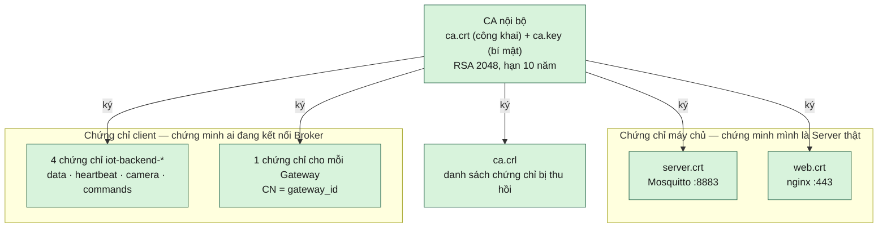

| Chứng chỉ | Loại khoá, hạn | Ghi trong chứng chỉ | Nằm ở đâu | Dùng cho |
|---|---|---|---|---|
| `ca.crt` / `ca.key` | RSA 2048, 10 năm; chỉ được ký chứng chỉ (`CA:TRUE, pathlen:0`) | — | `infra/mosquitto/certs/` trên máy quản trị. `ca.key` **không** đưa vào container nào, có thể mã hoá bằng `CA_KEY_PASS`. `ca.crt` phát cho mọi bên | Ký và kiểm mọi chứng chỉ khác |
| `server.crt` | RSA 2048, 825 ngày, `serverAuth` | Tên: `mqtt-broker`, `localhost`, IP LAN | Container Mosquitto | Broker chứng minh với Gateway và Backend |
| `web.crt` | RSA 2048, 825 ngày, `serverAuth` | Tên: `localhost`, `admin/operator/user.localhost`, IP LAN | Container nginx | HTTPS cho Web, App, và đường HTTPS của Gateway |
| `iot-backend-*.crt` (4 cái) | ECDSA P-256, 825 ngày, `clientAuth` | CN = tên kết nối | Container backend | Backend đăng nhập Broker, mỗi kết nối một quyền ACL |
| Chứng chỉ Gateway | ECDSA P-256, 825 ngày, `clientAuth` | CN = `gateway_id` | NVS Gateway `cloud/mqtt_cert`, `cloud/mqtt_key` | Gateway đăng nhập Broker |
| `ca.crl` | do CA ký | số serial các chứng chỉ bị thu hồi | Container Mosquitto | Broker từ chối chứng chỉ trong danh sách |

Nguồn: `infra/pki/lib.sh` (`CA_DAYS=3650`, `LEAF_DAYS=825`, extension `client_ext`), `infra/pki/gen_mqtt_certs.sh`, `infra/pki/gen_mqtt_client.sh`, `compose.yaml` (mount từng file, không mount `ca.key`).

Tách `server.crt` và `web.crt`: lộ khoá của nginx không giả được Broker, và ngược lại.

#### Ai kiểm ai khi bắt tay TLS

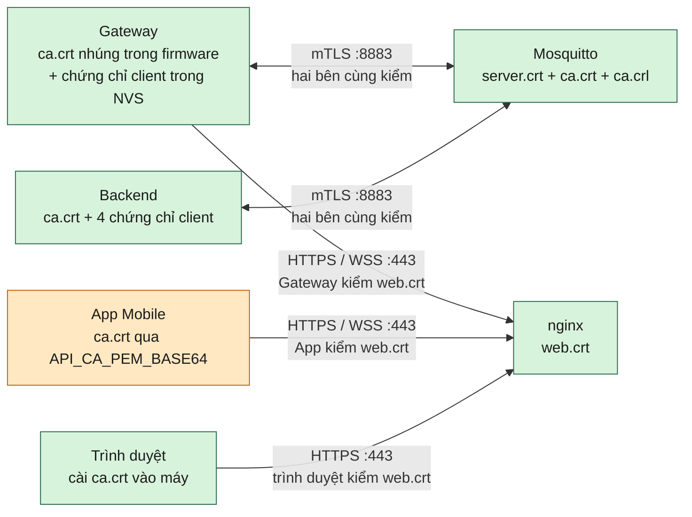

Bắt tay mTLS giữa Gateway và Broker gồm 4 bước:

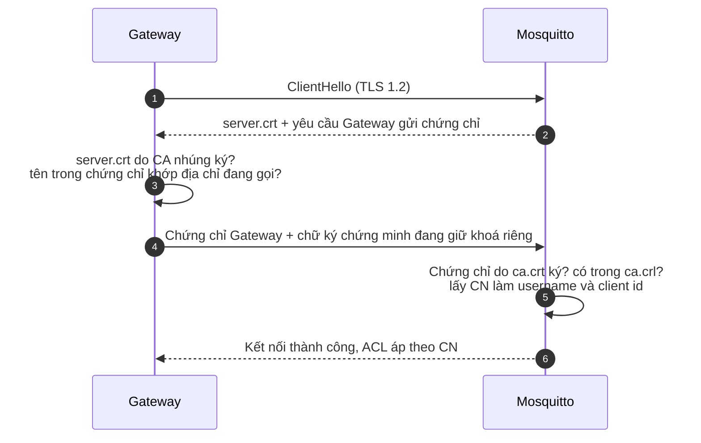

- **Gateway**: `gw_tls.h` không cho kết nối `mqtts://`/`https://` nếu thiếu CA nhúng; `mqtt://`/`http://` chỉ mở khi bật cờ dev `CONFIG_GW_DEV_ALLOW_PLAINTEXT` (đang tắt, `sdkconfig:618`). Thiếu chứng chỉ client thì không kết nối (`gw_mqtt.c:361-376`).
- **Backend**: `rejectUnauthorized: true`, luôn kiểm chứng chỉ Broker (`infrastructure/mqtt/broker.ts`).
- **Broker**: `require_certificate true`, `use_identity_as_username true`, `use_username_as_clientid true`, `crlfile` (`mosquitto.conf`).
- **App Mobile**: thêm CA nội bộ vào danh sách tin cậy, không tắt kiểm chứng (`mobile/lib/core/config/trusted_ca_io.dart`). Chưa pin chứng chỉ.
- **mbedTLS trên ESP32** so tên bằng SAN kiểu DNS, nên IP LAN được ghi cả dạng IP lẫn dạng DNS trong chứng chỉ (`gen_mqtt_certs.sh`).

#### Vòng đời chứng chỉ

```mermaid
flowchart LR
  A["1. Tạo CA + chứng chỉ máy chủ<br/>gen_mqtt_certs.sh IP_LAN"] --> B["2. Chép ca.crt vào firmware<br/>certs/mqtt_ca.crt, build Gateway"]
  B --> C["3. Cấp chứng chỉ Gateway<br/>gen_mqtt_client.sh gateway_id"]
  C --> D["4. Nạp vào NVS Gateway<br/>nvs_dev.csv: cloud/mqtt_cert, mqtt_key"]
  D --> E["5. Gateway kết nối Broker"]
  E --> F["6. Thu hồi khi mất / bị chiếm<br/>gen_mqtt_client.sh --revoke gateway_id"]
  F --> G["7. Cập nhật ca.crl<br/>restart mqtt-broker"]
  G --> H["Gateway không bắt tay được nữa<br/>khoá thêm trên Dashboard"]

  classDef done fill:#d8f3dc,stroke:#2d6a4f,color:#1b1b1b
  class A,B,C,D,E,F,G,H done
```

- **Đổi IP máy chủ**: chạy lại bước 1 để cấp lại `server.crt`/`web.crt`. CA giữ nguyên nên không phải nạp lại firmware.
- **Thay CA**: xoá `ca.*` rồi chạy lại. Khi đó phải build lại Gateway và cấp lại mọi chứng chỉ client.
- **Giới hạn hiện tại**:
  - Khoá riêng của Gateway nằm dạng rõ trong NVS; chưa có Secure Element/DS.
  - Chứng chỉ được cấp bằng script trên máy quản trị, chưa có CSR sinh trên thiết bị.
  - Thu hồi cần khởi động lại Broker.
  - Trình duyệt phải cài `ca.crt` thủ công thì mới không hiện cảnh báo.

### 5.4 Ai giữ khoá nào

| Khoá | Ở đâu | Dùng để | Ghi chú |
|---|---|---|---|
| CA nội bộ + chứng chỉ TLS | Xem mục 5.3 | mTLS Broker, HTTPS | `ca.key` không vào container |
| Secret Gateway | NVS Gateway + DB | Ký số đo lớp 2, heartbeat, ack; kiểm lệnh | DB lưu mã hoá AES-256-GCM (`devices/domain/secret-box.ts`) |
| Secret Node | NVS Node + DB | Ký số đo lớp 1 | Gateway **không** giữ |
| Secret Camera | NVS Camera + Gateway | Ký ảnh, mở luồng | Chỉ Gateway kiểm |
| Khoá LMK | Node/Camera + Gateway | Mã hoá ESP-NOW | Không có trên máy chủ |
| `JWT_SECRET`, `MOBILE_JWT_SECRET` | `.env` backend | Ký phiên web, access token App | Refresh token chỉ lưu SHA-256 |
| `SERVICE_API_TOKEN` | `.env` backend + agent | Agent gọi Backend | |
| `OPENAI_API_KEY` | `agent/.env` | Gọi OpenAI | |

### 5.5 Ma trận cơ chế bảo mật

| Nhóm | Cơ chế | Nơi thực thi | Trạng thái |
|---|---|---|---|
| Thiết bị | ESP-NOW mã hoá CCMP, chỉ nhận MAC đã ghép | `gw_espnow.h`, `node_link.h` | DONE |
| | HMAC-SHA256 hai lớp + `ctr` + thời gian ±300 s | `signature-v2.ts`, `ingest-auth.ts`, `security_manager` | DONE (firmware chưa nạp lại) |
| | Lệnh Server → Gateway có HMAC, `command_id` dùng 1 lần | `send-device-command.handler.ts`, `gw_mqtt.h` | DONE |
| | Khoá thiết bị sau 5 lần sai chữ ký (qua MQTT) | `devices/domain/auth-failure.ts` | DONE |
| | Phát hiện Gateway bị nhân bản (cảnh báo) | `devices/domain/gateway-clone-detector.ts` | DONE |
| | Ack và sự kiện camera chưa có `ctr` (chống lặp bằng `command_id` / 60 s) | `signature-v2.ts` | PARTIAL |
| | Ghép nối tự động, mã hoá bộ nhớ chip | — | NOT IMPLEMENTED |
| MQTT | TLS 1.2, bắt buộc chứng chỉ client, CRL, không cho ẩn danh | `mosquitto.conf` | DONE |
| | ACL theo tên chứng chỉ, Backend 4 danh tính | `acl` | DONE |
| Người dùng | Mật khẩu bcrypt; chống dò tài khoản bằng hash giả | `identity/features/login/login.handler.ts` | DONE |
| | Cookie HttpOnly, SameSite=Strict, Secure; header `X-Portal` chống CSRF | `identity/guards/` | DONE |
| | Access token App 15 phút, refresh token xoay vòng, dùng lại → thu hồi cả họ | `refresh-session.handler.ts` | DONE |
| | Đổi mật khẩu / khoá tài khoản làm mọi phiên mất hiệu lực ngay (`token_version`) | `session.service.ts` | DONE |
| Phân quyền | 2 tầng: role hệ thống + role trong nhà; không phải thành viên → 404, thiếu quyền → 403 | `permissions.ts`, `access-policy.ts` | DONE |
| | Operator cần được cấp quyền mới xem dữ liệu nhà khách, có ghi nhật ký | `access-policy.ts` | DONE |
| | Trợ lý AI chỉ tự làm lệnh rõ ràng, còn lại phải xác nhận | `modules/agent/domain/explicit-step.ts` | DONE |
| API | helmet, CORS danh sách cố định, giới hạn kích thước body, rate limit | `app.ts`, `core/http/rate-limit.ts` | DONE |
| Dữ liệu | Secret thiết bị trong DB mã hoá AES-256-GCM; role DB không phải superuser | `secret-box.ts`, `infra/postgres/init/00_init.sh` | DONE |
| | TLS giữa Backend và PostgreSQL | — dựa vào mạng Docker | NOT IMPLEMENTED |
| Nhật ký | `audit_log` ghi lỗi chữ ký, phát lại, đăng nhập sai, lệnh điều khiển | `modules/audit/` | DONE |

### 5.6 Điểm yếu còn lại

1. Secret và khoá LMK nằm dạng rõ trong bộ nhớ chip; chưa bật Flash/NVS Encryption, Secure Boot.
2. Ghép nối thiết bị là thủ công (nạp `nvs_dev.csv`).
3. Route cũ của Prototype vẫn mở để demo tấn công (`modules/legacy/`).
4. Ack và sự kiện camera chưa có bộ đếm `ctr`; chuỗi ký lệnh Server → Gateway chưa theo dạng `v2|`; chữ ký Camera → Gateway không băm nội dung ảnh (chặng Gateway → Server thì có SHA-256 ảnh).
5. Không có TLS giữa nginx/Backend/PostgreSQL bên trong mạng Docker.
6. Rate limit lưu trong RAM của một tiến trình; ở dev không bật `TRUST_PROXY` nên mọi request qua nginx tính chung một IP.
7. App Mobile chưa pin chứng chỉ; HSTS đang tắt để chạy `localhost`.
8. OTA chưa ghi firmware.

## 6. Authentication & Authorization Flow

### 6.1 Ai xác thực bằng gì

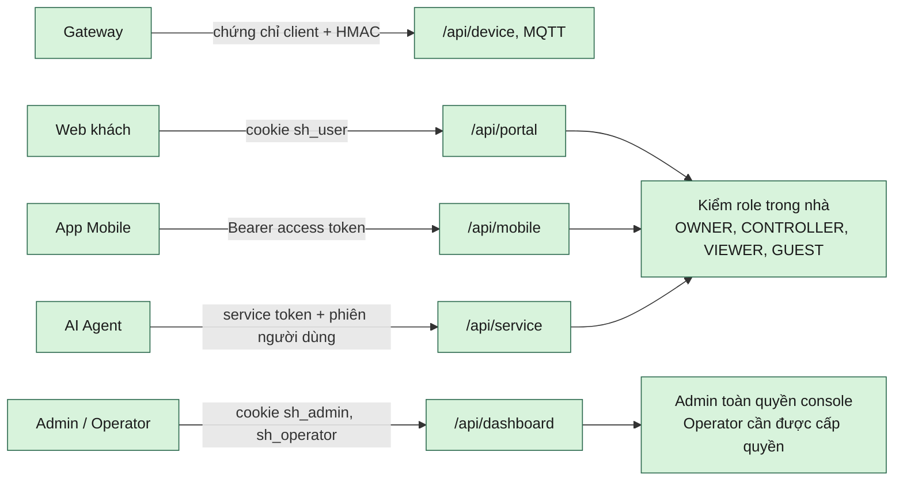

Mỗi kênh chỉ nhận đúng một loại tài khoản: khách hàng (USER) bị từ chối ở `/api/dashboard` (`403 USE_MOBILE_APP`), nhân viên bị từ chối ở `/api/portal` và `/api/mobile` (`403 USE_DASHBOARD`) — `identity/guards/auth.guards.ts`.

### 6.2 Xác thực thiết bị: tổng quan

Mỗi thiết bị giữ một bộ danh tính riêng trong NVS, đang được nạp tay bằng `nvs_dev.csv`. Mỗi chặng dùng hai lớp: **lớp đường truyền** (CCMP, WPA2, TLS) chứng minh "kết nối này của đúng thiết bị", và **lớp gói tin** (HMAC + thời gian + bộ đếm) chứng minh "gói này đúng do thiết bị đó tạo ra, chưa bị sửa, chưa bị gửi lại".

```mermaid
flowchart LR
  N["Node<br/>device_id · secret Node<br/>MAC Gateway · LMK"]
  C["Camera<br/>device_id · secret Camera<br/>MAC Gateway · LMK<br/>mật khẩu Wi-Fi nội bộ"]
  G["Gateway<br/>gateway_id · secret Gateway<br/>chứng chỉ client + CA<br/>danh sách thiết bị: MAC, LMK<br/>secret Camera"]
  S["Server<br/>secret Gateway, Node, Camera<br/>lưu mã hoá AES-256-GCM<br/>CA + chứng chỉ Broker"]

  N <-->|"① ESP-NOW: MAC + LMK, CCMP"| G
  C <-->|"② ESP-NOW: MAC + LMK, CCMP<br/>HTTP: WPA2 + HMAC secret Camera"| G
  G <-->|"③ mTLS chứng chỉ client<br/>+ HMAC secret Gateway hai chiều"| S
  N -.->|"chữ ký Node đi xuyên Gateway<br/>chỉ Server kiểm được"| S

  classDef done fill:#d8f3dc,stroke:#2d6a4f,color:#1b1b1b
  class N,C,G,S done
```

| Chặng | Danh tính | Chứng minh bằng | Ai kiểm | Chống gửi lại |
|---|---|---|---|---|
| Node → Gateway | MAC Node | Khung giải mã được bằng LMK của Node (CCMP) | Gateway | `seq` (8 khung gần nhất); số đo: ts ±300 s + `ctr` tăng |
| Gateway → Node | MAC Gateway | CCMP bằng cùng LMK | Node | `seq`; `command_id` trùng không chạy lại |
| Node → Server (xuyên Gateway) | `sensor_id` | HMAC `v2\|sn` bằng secret Node | Backend | ts ±300 s + `ctr > last_ctr` |
| Camera ↔ Gateway (ESP-NOW) | MAC Camera / MAC Gateway | CCMP bằng LMK của Camera | hai bên | `seq` |
| Camera → Gateway (gửi ảnh) | `X-Device-Id` | đến từ Wi-Fi nội bộ + HMAC `v2\|cam-up` bằng secret Camera | Gateway | ts ±300 s + `ctr` tăng |
| Gateway → Camera (mở luồng) | — | HMAC `v2\|cam-stream` bằng secret Camera | Camera | ts ±300 s + `ctr` tăng |
| Gateway → Broker | CN chứng chỉ = `gateway_id` | Chứng chỉ client do CA ký, không có trong CRL | Mosquitto | (TLS) |
| Gateway → Server (từng gói) | `gateway_id` trên topic / header | HMAC bằng secret Gateway | Backend | ts ±300 s + `ctr` hoặc `command_id` (mục 6.5) |
| Server → Gateway | chứng chỉ Broker + chỉ `iot-backend-commands` được ghi topic lệnh | HMAC bằng secret Gateway | Gateway | ts ±300 s + `command_id` chưa gặp |

**Hai cơ chế dùng chung cho mọi chặng** (`firmware/common/security_manager`):

- **Đồng hồ**: Gateway lấy giờ từ RTC (có pin) rồi SNTP, sau đó phát `TIME_SYNC` cho Node/Camera — khi trả lời `PING` và sau mỗi `CMD_ACK`. Chưa có giờ thì thiết bị **không ký và không kiểm** HMAC (`gw_time.h`, `gw_espnow.c:306, 356`).
- **Bộ đếm `ctr`**: `ctr = max(ctr trước + 1, giờ unix × 1000)`. Bộ đếm tăng ngặt kể cả khi mất điện, vì mức sàn được lưu NVS `sec/ctr_floor`, đặt trước 10 phút. Bên nhận lưu `ctr` lớn nhất đã thấy và từ chối gói có `ctr` nhỏ hơn hoặc bằng (`sm_counter.h`).

### 6.3 Node ↔ Gateway

```mermaid
sequenceDiagram
  autonumber
  participant N as Node
  participant G as Gateway
  participant S as Server

  Note over N,G: Chuẩn bị (nạp tay NVS)
  Note over N: identity/device_uuid, device_secret<br/>pairing/gateway_mac, session_key (LMK)
  Note over G: nodes/i_id, i_kind = node<br/>i_mac, i_lmk (KHÔNG có secret Node)

  Note over N,G: Khởi động
  N->>N: Thiếu MAC Gateway hoặc LMK → không bật ESP-NOW
  N->>N: Thêm Gateway làm peer, encrypt = true, khoá = LMK
  G->>G: Thêm từng thiết bị đã ghép làm peer có LMK<br/>thiết bị thiếu LMK bị bỏ qua
  N->>G: PING trên kênh 1..13 (mã hoá CCMP) tới khi Gateway ack
  G->>G: MAC có trong danh sách? giải mã được?
  G->>N: TIME_SYNC {ts}

  Note over N,S: Gửi số đo
  N->>N: ctr = sm_counter_next, ký HMAC v2 sn bằng secret Node
  N->>G: TELEMETRY_V2 {sn_timestamp, sn_ctr, sn_hmac, data}
  G->>G: Khung đúng phiên bản, ≤ 250 byte, seq không trùng<br/>ts ±300 s, ctr tăng (không kiểm sn_hmac)
  G->>S: Bọc chữ ký Gateway, gửi lên (mục 6.5)
  S->>S: Kiểm sn_hmac bằng secret Node

  Note over N,G: Nhận lệnh
  G->>N: CMD {command_id, action, ts}
  N->>N: Chỉ từ MAC Gateway, seq không trùng<br/>command_id, action đúng ký tự cho phép<br/>command_id đã gặp → gửi lại ack cũ
  N->>G: CMD_ACK {command_id, status, power}
  G->>N: TIME_SYNC (kèm sau mỗi ack)
```

- **Vì sao CCMP chưa đủ, phải ký thêm HMAC:** CCMP chỉ bảo vệ chặng sóng; Gateway giải mã được mọi khung. Chữ ký Node dùng secret mà Gateway **không có**, nên số đo được bảo vệ từ Node tới tận Server kể cả khi Gateway bị chiếm (`gw_registry.h`: "Gateway không giữ secret Node").
- **Gói không ký HMAC, chỉ dựa vào CCMP:** `HEARTBEAT`, `CMD`, `CMD_ACK`, `TIME_SYNC` trên chặng ESP-NOW. Gateway ký lại ack trước khi gửi lên Server.
- **Chế độ không mã hoá** (`CONFIG_*_ESPNOW_ALLOW_UNENCRYPTED`) đang **tắt** ở cả 3 firmware (`sdkconfig`), nên peer thiếu LMK bị từ chối.
- **Còn thiếu:**
  - LMK nạp tay, chưa có ghép nối ECDH (khung `PAIR_*` mới khai báo trong `espnow_proto.h`).
  - PMK của ESP-NOW đang là giá trị mặc định (`gw_espnow.c:440`, TODO).
  - Node chưa bắt buộc `ts` trong lệnh (`CONFIG_NODE_CMD_REQUIRE_TS` tắt).

Code: `firmware/esp32_s3_firmware_node/components/services/include/node_link.h`, `node_config.h`; Gateway `components/services/include/gw_espnow.h`, `gw_registry.h`; `firmware/common/espnow_proto/include/espnow_proto.h`.

### 6.4 Camera ↔ Gateway

Camera có **hai kênh** tới Gateway:

- **ESP-NOW** chở tin nhắn nhỏ: `PING`, `HEARTBEAT` (30 s), `EVENT motion`, `CMD`, `CMD_ACK`, `TIME_SYNC`.
- **HTTP trong Wi-Fi nội bộ** (Local AP do Gateway phát, WPA2, mạng `192.168.4.0/24`) chở ảnh và video, vì ảnh quá lớn cho khung ESP-NOW 250 byte.

```mermaid
sequenceDiagram
  autonumber
  participant CM as Camera
  participant G as Gateway

  Note over CM,G: Chuẩn bị (nạp tay NVS)
  Note over CM: identity, secret Camera, LMK, MAC Gateway<br/>wifi/ssid, password của Local AP (không phải Wi-Fi nhà)
  Note over G: nodes/i_kind = camera, i_mac, i_lmk<br/>i_secret = secret Camera

  Note over CM,G: Kết nối
  CM->>G: Vào Local AP bằng WPA2, nhận IP qua DHCP
  CM->>G: ESP-NOW PING (CCMP bằng LMK) khi chưa có giờ
  G->>CM: TIME_SYNC {ts}

  Note over CM,G: Camera gửi ảnh lên Gateway
  CM->>G: POST /local/camera/snapshot<br/>X-Device-Id, X-Timestamp, X-Counter<br/>X-Signature = HMAC(secret Camera, v2 cam-up, id, ts, ctr, trigger, command_id)
  G->>G: 1 đến từ Local AP? (không → 403)<br/>2 header đủ? 3 là camera đã ghép? 4 Gateway có giờ?
  G->>G: 5 ts ±300 s? 6 chữ ký đúng (so thời gian hằng)?<br/>7 ctr > ctr lớn nhất đã nhận? 8 ≤ 200 KB, đúng JPEG?
  G->>G: Mới đọc thân ảnh, rồi cập nhật ctr đã nhận
  G-->>CM: 201 · sai thiết bị, ts, chữ ký hoặc ctr → 401 không nói lý do

  Note over CM,G: Gateway mở luồng video của Camera
  G->>CM: GET /stream?fs&q tới IP mà DHCP cấp cho MAC đã ghép<br/>X-Signature = HMAC(secret Camera, v2 cam-stream, id, ts, ctr, fs, q)
  CM->>CM: ts ±300 s? chữ ký đúng? ctr tăng?<br/>đang có luồng khác → 409
  CM-->>G: MJPEG
```

- **Chiều xác thực:** Camera chứng minh với Gateway bằng chữ ký `cam-up`; Gateway chứng minh với Camera bằng chữ ký `cam-stream`. Cả hai cùng dùng secret Camera, nên đây là xác thực hai chiều bằng khoá chung.
- **Bộ đếm ở bên nhận nằm trong RAM.** Sau khi khởi động lại, mức sàn là `(giờ hiện tại − 300 s) × 1000`, nên gói cũ hơn 5 phút vẫn bị chặn (`gw_local_http.h`, `cam_stream.h`).
- **Server không tham gia chặng này.** Secret Camera có lưu trong DB (lúc đăng ký Gateway) nhưng Backend không dùng.
- **Còn thiếu:**
  - Chữ ký `cam-up` không băm nội dung ảnh, toàn vẹn ảnh dựa vào WPA2.
  - Kênh HTTP nội bộ không có TLS.
  - Mật khẩu Local AP và LMK nạp tay.

Code: `firmware/esp32_cam/components/services/include/cam_espnow.h`, `cam_snapshot.h`, `cam_stream.h`, `cam_config.h`; Gateway `gw_local_http.h`, `gw_camera_live.h`, `gw_wifi.h`.

### 6.5 Gateway ↔ Server

**Lớp 1 — kết nối (mTLS).** Gateway và Broker kiểm chứng chỉ của nhau bằng CA nội bộ (mục 5.3). Broker lấy CN của chứng chỉ làm username và client id, rồi áp ACL: Gateway chỉ đọc/ghi topic mang đúng `gateway_id` của mình. Các đường HTTPS/WSS của Gateway (ảnh, số đo dự phòng, video) cũng kiểm `web.crt` bằng CA nhúng, nhưng không dùng chứng chỉ client — ở đó danh tính chỉ dựa vào HMAC.

**Lớp 2 — từng gói (HMAC bằng secret Gateway).**

| Hướng | Kênh | Chuỗi được ký | Chống gửi lại | Nơi kiểm |
|---|---|---|---|---|
| Gateway → Server · số đo | MQTT `gateway/<gw>/data`, dự phòng HTTPS `POST /api/device/data` | `v2\|gw\|<gw>\|<ts>\|<ip>\|<sensor_id>\|<ctr>\|<sn_hmac>` (bọc chữ ký Node) | ts ±300 s + `ctr` của Node | `telemetry/domain/ingest-auth.ts` |
| Gateway → Server · heartbeat (30 s) | MQTT `home/<h>/gateway/<gw>/heartbeat` | `v2\|hb\|<gw>\|<ts>\|<ctr>\|<sha256(body)>` | ts + `ctr` trên dòng Gateway | `devices/features/gateway-heartbeat/` |
| Gateway → Server · ack lệnh | MQTT `…/device/<dev>/command/ack` | `v2\|ack\|<gw>\|<dev>\|<command_id>\|<status>\|<power>\|<ts>` | `command_id` đang chờ, xoá sau ack đầu | `control/features/command-ack/` |
| Gateway → Server · sự kiện camera | MQTT `…/device/<cam>/camera/event` | `v2\|evt\|<gw>\|<cam>\|<type>\|<ts>\|<snapshot_id>` | ts + gộp trùng 60 s | `camera/features/camera-event/` |
| Gateway → Server · ảnh | HTTPS `POST /api/device/camera/snapshot` | `<gw>:<ts>:<cam>:<trigger>:<command_id>:<sha256(ảnh)>` | ts ±300 s | `camera/domain/gateway-auth.ts` |
| Gateway → Server · video | WSS `/api/device/camera/live` | `<gw>:<ts>:<cam>:<session_id>` | ts + phiên phải đang mở + 1 uplink | `live-relay/live-uplink.controller.ts` |
| Server → Gateway · lệnh thiết bị | MQTT `home/<h>/gateway/<gw>/device/<dev>/command` | `<command_id>:<device_uid>:<action>:<ts>` | ts ±300 s + `command_id` chưa gặp | `gw_mqtt.h` |
| Server → Gateway · lệnh Gateway | MQTT `…/gateway/<gw>/command` | `<command_id>:<gateway_id>:<action>:<ts>` | như trên | `gw_mqtt.h` |
| Server → Gateway · OTA | MQTT `…/gateway/<gw>/ota/command` | `<job_id>:<version>:<ts>` | ts | `gw_mqtt.h` |

Chuỗi `v2|…` khớp từng byte giữa `backend/src/modules/devices/domain/signature-v2.ts` và `firmware/common/security_manager`. Phía Server, secret Gateway được giải mã từ `devices.secret_key` (AES-256-GCM) và chỉ dùng bên trong module `devices` (`getGatewaySigner`); các module khác chỉ nhận hàm ký/kiểm.

```mermaid
sequenceDiagram
  autonumber
  participant G as Gateway
  participant MQ as Broker
  participant BE as Backend

  Note over G: Khởi động: RTC → SNTP, Wi-Fi nhà (STA)
  G->>MQ: mqtts :8883, gửi chứng chỉ client CN = gateway_id
  MQ->>MQ: Chứng chỉ do CA ký, không trong CRL<br/>username = client id = CN
  G->>MQ: SUBSCRIBE home/+/gateway/gw/device/+/command, …/command, …/ota/command
  MQ->>MQ: ACL: chỉ topic mang %u = gw

  loop mỗi 30 s
    G->>MQ: heartbeat {v:2, ts, ctr, hmac, body_raw}
    MQ->>BE: iot-backend-heartbeat
    BE->>BE: Gateway tồn tại, active? home_id trên topic = nhà của Gateway?
    BE->>BE: ts ±300 s, chữ ký v2 hb đúng? ctr > last_ctr?
    BE->>BE: Cập nhật online, theo dõi dấu hiệu nhân bản
  end

  BE->>MQ: lệnh {command_id, action, ts, hmac} (iot-backend-commands)
  MQ->>G: chuyển lệnh
  G->>G: topic đúng gw? home_id là số? đã có giờ?<br/>ts ±300 s? HMAC khớp? command_id chưa gặp?
  G->>G: home_id chưa biết thì học từ lệnh hợp lệ đầu tiên
```

Gói số đo được kiểm qua chuỗi bước sau (Broker làm 2 bước đầu, Backend làm các bước còn lại):

```mermaid
flowchart TB
  A["Gateway kết nối Broker"] --> B{"Chứng chỉ do CA ký,<br/>chưa bị thu hồi?"}
  B -- "không" --> X1["Từ chối kết nối"]
  B -- "có" --> C{"ACL cho phép topic?"}
  C -- "không" --> X2["Từ chối publish"]
  C -- "có" --> D{"Chữ ký Gateway đúng,<br/>thời gian ±300 s?"}
  D -- "không" --> X3["Bỏ gói, ghi audit<br/>cộng 1 lần lỗi"]
  D -- "có" --> E{"Chữ ký Node đúng?"}
  E -- "không" --> X3
  E -- "có" --> F{"Node thuộc Gateway này?"}
  F -- "không" --> X4["Bỏ gói, ghi audit"]
  F -- "có" --> G{"ctr lớn hơn lần trước?"}
  G -- "không" --> X5["Bỏ gói: gửi lại gói cũ"]
  G -- "có" --> OK["Lưu số đo"]
  X3 --> L{"Đủ 5 lần lỗi?"}
  L -- "có" --> BL["Khoá thiết bị"]

  classDef ok fill:#d8f3dc,stroke:#2d6a4f,color:#1b1b1b
  classDef bad fill:#fde2e1,stroke:#b42318,color:#1b1b1b
  class OK ok
  class X1,X2,X3,X4,X5,BL bad
```

**Khi xác thực thất bại, Server xử lý thế nào:**

| Trường hợp | Xử lý | Vì sao |
|---|---|---|
| Sai chữ ký số đo qua **MQTT** | Bỏ gói, audit, `fail_count + 1`; đủ 5 lần → `status = blocked` | Người gửi đã qua mTLS + ACL nên lỗi chắc chắn do chính Gateway đó |
| Sai chữ ký số đo qua **HTTPS** | Bỏ gói, audit, **không** khoá; 20 lỗi / 15 phút theo IP + gateway → 429 | Ai cũng gửi được tới nginx; nếu khoá thì kẻ xấu khoá được Gateway nhà người khác |
| Sai heartbeat / ack / sự kiện camera | Bỏ, log cảnh báo, không tăng `fail_count` | Broker đã chặn người ngoài; tránh khoá oan |
| Sai chữ ký ảnh / video | 401, audit, không khoá; giới hạn lỗi theo IP + gateway | Như HTTPS ở trên |
| `ctr` cũ hoặc lệch giờ | Bỏ, không bao giờ khoá | Có thể do mất điện, lệch đồng hồ |
| Heartbeat đúng chữ ký nhưng uptime lùi, IP đổi liên tục, `ctr` bị trùng | Cảnh báo "Gateway nghi bị nhân bản" cho nhân viên, tối đa 1 lần / giờ | Hai board dùng chung một danh tính (`devices/domain/gateway-clone-detector.ts`) |

Mã lỗi chi tiết của gói số đo: `GATEWAY_AUTH_FAIL`, `SENSOR_AUTH_FAIL`, `SENSOR_GATEWAY_MISMATCH`, `REPLAYED` (`telemetry/domain/ingest-auth.ts`). Đường HTTPS trả các mã này cho Gateway; đường MQTT không có phản hồi nên gói chỉ bị bỏ và ghi `audit_log`.

### 6.6 Người dùng Web (cookie)

```mermaid
sequenceDiagram
  autonumber
  participant BR as Trình duyệt
  participant BE as Backend
  participant DB as PostgreSQL

  BR->>BE: POST /api/portal/auth/login (email, mật khẩu)
  BE->>DB: Tìm user, so bcrypt
  alt Sai
    BE-->>BR: 401, ghi LOGIN_FAILED
  else Đúng
    BE-->>BR: Set-Cookie sh_user (JWT 7 ngày)<br/>HttpOnly, SameSite=Strict, Secure
  end
  BR->>BE: GET /api/portal/homes/{id}/… (cookie tự gửi)
  BE->>BE: Kiểm JWT, nạp lại user (role, token_version, khoá?)
  BE->>DB: Là thành viên nhà? role có quyền?
  BE-->>BR: 200, 404 (không phải nhà mình) hoặc 403 (thiếu quyền)
```

- Đăng nhập giới hạn 10 lần / 15 phút theo IP và theo email (`core/http/rate-limit.ts`).
- Console Admin/Operator dùng cùng cách, đăng nhập ở `/api/dashboard/auth/login`, cookie `sh_admin`/`sh_operator`, JWT 8 giờ.

### 6.7 App Mobile (access token + refresh token)

```mermaid
sequenceDiagram
  autonumber
  participant APP as App
  participant BE as Backend
  participant DB as PostgreSQL

  APP->>BE: POST /api/mobile/auth/login
  BE->>DB: Lưu SHA-256 của refresh token (30 ngày)
  BE-->>APP: access token (15 phút) + refresh token
  APP->>APP: Lưu vào flutter_secure_storage
  APP->>BE: Gọi API với Authorization: Bearer
  BE-->>APP: 401 khi access token hết hạn
  APP->>BE: POST /api/mobile/auth/refresh
  alt Refresh token còn hiệu lực
    BE-->>APP: Cặp token mới, token cũ bị thu hồi
  else Refresh token đã dùng rồi (bị đánh cắp?)
    BE->>DB: Thu hồi cả họ token, audit REFRESH_TOKEN_REUSED
    BE-->>APP: 401, bắt đăng nhập lại
  end
  APP->>BE: WebSocket /api/mobile/ws, gói đầu tiên mang token
  BE-->>APP: Sự kiện của các nhà mình là thành viên
```

Code: `identity/domain/session-tokens.ts`, `identity/features/refresh-session/`, `realtime/features/mobile-ws/mobile-ws.gateway.ts`, `mobile/lib/core/network/api_client.dart`.

### 6.8 Phân quyền trong nhà

```mermaid
flowchart TB
  R["Request đã đăng nhập, role USER"] --> M{"Là thành viên của nhà?"}
  M -- "không" --> E404["404 — không lộ nhà có tồn tại"]
  M -- "có" --> P{"Role có quyền cần?"}
  P -- "không" --> E403["403"]
  P -- "có" --> GU{"GUEST: thiết bị được cấp?"}
  GU -- "không" --> E404
  GU -- "có" --> OK["Thực hiện"]

  classDef ok fill:#d8f3dc,stroke:#2d6a4f,color:#1b1b1b
  classDef bad fill:#fde2e1,stroke:#b42318,color:#1b1b1b
  class OK ok
  class E404,E403 bad
```

| Quyền | OWNER | CONTROLLER | VIEWER | GUEST |
|---|---|---|---|---|
| Xem | có | có | có | chỉ thiết bị được cấp |
| Điều khiển thiết bị | có | có | — | chỉ thiết bị được cấp |
| Đổi tên | có | có | — | — |
| Xem / tạo tự động hoá | có | có | chỉ xem | — |
| Sửa mọi luật tự động | có | chỉ luật mình tạo | — | — |
| Quản lý thành viên | có | — | — | — |

Nguồn: `backend/src/modules/homes/domain/permissions.ts::ROLE_PERMISSIONS`, `access-policy.ts`, `devices/domain/device-access.ts`. Nhà bị tạm ngưng vẫn xem được nhưng không điều khiển được (`409 HOME_SUSPENDED`).

### 6.9 Trợ lý AI thay mặt người dùng

```mermaid
sequenceDiagram
  autonumber
  participant U as Web / App
  participant AG as AI Agent (Python)
  participant OA as OpenAI
  participant BE as Backend

  U->>AG: Giọng nói hoặc chữ, kèm phiên đăng nhập (qua nginx)
  AG->>BE: Lấy thiết bị người dùng được thấy<br/>service token + phiên người dùng
  BE->>BE: Kiểm service token, kiểm phiên, kiểm thành viên nhà
  AG->>OA: Chuyển giọng nói thành chữ, hiểu ý
  OA-->>AG: Kế hoạch đề xuất
  AG->>BE: Gửi kế hoạch + câu gốc
  BE->>BE: Kiểm từng bước: câu gốc có ra lệnh rõ?<br/>người dùng có quyền điều khiển thiết bị?
  alt Lệnh rõ
    BE->>BE: Làm ngay hoặc tự hẹn giờ
  else Chưa rõ
    BE-->>U: Thẻ chờ xác nhận (hết hạn 5 phút)
  end
  AG-->>U: Câu trả lời
```

Code: `agent/src/smarthome_agent/api/commands.py`, `clients/backend/client.py`, `backend/src/core/auth/service-token.ts`, `backend/src/modules/agent/domain/explicit-step.ts`, `step-rules.ts`.
