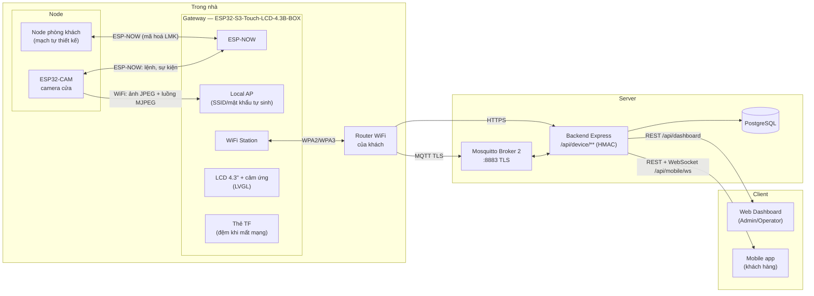
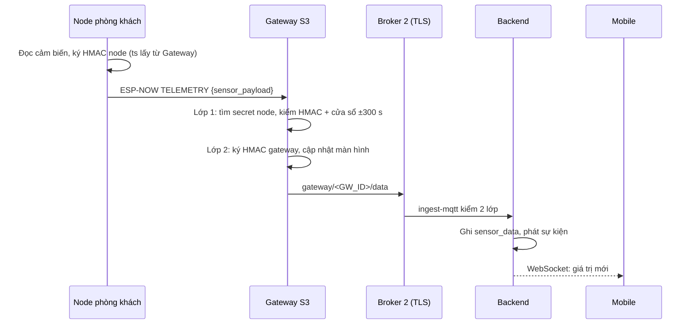
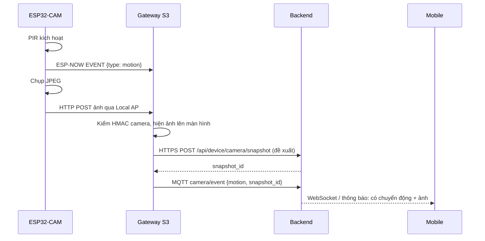
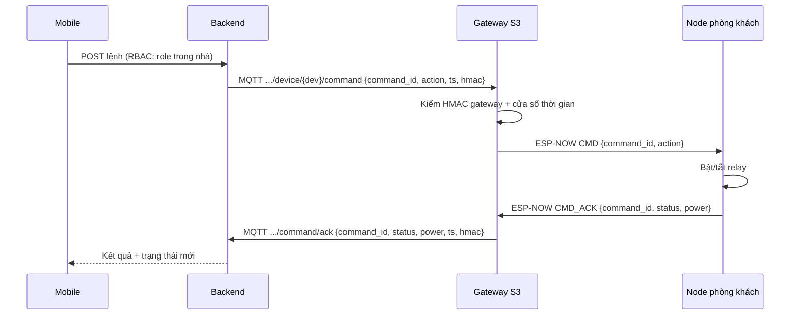

# IOT_NODE_NETWORK.md

> **Mạng node IoT của đồ án — phần cứng, giao thức từng chặng và luồng dữ liệu từ node tới client.**
> Đường đi: **Node (ESP32-CAM, Node phòng khách) → Gateway (Waveshare ESP32-S3-Touch-LCD-4.3B-BOX) → Server (Broker 2 TLS + Backend) → Client (Web Dashboard, Mobile)**.
> Tài liệu này mô tả **thiết kế đích cho bộ phần cứng demo**. Hiện trạng code (gateway ESP32 DOIT + `sensor-node` gửi qua Broker 1) nằm ở mục 9. Nguyên tắc chung (ESP-NOW cho node, Local AP cho camera, key hierarchy) đã chốt ở [WiFi Provisioning](SMART_HOME_WIFI_PROVISIONING.md); cấu trúc firmware ESP-IDF ở [Firmware](EMBEDDED_ARCHITECTURE_ESP_IDF.md); bảng tổng hợp mọi API (hiện có + dự kiến) ở [API Design](../API_DESIGN.md). Tài liệu này **không lặp lại** các phần đó mà áp chúng vào phần cứng cụ thể.
>
> **Trạng thái:** bản thiết kế, chưa có code. Phần cứng Node phòng khách **chờ bổ sung** (mục 4.3). Các hợp đồng đánh dấu **(đề xuất)** chưa có ở backend.

---

## MỤC LỤC

1. [Tóm tắt](#1-tóm-tắt)
2. [Topology tổng thể](#2-topology-tổng-thể)
3. [Gateway — ESP32-S3-Touch-LCD-4.3B-BOX](#3-gateway--esp32-s3-touch-lcd-43b-box)
4. [Node](#4-node)
5. [Giao thức từng chặng](#5-giao-thức-từng-chặng)
6. [Luồng dữ liệu chính](#6-luồng-dữ-liệu-chính)
7. [Đồng bộ thời gian và chạy khi mất Internet](#7-đồng-bộ-thời-gian-và-chạy-khi-mất-internet)
8. [Tổ chức firmware](#8-tổ-chức-firmware)
9. [Hiện trạng và lộ trình chuyển đổi](#9-hiện-trạng-và-lộ-trình-chuyển-đổi)
10. [Câu hỏi còn mở](#10-câu-hỏi-còn-mở)
11. [Nguồn tham khảo](#11-nguồn-tham-khảo)

---

## 1. TÓM TẮT

| Thiết bị | Phần cứng | Kết nối lên trên | Vai trò |
|---|---|---|---|
| **Gateway** | Waveshare ESP32-S3-Touch-LCD-4.3B-BOX (ESP32-S3, 16 MB flash, 8 MB PSRAM, LCD 4.3" cảm ứng) | WiFi Station → router nhà → Internet → Broker 2 (TLS) và Backend (HTTPS) | Thiết bị **duy nhất** giữ WiFi thật của khách. Gom dữ liệu node, xác thực HMAC lớp 1, ký HMAC lớp 2, chuyển lệnh xuống node, hiển thị và điều khiển tại chỗ trên màn hình |
| **Camera cửa** | ESP32-CAM (giả định module AI-Thinker, OV2640) | ESP-NOW (điều khiển, sự kiện) + WiFi vào **Local AP của Gateway** (ảnh và luồng MJPEG) | Chụp ảnh khi có chuyển động hoặc khi được yêu cầu; phát luồng hình trực tiếp về Gateway khi có người xem |
| **Node phòng khách** | Mạch tự thiết kế — **chờ chi tiết** | ESP-NOW tới Gateway | Cảm biến môi trường + điều khiển thiết bị trong phòng khách (theo Kit ở [Kiến trúc sản phẩm](../SMART_HOME_PRODUCT_ARCHITECTURE.md) §4.1) |

Ba quyết định chính:

1. **Node không bao giờ nói chuyện trực tiếp với Server.** Mọi dữ liệu đi qua Gateway, đúng mô hình "chỉ Gateway giữ WiFi thật" của [WiFi Provisioning](SMART_HOME_WIFI_PROVISIONING.md) §2.
2. **Hợp đồng Gateway ↔ Backend giữ nguyên** (`gateway/+/data`, lệnh `home/.../command`). Chỉ chặng Node ↔ Gateway đổi từ MQTT Broker 1 sang ESP-NOW. Backend không phải sửa để chạy được telemetry và lệnh.
3. **Ảnh và luồng hình camera đi Camera → Gateway**, không NAT camera ra Internet. Luồng trực tiếp xem trên màn hình Gateway là mục tiêu chính; xem từ xa trên Mobile thì Gateway chuyển tiếp lên Backend (mở rộng tuỳ chọn, mục 5.5). Gateway là nơi duy nhất mở kết nối TLS ra ngoài.

---

## 2. TOPOLOGY TỔNG THỂ



| Chặng | Kênh | Bảo vệ |
|---|---|---|
| Node phòng khách ↔ Gateway | ESP-NOW | Mã hoá ESP-NOW bằng LMK riêng từng node (cấp lúc ghép nối) + HMAC node |
| Camera ↔ Gateway (lệnh, sự kiện) | ESP-NOW | Như trên |
| Camera → Gateway (ảnh) | HTTP trên Local AP | WPA2 của Local AP (mật khẩu tự sinh) + HMAC camera ở header |
| Camera → Gateway (luồng trực tiếp) | HTTP MJPEG trên Local AP, Gateway kéo về | WPA2 của Local AP + Gateway ký HMAC khi mở luồng; camera chỉ nhận 1 kết nối luồng |
| Gateway → Server (luồng từ xa, tuỳ chọn) | WebSocket TLS | TLS + HMAC gateway; chỉ mở khi có người xem, tự đóng khi hết hạn |
| Gateway → Server | MQTT TLS (Broker 2, cổng 8883) cho telemetry, sự kiện, ack; HTTPS cho ảnh | TLS có kiểm chứng CA (bất biến 3) + HMAC gateway |
| Server → Client | REST, WebSocket | Cookie phiên (Web), JWT Bearer (Mobile); RBAC 2 tầng |

Mobile **không** kết nối MQTT (bất biến 7). Dữ liệu realtime tới Mobile đi qua WebSocket `/api/mobile/ws` của Backend.

---

## 3. GATEWAY — ESP32-S3-TOUCH-LCD-4.3B-BOX

### 3.1. Thông số liên quan tới thiết kế

Số liệu theo trang Waveshare và trang bán hàng (mục 11).

| Hạng mục | Thông số | Dùng để làm gì trong đồ án |
|---|---|---|
| SoC | ESP32-S3-WROOM-1-N16R8, Xtensa LX7 2 nhân, tới 240 MHz | Nhân 0 cho WiFi/ESP-NOW/MQTT, nhân 1 cho giao diện và xử lý |
| Bộ nhớ | 512 KB SRAM, **16 MB flash**, **8 MB PSRAM** | Flash đủ 2 slot OTA + phân vùng tài nguyên giao diện; PSRAM chứa framebuffer LCD và bộ đệm ảnh camera |
| Không dây | WiFi 2.4 GHz 802.11 b/g/n, Bluetooth 5 LE, anten trên mạch | Station lên router, SoftAP cho camera, ESP-NOW cho node, BLE cho provisioning |
| Màn hình | 4.3", 800×480, IPS, giao tiếp RGB song song | Bảng điều khiển tại chỗ (mục 3.3) |
| Cảm ứng | Điện dung 5 điểm, I2C (GPIO8 SDA, GPIO9 SCL), ngắt GPIO4 | Thao tác trên màn hình |
| RTC | PCF85063 trên I2C, pin CR927 | Giữ giờ khi mất điện, mất Internet — cần cho timestamp HMAC (mục 7) |
| Thẻ nhớ | Khe TF (SPI: GPIO11/12/13, CS qua CH422G) | Đệm telemetry và ảnh khi mất Internet |
| Vào/ra cách ly | 2 DI (5–36 V), 2 DO open-drain (5–36 V, tối đa 450 mA/kênh) | Dự phòng: còi báo động 12 V, tiếp điểm cửa có dây |
| Bus mở rộng | CAN, RS485, I2C (header 5 V hoặc 3,3 V) | Dự phòng, chưa dùng ở V2 |
| Nguồn | DC 7–36 V hoặc USB-C 5 V; tiêu thụ 5 V/450 mA; cổng pin Li-ion 3,7 V (vỏ BOX vừa pin 60×30×6 mm, mua riêng) | Pin giúp Gateway chạy tiếp khi cúp điện ngắn |
| Vỏ BOX | Vỏ nhựa, lỗ bắt VESA 75 mm, chỉ đi dây phía sau | Gắn tường cạnh cửa ra vào |

### 3.2. Ràng buộc phần cứng cần nhớ khi viết firmware

- **Gần như không còn GPIO trống.** LCD RGB, cảm ứng, thẻ TF, CAN, RS485, USB đã dùng GPIO0–5, 7–21, 38–48; GPIO22–37 thuộc flash/PSRAM bên trong module. Gateway **không** đọc cảm biến trực tiếp — mọi cảm biến nằm ở node. Mở rộng phần cứng cho Gateway chỉ qua I2C header, RS485/CAN hoặc DI/DO.
- **Nhiều ngoại vi qua bộ mở rộng CH422G** (đèn nền, reset cảm ứng, CS thẻ TF, DI/DO). Driver CH422G phải khởi tạo trước LCD và thẻ TF.
- **GPIO8/9 dùng chung** cho cảm ứng, RTC và header I2C — mọi truy cập I2C qua một bus driver duy nhất, có mutex.
- **Màn hình RGB dùng PSRAM làm framebuffer.** Khi ghi flash (OTA, NVS) cache bị tắt tạm thời, ảnh có thể bị trôi. ESP-IDF xử lý bằng *bounce buffer* và các tuỳ chọn `CONFIG_SPIRAM_FETCH_INSTRUCTIONS`, `CONFIG_SPIRAM_RODATA`. Cần kiểm chứng trên board khi bật cùng lúc WiFi, OTA và LVGL.
- **Một radio dùng chung cho Station, SoftAP và ESP-NOW**, nên cả ba chạy **cùng một kênh WiFi** — kênh của router. Hệ quả ở mục 5.1.
- **Chỉ có WiFi 2.4 GHz** (giả định đã có trong [PRD](../PRD_SMART_HOME.md) §9.1).

### 3.3. Màn hình tại chỗ

Giao diện LVGL, tiếng Việt (bất biến 10). Màn hình là **kênh điều khiển cục bộ**, không thay Mobile app.

| Màn hình | Nội dung |
|---|---|
| Trang chủ | Nhiệt độ, độ ẩm, trạng thái thiết bị phòng khách; biểu tượng trạng thái WiFi, Server, số node online |
| Camera | Mặc định hiện ảnh chụp gần nhất kèm thời điểm. Nút "Xem trực tiếp" mở luồng hình (mục 5.4), nút "Chụp ảnh". Rời màn hình hoặc tắt màn hình thì luồng tự dừng |
| Thiết bị | Danh sách node: tên, phòng, RSSI, pin (nếu có), lần cuối thấy |
| *(chung)* | Khi màn hình tắt (hết thời gian chờ), mọi luồng camera do màn hình mở đều dừng |
| Ghép nối | Bật chế độ ghép nối 60 giây ([WiFi Provisioning](SMART_HOME_WIFI_PROVISIONING.md) §9); hiển thị kết quả |
| Cài đặt | Trạng thái mạng, phiên bản firmware, khôi phục cài đặt gốc (cần xác nhận 2 bước) |

Quy tắc:
- Thao tác trên màn hình được ghi về Server như một lệnh có `source = "gateway_local"` để có audit log. Ai đứng trước Gateway được coi là người trong nhà; nếu cần khoá, thêm mã PIN ở màn hình Cài đặt.
- Màn hình **không** hiển thị secret, mật khẩu WiFi hay token (bất biến 1, 2).

### 3.4. Phân vùng flash (16 MB, đề xuất)

| Phân vùng | Kích thước | Ghi chú |
|---|---|---|
| `nvs` | 24 KB | WiFi, secret gateway, danh sách node (mã hoá NVS) |
| `otadata` | 8 KB | |
| `phy_init` | 4 KB | |
| `ota_0` | 6 MB | Ứng dụng có LVGL + font tiếng Việt nên lớn hơn gateway cũ |
| `ota_1` | 6 MB | Slot OTA thứ hai, có rollback |
| `storage` | ~3,9 MB | LittleFS: ảnh nền, icon, font bổ sung, log vòng |

Khung chung về OTA và NVS ở [Firmware](EMBEDDED_ARCHITECTURE_ESP_IDF.md) §14–16.

---

## 4. NODE

### 4.1. Nguyên tắc chung cho mọi node

- Giao tiếp với Gateway bằng **ESP-NOW**; không giữ WiFi thật, không biết địa chỉ Server.
- Mỗi node có `device_id` và `secret` riêng (bất biến 1: secret chỉ trả 1 lần khi tạo), lưu NVS, ký HMAC đúng định dạng `HMAC-SHA256(secret, "<device_id>:<unix_ts>")` hex thường (bất biến 5).
- Không có NTP — thời gian lấy từ Gateway (mục 7).
- Báo heartbeat 30 giây/lần (RSSI, uptime, pin nếu có, phiên bản firmware).

### 4.2. Camera cửa — ESP32-CAM

| Hạng mục | Giá trị (giả định module AI-Thinker — cần xác nhận) | Ghi chú thiết kế |
|---|---|---|
| SoC | ESP32 (2 nhân, 240 MHz), WiFi + BT | Đủ cho JPEG từ phần cứng của OV2640 |
| Bộ nhớ | 4 MB flash, 4 MB PSRAM | PSRAM cần cho bộ đệm khung hình (2 buffer) |
| Cảm biến ảnh | OV2640, xuất JPEG trực tiếp | Mặc định SVGA 800×600, chất lượng 12 → ảnh khoảng 20–60 KB |
| Đèn flash | LED trắng trên GPIO4 | Chỉ bật khi chụp trong tối; GPIO4 dùng chung với thẻ SD ở chế độ 4-bit |
| Cảm biến chuyển động | PIR (VD HC-SR501) — **thêm ngoài** | Nối GPIO13; nếu dùng thẻ SD thì chạy SD ở chế độ 1-bit để giải phóng chân |
| Nạp code | Không có USB-UART trên module | Cần đế ESP32-CAM-MB hoặc USB-TTL, kéo GPIO0 xuống GND khi nạp |
| Nguồn | 5 V | Dòng đỉnh khi WiFi phát + flash LED cao, nguồn yếu gây *brownout* reset. Dùng adapter 5 V riêng (khuyến nghị ≥ 2 A) và tụ lọc gần chân nguồn |

Hai kênh song song trên cùng radio:

| Kênh | Nội dung | Lý do |
|---|---|---|
| **ESP-NOW** | Ghép nối, heartbeat, sự kiện chuyển động, lệnh "chụp ảnh", ack | Dùng chung cơ chế với mọi node khác; nhận thông tin Local AP qua kênh này lúc ghép nối ([WiFi Provisioning](SMART_HOME_WIFI_PROVISIONING.md) §5.2) |
| **WiFi Station → Local AP của Gateway** | Gửi ảnh JPEG; phục vụ luồng MJPEG khi Gateway yêu cầu | ESP-NOW tối đa 250 byte/gói (ESP-NOW v1), không phù hợp truyền ảnh/hình |

Camera **chỉ** kết nối Local AP của Gateway, không bao giờ biết WiFi thật. Luồng trực tiếp thiết kế ở mục 5.4 (xem trên Gateway) và 5.5 (xem từ xa — tuỳ chọn, [PRD](../PRD_SMART_HOME.md) FR-5.8 xếp live view là COULD).

### 4.3. Node phòng khách — chờ chi tiết phần cứng

Phần cứng do nhóm tự thiết kế; mục này sẽ hoàn thiện khi có sơ đồ. Kỳ vọng theo Kit ở [Kiến trúc sản phẩm](../SMART_HOME_PRODUCT_ARCHITECTURE.md) §4.1: cảm biến nhiệt độ, độ ẩm, ánh sáng + relay đèn và quạt.

Thông tin cần bổ sung:

| # | Thông tin | Ảnh hưởng tới |
|---|---|---|
| 1 | Chip/module (ESP32, ESP32-C3, ESP32-S3, ESP32-C6…) | Target build, ESP-NOW, có Zigbee/Thread hay không |
| 2 | Danh sách cảm biến, model, giao tiếp (I2C/1-Wire/ADC) | Driver, trường `data` trong telemetry |
| 3 | Cơ cấu chấp hành: relay, triac/dimmer, IR, số kênh, tải tối đa | Lệnh `action` hỗ trợ, ack trạng thái |
| 4 | Nguồn: điện lưới (AC-DC trên mạch) hay pin | Có deep-sleep hay không, chu kỳ gửi |
| 5 | Sơ đồ nguyên lý, bảng chân GPIO | Kiểm tra chân strapping, xung đột |
| 6 | Nút bấm, LED trạng thái, nút reset/ghép nối | Luồng ghép nối, khôi phục gốc |
| 7 | Vỏ, vị trí lắp | Tầm phủ ESP-NOW tới Gateway |

---

## 5. GIAO THỨC TỪNG CHẶNG

### 5.1. Node ↔ Gateway: ESP-NOW

**Kênh WiFi.** ESP-NOW chạy trên kênh mà Gateway đang kết nối router. Node không biết trước kênh này, nên:
1. Khi khởi động, node thử gửi `PING` tới MAC của Gateway (lưu trong NVS khi ghép nối) lần lượt trên kênh 1–13 cho tới khi nhận ack.
2. Lưu kênh vừa tìm được; lần sau thử kênh đó trước.
3. Mất ack liên tiếp 3 lần → quét lại. Trường hợp router đổi kênh xử lý tự động theo cách này.

**Mã hoá.** Mỗi node là một peer mã hoá với LMK riêng, cấp trong phiên ghép nối ECDH ([WiFi Provisioning](SMART_HOME_WIFI_PROVISIONING.md) §6, §9). ESP-IDF giới hạn số peer mã hoá (mặc định 7, tối đa 17), đủ cho một nhà ở V2.

**Khung tin (đề xuất).** Mỗi gói ≤ 250 byte:

| Trường | Kiểu | Ý nghĩa |
|---|---|---|
| `ver` | uint8 | Phiên bản khung, bắt đầu từ 1 |
| `type` | uint8 | `TELEMETRY`, `EVENT`, `CMD`, `CMD_ACK`, `HEARTBEAT`, `TIME_SYNC`, `PING`, `PAIR_*` |
| `seq` | uint16 | Tăng dần, Gateway bỏ gói trùng |
| `body` | JSON thu gọn | Nội dung theo `type` |

Với `TELEMETRY`, `body` **chính là `sensor_payload` mà backend đang nhận**, để Gateway chỉ việc bọc lại như hiện nay:

```json
{"sensor_id":"<device_id>","sn_timestamp":1761480000,"sn_hmac":"<64 hex>","data":{"temperature":28.4,"humidity":61}}
```

Khoảng 200 byte với 2–3 trường đo. Nếu node phòng khách gửi nhiều trường hơn, tách thành nhiều gói hoặc rút gọn tên trường — quyết định khi có danh sách cảm biến (mục 4.3).

### 5.2. Camera → Gateway: HTTP trên Local AP (đề xuất)

```
POST http://<ip-gateway-trên-Local-AP>/local/camera/snapshot
X-Device-Id: <camera device_id>
X-Timestamp: <unix_ts>
X-Signature: HMAC-SHA256(secret_camera, "<device_id>:<unix_ts>")
X-Trigger: motion | request
X-Command-Id: <command_id nếu chụp theo lệnh>
Content-Type: image/jpeg

<JPEG>
```

- Gateway kiểm tra HMAC và cửa sổ thời gian ±300 giây giống backend (`modules/devices/domain/hmac.service.ts`), từ chối ảnh > 200 KB.
- Kênh này không có TLS. Nội dung ảnh được bảo vệ bằng WPA2 của Local AP; HMAC hiện tại chỉ ký `device_id:ts`, không ký nội dung — cùng giới hạn với telemetry hiện nay (xem [Bảo mật](../SECURITY_ARCHITECTURE.md)).

### 5.3. Gateway → Server

| Dữ liệu | Kênh | Topic / endpoint | Trạng thái |
|---|---|---|---|
| Telemetry | MQTT TLS Broker 2 | `gateway/<GW_ID>/data`, payload `{gateway_id, gw_timestamp, gw_hmac, gateway_ip, sensor_payload}` | **Đã có** — `backend/src/modules/telemetry/features/ingest-mqtt/` |
| Lệnh xuống thiết bị | MQTT, Server → Gateway | `home/{home}/gateway/{gw}/device/{dev}/command`, HMAC `command_id:device_id:action:ts` bằng secret gateway | **Đã có** ở backend (`backend/src/modules/control/`); firmware chưa xử lý |
| Ack lệnh | MQTT, Gateway → Server | `.../device/{dev}/command/ack`, HMAC `command_id:status:ts` | **Đã có** ở backend |
| Heartbeat gateway | MQTT | `home/{home}/gateway/{gw}/heartbeat` | Thiết kế ở [Backend](../architecture/BACKEND_REFACTOR_SMARTHOME.md) §10.2, chưa có |
| Sự kiện camera | MQTT | `home/{home}/gateway/{gw}/device/{dev}/camera/event` `{type:"motion", ts, snapshot_id?}` | Thiết kế ở [Backend](../architecture/BACKEND_REFACTOR_SMARTHOME.md) §10.2, chưa có |
| Ảnh camera | HTTPS | `POST /api/device/camera/snapshot` — header HMAC gateway như `/api/device/data`, body JPEG, trả `snapshot_id` | **(đề xuất)** — cần backend thêm endpoint + lưu file (cột `last_snapshot_url`, [Kiến trúc sản phẩm](../SMART_HOME_PRODUCT_ARCHITECTURE.md)) |

Ảnh đi HTTPS thay vì MQTT vì: payload nhị phân 20–60 KB, base64 qua MQTT làm tăng ~33% và chiếm bộ nhớ broker; HTTP có sẵn kiểm tra kích thước, mã lỗi và retry rõ ràng. Gateway kiểm chứng chứng chỉ Server bằng CA (không `setInsecure()`, bất biến 3).

### 5.4. Luồng trực tiếp Camera → Gateway (xem trên màn hình)

**Cách truyền:** camera chạy HTTP server, phát **MJPEG** (`multipart/x-mixed-replace`, mỗi phần là 1 khung JPEG do OV2640 nén sẵn) — cách làm chuẩn của ví dụ `esp32-camera`. **Gateway là bên kéo luồng**: chỉ khi có người mở màn hình Camera (hoặc có người xem từ xa, mục 5.5) thì Gateway mới mở kết nối; không ai xem thì camera không phát, đỡ nóng và đỡ chiếm sóng.

```
GET http://<ip-camera-trên-Local-AP>/stream?fs=vga&q=12
X-Device-Id: <camera device_id>
X-Timestamp: <unix_ts>
X-Signature: HMAC-SHA256(secret_camera, "<device_id>:<unix_ts>")
```

- Gateway đã giữ secret của camera (để kiểm HMAC telemetry), nên ký yêu cầu mở luồng bằng chính secret đó — cùng định dạng bất biến 5, camera kiểm cửa sổ ±300 giây.
- Camera chỉ cho **1 kết nối luồng** cùng lúc. Mọi người xem khác (màn hình Gateway, Mobile) dùng chung luồng mà Gateway đã kéo về.
- Khi đang phát luồng mà PIR kích hoạt, camera lấy luôn khung hiện tại làm snapshot (không đổi độ phân giải giữa chừng).
- Mất kết nối → Gateway thử lại sau 1, 2, 4 giây; quá 3 lần thì hiện "Không kết nối được camera" trên màn hình.

**Thông số đề xuất (ước lượng, cần đo trên board thật):**

| Thông số | Giá trị | Lý do |
|---|---|---|
| Độ phân giải | VGA 640×480 | Vừa màn hình 800×480 của Gateway, còn 160 px bên cạnh cho nút điều khiển; không phải co giãn ảnh |
| Chất lượng JPEG | 12–15 | Khung khoảng 15–30 KB |
| Số khung/giây | Mục tiêu 10 fps trên màn hình Gateway | Giới hạn thực tế thường nằm ở khâu giải nén JPEG trên Gateway, không phải WiFi |
| Băng thông | ~1,2–2,4 Mbps (15–30 KB × 10 fps) | Thấp so với WiFi 2.4 GHz; chỉ chạy trong Local AP, không tốn Internet của khách |
| Bộ đệm camera | `fb_count = 2`, `grab_mode = CAMERA_GRAB_LATEST` | Luôn gửi khung mới nhất, bỏ khung cũ khi mạng chậm thay vì dồn trễ |

**Phía Gateway hiển thị:**
- ESP32-S3 **không có bộ giải mã JPEG phần cứng**, nên giải nén bằng phần mềm. Dùng component `esp_new_jpeg` của Espressif (tối ưu cho S3) hoặc `esp_jpeg`, xuất RGB565 rồi đưa vào `lv_image`/canvas của LVGL.
- Hai bộ đệm RGB565 640×480 (~600 KB mỗi bộ) trong PSRAM: giải nén vào bộ này trong khi LVGL vẽ bộ kia. Tổng PSRAM cho luồng + framebuffer LCD khoảng 3 MB / 8 MB.
- Giải nén chạy ở task riêng trên nhân 1. Nếu giải nén không kịp, bỏ khung — không xếp hàng.

### 5.5. Xem từ xa trên Mobile (mở rộng tuỳ chọn)

Gateway **chuyển tiếp nguyên khung JPEG** lên Backend (không giải nén, không nén lại), Backend phát lại cho Mobile. WebRTC hay RTSP không phù hợp vì ESP32 không đủ tài nguyên mã hoá H.264, và Backend không thể kết nối ngược vào mạng nhà.

```mermaid
sequenceDiagram
    participant M as Mobile
    participant S as Backend
    participant G as Gateway S3
    participant C as ESP32-CAM

    M->>S: Mở WebSocket xem trực tiếp (JWT, kiểm role trong nhà)
    S->>G: MQTT .../device/{cam}/command {action: "live_start"}
    G->>C: GET /stream (HMAC) nếu chưa kéo luồng
    G->>S: Mở WebSocket TLS /api/device/camera/live (HMAC gateway)
    loop Mỗi khung (giảm còn ~3–5 fps)
        C-->>G: Khung JPEG
        G-->>S: Khung JPEG (nhị phân)
        S-->>M: Khung JPEG
    end
    M->>S: Đóng màn hình (hoặc hết 60 s không gia hạn)
    S->>G: MQTT {action: "live_stop"}
    G->>G: Đóng WebSocket; ngừng kéo luồng nếu màn hình Gateway cũng không xem
```

| Hạng mục | Đề xuất |
|---|---|
| Khung hình | Gateway chỉ gửi lên ~3–5 fps (bỏ bớt khung), có thể hạ xuống QVGA nếu mạng chậm — băng thông tải lên của nhà thường hạn chế |
| Endpoint Gateway → Backend **(đề xuất)** | WebSocket TLS `/api/device/camera/live`, header HMAC gateway giống `/api/device/data`, tin nhắn nhị phân = 1 khung JPEG |
| Endpoint Mobile **(đề xuất)** | WebSocket `/api/mobile/cameras/:deviceId/live`, JWT; nhà không thuộc quyền → 404, role không được xem → 403 (bất biến 6). Tách khỏi `/api/mobile/ws` vì dữ liệu nhị phân dung lượng lớn |
| Phiên xem | Mobile gia hạn mỗi 30 giây; Backend gửi `live_stop` khi người xem cuối cùng rời hoặc hết hạn 60 giây |
| Ai được xem | OWNER, CONTROLLER, VIEWER. GUEST và Web Dashboard (Admin/Operator) **không** xem live camera của khách — quyền riêng tư; cần chốt ở mục 10 |
| Không lưu | Backend chỉ chuyển tiếp trong RAM, không ghi luồng xuống đĩa. Ghi hình là tính năng khác, ngoài phạm vi V2 |

### 5.6. Server → Client

Không đổi so với hiện tại: Backend ghi `sensor_data`, phát sự kiện nội bộ; Web Dashboard đọc qua `/api/dashboard/**`, Mobile qua `/api/mobile/**` và nhận realtime qua WebSocket `/api/mobile/ws`. Ảnh camera trả về client qua URL có kiểm quyền theo nhà (nhà không thuộc quyền → 404, bất biến 6).

---

## 6. LUỒNG DỮ LIỆU CHÍNH

### 6.1. Telemetry phòng khách



### 6.2. Chuyển động → chụp ảnh



Nếu mất Internet: Gateway lưu ảnh và sự kiện vào thẻ TF, gửi lại theo thứ tự khi có mạng (mục 7).

### 6.3. Lệnh điều khiển từ Mobile



Backend chờ ack 5 giây (`ACK_TIMEOUT_MS`). Gateway phải chuyển lệnh xuống node và trả ack trong khoảng này; nếu node không phản hồi trong 3 giây, Gateway gửi ack `status: "error"`.

Lệnh "chụp ảnh" cho camera đi cùng đường, `action = "snapshot"`; camera gửi ảnh như mục 6.2 kèm `X-Command-Id`.

---

## 7. ĐỒNG BỘ THỜI GIAN VÀ CHẠY KHI MẤT INTERNET

HMAC dùng `unix_ts` với cửa sổ ±300 giây, nên mọi thiết bị phải có giờ đúng.

| Thiết bị | Nguồn thời gian |
|---|---|
| Gateway | NTP khi có Internet → ghi vào RTC PCF85063. Khởi động khi chưa có Internet → đọc RTC |
| Node, Camera | Không có NTP. Gateway gửi `TIME_SYNC {ts}` sau mỗi lần ghép nối, khi node gửi `PING`, và trong mọi `CMD_ACK`/ack heartbeat; node giữ độ lệch so với đồng hồ nội bộ |

Khi mất Internet:
- Gateway vẫn nhận dữ liệu node, vẫn hiển thị và cho điều khiển tại chỗ trên màn hình.
- Telemetry và ảnh được ghi vào thẻ TF theo hàng đợi vòng (giới hạn dung lượng), gửi lại khi có mạng. Backend nhận dữ liệu cũ hơn 300 giây sẽ từ chối do cửa sổ chống replay — cần quyết định ở mục 10 (Q3).
- Pin Li-ion của BOX giữ Gateway chạy khi cúp điện ngắn; node dùng điện lưới sẽ tắt theo.

---

## 8. TỔ CHỨC FIRMWARE

| Project | Thư mục | Target | Thành phần chính |
|---|---|---|---|
| Gateway | `firmware/gateway-node` (chuyển sang board S3) | `esp32s3` | WiFi STA + SoftAP, ESP-NOW, esp-mqtt TLS, HTTP server cục bộ (nhận ảnh), HTTP client kéo luồng MJPEG, giải nén JPEG (`esp_new_jpeg`), HTTPS/WebSocket client, LVGL + driver LCD RGB/cảm ứng/CH422G/RTC/TF |
| Camera | `firmware/camera` | `esp32` | `esp32-camera`, ESP-NOW, WiFi STA, HTTP client (gửi ảnh), HTTP server `/stream` (MJPEG, 1 kết nối), driver PIR |
| Node phòng khách | `firmware/LivingRoom` | Theo chip của mạch | ESP-NOW, driver cảm biến/relay (chờ mục 4.3) |

- **Framework:** ESP-IDF cho cả ba (đúng hướng [Firmware](EMBEDDED_ARCHITECTURE_ESP_IDF.md) §3). Có thể build qua PlatformIO với `framework = espidf` để CI hiện tại (`pio run`) vẫn chạy. Waveshare cung cấp ví dụ ESP-IDF và Arduino cho board Gateway.
- **Mã dùng chung:** HMAC, khung tin ESP-NOW, định dạng `sensor_payload` đặt trong một thư mục chung (VD `firmware/common/`) để cả ba project cùng dùng. Đây là bài học từ 2 bản `hmac_util` khác nhau ở [Firmware](EMBEDDED_ARCHITECTURE_ESP_IDF.md) §1.2.
- **Credential:** mỗi project có `include/config_*.example.h`; bản thật bị gitignore (bất biến 3). Thêm macro mới thì thêm vào file mẫu, nếu không CI sẽ đỏ.
- **Phân task trên Gateway** theo [Firmware](EMBEDDED_ARCHITECTURE_ESP_IDF.md) §8.1, thêm `ui_task` (LVGL, nhân 1), `camera_rx_task` (HTTP server nhận ảnh), `stream_pull_task` (kéo MJPEG, tách khung, nhân 0), `jpeg_decode_task` (giải nén cho màn hình, nhân 1) và `live_relay_task` (gửi khung lên Backend khi có người xem từ xa).

---

## 9. HIỆN TRẠNG VÀ LỘ TRÌNH CHUYỂN ĐỔI

**Hiện trạng code (2026-10-26):**
- `firmware/gateway-node`: ESP32 DOIT DevKit V1, Arduino. Subscribe Broker 1 (`local/sensors/+/data`), kiểm HMAC sensor, ký HMAC gateway, publish Broker 2 TLS. Chưa có ESP-NOW, chưa xử lý lệnh, chưa có màn hình.
- `firmware/sensor-node`: ESP32 DOIT + DHT22, giữ WiFi thật, publish MQTT lên Broker 1.
- `firmware/camera`, `firmware/LivingRoom`: thư mục rỗng.
- Backend: đã có ingest `gateway/+/data`, lệnh và ack qua MQTT. Chưa có endpoint ảnh camera.

| Bước | Việc | Kết quả kiểm được |
|---|---|---|
| 1 | Port gateway sang board S3: WiFi, Broker 2 TLS, giữ nguyên payload `gateway/+/data` | Backend nhận telemetry từ Gateway mới, không sửa backend |
| 2 | ESP-NOW + khung tin mục 5.1; `sensor-node` chuyển sang ESP-NOW làm node thử | Bỏ được Broker 1 khỏi đường dữ liệu |
| 3 | Xử lý lệnh + ack trên Gateway và node | Bật/tắt relay từ Mobile, ack trong 5 giây |
| 4 | Giao diện LVGL trên màn hình Gateway | Xem số liệu, điều khiển tại chỗ |
| 5 | Camera: ESP-NOW + Local AP + HTTP gửi ảnh tới Gateway; backend thêm endpoint ảnh | FR-5.8 (snapshot), FR-4.6 (camera không giữ WiFi thật) |
| 5b | Luồng MJPEG Camera → Gateway, hiển thị trên màn hình Gateway (mục 5.4) | Xem trực tiếp tại chỗ, đo fps thật |
| 5c | *(Tuỳ chọn)* Chuyển tiếp luồng lên Backend và Mobile (mục 5.5) | FR-5.8 phần live view (COULD) |
| 6 | Node phòng khách trên mạch thật (sau khi có mục 4.3) | Thay node thử ở bước 2 |
| 7 | Ghép nối ECDH, provisioning BLE/SoftAP, OTA | Theo [WiFi Provisioning](SMART_HOME_WIFI_PROVISIONING.md), [Firmware](EMBEDDED_ARCHITECTURE_ESP_IDF.md) §12–14 |

Bước 1–3 không đổi hợp đồng backend. Bước 5 cần backend thêm endpoint; bước 7 đổi topic sang `home/{home_id}/...` theo [Backend](../architecture/BACKEND_REFACTOR_SMARTHOME.md) §10.4.

---

## 10. CÂU HỎI CÒN MỞ

| # | Câu hỏi | Đề xuất mặc định |
|---|---|---|
| Q1 | Chi tiết phần cứng Node phòng khách (mục 4.3) | Chờ sơ đồ từ nhóm |
| Q2 | Module camera chính xác (AI-Thinker hay loại khác, có PIR không) | AI-Thinker + PIR HC-SR501 trên GPIO13 |
| Q3 | Dữ liệu đệm khi mất Internet bị backend từ chối vì quá cửa sổ 300 giây | Thêm trường `buffered: true` và cho backend nhận với cửa sổ riêng, kèm chống trùng theo `seq` — cần thống nhất với [Bảo mật](../SECURITY_ARCHITECTURE.md) trước khi làm |
| Q4 | Có dùng DI/DO của Gateway (còi, tiếp điểm cửa có dây) không | Chưa dùng ở V2 |
| Q5 | Thao tác trên màn hình Gateway có cần mã PIN | Không ở V2, có ghi audit log |
| Q6 | Xem trực tiếp từ xa trên Mobile có làm ở V2 không | Làm xem trực tiếp trên màn hình Gateway trước (bước 5b); xem từ xa (bước 5c) chỉ làm nếu còn thời gian |
| Q7 | Ai được xem live camera | OWNER, CONTROLLER, VIEWER; không cho GUEST và Admin/Operator trên Web Dashboard |
| Q8 | fps thực tế khi giải nén VGA trên ESP32-S3 | Đo ở bước 5b; không đạt ~10 fps thì hạ xuống QVGA hoặc giảm chất lượng JPEG |

---

## 11. NGUỒN THAM KHẢO

- Waveshare — ESP32-S3-Touch-LCD-4.3B (thông số, sơ đồ chân, ví dụ ESP-IDF/Arduino): <https://docs.waveshare.com/ESP32-S3-Touch-LCD-4.3B>
- PROE — ESP32-S3-Touch-LCD-4.3B-BOX (phiên bản có vỏ, phụ kiện, nguồn): <https://www.proe.vn/esp32-s3-touch-lcd-4-3b-box>
- Espressif — ESP-NOW, RGB LCD (`esp_lcd`), `esp32-camera`: tài liệu ESP-IDF chính thức.
