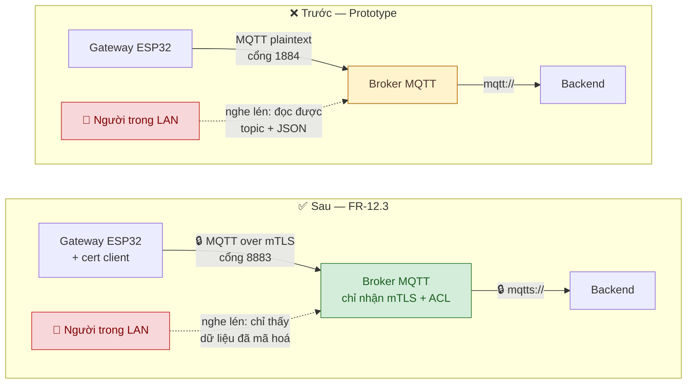
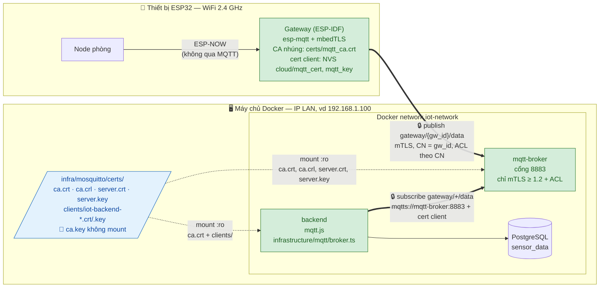
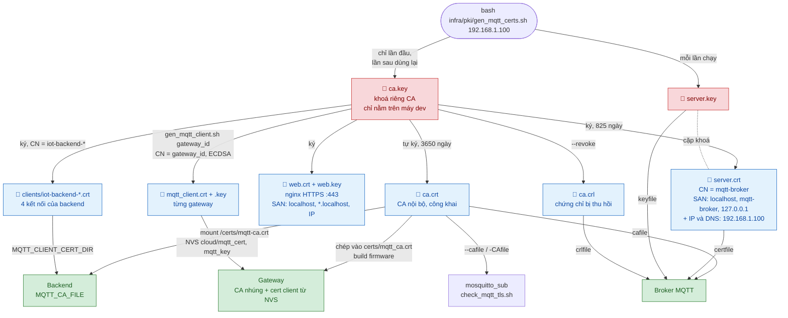
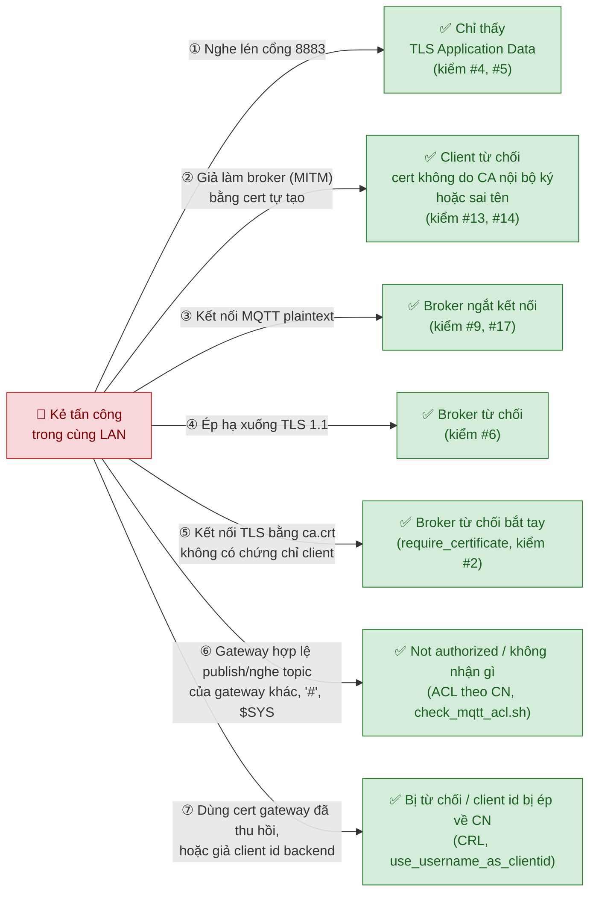

# MQTT_TLS.md

> **Hướng dẫn MQTT TLS hai chiều (mTLS) + ACL — Broker MQTT (Gateway ↔ Backend)**
> Tài liệu ghi lại những gì đã làm cho yêu cầu mã hoá MQTT bằng TLS, xác thực client bằng chứng chỉ và phân quyền topic, cách đã kiểm tra, các bước để chạy trên hệ thống thật, và phần còn thiếu.
> Tài liệu này mô tả **hiện trạng code**. Kiến trúc đích nằm ở [`SECURITY_ARCHITECTURE.md`](../SECURITY_ARCHITECTURE.md) §4 và [`PRD_SMART_HOME.md`](../PRD_SMART_HOME.md) FR-12.3, FR-12.4.

| | |
|---|---|
| **Yêu cầu** | FR-12.3 (MUST): MQTT Gateway ↔ Backend dùng TLS. FR-12.4 (MUST): tắt `allow_anonymous`, mỗi Gateway có danh tính riêng và ACL theo topic. NFR-S1 |
| **Trạng thái** | FR-12.3 và FR-12.4 **đã có code** (mTLS bắt buộc + ACL theo CN chứng chỉ + CRL thu hồi). Đã kiểm trên broker thật chạy trong container tạm (2026-11-16): không cert → bị từ chối, cert bị thu hồi → bị từ chối, publish topic gateway khác → `Not authorized`, gateway nghe `#`/`$SYS` → không nhận gì, giả client id backend → bị ép về CN. **Chưa kiểm tra đầu-cuối với Gateway ESP32 thật** |
| **Ngày kiểm tra** | 2026-09-27 (TLS một chiều); 2026-11-16 (mTLS + ACL) |
| **Cập nhật** | 2026-11-16 |

---

## MỤC LỤC

1. [Tổng quan và kiến trúc](#1-tổng-quan-và-kiến-trúc)
   - [1.1. Trước và sau](#11-trước-và-sau) · [1.2. Kiến trúc triển khai](#12-kiến-trúc-triển-khai) · [1.3. Chuỗi tin cậy chứng chỉ](#13-chuỗi-tin-cậy-chứng-chỉ) · [1.4. Luồng kết nối và gửi dữ liệu](#14-luồng-kết-nối-và-gửi-dữ-liệu) · [1.5. Phòng thủ nhiều lớp](#15-phòng-thủ-nhiều-lớp-trước-kẻ-tấn-công-trong-lan)
2. [Những gì đã làm](#2-những-gì-đã-làm)
3. [Những gì đã kiểm tra](#3-những-gì-đã-kiểm-tra)
4. [Việc cần làm để chạy thật](#4-việc-cần-làm-để-chạy-thật)
5. [Xử lý sự cố](#5-xử-lý-sự-cố)
6. [Việc chưa làm](#6-việc-chưa-làm)
7. [Tham chiếu](#7-tham-chiếu)

---

## 1. Tổng quan và kiến trúc

- Broker MQTT chỉ còn một cổng là **8883 (TLS)**. Cổng plaintext 1884 đã bỏ hẳn.
- **mTLS bắt buộc** (`require_certificate true`): Gateway và Backend kiểm chứng chứng chỉ của Broker bằng một **CA nội bộ**, và Broker kiểm chứng chứng chỉ **client** do cùng CA ký. Không có chế độ bỏ qua kiểm tra (`setInsecure()`, `rejectUnauthorized: false`).
- **Không còn kết nối ẩn danh** (`allow_anonymous false`): CN của chứng chỉ là username **và** client id (`use_identity_as_username`, `use_username_as_clientid`), nên không đổi tên để đọc topic người khác, không chiếm client id của backend/gateway khác.
- **ACL theo CN** (`infra/mosquitto/acl`): Gateway (CN = `gateway_id`) chỉ publish/subscribe topic mang đúng id của nó; Backend dùng 4 tài khoản `iot-backend-data|commands|heartbeat|camera`, mỗi tài khoản chỉ đúng topic nó cần. Chứng chỉ bị thu hồi nằm trong `ca.crl`.
- Broker không còn publish log ra `$SYS/broker/log/#` (trước đây ai kết nối được cũng đọc thấy client id + IP), và backend không còn worker dò IP gateway từ `$SYS` — IP lấy từ `gateway_ip` trong telemetry / `ip` trong heartbeat.
- TLS chỉ bảo vệ kênh truyền. HMAC 2 lớp (chữ ký telemetry v2 ký cả nội dung, [API_DESIGN](../API_DESIGN.md) §3) vẫn giữ nguyên để bảo vệ nội dung từng gói tin (Defense-in-Depth, [Bảo mật](../SECURITY_ARCHITECTURE.md) §3).

Năm sơ đồ dưới đây đi từ tổng quát tới chi tiết. Khi trình bày: 1.1 dành cho người không chuyên, 1.2–1.4 cho phần kỹ thuật, 1.5 cho phần bảo mật và demo.

> Sơ đồ viết bằng Mermaid, hiển thị trực tiếp trên GitHub và trong VS Code (cần extension *Markdown Preview Mermaid Support*). Để đưa vào slide: dán khối code vào [mermaid.live](https://mermaid.live) rồi xuất PNG/SVG.

### 1.1. Trước và sau



**Ý chính:** trước đây ai ở cùng mạng LAN cũng đọc được topic và dữ liệu JSON gateway gửi lên, và ai kết nối được cũng publish/subscribe được mọi topic. Giờ chặng Gateway → Broker MQTT → Backend được mã hoá, người nghe lén chỉ thấy dữ liệu không đọc được, và chỉ client có chứng chỉ do CA nội bộ ký (chưa bị thu hồi) mới kết nối được — chỉ vào đúng topic của mình.

### 1.2. Kiến trúc triển khai



**Cách đọc:**

- Mũi tên chỉ chiều **client mở kết nối tới broker**. Dữ liệu thực tế đi theo thứ tự Node →(ESP-NOW)→ Gateway → Broker MQTT → Backend (xem 1.4).
- Mũi tên đậm 🔒 là kênh TLS. Mũi tên chấm là file chứng chỉ được mount chỉ đọc vào container.
- Gateway đi vào Broker MQTT qua cổng 8883 của máy chủ, dùng IP LAN. Backend đi trong mạng Docker bằng tên `mqtt-broker`. Cả hai tên này đều nằm trong SAN của `server.crt`, nên cả hai client xác thực được broker. Chiều ngược lại, Broker xác thực client bằng chứng chỉ client (gateway: cấp bằng `gen_mqtt_client.sh`; backend: `clients/iot-backend-*.crt`).
- Chỉ có **một** broker. Broker 1 (`mqtt-broker-1`, cổng 1883 plaintext, chặng Sensor → Gateway) đã gỡ ngày 2026-11-12 vì Node gửi Gateway qua ESP-NOW.

### 1.3. Chuỗi tin cậy chứng chỉ



**Ý chính:**

- `ca.key` là bí mật quan trọng nhất. Ai có file này đều cấp được chứng chỉ giả mà gateway và backend sẽ tin. Vì vậy file này chỉ nằm trên máy dev, không mount vào container nào, và đã được gitignore.
- `ca.key` có thể mã hoá bằng passphrase: đặt biến `CA_KEY_PASS` khi chạy `gen_mqtt_certs.sh` (lần đầu tạo CA) và mỗi lần chạy script cấp/thu hồi sau đó.
- Các client chỉ cần `ca.crt` (công khai) cộng chứng chỉ client của chính nó. Khoá riêng client không bao giờ rời máy ký/thiết bị đó.
- Đổi IP LAN thì chạy lại `gen_mqtt_certs.sh <IP mới>`: chỉ `server.crt`/`web.crt` thay đổi, CA và cert client giữ nguyên, nên **không phải nạp lại firmware**.

### 1.4. Luồng kết nối và gửi dữ liệu

```mermaid
sequenceDiagram
    autonumber
    participant SN as Node phòng
    participant GW as Gateway ESP32
    participant B2 as Broker MQTT (TLS 8883)
    participant BE as Backend
    participant DB as PostgreSQL

    rect rgba(46, 125, 50, 0.08)
    Note over B2,BE: Backend khởi động — Node.js, TLS 1.3
    BE->>B2: TCP connect + ClientHello
    B2-->>BE: ServerHello + server.crt + CertificateRequest
    BE->>BE: Kiểm chứng cert ký bởi ca.crt và SAN có mqtt-broker
    BE->>B2: Certificate client (CN = iot-backend-data)
    B2->>B2: Kiểm chữ ký CA + CRL; username = client id = CN
    BE->>B2: MQTT CONNECT trong kênh đã mã hoá
    BE->>B2: SUBSCRIBE gateway/+/data (QoS 1, ACL cho phép)
    end

    rect rgba(46, 125, 50, 0.08)
    Note over GW,B2: Gateway kết nối — mbedTLS, TLS 1.2
    GW->>B2: TCP connect + ClientHello
    B2-->>GW: ServerHello + server.crt + CertificateRequest
    GW->>GW: Kiểm chứng cert ký bởi CA nhúng và SAN có DNS 192.168.1.100
    GW->>B2: Certificate client (CN = gateway_id, từ NVS)
    alt Cert hợp lệ, chưa bị thu hồi
        GW->>B2: MQTT CONNECT (client id bị ép = CN)
    else Sai CA, sai IP, hoặc cert bị thu hồi
        GW->>GW: Huỷ kết nối, log lỗi TLS, thử lại sau
    end
    end

    SN->>GW: Khung ESP-NOW TELEMETRY_V2 (CCMP/LMK, sn_ctr, sn_hmac)
    GW->>GW: Kiểm ts ±300s + ctr tăng, ký HMAC gateway (không giữ secret Node)
    GW->>B2: 🔒 PUBLISH gateway/{gw_id}/data (QoS 1, ACL: chỉ topic của chính nó)
    B2->>BE: 🔒 Chuyển message
    BE->>BE: Topic = gateway_id, HMAC gateway + Node, ctr, node thuộc gateway
    BE->>DB: INSERT sensor_data
```

**Ý chính:**

- Trước khi gửi bất kỳ gói MQTT nào, client kiểm chứng 2 điều: chứng chỉ do CA nội bộ ký, và tên/IP đang kết nối có trong SAN. Sai một trong hai thì kết nối bị huỷ ngay. Chiều ngược lại Broker đòi chứng chỉ client và tra CRL.
- Broker đặt `tls_version tlsv1.2` (tối thiểu), nên client TLS 1.2 (mbedTLS) và 1.3 (backend Node.js) đều vào được.
- Sau khi kênh đã được mã hoá, chữ ký v2 vẫn được kiểm ở backend: chữ ký gateway, chữ ký Node (Gateway không giữ secret Node nên không tự kiểm), `sn_ctr` chống phát lại.

### 1.5. Phòng thủ nhiều lớp trước kẻ tấn công trong LAN



**Ý chính:**

- Số `#` là mã phép thử ở [mục 3](#3-những-gì-đã-kiểm-tra) (⑤–⑦ do `check_mqtt_tls.sh` và `check_mqtt_acl.sh`).
- TLS chặn được nghe lén, giả mạo broker, kết nối plaintext và hạ cấp giao thức (① đến ④). mTLS + ACL (⑤ đến ⑦) chặn kẻ không có chứng chỉ client và giới hạn một gateway bị chiếm trong topic của chính nó.
- Một gateway bị chiếm vẫn publish được dữ liệu sai **dưới danh nghĩa chính nó**; chữ ký Node (Gateway không giữ secret Node) khiến nó không giả được số đo của Node ([Bảo mật](../SECURITY_ARCHITECTURE.md)). Đây là lý do hệ thống giữ cả TLS, ACL lẫn HMAC.
- ① mới được xác nhận qua handshake (#4, #5). Chưa có ảnh Wireshark chụp trên mạng LAN thật (xem bước 7 ở mục 4).

---

## 2. Những gì đã làm

### 2.1. Các quyết định thiết kế

| Quyết định | Lý do |
|---|---|
| Chỉ một broker, chỉ TLS (Broker 1 plaintext đã gỡ 2026-11-12) | FR-12.3 chỉ yêu cầu chặng Gateway ↔ Backend. Theo [Backend](../architecture/BACKEND_REFACTOR_SMARTHOME.md) §17 và [Bảo mật](../SECURITY_ARCHITECTURE.md) §4.1, chặng Sensor ↔ Gateway là mạng nội bộ — nay đã chạy ESP-NOW nên không cần broker riêng |
| mTLS bắt buộc (`require_certificate true`), định danh bằng CN chứng chỉ (2026-11-16) | Mật khẩu/username phải lưu và cấp riêng; chứng chỉ client đã có sẵn hạ tầng CA, thu hồi bằng CRL. CN làm username **và** client id để không giả client id của backend/gateway khác ([Bảo mật](../SECURITY_ARCHITECTURE.md) §4.2) |
| `allow_anonymous false` + ACL theo CN (`pattern ... %u`) | Mỗi gateway chỉ đụng topic của chính nó (FR-12.4); gateway bị chiếm không đọc được lệnh/ack/telemetry của nhà khác. Backend dùng 4 chứng chỉ riêng, mỗi cái đúng quyền cần |
| Bỏ publish log broker ra `$SYS` và worker dò IP | `$SYS/broker/log/N` lộ client id + IP cho bất kỳ client nào đọc được; IP nay lấy từ `gateway_ip` (telemetry) và `ip` (heartbeat) |
| Gateway dùng khoá ECDSA P-256, server/CA dùng RSA-2048 | ECDSA nhẹ cho ESP32 (cert + khoá lưu NVS); RSA-2048 cho server tương thích mbedTLS, OpenSSL và Node mà không cần cấu hình thêm |
| Bỏ hẳn cổng plaintext của Broker MQTT | Tiêu chí nghiệm thu yêu cầu 100% lưu lượng Gateway ↔ Backend có TLS. Giữ cổng cũ song song sẽ để lại đường vòng không mã hoá |
| Tự ký một CA nội bộ và dùng lại CA đó | PRD cho phép "self-signed CA cho demo". Khi đổi IP chỉ cần cấp lại cert server, CA không đổi nên không phải nạp lại firmware |
| IP của broker được ghi vào SAN ở cả dạng `IP:` và `DNS:` | mbedTLS của ESP32 so khớp SAN kiểu DNS, còn OpenSSL và Node kiểm tra theo SAN kiểu IP. Ghi cả hai thì client nào cũng xác thực được |
| Tối thiểu TLS 1.2 | ESP32 (mbedTLS) dùng TLS 1.2. Backend và công cụ trên máy dev dùng TLS 1.3 |

### 2.2. File đã thay đổi

| File | Thay đổi |
|---|---|
| `infra/mosquitto/mosquitto.conf` | `allow_anonymous false`, `acl_file`, `listener 8883` với `cafile`/`certfile`/`keyfile`/`crlfile`, `tls_version tlsv1.2`, `require_certificate true`, `use_identity_as_username`, `use_username_as_clientid`; bỏ `log_dest topic` |
| `infra/mosquitto/acl` (mới) | ACL theo CN: gateway (`pattern ... %u`) và 4 tài khoản backend |
| `infra/pki/gen_mqtt_certs.sh` | Sinh CA nội bộ (tuỳ chọn mã hoá `ca.key` bằng `CA_KEY_PASS`), `server.crt` cho broker, `web.crt` riêng cho nginx (SAN `localhost`, `admin/operator/user.localhost`, IP), `clients/iot-backend-*.crt` (4 kết nối backend), `ca.crl` |
| `infra/pki/gen_mqtt_client.sh` (mới) | `<gateway_id>`: cấp cert client ECDSA CN = `gateway_id`, ghi `firmware/.../08_lvgl_Porting/certs/mqtt_client.{crt,key}`; `--revoke <id>`: đưa vào CRL |
| `Makefile` | `make gateway-cert GW=<id>`, `make revoke-gateway GW=<id>`, `make test-mqtt-acl GW=<id>` |
| `tests/security/check_mqtt_tls.sh` | 5 phép thử mTLS (xem mục 3) |
| `tests/security/check_mqtt_acl.sh` (mới) | Kiểm mTLS + ACL của broker đang chạy (container tạm) |
| `compose.yaml`, `compose.prod.yaml` | Broker mount `acl`, `ca.crl`; backend mount `clients/` và đặt `MQTT_CLIENT_CERT_DIR=/certs/clients` |
| `backend/src/infrastructure/mqtt/broker.ts` | `connectBroker()` dùng `mqtts://`, `ca`, `cert`/`key` của kết nối tương ứng, `rejectUnauthorized: true`; thiếu CA/cert thì dừng |
| `backend/src/modules/telemetry/features/ingest-mqtt/`, `control/features/command-ack/`, heartbeat, camera-event (consumer) | Mỗi consumer dùng chứng chỉ riêng; so `gateway_id` payload với topic |
| `backend/src/modules/devices/features/track-device-ip/` | **Đã gỡ** (worker đọc `$SYS`) |
| Firmware gateway (`08_lvgl_Porting`) | Đọc cert/khoá client từ NVS `cloud/mqtt_cert`, `cloud/mqtt_key`; `CONFIG_MBEDTLS_HAVE_TIME_DATE=y` để kiểm hạn cert |
| `.gitignore` | Bỏ qua `infra/mosquitto/certs/*` (trừ README) và `.../08_lvgl_Porting/certs/*` |
| `scripts/setup.sh`, `scripts/setup.bat` | Tự sinh chứng chỉ nếu chưa có, trước bước `compose up` |

### 2.3. Cấu hình

**Biến môi trường backend**

| Biến | Chạy local | Docker (compose tự đặt) |
|---|---|---|
| `MQTT_HOST` | `localhost` | `mqtt-broker` |
| `MQTT_PORT` | `8883` (mặc định trong code) | `8883` |
| `MQTT_CA_FILE` | `../infra/mosquitto/certs/ca.crt` (mặc định, tính từ thư mục `backend/`) | `/certs/mqtt-ca.crt` |
| `MQTT_CLIENT_CERT_DIR` | `../infra/mosquitto/certs/clients` (mặc định, chứa `iot-backend-*.crt/.key`) | `/certs/clients` |

`MQTT_HOST` phải có trong SAN của cert. SAN luôn có sẵn `localhost`, `127.0.0.1` và `mqtt-broker`. **Chạy backend ngoài Docker** vẫn cần thư mục `MQTT_CLIENT_CERT_DIR` (chạy `gen_mqtt_certs.sh` trước).

**Gateway (ESP-IDF)**: CA nhúng từ `certs/mqtt_ca.crt` (chép từ `infra/mosquitto/certs/ca.crt`); cert + khoá client nạp vào NVS `cloud/mqtt_cert`, `cloud/mqtt_key` (xem [Gateway README](../../firmware/ESP32-S3-Touch-LCD-4.3B-BOX-Demo/ESP-IDF/08_lvgl_Porting/README.md)); host trong `cloud/mqtt_uri` phải có trong SAN của `server.crt`.

**Các file chứng chỉ** (`infra/mosquitto/certs/`, gitignored)

| File | Ai dùng | Mount vào container |
|---|---|---|
| `ca.crt` | Broker MQTT, backend, nginx (gián tiếp), gateway (`certs/mqtt_ca.crt`), `mosquitto_sub --cafile`; **cài vào trình duyệt/điện thoại để tin HTTPS** | Broker MQTT, backend |
| `ca.key` | Chỉ script `gen_mqtt_certs.sh`/`gen_mqtt_client.sh`. Ai có file này đều cấp được cert giả. Có thể mã hoá bằng `CA_KEY_PASS` | **Không** |
| `ca.crl` | Broker MQTT (`crlfile`); cập nhật bởi `gen_mqtt_client.sh --revoke` | Broker MQTT |
| `server.crt`, `server.key` | Broker MQTT | Broker MQTT |
| `web.crt`, `web.key` | nginx HTTPS :443 (không dùng chung với broker) | nginx |
| `clients/iot-backend-*.crt/.key` | 4 kết nối MQTT của backend (`iot-backend-data`, `-commands`, `-heartbeat`, `-camera`) | Backend |
| `issued/<gateway_id>.crt` | Sổ cái cert gateway đã cấp (để thu hồi) | **Không** |

Thời hạn: CA 3650 ngày, cert server 825 ngày.

---

## 3. Những gì đã kiểm tra

### 3.1. mTLS + ACL (2026-11-16)

Chạy trên broker `eclipse-mosquitto:2` thật (container tạm, dùng đúng `mosquitto.conf` + `acl`) cùng backend + PostgreSQL:

| # | Hạng mục | Cách kiểm | Kết quả |
|---|---|---|---|
| A1 | Handshake mTLS với cert backend | `check_mqtt_tls.sh` phép thử 1 | `Verification: OK` |
| A2 | Không có chứng chỉ client | `check_mqtt_tls.sh` phép thử 2 | Không có CONNACK |
| A3 | TLS 1.1, client không tin CA, plaintext | `check_mqtt_tls.sh` phép thử 3-5 | Bị từ chối |
| A4 | Cert gateway bị thu hồi (`--revoke`, restart broker) | `check_mqtt_acl.sh` | Bị từ chối |
| A5 | Gateway publish `gateway/<id khác>/data` | `check_mqtt_acl.sh` | `Not authorized` |
| A6 | Gateway subscribe `#`, `$SYS/#`, lệnh gateway khác | `check_mqtt_acl.sh` | Không nhận gì (chỉ nhận lệnh của chính nó) |
| A7 | Giả client id của backend | `check_mqtt_acl.sh` | Client id bị ép về CN của chứng chỉ |
| A8 | Telemetry v2 đầu-cuối qua MQTT + HTTP, replay, tamper, node giả gateway | `tests/security/attack_demo.sh` S0–S7 | Đúng kỳ vọng ([ATTACK_SIMULATION_GUIDE](../../tests/security/ATTACK_SIMULATION_GUIDE.md)) |

**Chưa kiểm tra:** Gateway ESP32 thật nạp cert client từ NVS và kết nối mTLS (heap, thời gian handshake), Wireshark trên LAN thật, review bảo mật độc lập. Backend có bộ test `npm test` (node:test) cho phần chữ ký/envelope, nhưng broker + ACL kiểm bằng script chạy tay.

### 3.2. TLS một chiều (2026-09-27, lịch sử)

Các phép thử dưới đây làm khi broker còn `require_certificate false` và firmware Arduino (`firmware/gateway-node`, đã gỡ); giữ để tham khảo cách kiểm. Phép thử #8–#10 và #16–#17 dùng cấu hình cũ nên nay phải kèm cert client.

Môi trường kiểm tra: Windows 11, Mosquitto 2.1.2 cài trên máy (broker chạy với đúng các dòng TLS của `mosquitto.conf`, trên cổng test 18883), OpenSSL 1.1.1q (Git Bash), mqtt.js 5.15.1, PlatformIO với Arduino core 2.0.17.

| # | Hạng mục | Cách kiểm | Kết quả |
|---|---|---|---|
| 1 | Backend type-check | `cd backend && npx tsc --noEmit` | Không lỗi |
| 2 | Firmware gateway build | `pio run -d firmware/gateway-node` | SUCCESS, không có warning ở `mqtt_client.cpp`. Flash 70.5% (923 597 / 1 310 720 B), RAM tĩnh 15.1% (49 320 B) |
| 3 | Sinh chứng chỉ | Chạy `gen_mqtt_certs.sh 192.168.1.100 gw-broker.local` | `openssl verify` OK. SAN có `DNS:192.168.1.100` và `IP:192.168.1.100`. Có `CA:FALSE` và `serverAuth`. Chạy lại thì CA được dùng lại. Tham số sai (`bad;name`) bị từ chối |
| 4 | Handshake TLS 1.3 | `openssl s_client -CAfile ca.crt -verify_hostname localhost` | `TLSv1.3`, `TLS_AES_256_GCM_SHA384`, `Verification: OK` |
| 5 | Handshake TLS 1.2 với bộ mã mà ESP32 hỗ trợ | `openssl s_client -tls1_2 -cipher ECDHE-RSA-AES128-GCM-SHA256` | `TLSv1.2`, `Verification: OK` |
| 6 | Từ chối TLS 1.1 | `openssl s_client -tls1_1` | Bị từ chối (`alert protocol version`) |
| 7 | Client không tin CA nội bộ | `openssl s_client -verify_return_error` (không truyền `-CAfile`) | Verify thất bại. Broker ghi log `tlsv1 alert unknown ca` |
| 8 | Publish/subscribe qua TLS | `mosquitto_sub`/`mosquitto_pub --cafile ca.crt` | Nhận đúng message |
| 9 | Client plaintext vào cổng TLS | `mosquitto_pub` không TLS | Bị ngắt (`The connection was lost`) |
| 10 | Hostname không có trong SAN | `mosquitto_pub -h 127.0.0.2 --cafile ca.crt` | Bị từ chối |
| 11 | Backend dùng đúng CA | Script thử gọi thẳng `connectBroker()` | Kết nối, subscribe và nhận được message |
| 12 | Backend thiếu file CA | `MQTT_CA_FILE=./nope.crt` | Dừng với exit 1 và in `[startup] Cannot read MQTT CA certificate at ...` |
| 13 | Backend kết nối host không có trong SAN | `MQTT_HOST=127.0.0.2` | `ERR_TLS_CERT_ALTNAME_INVALID` |
| 14 | Backend dùng CA khác | Trỏ `MQTT_CA_FILE` sang CA của bộ cert thử khác | `SELF_SIGNED_CERT_IN_CHAIN` |
| 15 | `mqttTracker` vẫn lấy được IP gateway | Đưa dòng log `New client connected ...` của broker TLS qua regex của tracker | Vẫn khớp, lấy đúng IP và client id |
| 16 | Script nghiệm thu với broker TLS | `check_mqtt_tls.sh localhost 18883` | Đạt 4/4, exit 0 |
| 17 | Script nghiệm thu với broker plaintext (phép thử ngược) | `check_mqtt_tls.sh localhost 18884` | Báo không đạt ở phép thử 1 và 4, exit 1. Script không phải lúc nào cũng báo PASS |
| 18 | Đoạn sinh cert mới trong `setup.bat` | Chạy riêng đoạn đó ở 3 nhánh | Chưa có cert thì sinh cert. Đã có cert thì bỏ qua. Không có Git Bash thì báo lỗi và dừng trước `compose up` |
| 19 | Cú pháp script bash | `bash -n` cho `setup.sh`, `gen_mqtt_certs.sh`, `check_mqtt_tls.sh` | OK |

**Chưa kiểm tra (bản 2026-09-27)**

- Gateway ESP32 thật kết nối Broker MQTT qua TLS, gồm cả việc mbedTLS chấp nhận SAN `DNS:<IP>`, thời gian handshake và lượng heap còn trống khi chạy.
- Stack Docker (`eclipse-mosquitto:2`, backend trong container). Lúc kiểm tra Docker Desktop không chạy.
- Chụp gói tin bằng Wireshark trên mạng LAN thật.
- Chưa có review bảo mật độc lập cho thay đổi này.
- Chưa có test tự động. Mọi kết quả ở bảng trên đều là chạy tay.

---

## 4. Việc cần làm để chạy thật

### Bước 1 — Lấy IP LAN của máy chạy broker

```powershell
ipconfig   # lấy "IPv4 Address" của card WiFi/LAN cùng mạng với ESP32
```

IP này dùng cho `gen_mqtt_certs.sh` (bước 2) và `cloud/mqtt_uri` trong NVS gateway (bước 5).

### Bước 2 — Sinh CA, cert broker, cert web và cert client backend

Mở **Git Bash** ở thư mục gốc repo:

```bash
bash infra/pki/gen_mqtt_certs.sh 192.168.1.100      # hoặc: make certs IP=192.168.1.100
# CA_KEY_PASS='...' bash infra/pki/gen_mqtt_certs.sh 192.168.1.100   # nếu muốn mã hoá ca.key
```

Script ghi vào `infra/mosquitto/certs/`: `ca.crt`, `ca.key`, `ca.crl`, `server.crt/.key` (broker), `web.crt/.key` (nginx), `clients/iot-backend-*.crt/.key`. Sinh cert **trước** `docker compose up`, nếu không Docker tạo thư mục rỗng cho file mount (mục 5).

### Bước 3 — Cấp chứng chỉ client cho từng gateway

```bash
bash infra/pki/gen_mqtt_client.sh <gateway_id>      # hoặc: make gateway-cert GW=<gateway_id>
```

Ghi `firmware/ESP32-S3-Touch-LCD-4.3B-BOX-Demo/ESP-IDF/08_lvgl_Porting/certs/mqtt_client.{crt,key}` (CN = `gateway_id`, không in khoá ra màn hình). Thêm 2 dòng vào `nvs_dev.csv` của gateway (namespace `cloud`) và nạp lại NVS (chạy `nvs_partition_gen` từ thư mục project để đường dẫn `certs/...` đúng):

```csv
mqtt_cert,file,string,certs/mqtt_client.crt
mqtt_key,file,string,certs/mqtt_client.key
```

Thu hồi một gateway (mất, bị chiếm): `bash infra/pki/gen_mqtt_client.sh --revoke <gateway_id>` (hoặc `make revoke-gateway GW=<id>`), sau đó `docker compose restart mqtt-broker`; nên khoá thiết bị trên Dashboard cùng lúc.

### Bước 4 — Cấu hình backend

- **Docker**: không cần làm gì, compose đã đặt sẵn `MQTT_HOST`, `MQTT_PORT`, `MQTT_CA_FILE`, `MQTT_CLIENT_CERT_DIR`.
- **Chạy local (ngoài Docker)**: sửa `backend/.env`:

  ```env
  MQTT_HOST=localhost
  MQTT_PORT=8883
  MQTT_CA_FILE=../infra/mosquitto/certs/ca.crt
  MQTT_CLIENT_CERT_DIR=../infra/mosquitto/certs/clients
  ```

### Bước 5 — Khởi động broker và backend

Bật Docker Desktop trước, rồi:

```bash
docker compose up -d --build                               # lần đầu
docker compose up -d --force-recreate mqtt-broker backend  # sau khi sinh lại cert
docker compose logs mqtt-broker | grep -i "8883\|error"
docker compose logs backend | grep -i "mqtt"
```

Log mong đợi:

```
mqtt-broker  | ... Opening ipv4 listen socket on port 8883.
backend        | [mqttData] connected, subscribing to gateway/+/data
```

Chạy không dùng Docker thì làm theo [`CHAY_LOCAL.md`](CHAY_LOCAL.md) Bước 3 (config broker local có TLS + ACL).

### Bước 6 — Nạp firmware gateway

Gateway là project ESP-IDF `08_lvgl_Porting` (không còn PlatformIO/Arduino). Chép `ca.crt` vào `certs/mqtt_ca.crt`, đặt `cloud/mqtt_uri` = `mqtts://192.168.1.100:8883` (host trùng IP ở bước 2), nạp NVS có `mqtt_cert`/`mqtt_key`, rồi build và nạp theo [ESP_IDF_BUILD](ESP_IDF_BUILD.md) và README gateway. `CONFIG_MBEDTLS_HAVE_TIME_DATE=y` nằm trong `sdkconfig.defaults`; nếu `sdkconfig` đã sinh từ trước thì xoá hoặc bật bằng `menuconfig` để firmware kiểm hạn cert. Node không cần cert MQTT vì nói với Gateway qua ESP-NOW.

### Bước 7 — Mở firewall cho cổng 8883

ESP32 kết nối từ mạng LAN vào máy chạy Docker. Nếu Windows Firewall chặn, mở PowerShell với quyền Administrator:

```powershell
New-NetFirewallRule -DisplayName "MQTT TLS 8883" -Direction Inbound -Protocol TCP -LocalPort 8883 -Action Allow
```

### Bước 8 — Nghiệm thu FR-12.3, FR-12.4

1. Kiểm mTLS (từ máy bất kỳ có `ca.crt` và cert backend, hoặc chính máy chạy broker):

   ```bash
   bash tests/security/check_mqtt_tls.sh 192.168.1.100
   ```

   Kết quả phải là `5 đạt, 0 không đạt` (handshake mTLS đủ cert, không cert → không CONNACK, TLS 1.1 bị từ chối, client không tin CA bị loại, plaintext bị loại).

2. Kiểm ACL, cần cert của một gateway đã cấp (bước 3) và broker chạy trong Docker:

   ```bash
   bash tests/security/check_mqtt_acl.sh <gateway_id>      # hoặc: make test-mqtt-acl GW=<gateway_id>
   ```

   Script chạy `mosquitto_sub/pub` trong container tạm và kiểm: không cert → từ chối; publish `gateway/<id khác>/data` → `Not authorized`; nghe `#`/`$SYS`/lệnh gateway khác → không nhận gì; client id bị ép về CN. Lưu ý: dùng cert của gateway thật thì gateway đó bị broker ngắt vài giây (client id = CN) rồi tự nối lại.

3. Kiểm dữ liệu đi hết luồng: Node gửi dữ liệu, log backend ghi nhận bản ghi, Dashboard/web hiển thị số đo mới.

4. Demo bằng Wireshark (mốc M3 trong PRD): bắt gói trên card mạng LAN với bộ lọc `tcp.port == 8883`. Chỉ thấy `TLSv1.2 Application Data`, không đọc được topic hay payload.

### Cài CA vào máy để tin HTTPS của web

nginx (443) dùng `web.crt` do cùng CA ký, nên trình duyệt/điện thoại phải tin `infra/mosquitto/certs/ca.crt`:

- **Windows** (PowerShell/CMD, không cần quyền admin): `certutil -addstore -user Root infra\mosquitto\certs\ca.crt`, rồi khởi động lại trình duyệt.
- **Android**: chép `ca.crt` vào máy, Cài đặt → Bảo mật → Mã hoá và thông tin xác thực → Cài đặt chứng chỉ → Chứng chỉ CA. Trình duyệt Android tin được; app Mobile nạp CA riêng qua `--dart-define=API_CA_PEM_BASE64=<base64 của ca.crt>` (xem [LEN_SERVER](LEN_SERVER.md)).

---

## 5. Xử lý sự cố

| Triệu chứng | Nguyên nhân | Cách sửa |
|---|---|---|
| Backend thoát ngay, log `[startup] Cannot read MQTT CA certificate at ...` | Chưa sinh cert, hoặc `MQTT_CA_FILE` sai đường dẫn | Chạy `gen_mqtt_certs.sh`. Khi chạy local, chạy backend từ thư mục `backend/` hoặc đặt đường dẫn tuyệt đối |
| Trong `infra/mosquitto/certs/` xuất hiện **thư mục** tên `ca.crt`, `server.crt`... | Chạy `docker compose up` trước khi có cert. Docker tự tạo thư mục rỗng cho file mount chưa tồn tại | Chạy `gen_mqtt_certs.sh` (script tự xoá các thư mục rỗng này), rồi `docker compose up -d --force-recreate mqtt-broker backend` |
| Backend log `[mqttData] error: self-signed certificate in certificate chain` | Backend đang dùng một CA khác với CA đã ký cert của broker | Trỏ `MQTT_CA_FILE` về `infra/mosquitto/certs/ca.crt` hiện tại. Khởi động lại broker sau khi sinh cert |
| Backend log `Hostname/IP does not match certificate's altnames` | `MQTT_HOST` không có trong SAN | Dùng `localhost`/`mqtt-broker`, hoặc sinh lại cert kèm host đó |
| Backend log `connect ECONNREFUSED ...:1884` | `.env` cũ vẫn còn `MQTT_PORT=1884` | Đổi thành `MQTT_PORT=8883` |
| Gateway log `FAILED (rc=-2, TLS: X509 - Certificate verification failed ...)` | `MQTT_BROKER2_HOST` không có trong SAN, hoặc firmware đang chứa CA cũ | Sinh lại cert với đúng IP. Nếu đã thay CA thì build và nạp lại firmware |
| Gateway log `FAILED (rc=-2)` và không có dòng TLS | Không mở được TCP tới `IP:8883` | Kiểm tra IP, firewall (bước 6), container Broker MQTT có đang chạy không |
| Build firmware cảnh báo thiếu `certs/mqtt_ca.crt` | Chưa chép CA vào project gateway | Chép `infra/mosquitto/certs/ca.crt` vào `certs/mqtt_ca.crt` (chạy `gen_mqtt_certs.sh` trước) |
| `check_mqtt_tls.sh` báo không đạt ở phép thử 1 | Broker chưa bật TLS, sai cổng, sai tên/IP, hoặc thiếu `clients/iot-backend-data.*` | Xem log của broker. Chạy lại `gen_mqtt_certs.sh <IP>`, rồi script với đúng `host port` |
| Gateway log TLS handshake fail dù CA đúng | Chưa nạp `cloud/mqtt_cert`/`mqtt_key` vào NVS, cert đã bị thu hồi, hoặc cert/khoá không khớp nhau | Chạy lại `gen_mqtt_client.sh <gateway_id>` (thêm `--force` nếu đã cấp), nạp lại NVS. Xem log broker: `tlsv1 alert` / `certificate revoked` |
| Backend log `[mqtt…] error: … alert certificate required` hoặc `bad certificate` | Chưa có `clients/iot-backend-*.crt`, hoặc `MQTT_CLIENT_CERT_DIR` sai | Chạy lại `gen_mqtt_certs.sh <IP>`; chạy ngoài Docker thì trỏ `MQTT_CLIENT_CERT_DIR` tới `infra/mosquitto/certs/clients` |
| Gateway kết nối được nhưng publish bị bỏ/ngắt, log broker `Denied PUBLISH` | Topic/gateway_id không khớp CN | Cert phải cấp đúng `gateway_id` của thiết bị (CN = `identity/device_uuid`) |
| Gateway cũ (gói v1) bị backend `401 PROTOCOL_V1_DISABLED` | Chưa nạp firmware Node + Gateway giao thức v2 | Nạp lại cả hai ([API_DESIGN](../API_DESIGN.md) §3); chỉ tạm dùng `DEVICE_HMAC_V1=true` khi chuyển tiếp (biến này nay bao cả heartbeat, ack và sự kiện camera dạng cũ; Camera ↔ Gateway không có chế độ cũ nên nạp Camera + Gateway cùng lúc) |

Cần thay CA (ví dụ khi `ca.key` bị lộ): xoá `infra/mosquitto/certs/ca.crt` và `ca.key`, chạy lại script, khởi động lại broker và backend, rồi **build lại firmware và cấp + nạp lại cert client cho mọi gateway** (cert cũ do CA cũ ký không còn hợp lệ). Cert client của backend và `web.crt` cũng được cấp lại.

---

## 6. Việc chưa làm

FR-12.4 (tắt `allow_anonymous`, ACL theo gateway) và mTLS **đã làm** (2026-11-16). Phần còn lại:

| Hạng mục | Mức trong PRD | Ảnh hưởng hiện tại | Hướng làm |
|---|---|---|---|
| ACL theo `home_id` (không chỉ theo gateway) | — | ACL cho gateway dùng `home/+/gateway/%u/...` — gateway chỉ đụng topic mang id của nó, nhưng `<home_id>` trên topic do gateway tự chọn; backend kiểm `home_id` topic = nhà của gateway (heartbeat) | Đưa `home_id` vào chuỗi ký hoặc ACL động khi có Dynamic Security ([Bảo mật](../SECURITY_ARCHITECTURE.md) §4.3) |
| Ack lệnh (`v2\|ack`) và `camera/event` (`v2\|evt`) chưa có `ctr` | — | Heartbeat đã ký `v2\|hb` có `ctr` + nội dung (2026-11-16); ack/sự kiện camera có thể phát lại trong cửa sổ ±300 giây nhưng chỉ chính gateway publish được topic đó (mTLS + ACL), ack chỉ khớp được `command_id` đang chờ (1 lần), sự kiện camera chống lặp 60 giây | Thêm `ctr` nếu cần ([API_DESIGN](../API_DESIGN.md) §3) |
| Gateway nhân bản (2 board cùng cert + secret) | — | Backend nghi từ heartbeat đúng chữ ký (uptime lùi, IP đổi qua lại, `ctr` phát lại) → audit `GATEWAY_DUPLICATE_SUSPECTED` + thông báo nhân viên, không tự khoá; thu hồi cert bằng `gen_mqtt_client.sh --revoke` là việc của người vận hành | Cấp lại cert + secret cho board thật, thu hồi cert cũ |
| Cert client trong NVS chưa mã hoá | — | Dump flash lấy được khoá riêng client (và secret gateway) | NVS Encryption + Flash Encryption + Secure Boot v2: **đốt eFuse, không đảo ngược** — chỉ làm khi firmware ổn định, là quy trình sản xuất, chưa làm |
| Cấp cert client lúc provisioning (CSR trên thiết bị) | — | Hiện cấp bằng script trên máy chủ rồi nạp tay NVS; khoá riêng đi qua máy dev | Gateway tự sinh khoá, gửi CSR qua kênh provisioning ([WiFi Provisioning](../firmware/SMART_HOME_WIFI_PROVISIONING.md)) |
| Khoá riêng của CA không có passphrase mặc định | — | Chỉ mã hoá khi đặt `CA_KEY_PASS`; nếu không `ca.key` nằm dạng rõ trên máy dev (gitignore, không mount vào container) | Dùng `CA_KEY_PASS`; production lưu CA tách khỏi máy chạy dịch vụ (HSM/KMS) |
| Thu hồi cần khởi động lại broker | — | Mosquitto đọc `ca.crl` lúc khởi động | Chấp nhận cho demo; sau này reload hoặc dùng Dynamic Security |
| Kiểm tra trên Gateway ESP32 thật | — | Xem mục 3.1, "Chưa kiểm tra" | Làm theo mục 4, ghi kết quả vào bảng ở mục 3 |

HTTPS cho `/api/device/**`: **đã làm** — nginx 443 (`web.crt`), 80 → 301 https; Gateway gọi HTTPS và kiểm chứng bằng CA ([LEN_SERVER](LEN_SERVER.md)).

---

## 7. Tham chiếu

- [`PRD_SMART_HOME.md`](../PRD_SMART_HOME.md): FR-12.3, FR-12.4, NFR-S1, mốc M3 ("Wireshark cho thấy MQTT đã mã hoá")
- [`SECURITY_ARCHITECTURE.md`](../SECURITY_ARCHITECTURE.md): §4.1 bảng TLS theo broker, §4.2 mTLS, §4.3 ACL, §17.1 luồng TLS handshake
- [`API_DESIGN.md`](../API_DESIGN.md): §3 chữ ký telemetry v2, §9 MQTT
- [`BACKEND_REFACTOR_SMARTHOME.md`](../architecture/BACKEND_REFACTOR_SMARTHOME.md): §10 thiết kế topic, §17 security design
- [`CHAY_LOCAL.md`](CHAY_LOCAL.md): chạy Broker MQTT TLS không dùng Docker
- [`LEN_SERVER.md`](LEN_SERVER.md): phần cứng thật → Server, cert theo IP
- [`../infra/pki/README.md`](../../infra/pki/README.md): các file chứng chỉ
- [Gateway README](../../firmware/ESP32-S3-Touch-LCD-4.3B-BOX-Demo/ESP-IDF/08_lvgl_Porting/README.md): NVS và log mẫu của gateway
